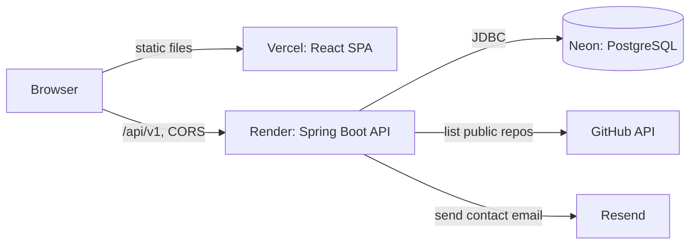

# Portfolio — Will Ly

Personal portfolio site and live full-stack demo of Will Ly, Full-stack Software Engineer ([GitHub](https://github.com/HyHyZhaLee)). A React frontend that always loads, a Spring Boot API for visit stats, contact messages, and GitHub projects, and PostgreSQL, all on free hosting tiers.

**Live site:** _URL to be added after the first deployment._

[](https://github.com/HyHyZhaLee/portfolio/actions/workflows/ci-cd.yml)

## Architecture



The page content is bundled into the frontend, so every section renders from static files. The API only adds live extras: the visit counter, the status panel, the projects list, and the contact form's delivery.

## Tech stack

| Layer | Technology | Hosting |
|---|---|---|
| Frontend | React 19, TypeScript 6, Vite 8, Tailwind CSS 4, TanStack Query, React Router 8, React Hook Form, Zod | Vercel |
| Backend | Java 21, Spring Boot 4.2, Gradle 9, Flyway, springdoc OpenAPI | Render, Docker |
| Database | PostgreSQL 17 | Neon |
| Integrations | GitHub REST API, Resend | — |
| Quality | JUnit, Testcontainers, WireMock, Vitest, Testing Library, MSW, Playwright, Lighthouse, GitHub Actions | — |

## Local development

```bash
make help        # list every target
make up          # start PostgreSQL in Docker
make backend     # run the API on :8080 with the local profile
make frontend    # run the site on :5173; it proxies /api and /actuator to the backend
make status      # read-only report of the local stack
make check       # all quality gates
make openapi     # regenerate the API snapshot and the frontend's generated types
```

The interactive API documentation (Swagger UI) is at <http://localhost:8080/swagger-ui.html> while `make backend` runs. Copy `.env.example` to `.env` to override local ports and database settings. Node commands run through `scripts/with-node.sh`, which uses the version pinned in `.nvmrc`.

### Tests

```bash
make test                                              # unit and integration tests for both packages
scripts/with-node.sh pnpm --dir frontend test          # frontend unit tests in watch mode
scripts/with-node.sh pnpm --dir frontend coverage      # frontend unit tests with the coverage gate
scripts/with-node.sh pnpm --dir frontend test:e2e      # Playwright smoke suite against the production build
E2E_ALL_BROWSERS=1 scripts/with-node.sh pnpm --dir frontend test:e2e   # the same suite in Firefox and WebKit too (install them once with pnpm exec playwright install firefox webkit)
```

## Design decisions

- **Free-tier trade-offs.** Vercel, Render, and Neon free plans cost nothing but have limits: the API sleeps after a quiet period and the database has a small storage cap. The design accepts that instead of paying around it.
- **Content never waits for the API.** Every section and every case-study page renders from content modules bundled with the site. A request to the sleeping API cannot block or break a page.
- **Cold-start handling.** The first API calls may take about a minute while Render wakes the service. The live panel shows a calm "waking up" state, retries quietly, and falls back to a neutral status; nothing else on the page changes.
- **Privacy.** A visit is stored as a keyed hash of the visitor (HMAC-SHA256 over the IP address and user agent), a path, a referrer host, and a device class: no cookies and no raw IP address. Visiting with `?notrack=1` opts a browser out for good, and the Global Privacy Control signal is honored.
- **Contact outbox.** A message is written to the database first and then emailed through Resend outside any open transaction; a failed send is marked and retried later, so a provider outage does not lose a message.
- **GitHub fallback.** The projects list comes from the GitHub API through the backend with an hour of caching; when GitHub is unavailable the last good result is used, then a bundled list of repositories.
- **Link previews without SSR.** After the client build, a small script writes one HTML file per case study with that page's title and description, taken from the same content modules the app uses. Vercel serves those files before the SPA rewrite, so a shared link shows the case study's title.

## Quality gates

| Gate | Command |
|---|---|
| Backend: format, tests, coverage, API snapshot | `make check` (CI: the `backend` job) |
| Frontend: types, lint, format, unit tests with a branch-coverage threshold | `pnpm --dir frontend check:type`, `check:lint`, `check:format`, `coverage` (CI: the `frontend` job) |
| End to end: smoke suite with the API unreachable | `pnpm --dir frontend test:e2e` (CI: the `e2e` job) |
| Live smoke test after every deploy | `LIVE_SITE_URL=… LIVE_ENVIRONMENT=staging pnpm --dir frontend test:live` (CI: the `smoke` job) |
| Lighthouse | Performance, accessibility, best practices, and SEO of at least 90 on the home page and a case study, measured on a production build with the API unreachable (results in [the PF-009 plan](docs/plans/site/PF-009-polish.md)) |

## Delivery

One workflow, [`ci-cd.yml`](.github/workflows/ci-cd.yml), runs for every commit, and one required check, `ci-ok`, gates every pull request.

| Trigger | What runs |
|---|---|
| Pull request | the checks for the changed areas, dependency review, then `ci-ok` |
| Merge to `main` | every check, `ci-ok`, then a deploy to **staging**: the backend first (the pipeline waits until `/actuator/info` reports the new commit), then the frontend, then a live browser smoke test |
| Release tag `vX.Y.Z` on `main` | a release gate (the commit passed staging, or went live before), the same deploy and smoke test against **production**, then a GitHub Release with generated notes |

Staging is a full free-tier copy with none of production's data: [will-ly-portfolio-staging.vercel.app](https://will-ly-portfolio-staging.vercel.app), a second Render service, and its own Neon project. It shows a "Staging" badge and is not indexed. The header shows the site's version beside the brand: `v` plus `version` in `frontend/package.json`.

To release what staging shows: raise `version` in `frontend/package.json` in a pull request, merge it, then run `make release`, which tags `main` with that version. To roll back, run `ci-cd` by hand from an older tag. Actions are pinned to commit SHAs, and secret scanning, push protection, Dependabot, and CodeQL are on.

## Documentation

| Doc | What it holds |
|---|---|
| [docs/README.md](docs/README.md) | Index of all documentation |
| [docs/architecture/](docs/architecture/overview.md) | Overview, backend and frontend design guides, ADRs |
| [docs/product/product-guide.md](docs/product/product-guide.md) | Product rules |
| [docs/plans/](docs/plans/README.md) | One plan and one refined requirement per ticket |
| [docs/prd/backlog.md](docs/prd/backlog.md) | Ticket registry |
| [docs/knowledge/](docs/knowledge/README.md) | Verified tooling and hosting notes |

## Repository layout

| Path | What it is |
|---|---|
| `backend/` | Spring Boot API; working guide in `backend/CLAUDE.md` |
| `frontend/` | React site; working guide in `frontend/CLAUDE.md` |
| `docs/` | Product rules, design guides, ADRs, ticket plans, knowledge base, backlog |
| `scripts/` | Helper scripts used by the Makefile |
| `.claude/` | AI-assisted workflow: rules, skills, and a review agent |

## How it is built

Work is planned, built, and reviewed in small tickets: `/plan` writes a refined requirement and an approved plan, `/dev` builds it with tests, `/review` checks it against the plan and the conventions, and `/create-pr` runs the gates and opens a pull request. AI coding assistants speed up the work; every change is reviewed and verified. The rules are in [CLAUDE.md](CLAUDE.md).
