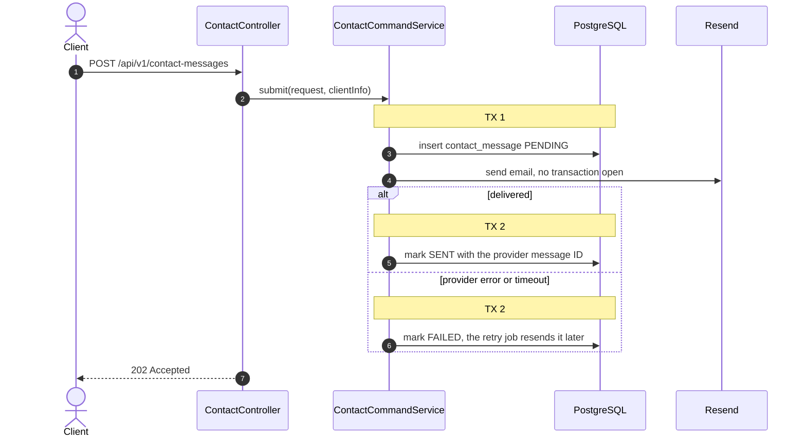
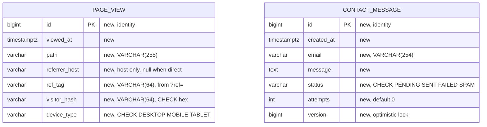

# Backend Architecture Guide

> The design reference for `backend/`. `/plan` designs against it, `/dev` builds to it, and `/review` and the `code-reviewer` agent check diffs against it. It was written before the code (PF-001) as the design contract. Classes in the Key Services Reference arrive with the ticket named next to them; update the table as each lands.

## Purpose

1. State the principles every backend change follows.
2. List known issues and anti-patterns (`KNOWN-BE-NNN`) so they are neither rediscovered nor re-litigated.
3. Give the evaluation checklist to run before writing a plan.
4. Provide the implementation plan template. Plans go to `backend/docs/{domain}/PF-NNN-{title}.md`.
5. Point at the platform services to reuse instead of rebuilding.

## Architecture Principles

### 1. Single responsibility first

Each class has one reason to change. Controllers translate HTTP. Query services read. Command services orchestrate a change. Lifecycle beans own transactional steps. Validators hold business rules. Entities guard their own state. Adapters talk to one external service. If describing a class needs "and", split it. When principles conflict, the priority is single responsibility, then simplicity, then avoiding duplication, then consistency.

### 2. Reuse before adding

Search for an existing service, query, validator, error code, or platform helper before writing one. Extending a well-named unit beats adding a parallel one. The Key Services Reference below is the first place to look.

### 3. Package by feature, layer inside the feature

`com.huygialy.portfolio.{feature}` holds an `api` package (controller, request and response records) plus the feature's services, entity, repository, validator, and ports. A file is for a type with its own behavior or its own callers. A type that only serves one other type nests inside it (`EmailSender.Email`, `ApiException.FieldViolation`). Variants that differ only by error code are one exception with factories (`ApiException.rateLimited`), not a subclass each. Shared code lives in `platform` (error, web and correlation, security and CORS, rate limiting, client info and visitor hashing, openapi). Dependencies point inward: `api` → services → repositories and ports. `platform` never depends on a feature, and features never reach into each other's internals; `stats` reads page views through a query the `visit` feature exposes, not through its repository.

### 4. Command shape: validate, load, decide, mutate

Every write follows the same order, never interleaved: (1) validate the request shape; (2) load what it acts on, throwing not-found; (3) apply business rules through the feature's validator; (4) mutate through entity methods. Reads never mutate.

### 5. Transactions are short and never span network I/O

Query services are `@Transactional(readOnly = true)`. Write transactions wrap database work only. Calls to the email provider, the GitHub API, or any other remote service happen with no transaction open (Non-Negotiable 7). The orchestrating command service is therefore not transactional, and it calls a separate `{Feature}Lifecycle` bean for each transactional step, because calling a method on the same bean bypasses the transaction proxy (`KNOWN-BE-006`). Order the steps so the database always records what happened: commit a `PENDING` row, call the provider, then commit the outcome.

### 6. Concurrency is settled by the database

Every mutable entity carries `@Version`, and a lost update surfaces as a 409. Uniqueness that matters is a database constraint, never a check-then-insert. Scheduled jobs follow the same rule: every instance may run a job at once, so a job takes its work from the current state ("what is still `FAILED`") and claims each item with a compare-and-set update, never with a scheduler lock. Append-only tables such as `page_view` need neither, because rows are only inserted.

### 7. One error model

Failures throw `ApiException(ErrorCode, detail)`. `GlobalExceptionHandler` is the only place that turns exceptions into RFC 9457 problem responses, with `code`, `correlationId`, `timestamp`, and field `errors` (Non-Negotiable 5). `detail` is written for the client and never contains framework, SQL, or provider text. Expected business failures log at WARN without a stack trace; unexpected failures log at ERROR with one. Nothing returns `null` to mean "not found".

### 8. External services sit behind ports

A feature depends on a port it owns and never on a provider's API: `contact` uses `EmailSender`, implemented by `ResendEmailSender`; `project` uses `GitHubClient`. Only the adapter builds provider requests and reads provider responses, and it maps every provider failure to the port's own exception, so no provider message reaches a client. Adapters use `RestClient` with explicit connect and read timeouts. Email gets a Resilience4j retry with exponential backoff and a bounded number of attempts; GitHub gets a circuit breaker whose fallback is the last good result, else an empty list. A provider outage degrades a feature; it never fails a page (Non-Negotiable 1). The `local` profile wires a sender that logs only the message ID, and integration tests point every adapter at WireMock.

### 9. Privacy by design

The backend never stores or logs a raw IP address, a full user-agent string, or a full referrer URL (Non-Negotiable 3). `ClientInfoResolver` is the only class that reads them: it returns a parsed device type and browser, the referrer host, and `visitorHash = HMAC-SHA256(app.visitor-hash-secret, ip + "|" + userAgent)` as 64 hex characters. Contact messages hold a real visitor's name, email, and text: they are stored for the owner and sent to the owner, and never logged, cached, or returned. The client IP comes from the forwarded headers Render's proxy sets. The scaffold uses `server.request.header.forwarded.strategy: framework`, whose `ForwardedHeaderFilter` takes the leftmost `X-Forwarded-For` value, which any client can set; before the visitor hash and the rate limits depend on the address, PF-004 must trust only Render's hop (the `native` strategy with the proxy's addresses as trusted proxies, or the rightmost untrusted `X-Forwarded-For` entry in `ClientInfoResolver`), confirm it against the running service, and record it in `docs/knowledge/`.

### 10. Public write endpoints resist abuse

There is no login, so every public `POST` defends itself (Non-Negotiable 4). Its request record has Bean Validation with explicit maximum lengths. A Bucket4j limit keyed by `visitorHash` caps it: visits 30 per minute, contact messages 3 per hour; a rejected request answers 429 `RATE_LIMITED` with `Retry-After`. The contact form has a honeypot field: a filled one is stored as `SPAM`, answered with the same 202 as a real message, and never sent. Visits from bot user agents are dropped before they are counted. CORS allows only the origins in `app.allowed-origins`. The frontend's checks are a convenience, never the defense.

### 11. It fits the free tier

The backend runs on Render Free: 512 MB of RAM, 0.1 CPU, a disk that is wiped on every restart, and a service that sleeps after 15 idle minutes (Non-Negotiable 8). So it writes nothing to the local disk, keeps the Hikari pool at 3, uses virtual threads instead of large thread pools, sends email over HTTPS (Render blocks SMTP), and starts with the JVM flags in the `Dockerfile` (`-XX:MaxRAMPercentage=75 -XX:+UseSerialGC -Xss512k -XX:TieredStopAtLevel=1`). In-memory state (caches, rate-limit buckets) is allowed to vanish on restart. A new dependency is justified in the plan by what it does and what it costs in memory and startup time.

### 12. Configuration is typed and validated

Settings bind to validated `@ConfigurationProperties` records under `app.*`; `@Value` is not used. YAML values are written as `${ENV_VAR:default}`. Secrets (`app.visitor-hash-secret`, the Resend key, the GitHub token) have no default except in `application-local.yml`, and the `prod` profile fails at startup when one is missing. `server.port` is `${PORT:8080}` because Render injects `PORT`. Time comes from the injected `Clock`, never from `Instant.now()` directly.

### 13. Observable by default

Every request carries a correlation ID (`X-Correlation-Id`) in the logging context, on the response, and in problem bodies. Every scheduled run gets its own correlation ID in the logging context. Logs record identifiers and outcomes, never request bodies, IP addresses, user agents, email addresses, message text, or tokens. The `prod` profile logs structured JSON. Health includes `db`; an external provider is not a health component, so a GitHub or email outage never turns the Render health check red and never restarts the service.

### 14. Tests prove behavior against real infrastructure where mocks cannot

There are two tiers. `testUnit` covers pure logic with no Spring context and no Docker. `testIT` covers anything that depends on Spring wiring, the database, or an external service, using `@IntegrationTest`: one shared context with a Testcontainers PostgreSQL and a WireMock server standing in for Resend and GitHub. No test reaches a real provider.

**Integration-test gate.** A change must ship a passing `testIT` when it adds or changes any of:

- a repository query;
- an endpoint (binding, status codes, problem codes, CORS, rate limit);
- a persistence flow (entity writes, state transitions, optimistic locking, the outbox claim);
- a migration that changes queryable behavior;
- an interaction with an external HTTP service (through WireMock).

Pure in-memory logic is covered by `testUnit` alone, and claiming that exemption is stated explicitly, never assumed. Tests assert on problem `code`, never on message text, and build synthetic data in code. Branch coverage stays at or above 80%.

## Known Issues & Anti-Patterns

> When an issue is listed here, apply its rule; there is no need to explore alternatives. Add an entry when a trap costs real time or a review finding recurs. Numbers are permanent; a resolved entry is marked resolved, not deleted. Entries 001 to 010 were verified in the owner's earlier Spring Boot 4 scaffold on 2026-11-11; re-check each one when the code that depends on it lands. PF-002 re-checked 001 to 004 and 009 against Boot 4.2.0 and Gradle 9.9.2 on 2026-11-22. Evidence: `docs/knowledge/tooling.md`.

### KNOWN-BE-001: The aggregate `test` task ignores `--tests`

`test` only aggregates `testUnit` and `testIT`. A `--tests` filter given to it does not reach them, so both full suites run. **Rule.** Filter on a tier: `./backend/gradlew -p backend testUnit --tests "*VisitorHasherTest"` or `./backend/gradlew -p backend testIT --tests "*ContactApiIT"`.

### KNOWN-BE-002: Custom `Test` tasks in Gradle 9 must be wired to the test source set

A registered `Test` task without `testClassesDirs` and `classpath` finds no tests and passes vacuously. **Rule.** Set both from `sourceSets.test` in the task definitions in `build.gradle.kts`.

### KNOWN-BE-003: Spring Boot 4 split the starters

Boot 4 starter names differ from Boot 3: `spring-boot-starter-webmvc`, `spring-boot-starter-flyway`, and one `-test` starter per module. **Rule.** Keep the names Spring Initializr generated; never "fix" them to Boot 3 names.

### KNOWN-BE-004: Testcontainers 2 renamed artifacts and packages

**Rule.** Use artifact `org.testcontainers:testcontainers-postgresql` and class `org.testcontainers.postgresql.PostgreSQLContainer`, which has no type parameter. For other modules, follow the compiler and current documentation rather than older examples.

### KNOWN-BE-005: Jackson 3 moved its runtime packages

Runtime types such as `ObjectMapper`, serializers, and modules live under `tools.jackson.*`. Annotations such as `@JsonProperty` remain in `com.fasterxml.jackson.annotation`. **Rule.** Inject the Boot-configured mapper; never construct one, and never mix Jackson 2 runtime classes in.

### KNOWN-BE-006: Self-invocation bypasses `@Transactional`

Calling a `@Transactional` method from another method of the same bean skips the proxy, so no transaction applies, or the caller's does. **Rule.** Put transactional steps on a separate bean (`{Feature}Lifecycle`) and call it from the orchestrating service.

### KNOWN-BE-007: A filter declared as a bean runs twice

A servlet `Filter` that is a Spring bean is registered with the servlet container automatically, and again when it is added to the security chain. **Rule.** Construct security and rate-limit filters inside the security configuration, or disable their automatic registration.

### KNOWN-BE-008: `@MockitoBean` in integration tests multiplies Spring contexts

Each distinct set of mocked beans creates a new application context, with new containers, and slows the suite sharply. **Rule.** Integration tests use the shared `@IntegrationTest` context without `@MockitoBean`; external services are stubbed with WireMock. Failure paths that need a mocked collaborator are unit tests.

### KNOWN-BE-009: Gradle 9.8 deprecates the `by registering` task delegate

`val testUnit by tasks.registering(Test::class) { … }` prints a deprecation and is scheduled for removal in Gradle 10. **Rule.** Write `val testUnit = tasks.register<Test>("testUnit") { … }`. Run `./backend/gradlew -p backend help --warning-mode all` after editing the build script.

### KNOWN-BE-010: `CHAR(n)` columns come back blank-padded

PostgreSQL pads a `CHAR(n)` value to `n` characters, so a shorter value read back no longer `equals` what was written. **Rule.** Use `VARCHAR(n)` with a `CHECK` on the format for codes and hashes, such as `visitor_hash VARCHAR(64) CHECK (visitor_hash ~ '^[0-9a-f]{64}$')`.

## Evaluation Checklist

Run this before writing a plan. Record anything that fails as a risk or a decision in the plan.

### Duplication

- [ ] Searched for existing services, queries, and validators that cover the same data or rule
- [ ] Searched `ErrorCode` for entries to reuse
- [ ] Checked the Key Services Reference for a platform helper that already does this

### Single responsibility

- [ ] Each new class can be described without "and"
- [ ] Controllers contain no business logic and no repository calls
- [ ] Business rules live in the validator or the entity, not in the controller or the repository
- [ ] Only an adapter talks to an external provider

### Simplicity

- [ ] Considered a simpler shape: a query instead of a table, a constraint instead of code, a property instead of a branch
- [ ] No abstraction introduced for a single implementation, except a port to an external service
- [ ] No new file for a type that only serves one other type (it nests there), and no exception subclass that differs only by `ErrorCode` (principle 3)

### Consistency

- [ ] Names follow the naming conventions in `backend/CLAUDE.md`
- [ ] The REST shape follows `.claude/rules/rest-api-conventions.md`
- [ ] The migration follows the naming and column conventions

### Impact

- [ ] Listed existing endpoints, queries, and flows the change touches
- [ ] OpenAPI change identified, the snapshot regenerated, and the frontend impact noted (`make openapi`)
- [ ] The migration is additive, or its rollout path is stated

### Concurrency and consistency

- [ ] Every new write path handles concurrent modification, and the plan says how (`@Version`, constraint, or compare-and-set)
- [ ] No transaction spans network I/O; the write order around each provider call is stated
- [ ] A scheduled job claims its work with a compare-and-set, not a lock

### Privacy, disclosure, free tier

- [ ] No raw IP address, full user agent, full referrer URL, email address, or message text is stored outside its intended column, logged, cached, or returned (Non-Negotiable 3)
- [ ] Every new public `POST` has Bean Validation with maximum lengths and a rate limit; the contact form keeps its honeypot (Non-Negotiable 4)
- [ ] A provider outage degrades to a fallback or a retry, never to a failed page (Non-Negotiable 1)
- [ ] Nothing is written to the local disk; memory and startup cost of any new dependency are stated (Non-Negotiable 8)
- [ ] Seed data, fixtures, and examples are synthetic and contain no Tier C content (Non-Negotiables 2 and 9)

## Implementation Plan Template

Copy this into `backend/docs/{domain}/PF-NNN-{title}.md`. Drop a section that does not apply instead of filling it with "n/a". Keep each paragraph on one line. `/plan` writes it with Status Draft and sets it to Approved when the user approves; `/dev` builds only from an Approved plan.

```markdown
# PF-NNN — {Title} (backend)

**Ticket**: PF-NNN · **Refined requirement**: [PF-NNN-refined-requirement.md](PF-NNN-refined-requirement.md) · **Frontend plan**: `frontend/docs/{domain}/PF-NNN-{title}.md` · **Status**: Draft | Approved {YYYY-MM-DD} · **Last updated**: {YYYY-MM-DD}

> ⚠️ **Review these flows first** — {links to the subsections under section 6, or "No complex flows"}

## 1. Requirement summary
{Two to five lines. Link the product rules (SITE-NNN) this implements and the master plan section it maps to.}

## 2. Requirement analysis
| Need | Source | Backend work |
|---|---|---|

## 3. Current state
{What exists today that this touches or reuses, with `path:line` references.}

## 4. Approach
{The chosen approach and why.}

| Alternative | Why not |
|---|---|

**Reuse**: {existing classes used as-is or extended}. **Single responsibility**: {one line per new unit}.

## 5. Build
### Database
{Migration file name `V{yyyyMMddHHmmss}__{snake_description}.sql`, and whether it is additive or needs a backfill. Then a Mermaid `erDiagram` of the new and changed tables, with referenced existing tables shown by their key columns (conventions below).}

| Table.column | SQL type | Null | Default or constraint | Why |
|---|---|---|---|---|

**Constraints and indexes**: {each unique key, check, foreign key, and index, with its reason: the rule it enforces or the query it serves.}
### Domain
{Entities, states and transitions, validator rules.}
### Services
| Unit | Responsibility | Transaction |
|---|---|---|
### API
| Method and path | Rate limit | Success | Errors (code → status) |
|---|---|---|---|
### Failure modes
| Failure | Behavior | Test |
|---|---|---|

{Include a provider timeout and outage for every external call, invalid input, and the rate limit. The Test column names the test for the rows that get one within the test budget in `.claude/skills/dev/SKILL.md`, and says "none" for the rest.}

## 6. Complex flows
### F1 — {name}
> ⚠️ **Review this flow** — `{Class.method}` or the process: {participants, queries and external calls, transactions}

{Mermaid `sequenceDiagram` with `autonumber` from the trigger to the result, with transaction boundaries as notes and the failure and retry branches as `alt` blocks. Then numbered steps matching its message numbers, why each step exists, and the simplest alternative. Add a `flowchart` only for branching inside one method.}

## 7. Files, order, risks, tests
**New**: {paths}. **Modified**: {paths}.

**Order**: per slice, the contract first (migration → entity → records → port, service, and controller signatures), then the implementation while the test writers write the tests in parallel → `make openapi`.

| Risk | Mitigation |
|---|---|

**Tests**: {per slice, the unit and integration tests within the test budget, which integration-test gate surfaces they cover, and the WireMock stubs they need.}
```

### Diagram conventions

**Sequence diagrams** are the default for a complex flow or process.

- Start with `autonumber`, so the numbered steps under the diagram match the message numbers.
- Declare participants in call order with short aliases: `actor C as Client`, `participant API as ContactController`, `participant S as ContactCommandService`, `participant DB as PostgreSQL`, `participant R as Resend`. Add a scheduler or another external system as its own participant.
- Mark each transaction with `Note over S,DB: TX 1 …`, so it is visible that no transaction spans a provider call (Non-Negotiable 7).
- Show the failure-modes rows that change the flow as `alt` and `else` blocks (a provider failure, a honeypot hit, a rate limit), and an optional step as `opt`. Use `->>` for a call and `-->>` for its reply.
- Keep message text plain: no `;` or `#`, which break the parser.
- Keep one diagram to about 15 messages; split a bigger process into sub-flows.



**ER diagrams** show every schema change.

- One `erDiagram` per migration: the new and changed tables in full, and the existing tables they reference by their key columns only.
- Attributes are `type name KEYS "comment"`, with keys `PK`, `FK`, or `UK`. Mark new and changed columns in the comment: `"new"`, `"changed: now nullable"`.
- Use plain types without precision (`bigint`, `text`, `varchar`, `int`, `date`, `timestamptz`, `boolean`), because a type cannot contain a comma. Exact SQL types such as `VARCHAR(64)` go in the comment and in the column table.
- Draw relationships with cardinality and a quoted verb when tables reference each other: `PARENT ||--o{ CHILD : "contains"`.



**Flowcharts** are only for branching inside one method, such as a decision table.

- Quote every label that contains `(`, `)`, `[`, `]`, `:`, or `/`. Never put `#` in a label. Write `Step 1 - …` rather than `1. …`, which renders as an unsupported list.
- Prefix calls with where they go, inside quoted labels: `"DB: insert page_view"`, `"GitHub: list repos"`.
- Keep one diagram to about 15 nodes.

## Key Services Reference

Rows marked _built_ exist; the others are planned until the ticket named has run.

| Need | Use | Package | Ticket |
|---|---|---|---|
| Throw a client-safe failure | `ApiException` + `ErrorCode` (`VALIDATION_FAILED` 400, `NOT_FOUND` 404, `RATE_LIMITED` 429, `INTERNAL_ERROR` 500) | `platform.error` | PF-004 |
| Turn exceptions into problem JSON | `GlobalExceptionHandler` (the only `@RestControllerAdvice`) | `platform.error` | PF-004 |
| Correlation ID on requests, logs, and problem bodies | `CorrelationIdFilter` | `platform.web` | PF-004 |
| CORS allowlist and the public endpoint list | `SecurityConfig` (stateless chain and the public `GET` list built in PF-002; CORS and the API paths come with PF-004) | `platform.security` | PF-002, PF-004 |
| Client IP, device, browser, referrer host, visitor hash | `ClientInfoResolver` → `ClientInfo` | `platform.client` | PF-004 |
| Drop bot traffic | `BotFilter` | `platform.client` | PF-004 |
| Per-visitor rate limits | `RateLimiter` with `RateLimit.VISIT` and `RateLimit.CONTACT` | `platform.ratelimit` | PF-004 |
| Deterministic OpenAPI output and the snapshot test | `OpenApiConfig`, `OpenApiSnapshotIT` | `platform.openapi` | PF-002, _built_ |
| Record a page view | `VisitCommandService` | `visit` | PF-005 |
| Read totals for the footer | `StatsQueryService` (cached 60 s) | `stats` | PF-005 |
| Send an email | `EmailSender` port; `ResendEmailSender` (prod), logging sender (local) | `contact` | PF-006 |
| Accept and deliver a contact message | `ContactCommandService`, `ContactLifecycle`, `ContactRetryJob` | `contact` | PF-006 |
| List public GitHub repositories | `GitHubClient`, `ProjectQueryService` (cached 1 h, circuit breaker) | `project` | PF-007 |
| Integration-test context | `@IntegrationTest`, `TestcontainersConfiguration` (_built_ in PF-002); WireMock support arrives with the first adapter | `support` (test) | PF-002, PF-006 or PF-007 |

## Domain-Specific Guidelines

### Visits (PF-005)

A page view is recorded only when the frontend posts it, so crawlers that do not run JavaScript are never counted, and `BotFilter` drops the rest by user agent. The request carries `path`, `referrer`, and an optional `ref` tag; the backend keeps the referrer's host only and validates `ref` as lowercase letters, digits, and hyphens, at most 64 characters. "Unique visitors" is the count of distinct `visitor_hash` values. Page views are append-only: no updates, no deletes from application code. The rules are `SITE-NNN` entries in `docs/product/product-guide.md`.

### Contact messages (PF-006)

The outbox is the design: `PENDING` → `SENT` or `FAILED`, with `SPAM` for honeypot hits, and `FAILED` retried by `ContactRetryJob` up to 3 attempts (`app.contact.retry-enabled`). The visitor always gets 202 once the message is saved, because delivery is the owner's concern. Until the email domain is verified with Resend, mail goes only to the owner's account address, which is the only recipient anyway. Message content never appears in logs, problem bodies, or the email subject line.

### Projects (PF-007)

`GitHubClient` lists the owner's public repositories, drops forks and archived repositories, and puts the featured ones (`app.github.featured`) first. The token only raises the rate limit; the client works without it. The response is cached for 1 hour, and the circuit breaker's fallback is the last good result, else an empty list, so the endpoint answers 200 even when GitHub is down; the frontend then shows its own fallback list.
