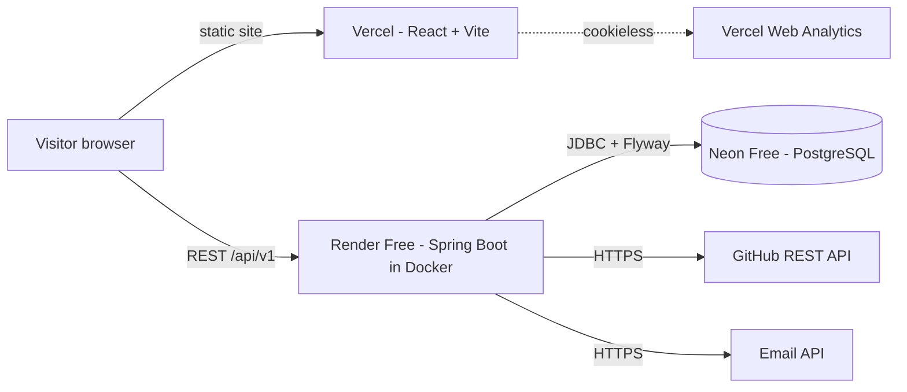

# Architecture overview

> What the system is made of and how a request moves through it. Everything below is _(planned)_ until the ticket named next to it is done; the full design is in the private master plan (`portfolio-implementation-plan.md` §2 and §5–§6 in the parent folder). The design rules for code are in [backend.md](backend.md), the main guide, and [frontend.md](frontend.md).

## System context

## Components

| Component | Responsibility | Hosting | Ticket |
|---|---|---|---|
| Frontend (`frontend/`) | Renders the portfolio from static content; calls the API for the counter, contact form, and status dot; never waits for it | Vercel Hobby | PF-002, PF-003 |
| Backend (`backend/`) | Records visits and serves stats, accepts and delivers contact messages, lists GitHub projects (no page calls it since PF-012), reports health | Render Free, Docker, 512 MB / 0.1 CPU | PF-002, PF-004, PF-005 |
| Database | `page_view` table (built in PF-005) and `contact_message` table (built in PF-006), migrated by Flyway | Neon Free PostgreSQL 17 | PF-005, PF-006 |
| Email API | Delivers contact messages to the owner's inbox over HTTPS | Free tier | PF-006 |
| GitHub API | Source of the public repository list | Public API; an optional read-only token only raises the rate limit | PF-007 |

No keep-alive pinger runs: Render Free has one pool of 750 instance hours a month for every service in the workspace, so the backend sleeps after 15 idle minutes and the frontend shows its waking state (PF-023, PF-027 D5).

## Environments

| Environment | Frontend | Backend | Database | Deployed by |
|---|---|---|---|---|
| Staging | Vercel preview deployment at `will-ly-portfolio-staging.vercel.app`, with a "Staging" badge, not indexed | Render Free `will-ly-portfolio-api-staging`, `APP_ENVIRONMENT=staging` | its own Neon Free project, empty except for staging's own visits and messages | every merge to `main`, after every check passes |
| Production | Vercel production `will-ly-portfolio.vercel.app` | Render Free `will-ly-portfolio-api` | Neon Free project | a release tag `vX.Y.Z` on a commit that passed staging |

Both are built from the same commit by `.github/workflows/deploy.yml`, backend first: the pipeline waits until the public `/actuator/info` reports the new commit and environment, then deploys the frontend, then runs a live smoke test. The footer shows the deployed version, taken from the git tag (PF-027).

## Request lifecycle (backend)

1. Render's proxy forwards the request; the forwarded-headers strategy (`server.request.header.forwarded.strategy`) resolves the client address, trusting only Render's hop from PF-004 on.
2. A correlation filter accepts or creates `X-Correlation-Id` and puts it in the logging context.
3. CORS allows only the configured origins; the rate-limit filter checks the visitor's bucket for public `POST` endpoints.
4. The controller validates the request shape and calls one service method.
5. The service does its database work in short transactions and calls external APIs with no transaction open (Non-Negotiable 7).
6. Failures become RFC 9457 problem responses in one exception handler, with `code` and `correlationId`.

## Resilience on the free tier

- The frontend's content is static, so a sleeping or failing backend only delays the counter and the contact form (Non-Negotiable 1).
- The first visit request doubles as a warm-up call while the visitor reads.
- GitHub failures fall back to the backend's last good result; email failures are retried by a scheduled job.
- Everything is containerized and configured by environment variables, so the backend can move to another host without code changes.
