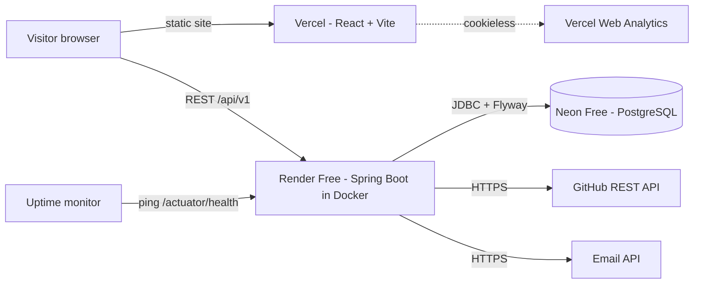

# Architecture overview

> What the system is made of and how a request moves through it. Everything below is _(planned)_ until the ticket named next to it is done; the full design is in the private master plan (`portfolio-implementation-plan.md` §2 and §5–§6 in the parent folder). The design rules for code are in [backend.md](backend.md), the main guide, and [frontend.md](frontend.md).

## System context

## Components

| Component | Responsibility | Hosting | Ticket |
|---|---|---|---|
| Frontend (`frontend/`) | Renders the portfolio from static content; calls the API for the counter, open-source list, contact form, and status dot; never waits for it | Vercel Hobby | PF-002, PF-003 |
| Backend (`backend/`) | Records visits and serves stats, accepts and delivers contact messages, lists GitHub projects, reports health | Render Free, Docker, 512 MB / 0.1 CPU | PF-002, PF-004, PF-005 |
| Database | `page_view` table (built in PF-005) and `contact_message` table _(planned, PF-006)_, migrated by Flyway | Neon Free PostgreSQL 17 | PF-005, PF-006 |
| Email API | Delivers contact messages to the owner's inbox over HTTPS | Free tier | PF-006 |
| GitHub API | Source of the public repository list | Public API with a read-only token | PF-007 |
| Uptime monitor | Pings the health endpoint so the backend rarely sleeps | Free tier | PF-009 |

## Request lifecycle (backend)

1. Render's proxy forwards the request; the forwarded-headers strategy (`server.request.header.forwarded.strategy`) resolves the client address, trusting only Render's hop from PF-004 on.
2. A correlation filter accepts or creates `X-Correlation-Id` and puts it in the logging context.
3. CORS allows only the configured origins; the rate-limit filter checks the visitor's bucket for public `POST` endpoints.
4. The controller validates the request shape and calls one service method.
5. The service does its database work in short transactions and calls external APIs with no transaction open (Non-Negotiable 7).
6. Failures become RFC 9457 problem responses in one exception handler, with `code` and `correlationId`.

## Resilience on the free tier

- The frontend's content is static, so a sleeping or failing backend only delays the counter, open-source list, and contact form (Non-Negotiable 1).
- The first visit request doubles as a warm-up call while the visitor reads.
- GitHub failures fall back to cached or static data; email failures are retried by a scheduled job.
- Everything is containerized and configured by environment variables, so the backend can move to another host without code changes.
