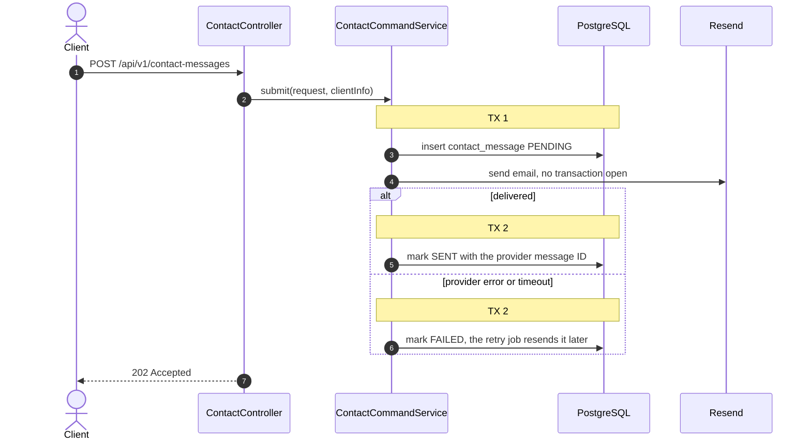
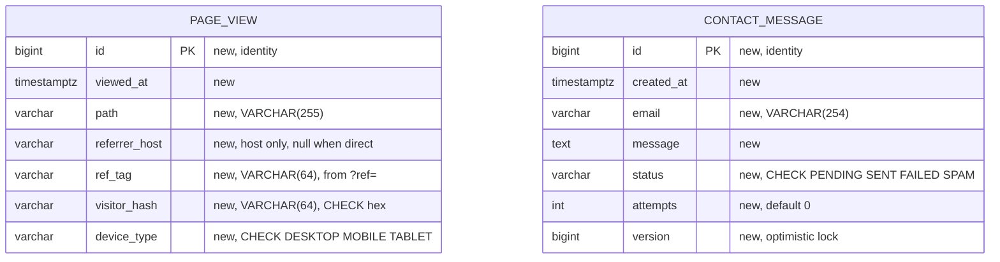

# Plans

Every ticket's working docs live here, for the backend and the frontend alike. A ticket has **one plan that covers both packages**, and the plan leads with the backend: its database, services, API, failure modes, and flows are planned in full, because that is where the design decisions and the risks are. The frontend part stays short: only what the change adds or alters, mostly as tables.

## Layout

```
docs/plans/
├── README.md                          # this file: domains, the plan template, diagram conventions
└── {domain}/
    ├── PF-NNN-{title}.md              # the plan: how it is built (/plan writes it, /dev builds from it)
    ├── PF-NNN-refined-requirement.md  # what it must do, as clarified (/plan writes it, /dev keeps it current)
    └── PF-NNN-PROGRESS.md             # where the work stands, for resuming in a new session (/dev)
```

| Domain | Holds | Tickets |
|---|---|---|
| `platform` | Scaffolding, the cross-cutting backend platform (errors, correlation IDs, security, rate limits, client info), CI, and deployment | PF-002, PF-004, PF-008, PF-013, PF-024, PF-027 |
| `site` | The static site: layout, sections, content, routes, SEO, and launch | PF-003, PF-009 |
| `visits` | Visit tracking and the stats summary | PF-005, PF-023 |
| `contact` | The contact form and email delivery | PF-006 |
| `projects` | The open-source projects list | PF-007 |
| `content` | The content API: backend-owned portfolio content, its Flyway seed, and the frontend snapshot | PF-014, PF-020 |

Add a domain only when a ticket fits none of these, and list it here. A docs or tooling chore without a plan needs no folder.

## Rules

- One plan per ticket, `{domain}/PF-NNN-{title}.md`, written from the template below. Drop a section that does not apply instead of filling it with "n/a": a backend-only ticket drops section 6, and a frontend-only ticket drops section 5.
- Before writing it, read the design guides the change touches and run their evaluation checklists: [backend](../architecture/backend.md) first, then [frontend](../architecture/frontend.md).
- `/plan` writes it with Status **Draft** and sets it to **Approved {YYYY-MM-DD}** when the owner approves; `/dev` builds only from an Approved plan.
- The plan stays in sync with the code. When names, schema, endpoints, error codes, flows, or responsibilities change, update it in the same change.
- Keep each paragraph on one line (`.claude/rules/docs-conventions.md`).
- The plan, refined requirement, and PROGRESS docs are committed with the code they describe.

## Plan template

```markdown
# PF-NNN — {Title}

**Ticket**: PF-NNN · **Refined requirement**: [PF-NNN-refined-requirement.md](PF-NNN-refined-requirement.md) · **Packages**: backend and frontend | backend | frontend · **Status**: Draft | Approved {YYYY-MM-DD} · **Last updated**: {YYYY-MM-DD}

> ⚠️ **Review these flows first** — {links to the subsections under section 7, or "No complex flows"}

## 1. Requirement summary
{Two to five lines. Link the product rules (SITE-NNN) this implements and the master plan section it maps to.}

## 2. Requirement analysis
| Need | Source | Backend work | Frontend work |
|---|---|---|---|

## 3. Current state
{What exists today that this touches or reuses, with `path:line` references.}

## 4. Approach
{The chosen approach and why.}

| Alternative | Why not |
|---|---|

**Reuse**: {existing classes, components, and hooks used as-is or extended}. **Single responsibility**: {one line per new unit}.

## 5. Backend
### Database
{Migration file name `V{yyyyMMddHHmmss}__{snake_description}.sql`, and whether it is additive or needs a backfill. Then a Mermaid `erDiagram` of the new and changed tables, with referenced existing tables shown by their key columns (conventions below).}

| Table.column | SQL type | Null | Default or constraint | Why |
|---|---|---|---|---|

**Constraints and indexes**: {each unique key, check, foreign key, and index, with its reason: the rule it enforces or the query it serves.}
### Domain
{Entities, states and transitions, validator rules.}
### Services
| Unit | Responsibility | Transaction |
|---|---|---|
### API
| Method and path | Rate limit | Success | Errors (code → status) |
|---|---|---|---|
### Failure modes
| Failure | Behavior | Test |
|---|---|---|

{Include a provider timeout and outage for every external call, invalid input, and the rate limit. The Test column names the test for the rows that get one within the test budget in `.claude/skills/dev/SKILL.md`, and says "none" for the rest.}

## 6. Frontend
{Only what the change adds or alters. Drop a subsection that does not apply.}
### Components and routes
{Indented list from page to section to components, each marked new or reused. Each new or changed route with its `<title>`, meta description, and sitemap entry.}
### Content
| Block | Source | Tier | Status |
|---|---|---|---|

{Source is the master CV section or the approved content-pack item. Tier is A, or B with the owner's approval noted. Status is placeholder or reviewed; only reviewed blocks ship (Non-Negotiable 2).}
### Data and states
| View | Hook and query key | Endpoint | Loading | Fallback | Error |
|---|---|---|---|---|---|
### Forms
{Schema, fields, limits mirrored from the server, and how `VALIDATION_FAILED` and `RATE_LIMITED` map onto the form.}
### Test IDs
| Element | Test ID | Purpose |
|---|---|---|
### User flow
{Numbered steps of the main interaction, for an interactive change only.}

## 7. Complex flows
### F1 — {name}
> ⚠️ **Review this flow** — `{Class.method}`, hook, or process: {participants, queries and external calls, transactions}

{Mermaid `sequenceDiagram` with `autonumber` from the trigger to the result, with transaction boundaries as notes and the failure and retry branches as `alt` blocks. Then numbered steps matching its message numbers, why each step exists, and the simplest alternative. Add a `flowchart` only for branching inside one method. A frontend hook that merges several queries or derives state in several steps gets the same treatment.}

## 8. Files, order, risks, tests
**New**: {paths}. **Modified**: {paths}.

**Order**: per slice, the backend first: the contract (migration → entity → records → port, service, and controller signatures), then the implementation while the test writers write the tests in parallel → `make openapi`. Then the frontend: `pnpm gen:api` → content types → `api.ts` → `queries.ts` → components → section or route.

| Risk | Mitigation |
|---|---|

**Tests**: {per slice, within the test budget: the unit and integration tests, which integration-test gate surfaces they cover, and the WireMock stubs they need; then the frontend hook tests against MSW (success, fallback, problem response), component tests, and content shape tests.}
```

## Diagram conventions

These apply to every diagram in a plan, backend or frontend.

### Sequence diagrams

The default for a complex flow or process.

- Start with `autonumber`, so the numbered steps under the diagram match the message numbers.
- Declare participants in call order with short aliases: `actor C as Client`, `participant API as ContactController`, `participant S as ContactCommandService`, `participant DB as PostgreSQL`, `participant R as Resend`. Add a scheduler or another external system as its own participant.
- Mark each transaction with `Note over S,DB: TX 1 …`, so it is visible that no transaction spans a provider call (Non-Negotiable 7).
- Show the failure-modes rows that change the flow as `alt` and `else` blocks (a provider failure, a honeypot hit, a rate limit), and an optional step as `opt`. Use `->>` for a call and `-->>` for its reply.
- Keep message text plain: no `;` or `#`, which break the parser.
- Keep one diagram to about 15 messages; split a bigger process into sub-flows.



### ER diagrams

Every schema change gets one.

- One `erDiagram` per migration: the new and changed tables in full, and the existing tables they reference by their key columns only.
- Attributes are `type name KEYS "comment"`, with keys `PK`, `FK`, or `UK`. Mark new and changed columns in the comment: `"new"`, `"changed: now nullable"`.
- Use plain types without precision (`bigint`, `text`, `varchar`, `int`, `date`, `timestamptz`, `boolean`), because a type cannot contain a comma. Exact SQL types such as `VARCHAR(64)` go in the comment and in the column table.
- Draw relationships with cardinality and a quoted verb when tables reference each other: `PARENT ||--o{ CHILD : "contains"`.



### Flowcharts

Only for branching inside one method, such as a decision table.

- Quote every label that contains `(`, `)`, `[`, `]`, `:`, or `/`. Never put `#` in a label. Write `Step 1 - …` rather than `1. …`, which renders as an unsupported list.
- Prefix calls with where they go, inside quoted labels: `"DB: insert page_view"`, `"GitHub: list repos"`.
- Keep one diagram to about 15 nodes.
