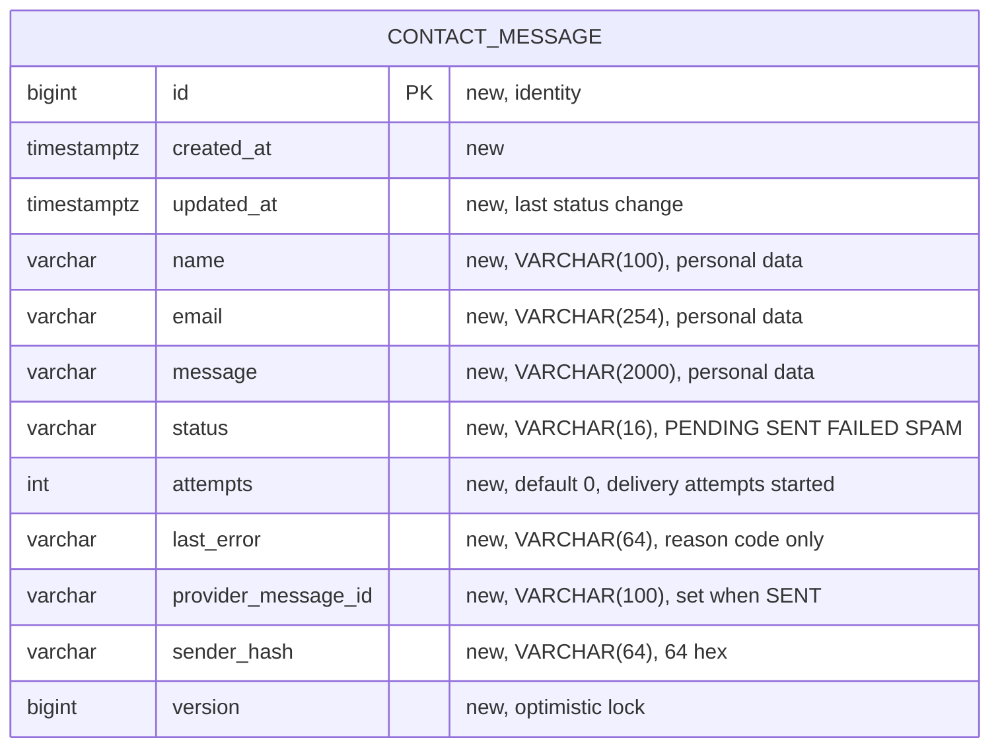
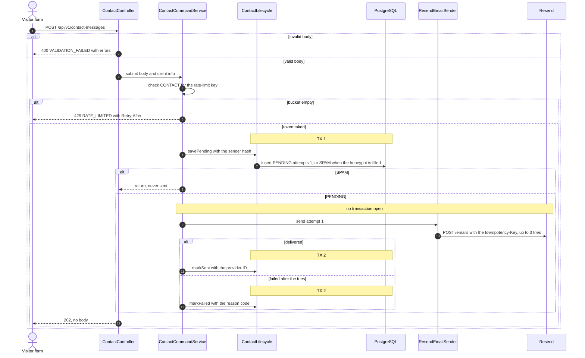
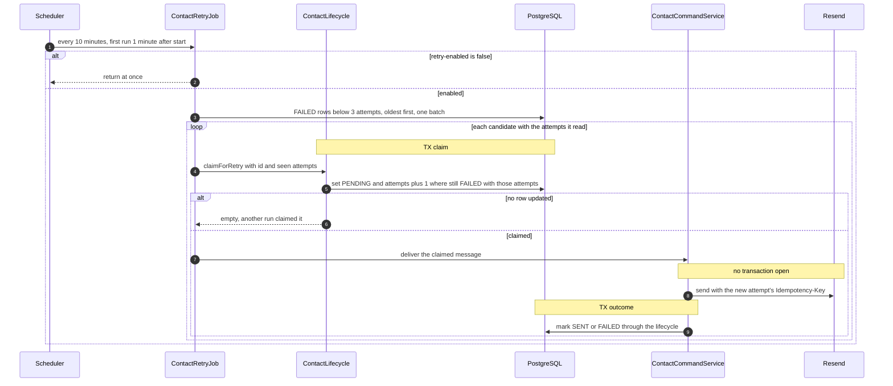
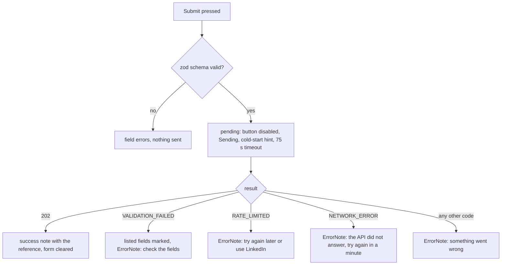

# PF-006 — Contact form

**Ticket**: PF-006 · **Refined requirement**: [PF-006-refined-requirement.md](PF-006-refined-requirement.md) · **Packages**: backend and frontend · **Status**: Approved 2026-11-23 · **Last updated**: 2026-11-23 (planned in `/plan`; every clarifying question decided with its recommended default, pre-approved by the owner (blanket approval, 2026-11-23); built in `/dev` and synced with the code: the build-time refinements are marked "Built:" in P7, P8, P10, P13, P19, P20, and section 8)

> ⚠️ **Review these flows first** — [F1 — Submit a contact message](#f1--submit-a-contact-message) · [F2 — Retry failed messages](#f2--retry-failed-messages) · [F3 — The form's outcome](#f3--the-forms-outcome)

## 1. Requirement summary

A visitor sends the owner a message from the Contact section without the owner's email address ever appearing on the site. `POST /api/v1/contact-messages` validates the message (SITE-004 limits), rate-limits each client address to 3 per hour, stores a filled honeypot as `SPAM` with the same 202, and otherwise runs the outbox: save `PENDING`, email the owner through the `EmailSender` port with no transaction open, record `SENT` or `FAILED`. A scheduled job resends `FAILED` messages with a compare-and-set claim, up to 3 delivery attempts in total (D2). Resend is the provider in every non-local profile and WireMock stands in for it in integration tests; the local profile only logs the message ID. The frontend form mirrors the server's limits with zod, hides the honeypot from people and assistive technology, and shows the pending, success, and failure states with the correlation ID. Implements SITE-004 and Non-Negotiables 4, 5, 7, and 9 on the PF-004 platform; maps to `../portfolio-implementation-plan.md` §5.1, §5.2, §5.5, §6.3, §6.5, and §7 Phase 5 (private). No real email is sent anywhere in this ticket: the Resend key, the recipient, and the verified domain are owner steps for PF-012.

## 2. Requirement analysis

| Need | Source | Backend work | Frontend work |
|---|---|---|---|
| Store messages with an outbox status and a version | FR-1, principle 6, implementation plan §5.2 | Migration, `ContactMessageEntity`, `ContactMessageRepository` | — |
| Accept a message: validate, rate-limit, honeypot, 202 | FR-2 to FR-5, SITE-004, D4, D5 | `ContactController`, `CreateContactMessageRequest`, `ContactCommandService.submit` (F1) | — |
| Save, send with no transaction open, record the outcome | FR-6, Non-Negotiable 7, KNOWN-BE-006, D1 | `ContactLifecycle`, `ContactCommandService.deliver` (F1) | — |
| Email the owner in plain text, reply-to the visitor | FR-7, D6 | `EmailSender.Email.from` | — |
| Resend over HTTPS with timeouts, bounded retry, failures mapped | FR-8, principle 8, D3, D7, D8 | `EmailSender` port, `ResendEmailSender`, `ResendProperties` | — |
| Resend `FAILED` messages, claimed with a compare-and-set | FR-9, principle 6, D2 | `ContactRetryJob`, `ContactLifecycle.claimForRetry`, repository claim | — |
| No email from a developer machine; startup fails without the key | FR-10, principles 8 and 12, D14 | `LoggingEmailSender` (local), `ResendProperties` (non-local) | — |
| Personal data never in logs, responses, caches, or the subject | FR-11, Non-Negotiable 9 | `toString` redaction, JDBC error detail off (P14) | — |
| WireMock for Resend in the shared test context | FR-15, principle 14 | `support/WireMockSupport` | — |
| Form with zod limits and a hidden honeypot | FR-12, FR-14, implementation plan §6.5 | — | `features/contact` (`validation.ts`, `ContactForm`) in `Contact` |
| Pending, success, and failure states with the correlation ID | FR-13, D11, D12 | — | `useSendContactMessage`, `ErrorNote` (F3) |
| Contract | AC-12 | `make openapi` | `pnpm gen:api` |

## 3. Current state

- Platform (PF-004, merged): `RateLimit.CONTACT` is already 3 per hour (`backend/src/main/java/com/huygialy/portfolio/platform/ratelimit/RateLimit.java:8`) and `RateLimiter.check` throws `ApiException.rateLimited` with the wait; `ClientInfoResolver.resolve` returns `ClientInfo(visitorHash, rateLimitKey, …)`; `GlobalExceptionHandler` renders `MethodArgumentNotValidException` as 400 `VALIDATION_FAILED` with field `errors` (`platform/error/GlobalExceptionHandler.java:76`, `:101`) and logs only the exception's class name; the 64 KB JSON document cap applies to every body (`backend/src/main/resources/application.yml:35`). `SecurityConfig.PUBLIC_POST_PATHS` holds only `/api/v1/visits` (`platform/security/SecurityConfig.java:35`); CORS already allows `POST` with `Content-Type` and `X-Correlation-Id` and exposes `X-Correlation-Id` and `Retry-After`. `CorrelationIdFilter.MDC_KEY` is package-private (`platform/web/CorrelationIdFilter.java:24`). `PortfolioApplication` has `@ConfigurationPropertiesScan` and no `@EnableScheduling` (`PortfolioApplication.java:10`).
- Visits (PF-005, merged) is the model for a public `POST`: controller → non-transactional command service → one insert; `VisitApiIT` gives each test its own `X-Forwarded-For` address because the rate limiter is shared across the one test context.
- Not on the classpath yet: Resilience4j, WireMock, and Boot's `RestClient.Builder` auto-configuration (Boot 4 moved it to `spring-boot-starter-restclient`, which is absent; checked with `dependencies --configuration runtimeClasspath`, 2026-11-23). Spring Framework 7.1's `RestClient.builder()`, `JdkClientHttpRequestFactory`, and `JacksonJsonHttpMessageConverter(JsonMapper)` are present, and Boot auto-configures the Jackson 3 `JsonMapper` bean.
- Tests: `@IntegrationTest` imports only `TestcontainersConfiguration` (`backend/src/test/java/com/huygialy/portfolio/support/IntegrationTest.java:27`); `application-test.yml` holds synthetic values for the settings without defaults.
- Frontend: `Contact` renders the placeholder note and the LinkedIn and GitHub links (`frontend/src/sections/Contact.tsx:11`); `COLD_START_TIMEOUT_MS` is 75 s (`frontend/src/api/client.ts:8`) and `ApiError` carries `code`, `correlationId`, and `errors`; mutations never retry (`frontend/src/app/queryClient.ts:19`); react-hook-form 7.92.0, `@hookform/resolvers` 7.0.6, and zod 4.6.7 are already dependencies; `ErrorNote` does not exist yet (frontend principle 2: it arrives with its first caller); `TestIds.contact` holds the two links (`frontend/src/config/test-ids.config.ts:29`); the MSW defaults are health, visits, and stats (`frontend/src/test/handlers.ts:13`). `.env.example` already lists `RESEND_API_KEY=` and `CONTACT_TO_EMAIL=` as empty, "leave empty locally".

## 4. Approach

| # | Decision | Why |
|---|---|---|
| P1 | One migration creates `contact_message` (section 5), close to the master plan's §5.2 with three changes: `message` is `VARCHAR(2000)` instead of `TEXT`, `last_error` is `VARCHAR(64)` holding a reason code, and `provider_message_id` and `updated_at` are added; the partial index covers `(status, id)` for unsent rows | Constraints live in the database (Non-Negotiable 6); a reason code never holds provider text, which can echo an email address (D8); the provider ID traces a message in the Resend dashboard |
| P2 | `ContactMessageEntity` (`@Version`): `receive(name, email, message, honeypot, senderHash, now)` is the only factory and returns `PENDING` with `attempts = 1` (the immediate attempt) or, when `honeypot` is not blank, `SPAM` with `attempts = 0`; `markSent(providerId, now)` and `markFailed(reason, now)` require `PENDING`, else throw `IllegalStateException`; both cut their value to the column length; no setters; `toString` is `Object`'s (no Lombok) | Entities guard their state (principle 4); the honeypot rule sits where the initial status is decided, so no one-method validator class |
| P3 | `CreateContactMessageRequest(name, email, message, website)`: `name` `@NotBlank @Size(max = 100) @Pattern(regexp = "[^\\p{Cntrl}]*", message = "must not contain control characters")`; `email` `@NotBlank @Email @Size(max = 254)`; `message` `@NotBlank @Size(min = 10, max = 2000) @Pattern(regexp = "[^\\x00-\\x08\\x0B\\x0C\\x0E-\\x1F\\x7F]*", message = "must not contain control characters")`; `website` `@Size(max = 2048)`, optional; `toString()` is overridden to `CreateContactMessageRequest[redacted]` | SITE-004 limits (FR-3, D5). PostgreSQL rejects NUL, which would otherwise answer 500 and log a stack trace (the PF-005 P3 lesson); tab, line feed, and carriage return stay legal in a message. Spring's DEBUG argument logging prints a body with `toString`, so the record never prints its content (FR-11) |
| P4 | `ContactController` (`contact.api`): `@PostMapping("/api/v1/contact-messages")`, `@Operation(operationId = "createContactMessage")`, `@ResponseStatus(HttpStatus.ACCEPTED)`, returns `void`; resolves `ClientInfo` and calls `ContactCommandService.submit` | Controllers translate HTTP only; 202 with no identifier (REST rules) |
| P5 | `ContactCommandService` (not transactional). `submit(body, client)`: `rateLimiter.check(RateLimit.CONTACT, client.rateLimitKey())` first; `lifecycle.savePending(body, client.visitorHash())`; a `SPAM` row returns at once; otherwise `deliver(message)`. `deliver(message)` (package-private, also called by the job): `emailSender.send(Email.from(message))` with no transaction open, then `lifecycle.markSent(id, providerId)`; on `EmailSender.DeliveryException` it calls `lifecycle.markFailed(id, e.reason())`; any other `RuntimeException` after the save is logged at ERROR with the message ID and swallowed, so the visitor still gets 202 | F1 and the shape in `backend/CLAUDE.md` (D1); the visitor always gets 202 once the message is saved (backend guide, Contact messages); one delivery path for the request and the job, so the outcome logic is not duplicated |
| P6 | `ContactLifecycle`, one short write transaction per public method: `savePending` (insert, returns the saved entity, detached after commit), `markSent`, `markFailed` (load by ID, apply the guarded transition; `@Version` increments), and `claimForRetry(id, seenAttempts)` (the repository's compare-and-set, then `findById`, returning `Optional<ContactMessageEntity>`) | KNOWN-BE-006: self-invocation skips the proxy, so transactional steps live on their own bean; no transaction ever spans the send (Non-Negotiable 7) |
| P7 | `ContactMessageRepository`: `findRetryCandidates(int maxAttempts, Limit limit)`, a JPQL constructor query returning the nested `RetryCandidate(long id, int attempts)` for `status = FAILED and attempts < :maxAttempts order by id`; `claim(id, seenAttempts, now)`, a `@Modifying(clearAutomatically = true)` JPQL update `set status = PENDING, attempts = attempts + 1, version = version + 1, updatedAt = :now where id = :id and status = FAILED and attempts = :seen`, returning the row count. Built: the candidate query is `@Transactional(readOnly = true)`, and both queries use Hibernate 7's unqualified enum literals (`FAILED`, `PENDING`) and the nested record as `ContactMessageRepository$RetryCandidate` | Principle 6: the job claims each row with a compare-and-set, never a lock; a bulk update skips `@Version`'s automatic increment, so it bumps `version` itself and a stale entity can never overwrite a claim |
| P8 | `EmailSender` port: `String send(Email email)` returns the provider's message ID (or `null` when the provider gave none). Nested `Email(long messageId, int attempt, String replyTo, String subject, String text)` with `static Email from(ContactMessageEntity)`, `idempotencyKey()` = `contact-message-{id}-attempt-{n}`, and a `toString()` that prints only the ID and attempt; nested `DeliveryException(String reason, boolean retryable)`, a `RuntimeException` whose message is the reason and which never carries a cause. Built: it also skips the stack trace (`super(reason, null, false, false)`), since it is an expected failure logged at WARN without one | Principle 8 and the naming table (`EmailSender.Email`); a record's generated `toString` would print the visitor's email and text; a provider exception's message holds the response body, so it is never chained or logged (Non-Negotiable 5) |
| P9 | `Email.from`: subject `New portfolio contact message (#{id})`; plain-text body with the name, the email, the received time (ISO-8601 UTC), the message ID, a blank line, and the message; `replyTo` is the visitor's email | D6: the subject never holds content (backend guide, Contact messages); the owner replies straight to the visitor |
| P10 | `ResendEmailSender` (`@Profile("!local")`): built from `ResendProperties` and the Boot `JsonMapper`; `RestClient.builder()` with `baseUrl`, the message converters, and a `JdkClientHttpRequestFactory` over `HttpClient.newBuilder().version(HTTP_1_1).connectTimeout(connectTimeout)` with `setReadTimeout(readTimeout)`. `send` runs `sendOnce` inside a Resilience4j `Retry` (`maxAttempts = maxTries`, `IntervalFunction.ofExponentialBackoff(backoff, 2.0)`, retrying only a `DeliveryException` with `retryable()`). `sendOnce` posts `/emails` with `Authorization: Bearer {apiKey}`, `Idempotency-Key`, and the nested `SendRequest(from, to = [toEmail], subject, text, @JsonProperty("reply_to") replyTo)`; on 2xx it reads `{id}` leniently (a missing or unreadable ID returns `null`, logged at WARN with the message ID, because the email was accepted). Built: `messageConverters(Iterable)` is deprecated for removal in Framework 7.1, so the client uses `configureMessageConverters` with a `StringHttpMessageConverter` and `JacksonJsonHttpMessageConverter(jsonMapper)`; the 2xx body is read as a string and parsed into the nested `SendResponse(id)` with the Boot `JsonMapper`, so any `JacksonException` falls through to the warning; the key is a default `Authorization` header; `SendRequest.toString()` is redacted, because DEBUG client logging prints bodies; `RestClientResponseException` maps to `HTTP_{status}`, retryable for 429 and 5xx only; `ResourceAccessException` (timeouts, connection errors) maps to `IO_ERROR`, retryable | Principle 8: timeouts, a bounded exponential retry, and every provider failure mapped to the port's exception (D3, D7, D8). Building the client from Framework classes needs no new Boot module (D15) and still uses the Boot-configured mapper (KNOWN-BE-005). HTTP/1.1 avoids the JDK client's h2c upgrade on WireMock's plain-HTTP port and behaves the same against Resend |
| P11 | `LoggingEmailSender` (`@Profile("local")`): logs `Contact message {id} not emailed: the local profile logs instead of sending` at INFO and returns `local-{id}` | Principle 8: nothing leaves a developer machine; logs only the ID (FR-10) |
| P12 | `ContactRetryJob`: `@Scheduled(fixedDelay = 10, initialDelay = 1, timeUnit = TimeUnit.MINUTES) void scheduledRun()` returns at once when `app.contact.retry-enabled` is false; otherwise it puts a fresh UUID under `CorrelationIdFilter.MDC_KEY` (made public), calls `retryFailed()`, and removes it. `int retryFailed()` reads one batch of candidates (`maxAttempts`, `retryBatchSize`), claims each through `lifecycle.claimForRetry`, delivers each claimed row through `commandService.deliver`, catches and logs a per-row failure so the batch continues, logs one summary line, and returns the number claimed. `@EnableScheduling` goes on `PortfolioApplication` | The scheduled-job pattern in `backend/CLAUDE.md` (switch, work method called directly by tests, compare-and-set); each run has its own correlation ID (principle 13); one batch per run spaces the attempts about 10 minutes apart (D2); the interval is a constant, because tests call the work method and nothing needs to tune it |
| P13 | Configuration. `ContactProperties` (`app.contact`, all defaulted): `retryEnabled` (`CONTACT_RETRY_ENABLED`, true), `maxAttempts` (3, `@Min(1)`), `retryBatchSize` (10, `@Min(1)`). `ResendProperties` (`app.contact.resend`, `@Validated`, `@Profile("!local")`, so `@ConfigurationPropertiesScan` binds it only where the adapter runs): `apiKey` (`RESEND_API_KEY`, `@NotBlank`, no default), `toEmail` (`CONTACT_TO_EMAIL`, `@NotBlank @Email`, no default), `fromEmail` (`CONTACT_FROM_EMAIL`, default `Portfolio <onboarding@resend.dev>`), `baseUrl` (`https://api.resend.com`), `connectTimeout` (2s), `readTimeout` (5s), `maxTries` (3, `@Min(1) @Max(5)`), `backoff` (500ms). The test profile sets `retry-enabled: false`, `retry-batch-size: 50`, a synthetic key and `owner@example.com`, `read-timeout: 500ms`, and `backoff: 50ms`; `WireMockSupport` supplies `base-url`. Built: `ResendProperties.toString()` prints only the base URL and the tries, never the key or the recipient | Principle 12: a non-local profile fails at startup without the key or the recipient (D14), while `make backend` keeps working with the empty values `.env.example` exports (Spring's `${VAR:default}` resolves an empty variable to empty, so a local default would not help); the scanner evaluates `@Profile` (it is given the environment; read from `ConfigurationPropertiesScanRegistrar`, 2026-11-23) and `ContactPropertiesTest` proves it |
| P14 | `application.yml` sets `spring.datasource.hikari.data-source-properties.logServerErrorDetail: false` | PostgreSQL's error detail for a failed row ("Failing row contains …") would put a name, email, or message into an exception message and an ERROR stack trace; the column limits are already validated before the insert, so this is defense in depth for Non-Negotiable 9 |
| P15 | `SecurityConfig.PUBLIC_POST_PATHS` adds `/api/v1/contact-messages` | Off-list paths still answer 404 (PF-004 D4) |
| P16 | `support/WireMockSupport` (`@TestConfiguration`, imported by `@IntegrationTest` next to `TestcontainersConfiguration`): a `WireMockServer` bean on a dynamic port (`initMethod = "start"`, `destroyMethod = "stop"`) and a `DynamicPropertyRegistrar` that sets `app.contact.resend.base-url` to its base URL; integration tests inject `WireMockServer` through the constructor and call `resetAll()` in `@BeforeEach`. PF-007 adds `app.github.base-url` to the same registrar | Principle 14 and the Key Services row "WireMock support arrives with the first adapter"; one shared context, no `@MockitoBean` (KNOWN-BE-008); unmatched requests get WireMock's 404, which maps to a non-retryable `HTTP_404`, so a forgotten stub fails loudly instead of reaching the internet |
| P17 | `make openapi` regenerates the snapshot and `frontend/src/api/schema.d.ts`; `name`, `email`, and `message` come out required from `@NotBlank`, `website` optional | REST rules; frontend types come only from the generated schema |
| P18 | `features/contact`: `api.ts` creates its own `createApiClient({ timeoutMs: COLD_START_TIMEOUT_MS })` and `sendContactMessage(body)` returns `{ correlationId }` read from the response's `X-Correlation-Id` header; `queries.ts` has `contactKeys` and `useSendContactMessage()` (`mutationKey: contactKeys.send()`, `retry: false`); `validation.ts` has `CONTACT_LIMITS` and `contactSchema` (`name` trimmed 1 to 100, `email` trimmed, at most 254 and `z.email()`, `message` trimmed 10 to 2000, `website` at most 2048, passed through), each field's message from `t('contact.error.{field}')`; `index.ts` exports `ContactForm` | Frontend principles 4, 7, and 9; the 75 s client survives a cold start (implementation plan §6.2); trimming on the client sends what the server's `@NotBlank` and lengths accept, so the client never relaxes a server rule |
| P19 | `ContactForm`: react-hook-form with `zodResolver(contactSchema)` and `noValidate`; a sub-heading `contact.form.heading` (h3) labels the form; inputs with visible labels, `autoComplete="name"` and `"email"`, `aria-invalid` and `aria-describedby` to their error text; the honeypot is a `website` input inside a wrapper with `aria-hidden="true"` placed off-screen (not `display: none`), with `tabIndex={-1}` and `autoComplete="off"`. Pending: the submit button is disabled and reads `contact.form.sending`, and `contact.form.coldStartHint` shows for the whole pending time. Success: `reset()`, and the form is replaced by a `role="status"` note with `contact.form.success`, `contact.form.reference` when a correlation ID exists, and a `contact.form.sendAnother` button that resets the mutation. Built: the note has `tabIndex={-1}` and takes focus when it replaces the form, so keyboard and screen-reader users are not left on a removed button. After a `VALIDATION_FAILED` answer, focus moves to the first listed field in form order (`setFocus`), as it does for a client-side error (review fix). Failure: an `ErrorNote` under the button with the code's message (F3); `VALIDATION_FAILED` also marks each listed `name`, `email`, or `message` field with `setError(field, { type: 'server', message: t('contact.error.{field}') })` | FR-12 to FR-14; the hint follows implementation plan §6.3 literally (D12); `aria-hidden` plus `tabIndex={-1}` keeps the honeypot out of the accessibility tree and the tab order without failing the "aria-hidden element is focusable" check; off-screen rather than `display: none`, because some bots skip fields that are not displayed |
| P20 | `components/ErrorNote` (new primitive): `role="alert"`, a short message, and, when the error is an `ApiError`, `errorNote.code` and `errorNote.reference` with the correlation ID in a `select-all` `<code>` so one click selects it. Built: the `Reference: {id}` template is split at `{id}`, so the string stays one UI string and only the ID sits in the `<code>` | Frontend principle 8 (code and copyable correlation ID); selectable text needs no clipboard permission or extra state (D18) |
| P21 | `Contact` section: the placeholder note and the links stay first; the form follows; at `xl` a two-column grid puts the links in a 17rem column and the form beside them, with the visual order equal to the DOM order | "next to the LinkedIn and GitHub links" (ticket); the links work with no API and come first for a quick scan (Non-Negotiable 1); no CSS `order`, so reading and focus order match (D13) |
| P22 | `src/test/handlers.ts` adds a default `POST */api/v1/contact-messages` answering 202 with an `X-Correlation-Id` header | Every page test renders the form; a default keeps any submit in a page test from failing on an unhandled request |

| Alternative | Why not |
|---|---|
| Answer 202 right after the save and send on a background thread | A `PENDING` row could be orphaned when the free-tier instance stops, and it adds an executor; the synchronous send is bounded at about 22.5 s (D3), and the retry job covers failures (D1) |
| Spring Framework 7's built-in `RetryTemplate` instead of Resilience4j | No new dependency, but the ticket and backend principle 8 name Resilience4j, and PF-007 needs Resilience4j's circuit breaker anyway; one resilience library for both adapters |
| `resilience4j-spring-boot4` with `@Retry` annotations | Pulls in AspectJ proxies and annotation scanning for one call site, and annotations on the same bean hit the self-invocation trap (KNOWN-BE-006); the programmatic core module is about 150 KB with only `slf4j-api` |
| `spring-boot-starter-restclient` for an auto-configured `RestClient.Builder` | Its Boot 4.2.0 modules were published on 2026-11-19, inside the one-week age rule, and Framework's `RestClient.builder()` with the injected `JsonMapper` does the same for one client; PF-007 may revisit it |
| WireMock 4.0.0 betas, or `wiremock-jetty12` | Betas are not pinned in this repository; `wiremock-jetty12` brings unshaded Jetty 12 that Boot's dependency management would re-version; the standalone jar shades Jetty, `jakarta.servlet`, and Jackson under `wiremock.` (jar listing read 2026-11-23) |
| A stale-`PENDING` recovery in the job | Needs a staleness rule and risks a double send; a crash between the save and the outcome is rare, and the owner's SQL finds such rows (D9) |
| One key for every attempt of a message | Resend does not document whether a failed request's key is cached; a per-attempt key lets each scheduled attempt through while the in-call tries still share one key (D7) |
| Showing the cold-start hint only after 3 s | Needs the panel's `useSlowAfter` moved to a shared place for one line of text; the master plan shows the hint for the whole pending time (D12) |

**Reuse**: `ClientInfoResolver`, `RateLimiter` and `RateLimit.CONTACT`, `ApiException` and `GlobalExceptionHandler` (no new `ErrorCode`, D10), `SecurityConfig`, `CorrelationIdFilter.MDC_KEY`, the injected `Clock` and `JsonMapper`, springdoc's `@Operation`, `@IntegrationTest` and `TestcontainersConfiguration`; `createApiClient`, `COLD_START_TIMEOUT_MS`, `CORRELATION_HEADER`, `ApiError`, `Section`, `t()`, `TestIds`, `renderWithProviders`, MSW, react-hook-form, `@hookform/resolvers`, zod. **New dependencies** (Non-Negotiable 8): `io.github.resilience4j:resilience4j-retry:2.4.0` (published 2026-03-14; about 50 KB plus `resilience4j-core` about 100 KB, depends only on `slf4j-api`; no proxies, no startup scanning, a few objects of heap) and, test-only, `org.wiremock:wiremock-standalone:3.13.2` (published 2025-11-14; a 19.5 MB shaded jar on the test classpath only, nothing in the Docker image). The frontend adds none. **Single responsibility**: `ContactController` binds the request; `ContactCommandService` orchestrates acceptance and delivery; `ContactLifecycle` owns the transactional steps; `ContactMessageEntity` guards a message's state; `ContactMessageRepository` reads candidates and claims rows; `ContactRetryJob` schedules and batches retries; `EmailSender` is the port; `ResendEmailSender` talks to Resend; `LoggingEmailSender` stands in locally; `ContactProperties` and `ResendProperties` hold settings; `WireMockSupport` stands in for providers in tests; `contactSchema` holds the client limits; `useSendContactMessage` sends; `ContactForm` renders the form and its states; `ErrorNote` renders a failure.

## 5. Backend

### Database

Migration `V20261123160000__create_contact_message.sql`, additive (a new table; nothing to backfill).

| Table.column | SQL type | Null | Default or constraint | Why |
|---|---|---|---|---|
| `contact_message.id` | `BIGINT GENERATED ALWAYS AS IDENTITY` | no | primary key | Row identity; the message ID in logs and the email subject |
| `contact_message.created_at` | `TIMESTAMPTZ` | no | `DEFAULT now()` | When the message arrived; the application sets it from the `Clock` |
| `contact_message.updated_at` | `TIMESTAMPTZ` | no | `DEFAULT now()` | When the status last changed; lets the owner spot a stuck `PENDING` row (D9) |
| `contact_message.name` | `VARCHAR(100)` | no | — | SITE-004 |
| `contact_message.email` | `VARCHAR(254)` | no | — | SITE-004; the reply-to address |
| `contact_message.message` | `VARCHAR(2000)` | no | — | SITE-004; the length holds in the database too (P1) |
| `contact_message.status` | `VARCHAR(16)` | no | `DEFAULT 'PENDING'`, `CHECK (status IN ('PENDING', 'SENT', 'FAILED', 'SPAM'))` | The outbox state |
| `contact_message.attempts` | `INT` | no | `DEFAULT 0`, `CHECK (attempts >= 0)` | Delivery attempts started; the job stops at `app.contact.max-attempts` (D2) |
| `contact_message.last_error` | `VARCHAR(64)` | yes | — | The last failure's reason code (`HTTP_503`, `IO_ERROR`), never provider text (D8) |
| `contact_message.provider_message_id` | `VARCHAR(100)` | yes | — | Resend's email ID once `SENT`, `local-{id}` locally |
| `contact_message.sender_hash` | `VARCHAR(64)` | no | `CHECK (sender_hash ~ '^[0-9a-f]{64}$')` | The visitor hash, so the owner can see repeat senders without an IP address (KNOWN-BE-010: never `CHAR`) |
| `contact_message.version` | `BIGINT` | no | `DEFAULT 0` | `@Version`: the request path and the retry job both write rows (principle 6) |

**Constraints and indexes**: the status and attempts checks keep the outbox states valid in the database; the hash check enforces the visitor-hash format. `idx_contact_message_unsent ON contact_message (status, id) WHERE status IN ('PENDING', 'FAILED')` serves the job's candidate query (`status = 'FAILED' … ORDER BY id`) and the owner's stuck-row SQL, and stays small because sent and spam rows are not in it. No unique key: two identical messages are two messages. **Personal data**: `name`, `email`, and `message` hold a real visitor's details, stored for the owner and sent to the owner only; `sender_hash` is pseudonymous. No column holds a raw IP address, a user-agent string, or a referrer (Non-Negotiable 3).

### Domain

| From | To | How | Guard |
|---|---|---|---|
| (new) | `PENDING`, attempts 1 | `ContactMessageEntity.receive` with a blank honeypot | — |
| (new) | `SPAM`, attempts 0 | `receive` with a filled honeypot | — |
| `PENDING` | `SENT` | `markSent(providerId, now)` | status is `PENDING` |
| `PENDING` | `FAILED` | `markFailed(reason, now)` | status is `PENDING` |
| `FAILED` | `PENDING`, attempts + 1 | `ContactMessageRepository.claim` (compare-and-set) | still `FAILED` with the attempts the job read, and attempts below `max-attempts` |

`SENT` and `SPAM` are final. Rows are never deleted by the application (retention is the owner's, D16).

### Services

| Unit | Responsibility | Transaction |
|---|---|---|
| `contact.api.ContactController` | Bind and validate `CreateContactMessageRequest`, resolve `ClientInfo`, answer 202 | none |
| `contact.ContactCommandService` | F1: rate limit, save, honeypot branch, `deliver` (also used by F2) | none: no transaction is open while the email is sent |
| `contact.ContactLifecycle` | `savePending`, `markSent`, `markFailed`, `claimForRetry` | one short write transaction per method |
| `contact.ContactMessageRepository` | Insert, `findById`, `findRetryCandidates`, `claim` | read-only for the candidate query; `claim` joins the lifecycle's transaction |
| `contact.ContactRetryJob` | F2: switch, correlation ID, one batch of claims and deliveries | none |
| `contact.EmailSender` | Port: `send(Email)`; `Email`, `DeliveryException` nested | none |
| `contact.ResendEmailSender` | Adapter (non-local profiles): Resend over `RestClient`, timeouts, Resilience4j retry, failure mapping | none |
| `contact.LoggingEmailSender` | Adapter (local profile): logs the message ID only | none |
| `contact.ContactProperties` | `app.contact.*` | — |
| `contact.ResendProperties` | `app.contact.resend.*`, bound in non-local profiles only | — |

### API

| Method and path | Rate limit | Success | Errors (code → status) |
|---|---|---|---|
| `POST /api/v1/contact-messages` (`createContactMessage`), body `{name, email, message, website?}` | `RateLimit.CONTACT`: 3 per hour per client address (`ClientInfo.rateLimitKey`), checked before any work, honeypot hits included (D4) | 202, no body, whether delivery succeeded, failed, or the message was spam | `VALIDATION_FAILED` → 400 (with `errors` for invalid fields; without them for a body that is not JSON or is over 64 KB); `RATE_LIMITED` → 429 with `Retry-After`; `INTERNAL_ERROR` → 500 only when the first save fails |

A delivery failure never reaches the visitor (REST rules: an upstream outage with a fallback is not an error), so PF-006 adds no `ErrorCode` (D10).

### Failure modes

| Failure | Behavior | Test |
|---|---|---|
| Blank name, invalid email, message under 10 characters, NUL or another control character | 400 `VALIDATION_FAILED` with a field error; nothing stored, nothing sent | `ContactApiIT` (four rows) |
| Name over 100, email over 254, message over 2000 characters | 400 `VALIDATION_FAILED` with a field error | `validation.test.ts` covers the mirrored limits; none on the server (Bean Validation behavior) |
| Body that is not JSON, or over 64 KB | 400 `VALIDATION_FAILED` without field errors | none (platform, PF-004 and PF-005) |
| Honeypot filled | 202; row `SPAM` with attempts 0; no request to the provider | `ContactApiIT` |
| 4th message within an hour from one address (spam included) | 429 `RATE_LIMITED` with `Retry-After` | `ContactApiIT` |
| Resend answers 5xx or 429, then recovers within the attempt | Retried with backoff and the same `Idempotency-Key`; `SENT` | `ResendEmailSenderIT` |
| Resend down for every try of the attempt | Visitor gets 202; row `FAILED`, attempts 1, `last_error` `HTTP_503` | `ContactApiIT`, `ResendEmailSenderIT` |
| Resend read timeout or connection failure | Retried; then `DeliveryException` `IO_ERROR`, row `FAILED` | `ResendEmailSenderIT` |
| Resend rejects the request (400, 401, 403, 422) | Not retried within the attempt; `FAILED` with `HTTP_{status}`; the job still retries it up to the attempt limit | `ResendEmailSenderIT` (400) |
| Resend answers 2xx without a readable ID | `SENT` with a null provider ID; WARN with the message ID | none |
| Database down at the first save | 500 `INTERNAL_ERROR`; nothing stored or sent | none |
| Outcome write fails after a successful send (database down, optimistic-lock conflict) | Visitor still gets 202; row stays `PENDING`; ERROR log with the message ID | `ContactCommandServiceTest` |
| The instance stops between the save and the outcome | Row stays `PENDING`; not retried automatically (D9); the owner's SQL finds it | none |
| `FAILED` row while the provider is back | The job claims it, sends with the attempt's new key, `SENT`, attempts 2 | `ContactRetryJobIT` |
| `FAILED` row at the attempt limit | Left `FAILED`; never claimed again | `ContactRetryJobIT` |
| Two runs try to claim the same row | Exactly one claim succeeds | `ContactRetryJobIT` |
| `app.contact.retry-enabled` is false | The scheduled method returns at once | `ContactRetryJobIT` |
| A non-local profile without `RESEND_API_KEY` or `CONTACT_TO_EMAIL` | Startup fails; the local profile starts without them | `ContactPropertiesTest` |
| A name, email, or message reaching the logs | Never: only IDs, attempts, and reason codes are logged | `ContactApiIT` (captured output) |
| API asleep when the visitor sends | The form waits up to 75 s with the cold-start hint; the page never waits | `ContactForm.test.tsx` (pending state) |
| API unreachable or the 75 s timeout | `NETWORK_ERROR` note suggesting LinkedIn | `ContactForm.test.tsx` |

## 6. Frontend

### Components and routes

- `HomePage` → `Contact` (modified): the placeholder note and the links (reused), then `ContactForm` (new, `features/contact`); two columns at `xl` (P21)
- `ContactForm` (new): the fields, the hidden honeypot, the submit button with the pending hint, the success note, and `ErrorNote` (new, `src/components/`)

No route, title, meta description, or sitemap change.

### Content

| Block | Source | Tier | Status |
|---|---|---|---|
| Contact note (`site.contactNote`) | placeholder (PF-003 D2) | A once reviewed | placeholder, unchanged |
| Form labels, button, hint, success, and error messages | UI strings in `src/i18n/en.ts`, not portfolio copy | — (UI strings) | new UI strings |

New UI strings: `contact.form.heading` "Send a message", `contact.form.name` "Name", `contact.form.email` "Email", `contact.form.message` "Message", `contact.form.website` "Website" (the honeypot's label, never shown), `contact.form.submit` "Send message", `contact.form.sending` "Sending…", `contact.form.coldStartHint` "The first request can take up to a minute while the free-tier API wakes up.", `contact.form.success` "Thanks, your message was received.", `contact.form.reference` "Reference: {id}", `contact.form.sendAnother` "Send another message", `contact.error.name` "Enter your name, up to 100 characters.", `contact.error.email` "Enter a valid email address, up to 254 characters.", `contact.error.message` "Write between 10 and 2,000 characters.", `contact.error.invalid` "Some fields need attention. Check them and try again.", `contact.error.rateLimited` "You have sent several messages in the last hour. Please try again later, or reach me on LinkedIn.", `contact.error.network` "The API did not answer, so the message may not have arrived. It may be waking up: try again in a minute, or reach me on LinkedIn.", `contact.error.unexpected` "Something went wrong while sending. Please try again later.", `errorNote.code` "Error code: {code}", `errorNote.reference` "Reference: {id}".

### Data and states

| View | Hook and query key | Endpoint | Loading | Fallback | Error |
|---|---|---|---|---|---|
| `ContactForm` | `useSendContactMessage`, mutation `contactKeys.send()` | `POST /api/v1/contact-messages` (75 s timeout) | button disabled, "Sending…", cold-start hint | the form always renders; the LinkedIn and GitHub links beside it work without the API | `ErrorNote` with the code's message, the code, and the reference (F3) |

### Forms

| Field | zod (client) | Server | Error key |
|---|---|---|---|
| `name` | trimmed, 1 to 100 | `@NotBlank`, `@Size(max = 100)`, no control characters | `contact.error.name` |
| `email` | trimmed, at most 254, `z.email()` | `@NotBlank`, `@Email`, `@Size(max = 254)` | `contact.error.email` |
| `message` | trimmed, 10 to 2000 | `@NotBlank`, `@Size(min = 10, max = 2000)`, no control characters except tab and line breaks | `contact.error.message` |
| `website` (honeypot) | at most 2048, passed through unchanged | `@Size(max = 2048)`; any non-blank value stores `SPAM` | — |

`VALIDATION_FAILED` maps each `ApiError.errors[].field` that is `name`, `email`, or `message` onto that field with its error key and always shows `contact.error.invalid` in the `ErrorNote`; `RATE_LIMITED` shows `contact.error.rateLimited`; `NETWORK_ERROR` shows `contact.error.network`; any other code shows `contact.error.unexpected`. Field values stay in place after a failure and are cleared after a success.

### Test IDs

| Element | Test ID | Purpose |
|---|---|---|
| Form | `contact-form-region` | The form element |
| Name input | `contact-name-input` | Typing and field errors |
| Email input | `contact-email-input` | Typing and field errors |
| Message textarea | `contact-message-input` | Typing and field errors |
| Honeypot input | `contact-website-input` | Proves it is hidden and still sent |
| Submit button | `contact-submit-button` | Submitting and the pending state |
| Cold-start hint | `contact-hint-text` | The pending hint |
| Success note | `contact-success-region` | The success state and the reference |
| Send another button | `contact-another-button` | Back to an empty form |
| Error note | `error-note-region` | Any failure |
| Error code | `error-note-code-text` | The problem code |
| Reference | `error-note-reference-text` | The correlation ID |

### User flow

1. The visitor reaches the Contact section: the note and the LinkedIn and GitHub links show at once, and the form beside them works without waiting for the API.
2. They fill in a name, an email, and a message; a mistake shows under its field before anything is sent.
3. They press "Send message": the button reads "Sending…" and the cold-start hint appears; the send may wait up to 75 s for the API to wake.
4. The API answers 202: the form is replaced by "Thanks, your message was received." with the reference and a "Send another message" button.
5. On a failure, the values stay, the note explains what happened with the code and the reference, and LinkedIn stays one click away.

## 7. Complex flows

### F1 — Submit a contact message

> ⚠️ **Review this flow** — `ContactController.createContactMessage` → `ContactCommandService.submit` and `deliver`: the rate limit, TX 1 (insert `PENDING` or `SPAM`), a provider call with up to three HTTP tries and no transaction open, then TX 2 (`SENT` or `FAILED`); five outcomes (400, 429, 202 spam, 202 sent, 202 failed).

| Messages | What happens, and why |
|---|---|
| 1, 2 | The parser cap and Bean Validation reject a bad body before any work (FR-3, Non-Negotiable 4) |
| 3 to 5 | 3 messages per hour per client address, checked first, spam included (FR-5, PF-004 D6, D4) |
| 6, 7 | TX 1 commits the message before anything else, so it is safe even if the send fails (FR-6, Non-Negotiable 7); a filled honeypot decides `SPAM` in the entity (FR-4) |
| 8 | A spam row is never sent, and the visitor gets the same 202 (SITE-004) |
| 9, 10 | The send runs with no transaction open; timeouts of 2 s and 5 s, up to 3 tries with 500 ms and 1 s backoff on timeouts, 429, and 5xx, one `Idempotency-Key` for all three (FR-8, D3, D7) |
| 11, 12 | TX 2 records the outcome with the provider ID or the reason code; a failure here is logged and swallowed (P5) |
| 13 | 202 with no body, whatever the delivery outcome (FR-2, D1) |

**Simplest alternative**: drop the in-call retry and rely on the job alone. A one-second provider blip would then delay the owner's email by 10 minutes and spend one of the three attempts; the in-call retry costs one library and at most about 1.5 s of backoff.

### F2 — Retry failed messages

> ⚠️ **Review this flow** — `ContactRetryJob.scheduledRun` → `retryFailed`: a process that spans time; one candidate query, then per row a compare-and-set claim (TX), a provider call with no transaction open, and an outcome write (TX).

| Messages | What happens, and why |
|---|---|
| 1, 2 | A fixed 10-minute delay (implementation plan §5.5); the switch lets integration tests stop the schedule and call `retryFailed` directly (FR-9) |
| 3 | The work comes from the current state, one batch per run, so attempts are spaced about 10 minutes apart (principle 6, D2) |
| 4 to 6 | The compare-and-set claim: of two runs, only one updates the row; it also counts the attempt before the send, so a crash cannot loop a message forever (principle 6) |
| 7 to 9 | The same `deliver` as F1, so the outcome logic exists once; a new key per attempt (D7) |

Each run carries its own correlation ID in the logging context and logs one summary line with counts only (principle 13). A row-level exception is logged with the row's ID and the batch continues. **Simplest alternative**: no job, and the owner re-sends failures by hand with SQL; SITE-004 requires the retry.

### F3 — The form's outcome

> ⚠️ **Review this flow** — `ContactForm`: a decision table on the mutation result with five branches.

Every `ErrorNote` shows the code and the reference (FR-13). **Simplest alternative**: one generic failure message for every code; the visitor would not learn that waiting an hour or fixing a field is the remedy (frontend principle 9).

## 8. Files, order, risks, tests

**New**: `backend/src/main/resources/db/migration/V20261123160000__create_contact_message.sql`; `backend/src/main/java/com/huygialy/portfolio/contact/{ContactMessageEntity,ContactMessageRepository,ContactLifecycle,ContactCommandService,ContactRetryJob,ContactProperties,ResendProperties,EmailSender,ResendEmailSender,LoggingEmailSender}.java` and `contact/api/{ContactController,CreateContactMessageRequest}.java`; `backend/src/test/java/com/huygialy/portfolio/support/WireMockSupport.java`; `frontend/src/features/contact/{api,queries,validation,index}.ts` and `ContactForm.tsx`; `frontend/src/components/ErrorNote.tsx`; the tests below.

**Modified**: `backend/build.gradle.kts` (the two dependencies); `platform/security/SecurityConfig.java` (public path); `platform/web/CorrelationIdFilter.java` (`MDC_KEY` public); `PortfolioApplication.java` (`@EnableScheduling`); `application.yml` (`app.contact.*`, `app.contact.resend.*`, `logServerErrorDetail`); `backend/src/test/resources/application-test.yml`; `backend/src/test/java/com/huygialy/portfolio/support/IntegrationTest.java` (imports `WireMockSupport`); `backend/openapi/openapi.json` and `frontend/src/api/schema.d.ts` (generated); `.env.example` (adds the optional `CONTACT_FROM_EMAIL` and `CONTACT_RETRY_ENABLED` as commented-out lines, because an exported empty value would override their defaults, and says `RESEND_API_KEY` and `CONTACT_TO_EMAIL` are required outside the local profile); `frontend/src/sections/Contact.tsx`; `frontend/src/i18n/en.ts`; `frontend/src/config/test-ids.config.ts`; `frontend/src/test/handlers.ts` (P22). Docs at hand-off: `docs/prd/backlog.md` (status), `docs/product/product-guide.md` (SITE-004 reworded per D2 and D4: at most 3 delivery attempts in total, honeypot hits count toward the limit), `docs/architecture/backend.md` (Key Services rows for `EmailSender`, the contact services, and WireMock support marked built), `docs/architecture/frontend.md` (`ErrorNote` and `features/contact` built), `docs/architecture/overview.md` (`contact_message` built), `.claude/rules/rest-api-conventions.md` (endpoint built, `createContactMessage`), `backend/CLAUDE.md` (the contact outbox shape updated to `void` and `deliver`; structure; the Docker line's required variables gain `RESEND_API_KEY` and `CONTACT_TO_EMAIL`), `frontend/CLAUDE.md` (structure, `ErrorNote`), `CLAUDE.md` (project structure: contact API built), and `docs/knowledge/` (facts verified while building, such as the WireMock shading and Resilience4j's last-exception behavior).

**Order**: backend first (S1 to S3, `make openapi` after S2), then the frontend (S4). Each slice writes its contract first (migration, entity, records, port and service signatures, properties), then the bodies while the test writer writes the tests.

| Slice | Demo | Contract first | Then |
|---|---|---|---|
| S1 — Email port and Resend adapter | `ResendEmailSenderIT` green against WireMock | Dependencies, `EmailSender` (`Email` without `from`, `DeliveryException`), `ResendProperties`, `ContactProperties`, `WireMockSupport`, `@IntegrationTest` import, test-profile values | `ResendEmailSender` (P10), `LoggingEmailSender` |
| S2 — Accept a message | `curl -X POST localhost:<port>/api/v1/contact-messages -H 'Content-Type: application/json' -d '{"name":"Ada Example","email":"visitor@example.com","message":"Hello from the plan demo"}'` on a spare port with the local profile answers 202 and logs only the message ID (Built: not run in `/dev`, which starts no servers; `ContactApiIT` covers the 202 and the clean logs, and `ContactPropertiesTest` the local profile's binding) | Migration, `ContactMessageEntity`, `ContactMessageRepository` (insert path), `ContactLifecycle` (save and mark), `Email.from`, `CreateContactMessageRequest`, `ContactController` and `ContactCommandService` signatures, public path | F1 bodies, `logServerErrorDetail`; `make openapi` |
| S3 — Retry job | `ContactRetryJobIT` green | `ContactRetryJob` signatures, `findRetryCandidates` and `claim`, `claimForRetry`, `@EnableScheduling`, `MDC_KEY` public, switch and batch settings | F2 bodies |
| S4 — Contact form | The form on the dev server sends to a local backend and shows each state | `pnpm gen:api` output, `features/contact` `api.ts`, `queries.ts`, `validation.ts`, strings, test IDs, the default MSW handler | `ErrorNote`, `ContactForm` (F3), `Contact` layout; docs |

| Risk | Mitigation |
|---|---|
| WireMock's server clashes with Tomcat, Jakarta Servlet 6.1, or Jackson 3 on the test classpath | The standalone 3.13.2 jar shades Jetty, `jakarta.servlet`, Jackson, and Apache HttpClient under `wiremock.` (jar listing read 2026-11-23); S1's first integration test proves it; fallback `wiremock-jetty12:3.13.2` |
| Resend's reply-to key is `reply_to` in its REST API, but the docs page read on 2026-11-23 did not show the key | `ResendEmailSenderIT` pins the body shape; PF-012's smoke test replies to a test message (owner step 3) |
| The synchronous send makes the visitor wait | Worst case about 22.5 s per attempt (3 × (2 s + 5 s) + 1.5 s backoff), inside the 75 s client timeout after a typical cold start; Resend usually answers well under a second |
| The client times out after the server saved the message, and the visitor sends it again | The network message says the message may not have arrived; the limit of 3 per hour caps duplicates; the owner sees both rows |
| Resend does not document how a failed request's idempotency key is treated | A key per attempt: the in-call tries share one key (a timed-out request that landed is not sent twice), and each scheduled attempt uses a new key, so a cached failure cannot block it (D7) |
| The shared test context carries rate-limit buckets, WireMock stubs, and other tests' `FAILED` rows | Each request uses its own `X-Forwarded-For` from `192.0.2.0/24`, never reused; `wireMock.resetAll()` in `@BeforeEach`; each test finds its row by a unique synthetic email; the test profile's batch size is 50, so a test's own row is always in the job's batch |
| `@ConfigurationPropertiesScan` might bind `ResendProperties` in the local profile and fail `make backend` | The scanner evaluates `@Profile`; `ContactPropertiesTest` runs the scan with the local profile and with a non-local profile |
| A database error message echoes a failing row's personal data | `logServerErrorDetail: false` (P14); every column limit is validated before the insert; reason and provider ID are cut to their columns |
| A record's generated `toString` prints personal data if it is ever logged | `CreateContactMessageRequest` and `EmailSender.Email` override `toString`; the entity has no generated `toString` |
| A browser autofills the honeypot and a real message is stored as `SPAM` | `autoComplete="off"`, off-screen, out of the tab order and the accessibility tree; spam rows keep their content, so the owner can find a real one |
| Boot's scheduler has one thread and does not wait for a running job at shutdown (`docs/knowledge/tooling.md`) | One job only; a run interrupted by a deploy leaves at most one row `PENDING`, found by the owner's SQL (D9) |
| Resend's free quota | 3 messages per hour per address; spam is never sent |

**Owner steps** (owner-only; agents never create or change Resend keys, Render variables, or DNS):

1. Before the PF-012 backend deploy, create a Resend API key with sending access only (implementation plan §8.B) and note the Resend account's email address.
2. On Render, set `RESEND_API_KEY` and `CONTACT_TO_EMAIL` (the Resend account email until a domain is verified); `CONTACT_FROM_EMAIL` is optional and defaults to `Portfolio <onboarding@resend.dev>`. Without the first two, the `prod` profile fails at startup by design (D14).
3. In the PF-012 smoke test, send one message from the production site with your own details, confirm it arrives, that replying goes to the address you entered, and that its row is `SENT` (Neon SQL editor, no content selected): `SELECT id, status, attempts, last_error, created_at FROM contact_message ORDER BY id DESC LIMIT 5;`
4. Now and then, list unsent rows: `SELECT id, status, attempts, last_error, updated_at FROM contact_message WHERE status IN ('PENDING', 'FAILED') ORDER BY id;` A `PENDING` row older than an hour or a `FAILED` row at 3 attempts needs you; to give one more attempt after fixing the cause: `UPDATE contact_message SET status = 'FAILED', attempts = 2, updated_at = now(), version = version + 1 WHERE id = <id> AND status IN ('PENDING', 'FAILED');`
5. Later, if you buy a domain: verify it in Resend and set `CONTACT_FROM_EMAIL` to an address on it (implementation plan §8.H).

**Tests** (within the test budget):

- S1: `ResendEmailSenderIT` (new, `@IntegrationTest`, calls the `EmailSender` bean directly with a synthetic `Email`): a 200 with `{"id": …}` returns the ID, and WireMock received one `POST /emails` with `Authorization: Bearer` and the test key, `Idempotency-Key: contact-message-{id}-attempt-1`, and a JSON body with `from`, `to` = `["owner@example.com"]`, `subject`, `text`, and `reply_to`; 503, 503, then 200 (a WireMock scenario) returns the ID after three requests sharing one key; 503 on every try throws `DeliveryException` `HTTP_503`, retryable, after 3 requests; 400 throws `HTTP_400`, not retryable, after exactly 1 request; a response delayed past the 500 ms test read timeout throws `IO_ERROR` after 3 requests. `ContactPropertiesTest` (new, unit, `ApplicationContextRunner` with `@ConfigurationPropertiesScan` on the contact package): with the local profile and no Resend settings the context starts and has no `ResendProperties`, and `ContactProperties` holds its defaults (true, 3, 10); a non-local profile without the key fails; a non-local profile with the key and recipient applies the Resend defaults (base URL, 2 s, 5 s, 3 tries, 500 ms, the default sender). Built: a fourth case shows that a non-local profile without the recipient fails, and the defaults case checks that `toString` hides the key and recipient.
- S2: `ContactApiIT` (new): a valid message answers 202 with an empty body, its row (found by its unique email) is `SENT` with attempts 1, the stubbed provider ID, and a 64-hex sender hash, no stored value holds the `X-Forwarded-For` address or the user agent, the request WireMock received has `reply_to` equal to the visitor's email and a subject without the message text, and the captured output (`OutputCaptureExtension`) contains none of the name, email, or message; a blank name, an invalid email, a 9-character message, and a message with a NUL each answer 400 `VALIDATION_FAILED` with an error on that field and store nothing; a filled honeypot answers 202, stores `SPAM` with attempts 0, and WireMock received no request; three honeypot messages from one address, then a fourth, answer 429 `RATE_LIMITED` with `Retry-After`; with Resend answering 503 on every try the visitor gets 202 and the row is `FAILED` with attempts 1 and `last_error` `HTTP_503`. `ContactMessageEntityTest` (new, unit, small table): a blank honeypot gives `PENDING` with attempts 1; a filled one `SPAM` with attempts 0; `markSent` on `PENDING` gives `SENT` with the provider ID; `markFailed` on a `SENT` row throws; a reason longer than 64 characters is cut to 64. `ContactCommandServiceTest` (new, unit, Mockito): a spam row never calls the sender; when `markSent` throws after a successful send, `submit` returns normally. `OpenApiSnapshotIT` regenerates the snapshot through `make openapi`.
- S3: `ContactRetryJobIT` (new, rows inserted with `JdbcTemplate` and synthetic values): a `FAILED` row with attempts 1 and Resend answering 200 becomes `SENT` with attempts 2 after `retryFailed()`, and its request's key ends `-attempt-2`; a `FAILED` row with attempts 3 stays `FAILED` with attempts 3 and gets no request; `claimForRetry` twice with the same seen attempts claims once (`PENDING`, attempts 2) and then returns empty; `scheduledRun()` with the test profile's switch off leaves a `FAILED` row untouched.
- S4: `validation.test.ts` (new, small table): a 100-character name passes and 101 fails; a whitespace-only name fails; a 254-character email passes and 255 fails; an address without `@` fails; a 9-character message fails, 10 and 2000 pass, 2001 fails; a filled `website` passes. `ContactForm.test.tsx` (new, MSW): the form renders while the health check fails; submitting empty shows the three field errors and sends nothing; a valid submit posts `{name, email, message, website: ''}` and shows the success note with the reference from the response header, and "Send another message" brings back an empty form; a `VALIDATION_FAILED` problem with an `email` error marks the email field invalid and shows the code and reference; `RATE_LIMITED` shows the try-later message; a network error shows the network message (Built: plus any other code, here `INTERNAL_ERROR`, showing the unexpected message, which covers F3's last branch); while a response is held, the button is disabled, reads "Sending…", and the hint shows; the honeypot has `tabIndex` -1, sits in an `aria-hidden` container, is not found by role, and a value typed into it by test ID is sent. Existing page and route tests stay green with the default handler (P22).
- Integration-test gate: the endpoint, the persistence flow and its transitions, the claim query, and the Resend interaction are covered by `ContactApiIT`, `ContactRetryJobIT`, and `ResendEmailSenderIT` against WireMock; the entity's transitions, the properties binding, and the command service's swallowed outcome failure are pure or mocked logic and claim the unit-test exemption explicitly. No test calls Resend.
