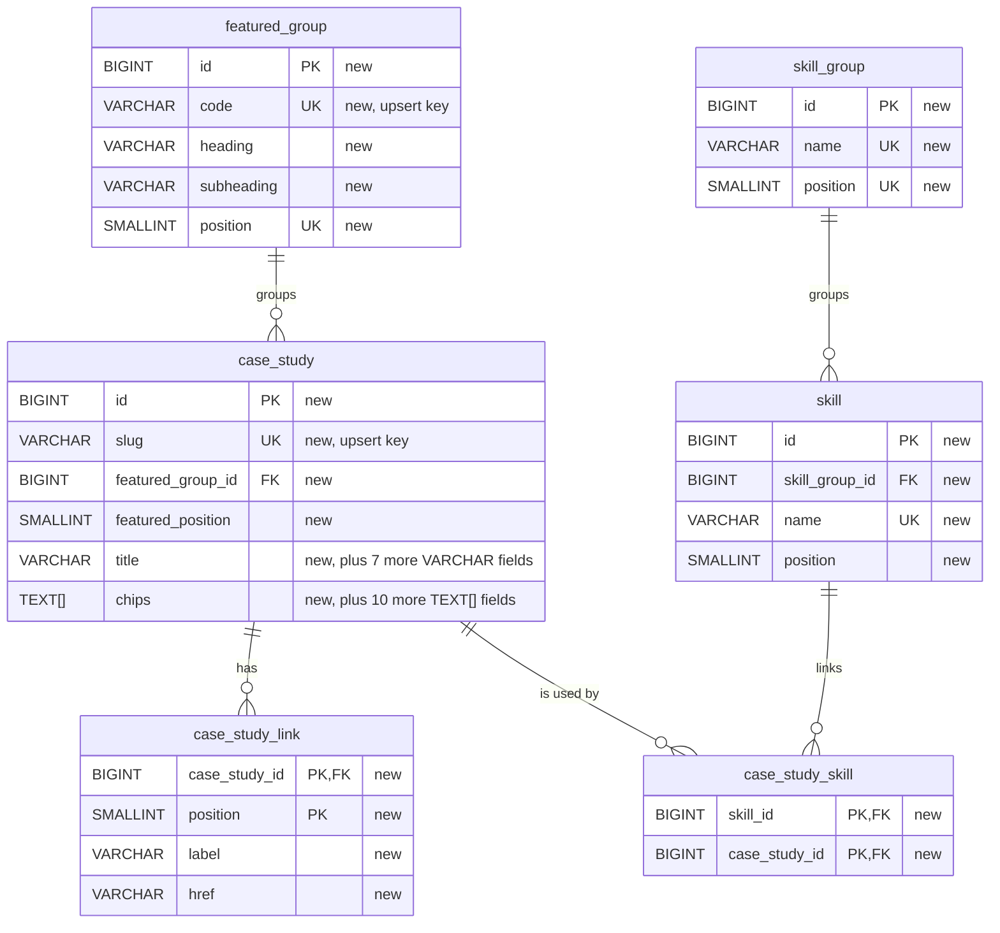
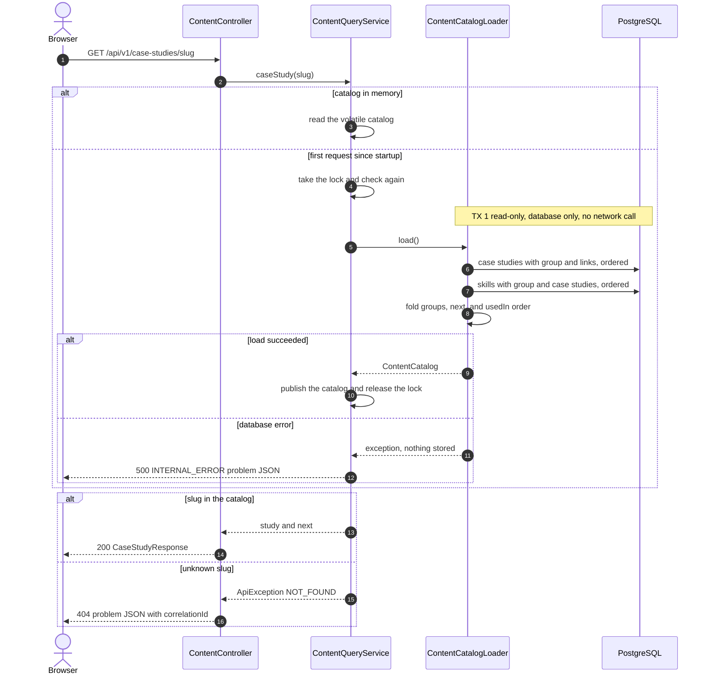
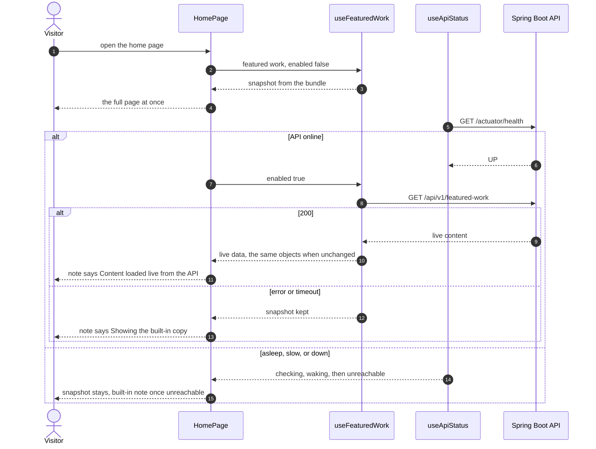
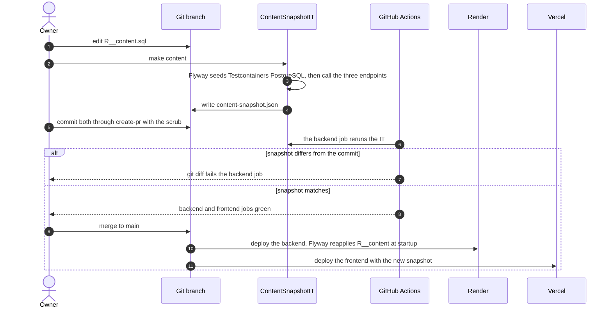

# PF-014 — Content API: case studies and skills served by the backend

**Ticket**: PF-014 · **Refined requirement**: [PF-014-refined-requirement.md](PF-014-refined-requirement.md) · **Packages**: backend and frontend · **Status**: Draft · **Last updated**: 2026-11-24

> ⚠️ **Review these flows first** — [F1 Catalog load and serve](#f1--catalog-load-and-serve) · [F2 Snapshot first, then live](#f2--snapshot-first-then-live) · [F3 Content change and drift check](#f3--content-change-and-drift-check)

## 1. Requirement summary

The backend becomes the source of truth for the seven case studies, the Featured work groups and their order, and the skill groups with their case-study links. The content lives in PostgreSQL tables seeded by Flyway and is served by three public `GET` endpoints from memory. The frontend renders a committed snapshot of those responses at once and swaps in the live API data when it answers, so SITE-001, Non-Negotiable 1, and the prerendered link previews (PF-009) hold unchanged. CI fails when the snapshot drifts from what the backend serves. The hero panel says where the content came from (D6), and the This Portfolio sentence about the API is updated (D7). Master plan: `portfolio-implementation-plan.md` §2 *Key decisions* (core content stays static for visitors; this ticket moves its source to the backend) and §5.1–§5.2 (three new API rows, six new tables).

## 2. Requirement analysis

| Need | Source | Backend work | Frontend work |
|---|---|---|---|
| Featured work groups in today's order | FR-1, AC-1, AC-13 | `featured_group`, `case_study`; `GET /api/v1/featured-work` | `useFeaturedWork`; `FeaturedWork` takes props |
| One case study by slug, 404 for an unknown slug | FR-2, AC-2, FR-13 | `GET /api/v1/case-studies/{slug}` with `next` | `useCaseStudy`; `CaseStudyArticle` reads `study.next` |
| Skill groups with their case-study links | FR-3, AC-12 | `skill_group`, `skill`, `case_study_skill`; `GET /api/v1/skills` | `useSkills`; `Skills` takes props, `usedIn` carries titles |
| Content in tables seeded by Flyway, verbatim | FR-4, D4, AC-7, AC-13 | `V20261124150000__create_content.sql`, `R__content.sql` | One-time parity check before the TS files are deleted |
| Committed snapshot | FR-5, D3 | `ContentSnapshotIT` writes it; `make content` | `content-snapshot.json`, typed against the generated OpenAPI schema |
| Snapshot first, then live | FR-6, AC-3, AC-4, NN1 | none | `initialData` from the snapshot; fetch once the API is online |
| Drift check in CI | FR-7, AC-5 | `backend.yml`: diff step, snapshot path in the path filter | none |
| Prerender unchanged | FR-8, AC-6 | none | `routeMeta` reads the snapshot |
| Panel note and API caption | FR-9, FR-12, AC-8, AC-10, D6 | none | `useContentSource`, two i18n keys, one changed caption |
| This Portfolio sentence | FR-10, AC-11, D7 | the sentence in `R__content.sql` | arrives through the snapshot |
| Answer from memory | FR-11, AC-9, NN8 | `ContentQueryService` loads the catalog once per process | none |
| Content edits only through git | D4, NN2 | no write endpoint; the content rule covers the seed file | none |

## 3. Current state

- Case studies: one TypeScript module each in `frontend/src/content/caseStudies/`, keyed by slug in `frontend/src/content/caseStudies/index.ts:12`; the slug union is `slugs.ts` and the shape is `types.ts` in the same folder.
- Featured work groups and the "next" rule: `frontend/src/content/featuredWork.ts:13` and `:30` (`nextInFeaturedOrder`, which wraps from the last study to the first).
- Skill groups with `usedIn` slugs: `frontend/src/content/skills.ts:25`; `frontend/src/sections/Skills.tsx` looks each title up in `caseStudies`.
- Prerender: `frontend/src/app/routeMeta.ts` (`prerenderedRoutes`) feeds `frontend/scripts/prerender.mjs`. The e2e smoke test `frontend/e2e/smoke.spec.ts` aborts every API call and checks a case-study route, its prerendered title, and the 404 page.
- Content-shape rules (three chips, one to three outcomes, three to five built items, known slugs, no empty strings) live in `frontend/src/content/content.test.ts`.
- Hero panel note: `frontend/src/features/api-status/SystemPanel.tsx:141`; its captions are in `frontend/src/i18n/en.ts:87`.
- Memo patterns: `StatsQueryService` (one-entry Caffeine cache) and `backend/src/main/java/com/huygialy/portfolio/project/ProjectQueryService.java:34` (a `ReentrantLock`, chosen because a cache loader's `synchronized` section pins a virtual thread's carrier on Java 21).
- Snapshot pattern: `OpenApiSnapshotIT` writes `backend/openapi/openapi.json`; `.github/workflows/backend.yml:36` fails on a diff; `make openapi` runs it (`Makefile:64`).
- Public GET paths: `backend/src/main/java/com/huygialy/portfolio/platform/security/SecurityConfig.java:31`. Error codes to reuse: `NOT_FOUND`, `INTERNAL_ERROR`.

## 4. Approach

The backend owns the data and the frontend owns the rendering. A versioned migration creates six tables, and a repeatable migration `R__content.sql` holds the full current text, so a content edit is a diff of one file. `ContentCatalogLoader` reads everything in one read-only transaction with two queries and folds the rows into an immutable `ContentCatalog`. `ContentQueryService` loads it once per process under a `ReentrantLock` and serves every request from memory. `ContentController` maps catalog entries to three response records. `ContentSnapshotIT` calls the three endpoints and writes the frontend snapshot, and the backend CI job fails when the committed file differs, the same mechanism as the OpenAPI snapshot. On the frontend, each resource has a TanStack Query hook whose `initialData` is the snapshot, so a page renders at once; the hook fetches once the API is online, and a successful response replaces the snapshot (structural sharing keeps the same objects when nothing changed, so an identical response causes no re-render).

Plan decisions:

- **P1.** Six tables: `featured_group`, `case_study`, `case_study_link`, `skill_group`, `skill`, `case_study_skill`. Paragraph and item lists are `TEXT[]` columns, so a case study is one row plus its links.
- **P2.** Seed in `R__content.sql`: upsert `featured_group` by `code` and `case_study` by `slug`, so their IDs stay stable for the foreign keys PF-017 and PF-021 will add; delete case studies no longer listed; fully replace the four tables nothing else references. Lookups use scalar subqueries, so a misspelled slug or skill name fails the migration on `NOT NULL` instead of silently dropping a row. Strings are dollar-quoted (`$$…$$`), so prose needs no escaping.
- **P3.** The endpoints are resources: `/featured-work` (summaries in groups), `/case-studies/{slug}` (the full study with `next`), and `/skills` (groups, with each skill's `usedIn` as slug and title, in Featured work order). The "next" rule moves to the backend.
- **P4.** The catalog loads lazily on the first content request and stays for the life of the process, because content only changes through a migration, and migrations only run at startup. A failed load is not stored. `ContentQueryService` is not transactional, so a memory hit never borrows a connection from the pool of 3; the transaction lives on the loader bean (backend guide principle 5, KNOWN-BE-006).
- **P5.** An unknown slug answers 404 `NOT_FOUND`. The path variable has no format validation: a malformed slug is simply unknown.
- **P6.** No rate limit and no HTTP caching on the three GETs: Non-Negotiable 4 covers public writes, and memory hits are cheap (see the alternatives).
- **P7.** The snapshot is `frontend/src/content/generated/content-snapshot.json`, written directly by `ContentSnapshotIT` (one hop, no copy script), listed in `frontend/.prettierignore`, and typed in TypeScript against `components['schemas']` from the generated API types, so a contract change the snapshot does not match is a compile error.
- **P8.** The frontend hooks take `enabled` from the caller (`api === 'online'`, as `useStatsSummary` does). `features/content` then imports nothing from `features/api-status`, and the two feature indexes cannot import each other in a cycle.
- **P9.** The case-study route knows only the snapshot's slugs: an unknown slug renders the 404 page without a request, and a 404 from the API for a slug the snapshot has keeps the snapshot (refined requirement §4).
- **P10. Needs approval.** The panel's content sentence appears once the API check has answered (online or unreachable), the same gate as today's "How this site is built" link. While the check runs or the API wakes, today's note already says the page works, and the long waking note keeps its length. FR-9 says "otherwise Showing the built-in copy."; read literally, that sentence would also show during checking and waking, which lengthens the note and risks the one-screen hero. On approval, FR-9 is refined to match.
- **P11.** The section intros `featuredWorkIntro` and `skillsIntro` stay in `featuredWork.ts` and `skills.ts`, which keep only those strings (D5).

| Alternative | Why not |
|---|---|
| Classpath JSON or YAML loaded into memory, no database | Simplest backend, but no foreign keys between skills and case studies, and nothing for PF-017 and PF-021 to join or reference: the backend would only serve files |
| A new versioned migration for each content edit | Immutable history, but the current text is spread across files of `UPDATE`s; the repeatable file keeps one readable source, and the snapshot shows the result |
| Delete and reinsert every table on each seed run | Simpler SQL, but case-study IDs would change with every edit and break the foreign keys PF-017 and PF-021 add |
| One `JSONB` body column per case study | Fewer columns, but Hibernate's JSON mapping with Jackson 3 is unverified here (KNOWN-BE-005), and `TEXT[]` with `cardinality` checks moves today's content-shape rules into the schema |
| The Vercel build fetches content from the production API | No committed copy, but the build then depends on Render being awake and deployed first |
| Render from the API behind skeletons | Rejected by the owner (D3) |
| Query the database on every request | Breaks FR-11: two queries per request on 0.1 CPU, plus Neon wake-ups |
| A Caffeine loader, as in `StatsQueryService` | On Java 21 the loader's `synchronized` section pins the carrier thread during the JDBC call; PF-007 chose a `ReentrantLock` for the same reason |
| `ETag` or `Cache-Control` on the GETs | Saves bandwidth only; the responses are small and come from memory. Add later if Render bandwidth matters |
| One bundle endpoint `GET /api/v1/content` | One call, but not a resource; the snapshot can be assembled from the three resources anyway |

**Reuse**: `ApiException` with `NOT_FOUND` and `GlobalExceptionHandler`; the public GET list in `SecurityConfig`; the `OpenApiSnapshotIT` pattern and the `backend.yml` diff step; `@IntegrationTest` with `RestTestClient`; the `ReentrantLock` memo shape of `ProjectQueryService`; on the frontend, `createApiClient`, `shouldRetryQuery` (no retry on 4xx), `useApiStatus`, `ChipList`, and the existing section and page markup as is.

**Single responsibility**: `ContentController` translates the three GETs. `ContentQueryService` serves the catalog from memory. `ContentCatalogLoader` builds the catalog from the database. `ContentCatalog` is the immutable, folded view. Each entity maps one table, read-only. `ContentSnapshotIT` writes the snapshot. Each frontend hook reads one resource. `useContentSource` derives where the page's content came from.

## 5. Backend

### Database

- `V20261124150000__create_content.sql`: additive; creates the six tables. No backfill.
- `R__content.sql`: repeatable; Flyway reruns it after the versioned migrations whenever its checksum changes, inside one transaction. A broken seed therefore leaves the previous content in place and fails startup (and CI) instead of applying halfway.

The `VARCHAR` bounds below have headroom over today's longest values; `/dev` measures each field before writing the migration (risk table).

| Table.column | SQL type | Null | Default or constraint | Why |
|---|---|---|---|---|
| `featured_group.id` | `BIGINT GENERATED ALWAYS AS IDENTITY` | no | PK | key convention |
| `featured_group.code` | `VARCHAR(32)` | no | `UNIQUE`, `CHECK (code ~ '^[a-z0-9-]{1,32}$')` | stable upsert key that survives a heading change (`employer`, `personal`); never served |
| `featured_group.heading` | `VARCHAR(80)` | no | | group heading |
| `featured_group.subheading` | `VARCHAR(160)` | no | | group subheading |
| `featured_group.position` | `SMALLINT` | no | `CHECK (position > 0)`, `UNIQUE DEFERRABLE INITIALLY DEFERRED` | group order; deferred so a reorder in one seed run does not collide mid-statement |
| `case_study.id` | `BIGINT GENERATED ALWAYS AS IDENTITY` | no | PK | stays stable across seed runs (upsert by slug) for PF-017 and PF-021 |
| `case_study.slug` | `VARCHAR(64)` | no | `UNIQUE`, `CHECK (slug ~ '^[a-z0-9]+(-[a-z0-9]+)*$')` | route key `/work/<slug>`; not deferrable, because it is the `ON CONFLICT` arbiter |
| `case_study.featured_group_id` | `BIGINT` | no | FK → `featured_group(id)` | its Featured work group |
| `case_study.featured_position` | `SMALLINT` | no | `CHECK (featured_position > 0)`; `UNIQUE (featured_group_id, featured_position) DEFERRABLE INITIALLY DEFERRED` | order within the group, which also sets `next` and the `usedIn` order |
| `case_study.title` | `VARCHAR(120)` | no | | page and row title |
| `case_study.meta_description` | `VARCHAR(200)` | no | | route meta description |
| `case_study.angle` | `VARCHAR(300)` | no | | the line under the title |
| `case_study.role` | `VARCHAR(200)` | no | | role line |
| `case_study.problem_line`, `outcome_line` | `VARCHAR(300)` | no | | Featured work row |
| `case_study.period` | `VARCHAR(60)` | no | | At a glance |
| `case_study.team` | `VARCHAR(200)` | no | | At a glance |
| `case_study.chips` | `TEXT[]` | no | `CHECK (cardinality(chips) = 3)` | three row chips; the rule moves here from `content.test.ts` |
| `case_study.stack`, `tech` | `TEXT[]` | no | `CHECK (cardinality(…) >= 1)` each | At a glance stack; closing tech list |
| `case_study.outcomes` | `TEXT[]` | no | `CHECK (cardinality(outcomes) BETWEEN 1 AND 3)` | At a glance outcomes |
| `case_study.context`, `problem`, `role_and_scope`, `outcome` | `TEXT[]` | no | `CHECK (cardinality(…) >= 1)` each | page sections, one element per paragraph |
| `case_study.built` | `TEXT[]` | no | `CHECK (cardinality(built) BETWEEN 3 AND 5)` | "What I built" items |
| `case_study.deep_dive_topic` | `VARCHAR(160)` | yes | `CHECK ((deep_dive_topic IS NULL) = (deep_dive IS NULL))` | absent when the study has no published deep dive; held Tier B stays absent |
| `case_study.deep_dive` | `TEXT[]` | yes | the same check | deep-dive paragraphs |
| `case_study.learned` | `TEXT[]` | yes | | absent when the study has no published lesson |
| `case_study_link.case_study_id` | `BIGINT` | no | PK part; FK → `case_study(id) ON DELETE CASCADE` | the study it belongs to |
| `case_study_link.position` | `SMALLINT` | no | PK part; `CHECK (position > 0)` | link order |
| `case_study_link.label` | `VARCHAR(80)` | no | | link text |
| `case_study_link.href` | `VARCHAR(500)` | no | `CHECK (href ~ '^https://')` | public HTTPS links only |
| `skill_group.id` | `BIGINT GENERATED ALWAYS AS IDENTITY` | no | PK | |
| `skill_group.name` | `VARCHAR(60)` | no | `UNIQUE` | group name |
| `skill_group.position` | `SMALLINT` | no | `UNIQUE`, `CHECK (position > 0)` | group order |
| `skill.id` | `BIGINT GENERATED ALWAYS AS IDENTITY` | no | PK | |
| `skill.skill_group_id` | `BIGINT` | no | FK → `skill_group(id) ON DELETE CASCADE` | its group |
| `skill.name` | `VARCHAR(80)` | no | `UNIQUE` | lookup key for the link rows; no name repeats across groups today |
| `skill.position` | `SMALLINT` | no | `CHECK (position > 0)`; `UNIQUE (skill_group_id, position)` | order within the group |
| `case_study_skill.skill_id` | `BIGINT` | no | PK part; FK → `skill(id) ON DELETE CASCADE` | |
| `case_study_skill.case_study_id` | `BIGINT` | no | PK part; FK → `case_study(id) ON DELETE CASCADE` | |

**Constraints and indexes**: the unique constraints create the only indexes needed: `case_study.slug` and `featured_group.code` serve the upserts. The catalog reads every row of these small tables (7 case studies, about 60 skills) with no `WHERE` clause, so no other index is added. The `case_study_skill` primary key `(skill_id, case_study_id)` serves the skills join; a cascade from `case_study` scans it by `case_study_id`, which is fine at this size. The position uniques that the upsert can reorder are deferred; `slug` and `code` are not, because a deferrable constraint cannot be an `ON CONFLICT` arbiter. **Personal data**: none; every column is public portfolio copy. No column holds an IP address, a user-agent string, or a referrer URL (Non-Negotiable 3).

**Seed shape** (`R__content.sql`), in order:

1. Upsert the `featured_group` rows by `code`.
2. Upsert the `case_study` rows by `slug`, with `featured_group_id` as `(SELECT id FROM featured_group WHERE code = …)`.
3. Delete case studies whose slug is not listed (`slug <> ALL (ARRAY[…])`); their links cascade.
4. Replace `case_study_link`: delete all rows, insert with slug subqueries.
5. Replace `skill_group`, `skill`, and `case_study_skill`: delete all, insert; each link row resolves both ends by subquery, so a typo fails `NOT NULL`.
6. Delete `featured_group` rows whose code is not listed.

### Domain

Read-only content: no states, no transitions, no validator. The entities are `@Immutable` (Hibernate), with a protected no-argument constructor and getters only:

- `FeaturedGroupEntity`.
- `CaseStudyEntity`: `@ManyToOne` group; links as an `@ElementCollection` list of the nested embeddable `CaseStudyEntity.Link` with `@OrderColumn(name = "position")` and `@ListIndexBase(1)`; the `TEXT[]` fields as `List<String>`.
- `SkillGroupEntity`.
- `SkillEntity`: `@ManyToOne` group; `@ManyToMany` case studies through `case_study_skill`, as a `Set`.

`ContentCatalog` is a record with nested records: `FeaturedGroup(heading, subheading, List<CaseStudyEntity> caseStudies)`, `SkillGroup(name, List<Skill> skills)`, `Skill(name, List<CaseStudyEntity> usedIn)`, plus a map from slug to `Entry(CaseStudyEntity study, CaseStudyEntity next)`. Fold rules: case studies are ordered by group position, then featured position; `next` is the following study in that order, and the last wraps to the first (today's `nextInFeaturedOrder`); each skill's `usedIn` follows the same order; a skill with no case study keeps an empty list.

### Services

| Unit | Responsibility | Transaction |
|---|---|---|
| `ContentController` (`content.api`) | `GET /api/v1/featured-work`, `/case-studies/{slug}`, `/skills`; maps catalog entries to responses | none |
| `ContentQueryService` | Holds the catalog in a `volatile` field; the first call loads it under a `ReentrantLock` (checked again inside the lock); a failed load stores nothing; `caseStudy(slug)` throws `ApiException(NOT_FOUND)` for an unknown slug | none, on purpose: a memory hit borrows no connection |
| `ContentCatalogLoader` | Runs the two catalog queries and folds the rows into `ContentCatalog` | `@Transactional(readOnly = true)`; one transaction, database only |
| `CaseStudyRepository.findAllForCatalog()` | Case studies `join fetch` group, `left join fetch` links, ordered by group position, then featured position | read |
| `SkillRepository.findAllForCatalog()` | Skills `join fetch` group, `left join fetch` case studies, ordered by group position, then skill position | read |
| `FeaturedWorkResponse`, `CaseStudyResponse`, `SkillsResponse`, `CaseStudyRefResponse` | API records with `static from(...)`; nested types live inside their record (backend guide principle 3); `CaseStudyRefResponse` (`slug`, `title`) is its own file because two responses use it | — |

The entities are detached when the loader's transaction ends, so the two fetch joins must initialize every association the controller maps; nothing is loaded lazily afterwards.

### API

Every response field is marked required in OpenAPI, and `deepDive` and `learned` are marked nullable, as `ProjectListResponse` does, so the generated TypeScript types are exact.

| Method and path | Rate limit | Success | Errors (code → status) |
|---|---|---|---|
| `GET /api/v1/featured-work` | none (public read; Non-Negotiable 4 covers writes) | 200 `{ groups: [{ heading, subheading, items: [summary] }] }`, where a summary has the fields `WorkRow` reads today (`slug`, `title`, `role`, `problemLine`, `outcomeLine`, `chips`) | `INTERNAL_ERROR` → 500 when the first load fails |
| `GET /api/v1/case-studies/{slug}` | none | 200 every field of today's `CaseStudy` type, with `links: [{ label, href }]`, `deepDive: { topic, paragraphs }` or `null`, `learned` or `null`, and `next: { slug, title }` | `NOT_FOUND` → 404; `INTERNAL_ERROR` → 500 |
| `GET /api/v1/skills` | none | 200 `{ groups: [{ name, skills: [{ name, usedIn: [{ slug, title }] }] }] }` | `INTERNAL_ERROR` → 500 |

The three paths join the public GET list in `SecurityConfig`; CORS already allows `GET` from the configured origins. The OpenAPI description in `OpenApiConfig` adds "portfolio content". `make openapi` regenerates the OpenAPI snapshot and the frontend types.

### Failure modes

| Failure | Behavior | Test |
|---|---|---|
| Database down on the first content request | The loader throws; `GlobalExceptionHandler` answers 500 `INTERNAL_ERROR`; nothing is stored, so the next request retries; the frontend keeps the snapshot | `ContentQueryServiceTest`: a failed load is retried on the next call |
| Database down after the catalog loaded | Content still answers 200 from memory | none |
| Concurrent first requests | One load under the lock; the others wait and reuse it | `ContentQueryServiceTest`: two calls, one load |
| Unknown slug | 404 `NOT_FOUND` with the `correlationId` | `ContentApiIT` |
| Broken seed (a misspelled key, a value over its bound, a failed check) | Flyway fails and the app does not start, so `testIT` fails in CI before merge; in production the previous deploy keeps serving | every `testIT` run |
| Seed changed, snapshot not regenerated | The `backend.yml` diff step fails | CI |
| Snapshot edited by hand | The snapshot path is in `backend.yml`'s path filter, so the backend job runs and its diff fails | CI |
| API asleep, slow, or down | Pages show the snapshot; the panel note says built-in once the check answers | frontend hook test; e2e smoke (every API call aborted) |
| API answers 404 for a slug the snapshot has | The snapshot stays (no retry on 4xx; TanStack Query keeps data on error) | frontend hook test |
| Frontend deployed before the backend has these endpoints, or before the first backend deploy (PF-012) | Same as the API being down | covered above |

No external provider is called, so there is no provider timeout row.

## 6. Frontend

### Components and routes

- `RootLayout` (reused)
  - `HomePage` (changed: reads `useApiStatus`, `useFeaturedWork(enabled)`, and `useSkills(enabled)`, and passes the data down)
    - `Hero` → `ProofPoints` (changed: `caseStudyPath` from `features/content`) and `SystemPanel` (changed: content sentence, API caption)
    - `FeaturedWork` (changed: `groups` prop) → `WorkRow` (changed: takes a summary)
    - `Skills` (changed: `groups` prop; `usedIn` carries titles, so the lookup goes)
  - `CaseStudyPage` (changed: `useCaseStudy(slug, enabled)`) → `CaseStudyArticle` (changed: reads `study.next`) → `GlanceAside` (type change only)
- New `src/features/content/`: `snapshot.ts` (typed import of the JSON and a lookup by slug), `api.ts`, `queries.ts` (`contentKeys`, `useFeaturedWork`, `useSkills`, `useCaseStudy`, `useContentSource`), `paths.ts` (`caseStudyPath`), `index.ts`.
- New `src/content/generated/content-snapshot.json`: generated, committed, prettier-ignored.
- Removed: `src/content/caseStudies/` (nine files); the groups and `nextInFeaturedOrder` from `featuredWork.ts`; the groups from `skills.ts`.
- `src/app/routeMeta.ts` reads the snapshot. Routes, titles, meta descriptions, and the sitemap do not change.

### Content

| Block | Source | Tier | Status |
|---|---|---|---|
| Seven case studies, every field | Today's text in `frontend/src/content/caseStudies/*.ts` (the owner-reviewed content pack shipped in PF-012), moved verbatim into `R__content.sql` | A, plus the Tier B items approved in PF-012; held Tier B stays absent | reviewed |
| Featured work group headings and subheadings | `featuredWork.ts`, verbatim | A | reviewed |
| Skill groups, skills, and their case-study links | `skills.ts`, verbatim | A | reviewed |
| This Portfolio, Context paragraph, sentence 2 (D7) | Proposed: "The API serves the case studies and skills, a visit counter and the contact form." It describes this site as PF-014 builds it | A (personal project) | draft: needs approval |
| Panel note, live (D6) | Proposed: "Content loaded live from the API." (`apiStatus.note.contentLive`) | UI string | draft: needs approval |
| Panel note, built-in (D6) | Proposed: "Showing the built-in copy." (`apiStatus.note.contentSnapshot`) | UI string | draft: needs approval |
| API row caption (D6) | Proposed: "Serves content, visits, contact" (replaces "Render free tier, sleeps when idle") | UI string | draft: needs approval |
| Database row caption (optional, new) | Proposed: "Neon, stores content, visits and messages" (today "Neon, stores visits and messages", which becomes incomplete) | UI string | proposal; default: keep today's text unless approved |
| This Portfolio, "Static-first content" built item | Unchanged by default: still true, because every page renders from a typed snapshot bundled into the frontend | A | reviewed; flagged only |

### Data and states

| View | Hook and query key | Endpoint | Loading | Fallback | Error |
|---|---|---|---|---|---|
| Featured work | `useFeaturedWork(enabled)`, `contentKeys.featuredWork()` | `GET /api/v1/featured-work` | none: the snapshot shows at once | snapshot | snapshot kept, no message |
| Skills | `useSkills(enabled)`, `contentKeys.skills()` | `GET /api/v1/skills` | none | snapshot | snapshot kept |
| Case-study page | `useCaseStudy(slug, enabled)`, `contentKeys.caseStudy(slug)` | `GET /api/v1/case-studies/{slug}` | none; a slug missing from the snapshot renders the 404 page with no request | snapshot | a 404 or 5xx keeps the snapshot |
| Panel content sentence | `useContentSource(enabled)`, derived from the featured-work query | — | hidden until the API check answers (P10) | "Showing the built-in copy." | the same |

Each hook passes `initialData` from the snapshot with `initialDataUpdatedAt: 0`, so the data counts as stale and is fetched as soon as `enabled` turns true; `enabled` is `api === 'online'`. `useContentSource` returns `live` when the featured-work query's `dataUpdatedAt` is above 0 (a fetch succeeded), and `snapshot` otherwise. The note keeps a reserved height for its longest variant, so the sentence appearing never shifts the layout (frontend guide principle 5).

### Test IDs

| Element | Test ID | Purpose |
|---|---|---|
| Panel content sentence | `TestIds.apiStatus.contentNote` = `api-status-content-note` | Assert the live versus built-in wording |

## 7. Complex flows

### F1 — Catalog load and serve

> ⚠️ **Review this flow** — `ContentQueryService.caseStudy()` → `ContentCatalogLoader.load()`: one lock, two queries in one read-only transaction, then a fold in memory. `featuredWork()` and `skills()` take the same path.

1–2. The controller only delegates (backend guide principle 1).
3. A memory hit returns at once and borrows no database connection (FR-11, AC-9, P4).
4. The first request takes the lock and checks again, so concurrent first requests load once.
5–7. One read-only transaction with two fetch-join queries initializes everything the controller maps, because the entities are detached afterwards.
8. The fold groups the case studies, computes `next` with wrap-around (FR-13), and orders each skill's `usedIn` by Featured work order.
9–10. Publishing the immutable catalog through a `volatile` field makes it visible to every thread; the lock is released in a `finally` block.
11–12. A failed load stores nothing, so the next request retries (failure-modes row 1); the handler renders the problem JSON (Non-Negotiable 5).
13–16. A known slug returns the study; an unknown one returns 404 (FR-2, AC-2).

**Simplest alternative**: query the database on every request, with no memo. That drops the lock, the loader, and the catalog, but costs two queries per request on 0.1 CPU plus Neon wake-ups, and breaks FR-11.

### F2 — Snapshot first, then live

> ⚠️ **Review this flow** — `HomePage` with `useFeaturedWork`, `useApiStatus`, and `useContentSource`: the content's source switches from the snapshot to the API, and the panel note follows a four-row decision table. `useSkills` and `useCaseStudy` follow the same path.

1–4. The snapshot is bundled, so the page renders completely before any request (FR-6, AC-3, Non-Negotiable 1).
5–7. The health check gates the content requests, as it gates the footer counter (P8, PF-005 D2), so a sleeping API is not hit with extra requests.
8–9. One request per resource; a 4xx is never retried (`shouldRetryQuery`).
10–12. Live data replaces the snapshot (AC-4); structural sharing means an identical response re-renders nothing.
13–14. Any failure keeps the snapshot with no message (refined requirement §4).
15–16. While the API wakes, today's note explains the wait; the content sentence appears once the check answers (P10).

| API check | Featured-work query | Content sentence in the note |
|---|---|---|
| checking or waking | not enabled | none; today's note already says the page works (P10) |
| unreachable | not enabled | "Showing the built-in copy." |
| online | in flight or failed | "Showing the built-in copy." |
| online | succeeded | "Content loaded live from the API." |

**Simplest alternative**: render the snapshot only and never call the content API at runtime. No hook logic, but visitors never see API content and the panel note has nothing true to report (breaks FR-6 and D6).

### F3 — Content change and drift check

> ⚠️ **Review this flow** — the process that spans an edit, CI, and two deploys: `R__content.sql` → `ContentSnapshotIT` → the `backend.yml` diff step → Render and Vercel.

1. Every content edit is a diff of one SQL file (D4, P2).
2–4. The snapshot is exactly what the API returns from the seeded database, so the two cannot disagree at the moment of writing.
5. The commit carries both files, and `/create-pr` scrubs the staged diff for Tier C (Non-Negotiable 2).
6–8. CI regenerates the snapshot and fails when it differs from the committed one (FR-7, AC-5), as it does for the OpenAPI snapshot.
9–11. Both packages deploy from the same merge. If the frontend goes live first, visitors see the new snapshot while the old API still answers, and live data replaces it once the backend is up. The backend's first deploy is still PF-012's.

**Simplest alternative**: no drift check, trusting the author to run `make content`. That saves a CI step, but the snapshot and the API could disagree silently (breaks FR-7).

## 8. Files, order, risks, tests

**New**:

- Backend: `backend/src/main/resources/db/migration/V20261124150000__create_content.sql`, `backend/src/main/resources/db/migration/R__content.sql`; in `backend/src/main/java/com/huygialy/portfolio/content/`: `ContentQueryService`, `ContentCatalogLoader`, `ContentCatalog`, `CaseStudyEntity`, `FeaturedGroupEntity`, `SkillGroupEntity`, `SkillEntity`, `CaseStudyRepository`, `SkillRepository`; in `content/api/`: `ContentController`, `FeaturedWorkResponse`, `CaseStudyResponse`, `SkillsResponse`, `CaseStudyRefResponse`. Tests in `backend/src/test/java/com/huygialy/portfolio/content/`: `ContentApiIT`, `ContentSnapshotIT`, `ContentQueryServiceTest`.
- Frontend: `frontend/src/content/generated/content-snapshot.json`; `frontend/src/features/content/` (`snapshot.ts`, `api.ts`, `queries.ts`, `paths.ts`, `index.ts`, `queries.test.tsx`).

**Modified**:

- Backend and build: `SecurityConfig.java`, `OpenApiConfig.java`, `backend/openapi/openapi.json`, `Makefile` (`content` target), `.github/workflows/backend.yml` (snapshot path in the path filter, diff step).
- Frontend: `src/api/schema.d.ts`, `src/pages/HomePage.tsx`, `src/pages/CaseStudyPage.tsx`, `src/pages/CaseStudyArticle.tsx`, `src/pages/GlanceAside.tsx`, `src/sections/FeaturedWork.tsx`, `src/sections/WorkRow.tsx`, `src/sections/Skills.tsx`, `src/sections/ProofPoints.tsx`, `src/features/api-status/SystemPanel.tsx`, `src/app/routeMeta.ts`, `src/content/featuredWork.ts`, `src/content/skills.ts`, `src/content/profile.ts` (slug type), `src/content/content.test.ts`, `src/i18n/en.ts`, `src/config/test-ids.config.ts`, `frontend/.prettierignore`, and the tests named below. Deleted: `src/content/caseStudies/` (nine files).
- Docs: `CLAUDE.md` (Non-Negotiable 1 and the project table), `README.md` (architecture paragraph and decisions), `docs/architecture/backend.md` (Key Services row, a *Content (PF-014)* domain section), `docs/architecture/frontend.md` (principles 3 and 4, Key Directories), `docs/architecture/overview.md` (components, resilience), `docs/product/product-guide.md` (SITE-001, one clause; needs approval), `.claude/rules/content-conventions.md` (adds the seed path), `docs/plans/README.md` (the `content` domain), `docs/prd/backlog.md` (PF-014 to PF-020; next free ID PF-021), `docs/knowledge/` (the Hibernate array mapping, once verified).

Proposed wording for the two rule texts, approved with this plan:

- Non-Negotiable 1, second sentence: "Portfolio content is static in `frontend/src/content/`: the case studies and skills there are a snapshot generated from the backend's content API (PF-014), and the rest is typed copy."
- SITE-001, first sentence: "Every route renders its content from static files; the case studies and skills come from a snapshot of the content API (PF-014)."

**New dependencies**: none. Hibernate, Flyway, and the frontend libraries are already in use; Caffeine is not used here.

**Order** (four slices, each one sitting):

1. **Case studies from the API (backend).** Contract first: the migration, the entities, the response records, then the `ContentCatalog`, loader, query service, and controller signatures. Then the seed for groups, case studies, and links, generated once from the TypeScript objects with a throwaway script in the scratchpad (never committed); the implementation; the `SecurityConfig` paths. Demo: `curl /api/v1/featured-work` and `/api/v1/case-studies/this-site`.
2. **Skills and the snapshot (backend).** The skills seed and `/skills`; `ContentSnapshotIT`; `make content`; `backend.yml`; `make openapi`. Demo: `make content` writes the snapshot.
3. **The frontend reads the snapshot and the API.** `pnpm gen:api` → `features/content` → pages and sections → `routeMeta` → parity check → delete the TypeScript content. The parity check is a temporary test that deep-compares the snapshot with today's TypeScript objects and must show zero differences; it is deleted with those files, and its result goes in the PROGRESS doc and the PR description. Demo: with the backend off, the site looks identical; with it on, the network tab shows the content calls.
4. **Panel note, copy, docs.** The i18n keys and `SystemPanel`; the D7 sentence in `R__content.sql`, then `make content`; the docs listed above.

| Risk | Mitigation |
|---|---|
| Hibernate's mapping of `List<String>` to `text[]` must pass `ddl-auto: validate` | Verify on slice 1's first IT run; fallback `@JdbcTypeCode(SqlTypes.ARRAY)`; record the result in `docs/knowledge/` |
| `@OrderColumn` counts from 0, but `case_study_link.position` checks `> 0` | `@ListIndexBase(1)` on the links list |
| Copy changes while transcribing to SQL | Generate the seed from the TypeScript objects with a throwaway script; the parity check must show zero differences before the TypeScript files go |
| A `VARCHAR` bound is too small for today's text | Measure each field's longest value before writing the migration |
| The note grows and the hero no longer fits one screen, or the note shifts the layout | P10 keeps the waking note's length; reserve the note's height for its longest variant; check the hero at the PF-012 viewport in the browser |
| Two feature indexes import each other | P8: the hooks take `enabled`; `features/content` imports nothing from `features/api-status` |
| `ContentSnapshotIT` writes outside `backend/` | The CI job already checks out the whole repository with working directory `backend`; the path is one constant with a comment |
| The bundle grows | The same text as today's modules, now as JSON; compare the `dist` sizes before and after |
| The SSR prerender build reads JSON | Vite handles JSON imports in SSR builds; the e2e prerender test proves it |
| Non-Negotiable 1 wording drifts from reality | Slice 4 amends Non-Negotiable 1, SITE-001 (on approval), and the guides |

**Tests** (within the test budget):

- Slice 1. `ContentApiIT` (`testIT`; gates: endpoint, repository query, migration): featured work returns 200 with two groups and seven summaries in today's order; `this-site` returns 200 with its link and `next` = `smart-pole`; `smart-pole`, the last study, wraps to `ai-assessment-integration`; `client-intake-platform` returns `deepDive: null`; an unknown slug returns 404 `NOT_FOUND` with a `correlationId` (AC-1, AC-2, AC-12, AC-13). `ContentQueryServiceTest` (`testUnit`, stub loader): two calls load once; a failed load is retried on the next call (AC-9, failure-modes rows 1 and 3).
- Slice 2. `ContentApiIT`: skills returns 200 with the groups in order, a skill with no case study has `usedIn: []`, and one skill's `usedIn` is in Featured work order with titles (AC-1, AC-12). `ContentSnapshotIT` writes the snapshot; the CI diff is its assertion (AC-5), as with `OpenApiSnapshotIT`.
- Slice 3. `features/content/queries.test.tsx` (MSW): disabled returns the snapshot with no request; enabled with a 200 carrying a changed title returns the live data, and `useContentSource` says live; enabled with a 503 keeps the snapshot, and the source says snapshot; `useCaseStudy` keeps the snapshot when the API answers 404 for a snapshot slug (AC-3, AC-4). Updated: `CaseStudyPage.test.tsx` (a known slug renders from the snapshot with the API down; an unknown slug renders the 404 page), `HomePage.test.tsx`, `routeMeta.test.ts` (seven prerendered routes from the snapshot, AC-6), `routes.test.tsx`, `content.test.ts` (every proof-point slug exists in the snapshot, no empty strings in the snapshot, each case study appears once across the groups). The e2e smoke suite stays unchanged and proves AC-3 and AC-6 with every API call aborted. The temporary parity test proves AC-7 and AC-13.
- Slice 4. `SystemPanel.test.tsx`: no content sentence while checking; the built-in sentence when unreachable; the live sentence after the featured-work fetch succeeds; the approved caption (AC-8, AC-10). The regenerated snapshot carries the D7 sentence through the API and the prerendered page (AC-11).
