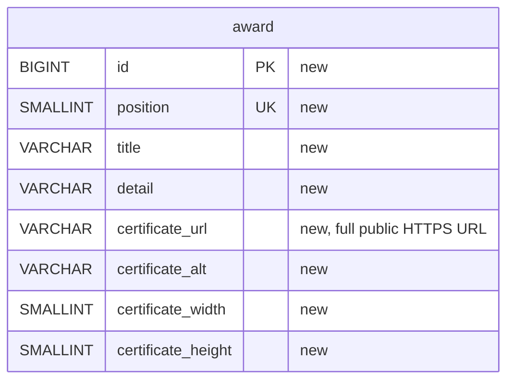

# PF-020 — Award certificates in object storage, awards served by the backend

**Ticket**: PF-020 · **Refined requirement**: [PF-020-refined-requirement.md](PF-020-refined-requirement.md) · **Packages**: backend and frontend · **Depends on**: [PF-014](PF-014-content-api.md) (content API, catalog, snapshot) · **Status**: Dropped · **Last updated**: 2026-11-24

> **Dropped on 2026-11-25** (PF-029 D1): portfolio content stays in the frontend, as [ADR 0001](../../architecture/adr/0001-where-data-lives.md) records. This document is kept for the record and is not to be built.

> ⚠️ **Review these flows first** — No new complex flows: the awards query joins PF-014's [F1 Catalog load and serve](PF-014-content-api.md#f1--catalog-load-and-serve) as a third query in the same read-only transaction, and the awards ride PF-014's [F2](PF-014-content-api.md#f2--snapshot-first-then-live) and [F3](PF-014-content-api.md#f3--content-change-and-drift-check) unchanged.

## 1. Requirement summary

The three award certificate images move from the frontend bundle to a public Cloudflare R2 bucket, and the awards list (title, detail line, certificate URL, alt text, size) moves to PostgreSQL behind PF-014's content API as `GET /api/v1/awards`. The awards join the committed content snapshot, so the Education section still renders at once with the API asleep (SITE-001, Non-Negotiable 1), and each certificate URL in the snapshot points at the bucket, so the images load without the API. A dialog whose image fails to load shows the alt text. Degrees stay in the frontend (PF-019). Every detail is a best-practice default the owner may override at approval (refined requirement D1 to D5).

## 2. Requirement analysis

| Need | Source | Backend work | Frontend work |
|---|---|---|---|
| Awards in today's order with certificate data | FR-1, AC-1 | `award` table; `GET /api/v1/awards` | `useAwards` |
| Seeded verbatim, full public URLs | FR-2, D3, D5 | `V20261124160000__create_award.sql`; award rows in `R__content.sql` | none |
| Snapshot and drift check cover the awards | FR-3, AC-6 | `ContentSnapshotIT` adds `awards` | the snapshot type gains `awards` |
| Snapshot first, then live | FR-4, AC-2 | none | `Education` takes `awards` from `HomePage` |
| Image from the bucket, no layout shift | FR-5, AC-3 | none | `CertificateViewer` uses `certificate.url` with width and height |
| Bucket unreachable | FR-6, AC-4 | none | `CertificateViewer` shows the alt text on an image error |
| Files leave the bundle | FR-7, AC-5, D4 | none | delete `src/assets/certificates/` |
| No text changes | FR-8, NN2 | seed verbatim | none |
| From memory | FR-9, NN8 | the catalog holds the awards | none |
| Bucket on the free tier, no credentials | D2, D3, NN8 | no SDK, no secret | no `VITE_` variable |

## 3. Current state

- Awards and their certificates: `frontend/src/content/education.ts` (`awards`, each with `certificate: { src, alt, width, height }`, `src` imported from `frontend/src/assets/certificates/*.webp`, about 240 KB in total).
- The dialog: `CertificateViewer` in `frontend/src/sections/Education.tsx:16`, a native `<dialog>` with an `` that has explicit `width` and `height`.
- PF-014 (planned) provides `ContentCatalogLoader`, `ContentQueryService`, `ContentController`, `R__content.sql`, `ContentSnapshotIT`, and `features/content`. This plan extends each of them; it adds no new mechanism.
- `frontend/vercel.json` sets no `Content-Security-Policy`, so an image from another origin needs no header change.

## 4. Approach

Awards are content, so they follow PF-014's path end to end: one more table, one more seed block, one more query in the catalog load, one more endpoint on `ContentController`, one more key in the snapshot, one more hook. The images live in a public R2 bucket, and each award row stores the full HTTPS URL. A URL composed from a configured base address was rejected: the snapshot is written by an integration test, and its URLs must be the production ones, which a full URL in the seed guarantees by construction. The owner creates the bucket and uploads the files once (agents never touch hosting accounts, `.claude/rules/security.md`).

| Alternative | Why not |
|---|---|
| Base URL in `app.*` configuration plus an object key in the seed | The test profile writes the snapshot, so its base URL would have to equal production's; a full URL in the seed is correct by construction, and a domain change is a seed edit |
| Signed URLs from a private bucket | Needs an S3 SDK (memory on 512 MB) and a secret on Render, and a snapshot cannot hold URLs that expire, so images would break while the API sleeps (refined requirement D3) |
| Keep the images in the bundle and move only the awards text | Leaves the owner's request undone |
| A CI job that syncs the files to the bucket | Needs a bucket write token as a repository secret, for three files that rarely change (D4) |
| AWS S3 or Supabase Storage | S3's free tier lasts 12 months; Supabase means another account with 1 GB (D2) |

**Reuse**: everything PF-014 builds, plus `CertificateViewer` and its dialog. **Single responsibility**: `AwardEntity` maps the `award` table; `AwardRepository` reads it in order; `AwardsResponse` is the API record; `useAwards` reads one resource; `CertificateViewer` additionally owns its image's fallback.

## 5. Backend

### Database

- `V20261124160000__create_award.sql`: additive; creates `award`. No backfill.
- `R__content.sql`: a new last block replaces the award rows (delete all, insert), because nothing references them.

| Table.column | SQL type | Null | Default or constraint | Why |
|---|---|---|---|---|
| `award.id` | `BIGINT GENERATED ALWAYS AS IDENTITY` | no | PK | key convention |
| `award.position` | `SMALLINT` | no | `UNIQUE`, `CHECK (position > 0)` | today's order |
| `award.title` | `VARCHAR(160)` | no | | award title |
| `award.detail` | `VARCHAR(160)` | no | | issuer or date line |
| `award.certificate_url` | `VARCHAR(500)` | yes | `CHECK (certificate_url ~ '^https://')` | the image's public bucket URL |
| `award.certificate_alt` | `VARCHAR(300)` | yes | | image alt text, also the fallback text |
| `award.certificate_width`, `certificate_height` | `SMALLINT` | yes | `CHECK (… > 0)` each | intrinsic size, so the dialog reserves its space |
| (table) | | | `CHECK (num_nulls(certificate_url, certificate_alt, certificate_width, certificate_height) IN (0, 4))` | a certificate is all four fields or none |

**Constraints and indexes**: the `position` unique constraint is the only index; the catalog reads all three rows. **Personal data**: none. The certificates were checked for personal data and approved for publication in PF-012, and no column holds an IP address, a user-agent string, or a referrer URL (Non-Negotiable 3).

### Domain and services

- `AwardEntity`: `@Immutable`; the certificate is a nested `@Embeddable` `AwardEntity.Certificate`, which Hibernate returns as `null` when all four columns are null (the check guarantees all or none).
- `AwardRepository.findAllByOrderByPositionAsc()`: read.
- `ContentCatalogLoader.load()`: a third query in the same read-only transaction; `ContentCatalog` gains `List<AwardEntity> awards`.
- `ContentController`: `GET /api/v1/awards` through `ContentQueryService.awards()`.
- `AwardsResponse`: `{ items: [{ title, detail, certificate }] }` with the nested record `Certificate { url, alt, width, height }`, marked required, and `certificate` marked nullable.

### API

| Method and path | Rate limit | Success | Errors (code → status) |
|---|---|---|---|
| `GET /api/v1/awards` | none (public read) | 200 `{ items: [{ title, detail, certificate: { url, alt, width, height } or null }] }` | `INTERNAL_ERROR` → 500 when the first catalog load fails |

The path joins the public GET list in `SecurityConfig`. `make openapi`, then `make content`.

### Failure modes

| Failure | Behavior | Test |
|---|---|---|
| Database down on the first load | As PF-014: 500, nothing stored, the frontend keeps the snapshot | covered by PF-014's `ContentQueryServiceTest` |
| A seed row breaks the all-or-none check or the HTTPS check | The migration fails; `testIT` fails in CI | every `testIT` run |
| Bucket unreachable, or an image is missing (404) | The dialog opens and shows the alt text instead of the image | `Education.test.tsx` |
| The `r2.dev` address is rate-limited | Same as unreachable for that request; the alt text shows | none |
| API asleep or down | The awards render from the snapshot, and the images still load from the bucket | `Education.test.tsx` with the API down; e2e smoke |

## 6. Frontend

### Components and routes

- `HomePage` (changed: `useAwards(enabled)`, passes `awards` to `Education`)
  - `Education` (changed: degrees from `education.ts`, awards from the prop) → `CertificateViewer` (changed: `src={certificate.url}`; an `onError` state swaps the image for a text block with the alt text)
- `features/content` (changed): `useAwards`, `contentKeys.awards()`, the snapshot type gains `awards`.
- `src/content/education.ts` (changed): keeps `degrees` only; the `Certificate` type goes (the generated schema has it).
- Deleted: `src/assets/certificates/` (three WebP files). No route, title, or meta change.

### Content

| Block | Source | Tier | Status |
|---|---|---|---|
| Award titles and detail lines (three) | `education.ts`, verbatim (master CV awards) | A | reviewed |
| Certificate alt texts (three) | `education.ts`, verbatim | A | reviewed |
| Certificate images (three) | The files approved and published in PF-012, byte for byte, now in the bucket | A (approved in PF-012) | reviewed |

### Data and states

| View | Hook and query key | Endpoint | Loading | Fallback | Error |
|---|---|---|---|---|---|
| Awards list | `useAwards(enabled)`, `contentKeys.awards()` | `GET /api/v1/awards` | none: the snapshot shows at once | snapshot | snapshot kept |
| Certificate image | — | the bucket URL | the browser loads it when the dialog opens; width and height reserve the space | — | the alt text as visible text (FR-6) |

### Test IDs

| Element | Test ID | Purpose |
|---|---|---|
| Image fallback text | `TestIds.education.certificateFallback` = `education-certificate-fallback` | Assert the alt text shows when the image fails |

## 8. Files, order, risks, tests

**Owner steps** (prerequisite; slice 1 needs the three URLs):

1. In the Cloudflare dashboard, go to R2, create the bucket `will-ly-portfolio-assets`, and enable its public `r2.dev` address (Settings → Public access).
2. Upload the three files from `frontend/src/assets/certificates/` under the prefix `certificates/`, keeping their names, with `Content-Type: image/webp` and `Cache-Control: public, max-age=31536000, immutable`. The dashboard upload sets the content type; the cache header needs the CLI, for example `npx wrangler@<pinned version> r2 object put will-ly-portfolio-assets/certificates/bosch-code-race-2023.webp --file frontend/src/assets/certificates/bosch-code-race-2023.webp --content-type image/webp --cache-control "public, max-age=31536000, immutable" --remote`.
3. Open each public URL in a browser, then share the three URLs (`https://pub-….r2.dev/certificates/….webp`). They are public, not secrets.
4. A replaced certificate gets a new object name (for example `-v2`), never an overwrite, because the cache header lets browsers keep a file for a year.

**New**: `backend/src/main/resources/db/migration/V20261124160000__create_award.sql`; in `backend/src/main/java/com/huygialy/portfolio/content/`: `AwardEntity`, `AwardRepository`, and `api/AwardsResponse`.

**Modified**: `R__content.sql`, `ContentCatalog`, `ContentCatalogLoader`, `ContentQueryService`, `ContentController`, `SecurityConfig.java`, `ContentApiIT`, `ContentSnapshotIT`, `backend/openapi/openapi.json`; `frontend/src/content/generated/content-snapshot.json`, `src/api/schema.d.ts`, `src/features/content/` (`snapshot.ts`, `api.ts`, `queries.ts`, `index.ts`, `queries.test.tsx`), `src/pages/HomePage.tsx`, `src/sections/Education.tsx`, `src/sections/Education.test.tsx`, `src/content/education.ts`, `src/content/content.test.ts`, `src/config/test-ids.config.ts`, `src/i18n/en.ts` (only if the fallback needs a label beyond the alt text); docs: `docs/architecture/overview.md` (an Object storage component and a system-context arrow), `README.md` (architecture), `docs/architecture/backend.md` (the content row and domain section name the awards), `docs/architecture/frontend.md` (Key Directories: `education.ts` holds degrees), `CLAUDE.md` (Overview: the bucket), `docs/prd/backlog.md` (the PF-020 row's plan link), `docs/knowledge/` (the R2 public address and upload behavior, once verified). **Deleted**: `frontend/src/assets/certificates/` (three files).

**New dependencies**: none in either package. R2 is used through public HTTPS URLs only; the owner's one-time `wrangler` run is not a project dependency.

**Order**:

0. **Owner steps** above.
1. **Awards from the API (backend).** Migration → `AwardEntity` → `AwardsResponse` → the loader's third query and `awards()` → the controller → the seed block with the owner's URLs → `make openapi` → `make content`. Demo: `curl /api/v1/awards`.
2. **The Education section reads the awards (frontend).** `pnpm gen:api` → `useAwards` → `HomePage` and `Education` → `CertificateViewer` URL and fallback → trim `education.ts` → delete the three files → docs. Demo: a certificate opens from the bucket; with the image request blocked in DevTools, the dialog shows the alt text; `dist/assets` no longer lists the WebP files.

| Risk | Mitigation |
|---|---|
| Cloudflare rate-limits `r2.dev` and recommends a custom domain for production | Three images opened on click stay far below the limit; a custom domain later is a seed edit plus `make content` (refined requirement open question 1) |
| The owner steps are not done when `/dev` starts | Slice 1 waits for the URLs; slice 0 is listed first |
| A browser keeps a wrong file for a year | New object name per replacement (owner step 4) |
| Opening a certificate makes the browser contact Cloudflare | Cloudflare sets no cookie, and the site stores nothing; the footer's privacy note stays true (refined requirement §4) |
| A Content-Security-Policy added later blocks the images | None exists today; any future CSP must allow the bucket host in `img-src` (noted in `docs/architecture/frontend.md`) |
| The bundle check for AC-5 is manual | Slice 2's demo lists `dist/assets`; the PR description records it |

**Tests** (within the test budget):

- Slice 1. `ContentApiIT`: awards returns 200 with three items in today's order, each with an `https://` certificate URL and positive dimensions (AC-1). `ContentSnapshotIT` writes the awards into the snapshot; the CI diff is the drift check (AC-6).
- Slice 2. `features/content/queries.test.tsx`: `useAwards` returns the live awards on a 200 and keeps the snapshot on a 503 (AC-2). `Education.test.tsx`: the awards render from the snapshot with the API down (AC-2); the dialog's image uses the bucket URL with width and height (AC-3); an `error` event on the image shows the alt text (AC-4). `content.test.ts`: no empty strings in the snapshot's awards. AC-5 is checked at build time (slice 2 demo).
