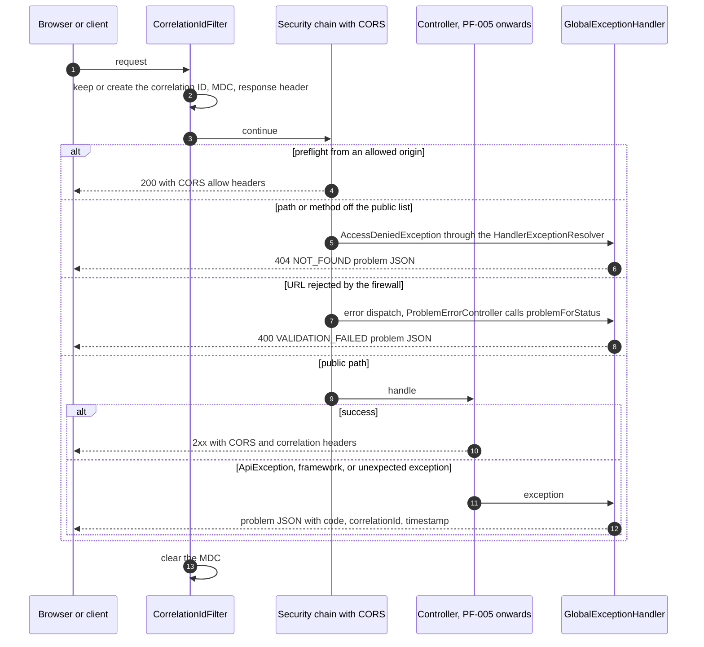
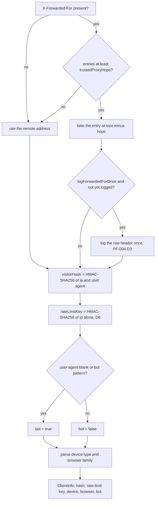

# PF-004 — Backend platform

**Ticket**: PF-004 · **Refined requirement**: [PF-004-refined-requirement.md](PF-004-refined-requirement.md) · **Packages**: backend · **Status**: Approved 2026-11-23 · **Last updated**: 2026-11-23 (built in `/dev`; synced with the code)

> ⚠️ **Review these flows first** — [F1 — A request through the platform](#f1--a-request-through-the-platform) · [F2 — Client info from one request](#f2--client-info-from-one-request)

## 1. Requirement summary

Build the shared backend platform that PF-005 to PF-007 add their endpoints to: one RFC 9457 error model with four codes, correlation IDs, CORS from configuration, the stateless security chain answering 404 for anything off the public list (D4), the client IP behind the proxy, the visitor hash, user-agent parsing, the bot filter, and the per-visitor rate limiter (D1), plus a Dockerfile whose image runs locally. No endpoint, table, or migration is added, and the first Render and Neon deploy moves to PF-012 (D2). Implements the platform parts of SITE-002, SITE-004, and SITE-006; maps to `../portfolio-implementation-plan.md` §5.3, §5.5, §5.6, and §7 Phase 3 (private).

## 2. Requirement analysis

| Need | Source | Backend work |
|---|---|---|
| One problem JSON shape, four codes, no framework text | FR-1, FR-2, Non-Negotiable 5 | `ErrorCode`, `ApiException`, `GlobalExceptionHandler` |
| Off-list paths and wrong methods answer 404 `NOT_FOUND` | FR-2, D4, AC-1 | Security entry point and access-denied handler delegate to `GlobalExceptionHandler` |
| Correlation ID on every response, log line, and problem body | FR-3, AC-2 | `CorrelationIdFilter`, registered before the security chain |
| CORS from configuration | FR-4, AC-3 | `CorsProperties`, `CorsConfigurationSource` in `SecurityConfig` |
| Stateless chain, public list | FR-5 | `SecurityConfig` (extended) |
| Client IP from the trusted hop; never logged | FR-6, D3, AC-6 | `ClientInfoResolver`, `ClientProperties.trustedProxyHops`, forwarded strategy `none` |
| Visitor hash | FR-7, AC-5 | `VisitorHasher` |
| Device type and browser family | FR-8, AC-7 | `UserAgentParser` |
| Bot filter | FR-9, AC-7 | `BotFilter` |
| Per-visitor rate limits | FR-10, D1, AC-8 | `RateLimiter`, `RateLimit`; Bucket4j and Caffeine |
| Docker image for Render Free, run locally | FR-11, D2, AC-10 | `backend/Dockerfile`, `.dockerignore`, `bootJar` named `app.jar` |
| Secrets and origins required outside the local profile | FR-12, AC-9 | Validated `@ConfigurationProperties` records; `spring-boot-starter-validation` |
| One-time forwarded-header check without a code change | FR-13, D3 | `app.client.log-forwarded-for-once` (off by default) |

## 3. Current state

- Security: `backend/src/main/java/com/huygialy/portfolio/platform/security/SecurityConfig.java:25` builds a stateless chain that permits `GET` on health and the API docs, `HEAD` on health, and the `ERROR` dispatch, and ends in `denyAll()`, which answers an empty 403.
- Forwarded headers: `backend/src/main/resources/application.yml:6` uses strategy `framework`, whose `ForwardedHeaderFilter` takes the leftmost, client-settable `X-Forwarded-For` entry and then removes the header (backend guide principle 9 flags this for PF-004).
- Problem details: `spring.mvc.problemdetails` is off on purpose (`application.yml:22`); no `@RestControllerAdvice` exists, so errors fall back to Boot's `/error` body.
- No `@ConfigurationProperties`, no `Clock` bean, no validation starter, and no Dockerfile (`backend/build.gradle.kts:25`).
- Tests: `HealthIT` asserts 403 for `GET /actuator/env` and `POST /actuator/health` (`backend/src/test/java/com/huygialy/portfolio/HealthIT.java:41`); `@IntegrationTest` has no active profile.
- OpenAPI: no operations yet; `OpenApiSnapshotIT` writes `backend/openapi/openapi.json`.

## 4. Approach

Keep each concern in one small platform class, reuse Spring's own extension points (a `ResponseEntityExceptionHandler`, the security chain's entry point, `CorsConfigurationSource`), and keep the client IP inside one resolver that hands out only derived values.

| # | Decision | Why |
|---|---|---|
| P1 | `GlobalExceptionHandler extends ResponseEntityExceptionHandler` is the only place that builds problem bodies. It sets `code`, `correlationId`, `timestamp` (from the injected `Clock`), and, for validation, `errors`; `title` comes from the `ErrorCode`; `instance` is the request path. Framework exceptions map as: invalid body or arguments, unreadable JSON, unsupported media type, missing parameter → `VALIDATION_FAILED`; no resource or handler, method not supported → `NOT_FOUND` (D4); `ApiException` → its code; anything else → `INTERNAL_ERROR` with an ERROR log and stack trace, and a fixed client-safe detail | One error model (principle 7, Non-Negotiable 5). `detail` texts are written here, never copied from the exception |
| P2 | The security chain's `AuthenticationEntryPoint` and `AccessDeniedHandler` both call the MVC `HandlerExceptionResolver`, which routes the exception into `GlobalExceptionHandler`; it maps `AuthenticationException` and `AccessDeniedException` to `NOT_FOUND`. `ProblemErrorController` (an `ErrorController` at `/error`, hidden from OpenAPI) renders whatever reaches the error dispatch without an exception, such as a URL the security firewall rejects or a container-level status, through `GlobalExceptionHandler.problemForStatus`, with the original path as `instance` | Off-list paths and firewall rejections answer the same problem JSON as everything else, from the same builder (D4, FR-1); Boot's default `/error` body has no `code` (review finding 2) |
| P3 | `ErrorCode` enum with status and title: `VALIDATION_FAILED` 400, `NOT_FOUND` 404, `RATE_LIMITED` 429, `INTERNAL_ERROR` 500. `ApiException(ErrorCode, String detail)` with nested `FieldViolation(field, message)` and factories `validationFailed(violations)`, `notFound(detail)`, `rateLimited(Duration retryAfter)`; the handler turns `retryAfter` into a `Retry-After` header in whole seconds, rounded up | Principle 3: variants are factories, not subclasses; the four codes from the REST rules |
| P4 | `CorrelationIdFilter` (`OncePerRequestFilter`, not a bean, KNOWN-BE-007) is registered through a `FilterRegistrationBean` at the highest precedence, so it runs before the security chain. It keeps an incoming `X-Correlation-Id` matching `^[A-Za-z0-9-]{1,64}$`, else creates a UUID, puts it in the MDC as `correlationId` and in a request attribute, sets the response header, and clears the MDC in `finally` | Every response, including a security 404, carries the ID (FR-3); the pattern keeps log lines safe from injection |
| P5 | CORS: `SecurityConfig` enables `http.cors(...)` with a `CorsConfigurationSource` for `/**` built from `CorsProperties.allowedOrigins` as origin patterns; methods `GET`, `HEAD`, `POST`; request headers `Content-Type`, `X-Correlation-Id`; exposed `X-Correlation-Id`, `Retry-After`; no credentials; max age 1 hour. The PF-003 status panel's cross-origin `GET /actuator/health` with `X-Correlation-Id` triggers a preflight, which this covers | FR-4; one place for the allowlist; preflights are answered before authorization |
| P6 | Configuration records, validated: `CorsProperties` at `app.cors` (`@NotEmpty List<String> allowedOrigins`, env `ALLOWED_ORIGINS`) and `ClientProperties` at `app.client` (`@NotBlank visitorHashSecret` from `VISITOR_HASH_SECRET`, `@Min(1) trustedProxyHops` default 1 from `TRUSTED_PROXY_HOPS`, `logForwardedForOnce` default false from `LOG_FORWARDED_FOR_ONCE`). `application.yml` gives the two required values no default, `application-local.yml` gives development defaults, and the integration tests run with a new `test` profile that supplies test values | Principle 12; the prod profile fails at startup without them (FR-12). The keys move from the master plan's `app.allowed-origins` and `app.visitor-hash-secret` to `app.cors.*` and `app.client.*`; the environment variable names stay |
| P7 | Forwarded headers: strategy `none`, and `ClientInfoResolver` reads `X-Forwarded-For` itself: split on commas, trim, and take the entry at position `size - trustedProxyHops`; with fewer entries than that, or no header, use `request.getRemoteAddr()`. `server.tomcat.use-relative-redirects: true` keeps Swagger UI's redirect relative behind the TLS proxy | `framework` trusts the leftmost entry and removes the header (FR-6); a hop count turns PF-012's finding into an environment variable instead of a code change |
| P8 | `ClientInfoResolver.resolve(HttpServletRequest)` returns `ClientInfo(visitorHash, rateLimitKey, deviceType, browser, bot)` with nested `DeviceType` (`DESKTOP`, `MOBILE`, `TABLET`); `rateLimitKey` is `HMAC-SHA256(secret, ip)` (D6). The IP and the user agent never leave the resolver | Principle 9: one class reads them; callers get derived values only |
| P9 | `VisitorHasher.hash(ip, userAgent)`: HMAC-SHA256 with the secret over `ip + "\|" + userAgent` (a missing user agent counts as empty), 64 lowercase hex characters; a new `Mac` per call because `Mac` is not thread-safe | FR-7; cheap on virtual threads |
| P10 | `UserAgentParser`: tablet if it contains `iPad`, `Tablet`, or `Android` without `Mobile`; mobile if it contains `Mobi`, `iPhone`, or `Android`; else desktop. Browser family by ordered rules: `Edg/` Edge, `OPR/` or `Opera` Opera, `SamsungBrowser` Samsung Internet, `Firefox/` or `FxiOS` Firefox, `Chrome/` or `CriOS` Chrome, `Safari/` Safari, else Other. No library | FR-8 and the open-question default; a dependency such as a full user-agent database costs megabytes of memory for two columns (Non-Negotiable 8) |
| P11 | `BotFilter.isBot(userAgent)`: true for a missing or blank user agent, or one matching `(?i)bot\|crawl\|spider\|slurp\|preview\|headless\|lighthouse\|monitor` | FR-9 and the open-question default |
| P12 | `RateLimiter.check(RateLimit, rateLimitKey)` throws `ApiException.rateLimited(retryAfter)` when the client's bucket is empty; the key is the IP-only HMAC, so a changed user agent does not reset a limit (D6). `RateLimit` enum: `VISIT` 30 per minute, `CONTACT` 3 per hour, each a Bucket4j bucket with greedy refill. Buckets live in one Caffeine cache keyed by `limit + ":" + rateLimitKey`, with at most 10,000 entries and expiry 1 hour after last access. Bucket4j's clock is the injected `Clock`, so tests move time. PF-005 and PF-006 call it from their command services | FR-10, D1; a service call instead of a path-matching filter keeps the limit next to the action it guards; memory stays bounded (about 10,000 small objects at most) and resets on restart, which the free tier accepts |
| P13 | With `logForwardedForOnce` on, the resolver logs the raw `X-Forwarded-For` value and its entry count once per process (an `AtomicBoolean`), at WARN, tagged `PF-004 D3`. Off by default | D3: PF-012 sets `LOG_FORWARDED_FOR_ONCE=true` on Render for one deploy, reads the line, and removes the variable; no code change carries an IP log |
| P14 | `backend/Dockerfile`: multi-stage, build on `eclipse-temurin:21.0.13_9-jdk`, run on `eclipse-temurin:21.0.13_9-jre` as a non-root user with the Render Free JVM flags; `bootJar` is named `app.jar` and the plain jar is disabled; `backend/.dockerignore` excludes `build/` and `.gradle/`. Tags are pinned, the newest 21.0.13 tags at least a week old | FR-11, implementation plan §5.6; the security rules forbid moving tags |
| P15 | A `Clock` bean (`Clock.systemUTC()`) in `platform` | Principle 12: time comes from the injected `Clock` |

| Alternative | Why not |
|---|---|
| `spring.mvc.problemdetails.enabled: true` | Puts framework text in `detail` and adds no `code` (`docs/knowledge/tooling.md`) |
| A second problem writer inside the security handlers | Two places to build the same body; P2 reuses the one handler |
| Strategy `native` with Render's proxy addresses as trusted proxies | Render does not publish stable proxy addresses; the hop count needs none |
| A rate-limit servlet filter keyed by path | Duplicates the endpoint list in the filter and runs before validation; the service call (P12) sits with the action |
| A plain `ConcurrentHashMap` of buckets | Grows without bound under spoofed traffic; Caffeine evicts |
| A user-agent library | Memory and startup cost for two coarse columns |

**Reuse**: `SecurityConfig` and its public list, `OpenApiConfig`, `@IntegrationTest` and `TestcontainersConfiguration`, `HealthIT`, `OpenApiSnapshotIT`, Boot's Jackson mapper, `ResponseEntityExceptionHandler`. **Single responsibility**: `ErrorCode` lists codes; `ApiException` carries one failure; `GlobalExceptionHandler` renders failures; `CorrelationIdFilter` tags a request; `SecurityConfig` decides what is reachable and from which origin; `ClientInfoResolver` derives client info; `VisitorHasher` hashes; `UserAgentParser` classifies; `BotFilter` flags bots; `RateLimiter` enforces limits.

## 5. Backend

### Services

| Unit | Responsibility | Transaction |
|---|---|---|
| `platform.error.ErrorCode` | The four codes with status and title | none |
| `platform.error.ApiException` | One client-safe failure; factories per code; nested `FieldViolation` | none |
| `platform.error.GlobalExceptionHandler` | Every exception to problem JSON (P1, P2) | none |
| `platform.error.ProblemErrorController` | The `/error` dispatch to problem JSON (P2) | none |
| `platform.web.CorrelationIdFilter` and `platform.web.WebConfig` | Correlation ID per request (P4) and its registration | none |
| `platform.security.SecurityConfig` (modified) and `platform.security.CorsProperties` | Public list, CORS, 404 for the rest (P2, P5, P6) | none |
| `platform.client.ClientInfoResolver`, `ClientInfo`, `ClientProperties` | Derived client info from one request (P6 to P8, P13) | none |
| `platform.client.VisitorHasher`, `UserAgentParser`, `BotFilter` | Hash, classify, flag (P9 to P11) | none |
| `platform.ratelimit.RateLimiter`, `RateLimit` | Per-visitor limits (P12) | none |
| `platform.ClockConfig` | The `Clock` bean (P15) | none |

No unit opens a transaction: PF-004 writes nothing to the database.

### API

No endpoint is added. Behavior on every path:

| Request | Answer |
|---|---|
| `GET` or `HEAD /actuator/health`, `GET` on the API docs and Swagger UI | As in PF-002, with `X-Correlation-Id` |
| Any other path or method, such as `GET /actuator/env`, `POST /actuator/health`, `GET /api/v1/anything` | 404 problem JSON, code `NOT_FOUND` |
| A missing static resource under a public prefix, such as `GET /swagger-ui/missing.js` | 404 problem JSON, code `NOT_FOUND` |
| A CORS preflight from an allowed origin | 200 with the allow headers |
| A cross-origin request, preflight or not, from any other origin | Spring's plain 403 with no allow headers: the browser blocks it either way, so this is the one non-2xx response that is not problem JSON (approved with the plan) |

Problem body: `type` `about:blank`, `title`, `status`, `detail`, `instance`, `code`, `correlationId`, `timestamp` (ISO-8601 UTC), and `errors` for `VALIDATION_FAILED`. Media type `application/problem+json`.

### Failure modes

| Failure | Behavior | Test |
|---|---|---|
| Off-list path or wrong method | 404 `NOT_FOUND` problem with correlation ID | `PlatformWebIT`, `HealthIT` (changed) |
| A URL the security firewall rejects, such as one with a semicolon | 400 `VALIDATION_FAILED` problem through `/error`, with the original path as `instance` | `PlatformWebIT` |
| A changed user agent from the same address | Same rate-limit key, same bucket (D6) | `ClientInfoResolverTest` |
| Well-formed or malformed `X-Correlation-Id` | Kept, or replaced by a UUID | `PlatformWebIT` |
| Preflight from an allowed and from another origin | Allow headers, or none | `PlatformWebIT` |
| Unexpected exception in a handler | 500 `INTERNAL_ERROR`, fixed detail, ERROR log with stack trace | `GlobalExceptionHandlerTest` |
| Invalid request body or arguments | 400 `VALIDATION_FAILED` with `errors` | `GlobalExceptionHandlerTest` (an endpoint-level test arrives with PF-005) |
| Rate limit exhausted | `ApiException` → 429 `RATE_LIMITED` with `Retry-After` | `RateLimiterTest`, `GlobalExceptionHandlerTest` |
| Spoofed leftmost `X-Forwarded-For`, fewer entries than hops, no header | Trusted entry, remote address, remote address | `ClientInfoResolverTest` |
| Missing or blank user agent | Counted as a bot; hashed as empty | `BotFilterTest`, `ClientInfoResolverTest` |
| Missing secret or origins outside the local profile | Startup fails with a binding error | `PlatformPropertiesTest` |
| Restart | Rate-limit buckets reset | none (accepted) |

## 7. Complex flows

### F1 — A request through the platform

> ⚠️ **Review this flow** — servlet filters, the security chain, and `GlobalExceptionHandler`: the order decides which responses carry a correlation ID and CORS headers, and the error mapping is a decision table with more than three outcomes.

| Messages | What happens, and why |
|---|---|
| 1 to 3 | The filter runs first, so every answer below carries `X-Correlation-Id` and every log line the MDC value (FR-3) |
| 4 | Spring Security's CORS filter answers an allowed preflight before authorization (FR-4); a disallowed one gets the plain 403 noted in the API table |
| 5, 6 | Anything off the public list goes through the same handler and answers 404 (D4, P2) |
| 7, 8 | A URL the firewall rejects never reaches a controller; the `/error` dispatch renders it through the same builder (FR-1, review finding 2) |
| 9 to 12 | Controllers arrive in PF-005; their failures, framework errors, and surprises all leave through the handler's decision table (P1, FR-1, FR-2) |
| 13 | The MDC never leaks into the next request on a reused thread |

**Simplest alternative**: let the security chain answer its own 403 and keep Boot's `/error` body. The API would then answer three different error shapes, and clients could not branch on `code` (FR-1).

### F2 — Client info from one request

> ⚠️ **Review this flow** — `ClientInfoResolver.resolve`: the IP choice, the hash, the bot flag, and the device and browser rules in one call; the IP and user agent stop here.

The steps serve FR-6 (trusted hop), D3 (the one-time log), FR-7 (hash), FR-10 and D6 (the rate-limit key), FR-9 (bot), and FR-8 (parsing). **Simplest alternative**: trust the leftmost entry as `framework` does; any client could then pick its own visitor hash and dodge its rate limit.

## 8. Files, order, risks, tests

**New**: `backend/Dockerfile`; `backend/.dockerignore`; `backend/src/main/java/com/huygialy/portfolio/platform/ClockConfig.java`; `platform/error/{ErrorCode,ApiException,GlobalExceptionHandler,ProblemErrorController}.java`; `platform/web/{CorrelationIdFilter,WebConfig}.java`; `platform/security/CorsProperties.java`; `platform/client/{ClientInfo,ClientInfoResolver,ClientProperties,VisitorHasher,UserAgentParser,BotFilter}.java`; `platform/ratelimit/{RateLimit,RateLimiter}.java`; `backend/src/test/resources/application-test.yml`; the tests below.

**Modified**: `backend/build.gradle.kts` (every `BootRun` task, `bootRun` and `bootTestRun`, defaults to the `local` profile, review finding 1; `spring-boot-starter-validation` and Caffeine, both Boot-managed; `com.bucket4j:bucket4j_jdk17-core:8.22.0`; `bootJar` named `app.jar`; plain jar disabled); `backend/src/main/resources/application.yml` (forwarded strategy `none`, relative redirects, `app.cors.*` and `app.client.*`, the correlation ID in the log pattern); `application-local.yml` (development origin and secret); `platform/security/SecurityConfig.java`; `backend/src/test/java/com/huygialy/portfolio/support/IntegrationTest.java` (`@ActiveProfiles("test")`); `HealthIT.java` (403 becomes 404 with code `NOT_FOUND`); `backend/openapi/openapi.json` only if `make openapi` changes it (it did not). `PortfolioApplication` gains `@ConfigurationPropertiesScan`; `CorrelationIdFilter.ATTRIBUTE` is public so unit tests can set it. Docs: `docs/product/product-guide.md` (SITE-002 and SITE-004 limits per client address, the rate-limit key in the glossary, D6), `docs/architecture/backend.md` (principle 9 now describes the hop count and D3; principle 10 the rate-limit key; Key Services rows marked built; config keys `app.cors.*` and `app.client.*`), `backend/CLAUDE.md` (Docker commands, project structure, the forwarded strategy), `.claude/rules/java-conventions.md` (a public `POST` calls `RateLimiter.check` instead of sitting behind a filter, P12), `.claude/rules/rest-api-conventions.md` (the `app.cors.*` key and D5), `.env.example` (the new variables, commented), and the knowledge entries this ticket verifies.

**New dependencies** (Non-Negotiable 8): `spring-boot-starter-validation` (Hibernate Validator; about 1.5 MB of jars; also needed by every request record from PF-005), Caffeine 3.3.1 (Boot-managed, about 0.9 MB), `bucket4j_jdk17-core` 8.22.0 (0.45 MB; 8.23.0 is less than a week old). No new startup cost worth measuring; heap use is bounded by the 10,000-entry cache.

**Order** (backend only; no migration, no frontend change). Built: S1 to S3 ran as one wave with three test writers, because none depends on another; S4 followed.

| Slice | Demo | Contract first | Then |
|---|---|---|---|
| S1 — Error model and correlation IDs | `curl -i localhost:8080/actuator/env` answers 404 problem JSON with `code` and `X-Correlation-Id` | `ErrorCode`, `ApiException` with factories, `GlobalExceptionHandler` signatures, `CorrelationIdFilter`, `ClockConfig`, the validation starter | Handler mapping, filter registration, security entry point and access-denied handler, `HealthIT` update |
| S2 — Configuration and CORS | A preflight from `http://localhost:5173` gets the allow headers; the app refuses to start without `ALLOWED_ORIGINS` outside the local profile | `CorsProperties`, `ClientProperties`, `application-test.yml`, `@ActiveProfiles("test")` | `CorsConfigurationSource`, YAML keys, forwarded strategy `none`, relative redirects |
| S3 — Client info and rate limits | Unit tests show the IP choice, hash, bot flag, parsing, and limits | `ClientInfo`, `ClientInfoResolver`, `VisitorHasher`, `UserAgentParser`, `BotFilter`, `RateLimit`, `RateLimiter` signatures; Bucket4j and Caffeine | Bodies, the one-time forwarded-header log |
| S4 — Docker image and docs | `docker build` and `docker run` against the compose PostgreSQL answer UP on `/actuator/health` | `bootJar` name, Dockerfile, `.dockerignore` | Local image check by hand, `make openapi`, docs and knowledge |

| Risk | Mitigation |
|---|---|
| The `HandlerExceptionResolver` route from the security chain may not render problem JSON outside the dispatcher | Resolved: `PlatformWebIT` shows security denials answer `application/problem+json` with `code` `NOT_FOUND` |
| Jackson 3 may not flatten `ProblemDetail` properties to the top level | Resolved: `$.code`, `$.correlationId`, and `$.timestamp` arrive at the top level |
| Render's `X-Forwarded-For` layout is unknown until PF-012 | The hop count is configuration (P7); PF-012 checks it once with D3 and records it in `docs/knowledge/` |
| Turning off `framework` changes absolute redirects behind TLS | `server.tomcat.use-relative-redirects: true`; Swagger UI checked in PF-012 on Render |
| The new `test` profile hides a missing value that prod needs | `PlatformPropertiesTest` proves startup fails without the values outside the local and test profiles |
| `springdoc` may add the handler's responses to the OpenAPI document | Checked: `OpenApiSnapshotIT` left `backend/openapi/openapi.json` unchanged (no operations yet); PF-005 will see the handler's responses on its first operation |
| Bucket4j's API differs from older examples | Follow the 8.22.0 Javadoc; `RateLimiterTest` with a moving clock |

**Tests** (within the test budget):

- S1: `PlatformWebIT` (new, `@IntegrationTest`): `GET /api/v1/nope`, `GET /actuator/env`, and `POST /actuator/health` answer 404 `application/problem+json` with `code` `NOT_FOUND` and a `correlationId` equal to the response header; a well-formed `X-Correlation-Id` is echoed, a malformed one replaced by a UUID. `HealthIT` (modified): the 403 assertions become 404 `NOT_FOUND`. `GlobalExceptionHandlerTest` (unit): an unexpected exception gives 500 `INTERNAL_ERROR` whose body holds none of the exception text; a `MethodArgumentNotValidException` gives 400 `VALIDATION_FAILED` with `errors`; `ApiException.rateLimited` gives 429 with `Retry-After` rounded up.
- S2: `PlatformWebIT` (same file): a preflight from the test profile's allowed origin gets `Access-Control-Allow-Origin`, the methods, and the two headers; one from `https://evil.example` gets none. `PlatformPropertiesTest` (unit, `ApplicationContextRunner`): binding fails without the secret or the origins and succeeds with both.
- Added at convergence to reach the branch-coverage gate (it stood at 70%): `GlobalExceptionHandlerTest` maps the five framework statuses, an unreadable body, a framework 5xx, and `Retry-After` rounding; `UserAgentParserTest` adds Samsung Internet, Opera, Firefox and Chrome on iOS, a generic tablet, a generic mobile, curl, and a missing user agent; `ClientInfoResolverTest` adds blank and empty header entries, a missing user agent, and the one-time log (logged once only when enabled). Result: 94% branch coverage, 53 unit and 13 integration tests.
- Review fixes (2026-11-23): `PlatformWebIT` adds a firewall-rejected URL answering 400 `VALIDATION_FAILED` problem JSON with its original path; `ClientInfoResolverTest` adds the rate-limit key (same address and a new user agent give the same key, another address a new one). `bootTestRun` was started on a spare port and answered health UP with the `local` profile. Result: 93% branch coverage, 54 unit and 14 integration tests.
- S3 (unit only, D1): `ClientInfoResolverTest`: a table of about five header cases (one hop, two hops, spoofed leftmost, fewer entries than hops, no header) and the hash rules (same input, same 64-hex value; a different IP, user agent, or secret, a different value); `UserAgentParserTest` and `BotFilterTest`: a table of about six real-world user agents each; `RateLimiterTest`: the 31st visit within a minute is rejected with a positive retry-after while another visitor passes, the bucket refills after the clock moves, and the 4th contact message in an hour is rejected.
- S4: none automated; the image check is by hand (AC-10), and `OpenApiSnapshotIT` keeps guarding the document. Checked on 2026-11-23: the image built, ran under a 512 MB limit against the compose PostgreSQL with health UP, answered an off-list path with 404 problem JSON and a correlation ID, and refused to start without `ALLOWED_ORIGINS` (AC-9).
- Integration-test gate: the endpoint surface (status codes, problem codes, CORS) is covered by `PlatformWebIT` and `HealthIT`. The client-info, hashing, parsing, and rate-limit logic is pure in-memory logic and claims the `testUnit` exemption explicitly; PF-005 adds the integration tests when an endpoint uses it.
