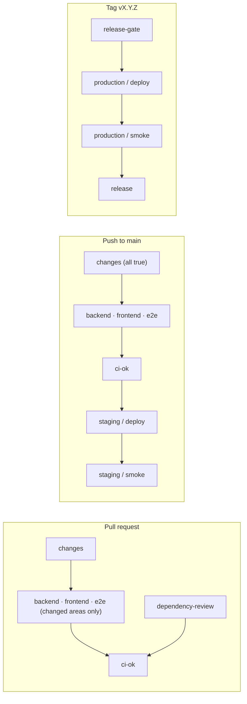
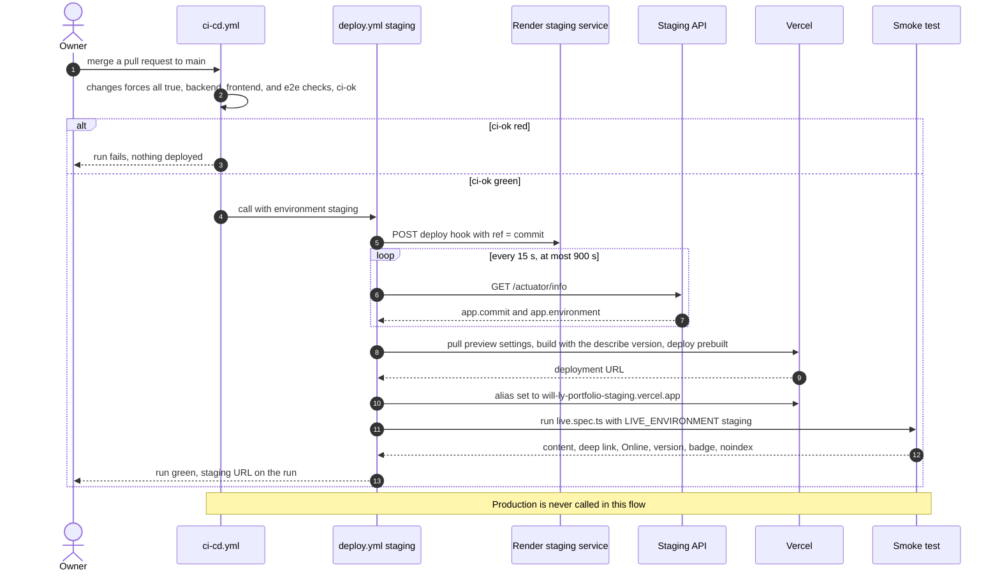
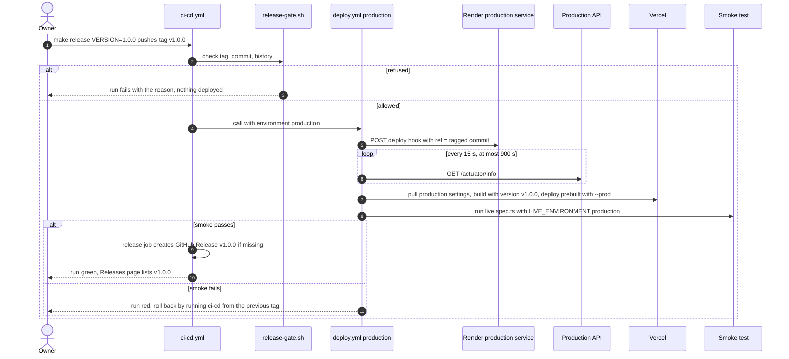
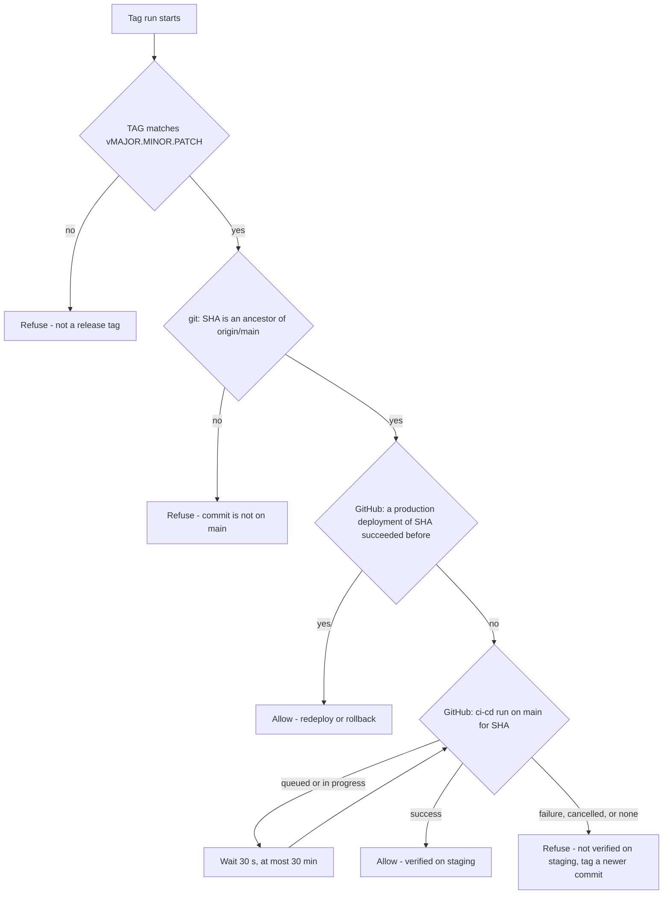

# PF-027 — One CI/CD pipeline with a staging environment and production releases from tags

**Ticket**: PF-027 · **Refined requirement**: [PF-027-refined-requirement.md](PF-027-refined-requirement.md) · **Packages**: CI and hosting, with a small backend change (`/actuator/info` and the environment marker on emails) and a small frontend change (the staging badge and the version beside the brand in the header) · **Status**: Approved 2026-11-25 · **Last updated**: 2026-11-25 (`secrets: inherit`, the staging `noindex` header, and the version moved to the header after the first staging runs)

> ⚠️ **Review these flows first** — [F1 A push to `main` deploys to staging](#f1--a-push-to-main-deploys-to-staging), [F2 A release tag deploys to production](#f2--a-release-tag-deploys-to-production), [F3 The release gate](#f3--the-release-gate)

## 1. Requirement summary

Every commit gets one pipeline run that reads like a GitLab pipeline: on a pull request, changes → checks → one `ci-ok` gate; on `main`, all checks → `ci-ok` → deploy to **staging** → live smoke test; on a release tag `vX.Y.Z`, release gate → deploy to **production** → live smoke test → GitHub Release (RR D1 to D3). Staging is a full free-tier copy of the stack with none of production's data: a Vercel preview deployment at a fixed address, a second Render Free service, and a separate Neon project (RR D9, D10). Every backend deploy is verified by the commit and environment it reports at a new public `GET /actuator/info` (RR D12); staging reuses production's Resend key and its emails carry a `[staging]` subject prefix and an `environment` tag (RR D20); the header shows the deployed version beside the brand, which is the release tag on production (`v1.0.0`) and the `git describe` value on staging (`v1.0.0-3-gabc1234`), linked to that release's notes or to the changes since it (RR D21); and the repository is hardened: the ruleset requires the gate, release tags cannot move, actions are pinned to SHAs, and secret scanning, push protection, Dependabot alerts and security updates, CodeQL, and dependency review are on (RR D13). This replaces PF-013's rule "a push to `main` deploys production" and changes the CI/CD row of `../portfolio-implementation-plan.md` §2 and its §8 runbook (private).

## 2. Requirement analysis

| Need | Source | Backend work | CI, hosting, and frontend work |
|---|---|---|---|
| One run per commit with a single required gate | FR-1, FR-2, D1 | none | `ci-cd.yml` with `changes`, the checks, `dependency-review`, and `ci-ok` (P1 to P3) |
| Checks skip unchanged areas on pull requests only | FR-1, FR-3, D15 (path filter on PRs only) | none | `changes` job with `dorny/paths-filter`; `main` and manual runs force every output to `true` (P2) |
| `main` deploys both apps to staging, then smoke-tests it | FR-3, FR-4, D3 | none | `staging` job calls `deploy.yml` with `environment: staging` (P1, P5) |
| Production only from a verified release tag | FR-5, FR-6, D3, D4, D16 (previously deployed) | none | `release-gate` job running `scripts/release-gate.sh` (F3) |
| A release deploys both apps, smoke-tests, and records a GitHub Release | FR-7, FR-8, D2, D7 | none | `production` job calls `deploy.yml` with `environment: production`; `release` job (P13) |
| Redeploy or roll back from an older tag | FR-9 | none | `workflow_dispatch` from a tag ref goes through the same gate (P14) |
| Backend deploy verified by its commit and environment | FR-10, FR-11, D12, D20 | `/actuator/info` with `app.commit` from `RENDER_GIT_COMMIT` and `app.environment`, public for GET and HEAD | `scripts/wait-for-commit.sh` (P6) |
| Staging reuses production's Resend key, and its emails are marked | D20 (owner, 2026-11-25) | `app.environment` (`APP_ENVIRONMENT`, default `production`): `ResendEmailSender` adds a `[staging]` subject prefix outside production and an `environment` tag on every email | owner step C sets `APP_ENVIRONMENT=staging` and the same `RESEND_API_KEY` |
| Backend live before the frontend deploys | D17 (deploy order) | none | step order in `deploy.yml` (P5) |
| Staging marked as not the live site and not indexed | FR-12, FR-14, FR-22, D11, D18 (badge variable), D19 | none | `StagingBadge` shown when `VITE_LIVE_SITE_URL` is set; `X-Robots-Tag: noindex` from `frontend/vercel.json` on the staging host (P17); the smoke test checks both (P8) |
| The site shows which version is live and links to what changed; the first release is `v1.0.0` | FR-25, D21 (owner, 2026-11-25) | ECS `service.version` in the logs from `RENDER_GIT_COMMIT` instead of the Gradle `0.0.1-SNAPSHOT` | the `deploy` job computes the version from the git tag and builds with `VITE_APP_VERSION`; the header shows it as a link beside the brand; the smoke test checks it (P16) |
| Staging isolated from production data and quotas | FR-13, D9, D10, Non-Negotiables 3 and 9 | same image, same `prod` profile, different environment values | owner steps A to D in section 8 |
| Environments with URLs and deployment policies | FR-15, D8 | none | GitHub environments `staging` (branch `main`) and `production` (tags `v*`), set with `gh api` (P12) |
| Ruleset, tag ruleset, SHA pins, security settings, dependency review | FR-16 to FR-19, D13 | none | rulesets and settings by `gh api` (P12); pins in every `uses:`; `dependency-review` job |
| No keep-alive pinger | FR-20, D5 | none | documented in `docs/knowledge/hosting.md` with the Render hour budget |

## 3. Current state

- **Workflows**: `.github/workflows/backend.yml`, `frontend.yml`, and `e2e.yml`, each with workflow-level `paths:` filters. `backend.yml` and `frontend.yml` have a `check` job and a `deploy` job that runs on a push to `main` or `workflow_dispatch` (PF-013 D1, D8); `e2e.yml` runs Playwright on pull requests only. Actions are pinned to tags (`actions/checkout@v7.0.1`). Concurrency cancels older runs on pull requests only (PF-013 D5).
- **Deploys**: the frontend `deploy` job runs `vercel pull/build/deploy --prod` with `vercel@66.2.0` from the repository root (`frontend/vercel.json` sets `git.deploymentEnabled: false`); the backend `deploy` job POSTs `${RENDER_DEPLOY_HOOK_URL}&ref=${GITHUB_SHA}` and ends when Render accepts it (PF-013 D9).
- **Backend**: `SecurityConfig.java:30-43` lists the public GET paths (health, liveness, API docs, stats, projects) and `SecurityConfig.java:75-76` allows HEAD on health and liveness; `application.yml` exposes only the `health` actuator endpoint. `HealthIT.java` covers health, liveness, and the 404 for other actuator paths. `ResendEmailSender.java` posts `SendRequest(from, to, subject, text, reply_to)` to Resend's `/emails` with the key from `ResendProperties` (bound outside the `local` profile only); `ResendEmailSenderIT.java` checks the request body against WireMock.
- **Frontend**: `frontend/src/api/client.ts:119` reads `VITE_API_URL` at build time; `frontend/src/app/RootLayout.tsx` renders the skip link, header, page, and footer; `frontend/playwright.config.ts` runs `frontend/e2e/` against `vite preview` with every API call aborted. Copy goes through `t()` in `frontend/src/i18n/en.ts`; test IDs live in `frontend/src/config/test-ids.config.ts`.
- **GitHub settings** (read on 2026-11-25): ruleset 28001606 "Protect main" has only `deletion` and `non_fast_forward`; no environments; repository secrets `VERCEL_TOKEN`, `VERCEL_ORG_ID`, `VERCEL_PROJECT_ID`, `RENDER_DEPLOY_HOOK_URL`; Dependabot alerts, Dependabot security updates, secret scanning, and push protection are off; `.github/dependabot.yml` already updates `github-actions`, `gradle`, and `npm` weekly.
- **Hosting**: Vercel Hobby project `will-ly-portfolio` (production `will-ly-portfolio.vercel.app`), Render Free service `will-ly-portfolio-api` (`srv-dc2jb6p7lnhs73el9bfg`), one Neon Free project. Facts that shape this plan, checked on 2026-11-25: Render Free has one pool of 750 instance hours a month per workspace, and when it runs out every free service is suspended; a sleeping service uses no hours. Neon Free allows 100 projects with 100 CU-hours each. GitHub environments, deployment policies, and CodeQL are free for public repositories. Vercel custom environments need Pro, and Vercel Authentication can be switched off on Hobby. (The plan first assumed Vercel marks every non-production deployment `noindex`; the first staging run showed the alias served without the header, hence P17.)

## 4. Approach

One orchestrating workflow and one reusable deploy workflow. `ci-cd.yml` decides *what runs*; `deploy.yml` knows *how to deploy one environment* and is called twice, with the differences held by the GitHub environment (its secrets and variables), so staging and production run exactly the same steps.



**Plan decisions**

- **P1 — Two workflow files.** `.github/workflows/ci-cd.yml` (`name: ci-cd`) triggers on `pull_request`, `push` to `main`, `push` of tags `v*`, and `workflow_dispatch`. `.github/workflows/deploy.yml` (`on: workflow_call`, inputs `environment`) has the jobs `deploy` and `smoke`. The `release` job sits in `ci-cd.yml` after `production`: a called workflow can never hold more permissions than its caller grants, and GitHub checks every job in it, even one an `if:` would skip, before the run starts, so a `contents: write` job inside `deploy.yml` would make every run fail at startup while the `staging` call grants read only. The old three workflows are deleted in the same change, so the merge commit runs only the new pipeline.
- **P2 — Path filtering on pull requests only.** The `changes` job uses `dorny/paths-filter` (pinned by SHA) on pull requests: `backend` = `backend/**`, `.github/**`, `scripts/**`; `frontend` = `frontend/**`, `.nvmrc`, `backend/openapi/openapi.json`, `.github/**`. On `main` and manual runs it outputs `true` for both, so a successful `main` run always means "this exact commit passed every check and both apps passed on staging" (D15).
- **P3 — One gate.** `ci-ok` has `if: always()` and `needs` every check job; it fails when any of them is `failure` or `cancelled` and passes when they succeeded or were skipped. It is the only required status check. It does not run on tag runs. The `staging` job checks `needs.ci-ok.result == 'success'` explicitly (with `!cancelled()`), because `dependency-review` is skipped on `main` and a skipped job further up the chain would otherwise skip `staging` too.
- **P4 — Tag runs do not re-run the checks.** The `release-gate` job checks that the commit already passed a `main` run, which included the checks and staging (F3). This keeps a release to about the deploy time.
- **P5 — Deploy order inside `deploy.yml`.** One `deploy` job, with `environment: {name, url}` and job-level concurrency `deploy-{environment}` (queue, never cancel): (1) POST the Render deploy hook with `ref=${GITHUB_SHA}`; (2) wait until `${API_URL}/actuator/info` reports `GITHUB_SHA`; (3) only then build and deploy the frontend; (4) on staging, point the alias at the new deployment. The `smoke` job then runs against the pair that is actually live. The new frontend therefore never runs against an older backend (D17).
- **P6 — Commit verification.** Spring's `info` endpoint shows `app.commit` from `RENDER_GIT_COMMIT`, which Render sets for the deployed commit (`local` elsewhere), and `app.environment` (P15). `scripts/wait-for-commit.sh <api-url> <sha> <environment> [timeout-seconds]` polls it every 15 s with a 110 s request timeout (a sleeping staging service wakes on the first call) until both match, and fails after 900 s, printing the last values it saw. Checking the environment as well catches a wrong `API_URL` in a GitHub environment, and a staging service started without `APP_ENVIRONMENT`, whose emails would otherwise go out unmarked. Fallback if Render does not expose the variable at run time: declare `ARG RENDER_GIT_COMMIT` and `ENV RENDER_GIT_COMMIT=$RENDER_GIT_COMMIT` in the runtime stage of `backend/Dockerfile`, because Render passes its environment variables as build arguments. Staging proves which one is needed before production depends on it.
- **P7 — Frontend builds per environment from the same commit.** Vite bakes `VITE_*` values in at build time, so staging and production are built separately: `vercel pull --environment=preview` + `vercel build` + `vercel deploy --prebuilt` + `vercel alias set <url> ${VERCEL_ALIAS}` for staging, and the PF-013 `--prod` commands for production. The token stays a `--token` argument, never a job variable (PF-013).
- **P8 — Live smoke test.** `frontend/playwright.live.config.ts` (no web server, Chromium, `retries: 1`, `testIdAttribute: 'data-test-id'`, `baseURL` from `LIVE_SITE_URL`) runs `frontend/e2e-live/live.spec.ts` with `pnpm test:live`. It opens pages with `?notrack=1`, so no visit is counted, and checks: the home heading renders and the API state reaches "Online" within 120 s; a deep link to `/work/scheduling-platform` renders its title; the header version equals the `deploy` job's `APP_VERSION` (passed as `LIVE_VERSION`), which proves the alias or the production domain serves this exact build (P16); with `LIVE_ENVIRONMENT=staging`, the badge is visible and `/` answers with `X-Robots-Tag` containing `noindex`; with `production`, the badge is absent.
- **P9 — One composite action for frontend setup.** `.github/actions/setup-frontend/action.yml` (pnpm, Node from `.nvmrc` with the pnpm cache, `pnpm install --frozen-lockfile`, and, with input `playwright: true`, the cached Chromium install from today's `e2e.yml`) is used by the `frontend`, `e2e`, and `smoke` jobs instead of three copies.
- **P10 — Concurrency.** Workflow level: group `ci-cd-${{ github.ref }}`, cancelling only on pull requests. On `main`, a run waits behind the one in progress and GitHub keeps only the newest waiting run, so an intermediate commit may never reach staging and cannot be released (the gate says so). Job level in `deploy.yml`: `deploy-${{ inputs.environment }}`, never cancelled, so two tags pushed together deploy one after the other.
- **P11 — Least privilege.** Top-level `permissions: {}`; each job grants only what it needs: `contents: read` for checks, plus `pull-requests: read` for `changes`, `actions: read` and `deployments: read` for `release-gate`, and `contents: write` for `release` only; both calls of `deploy.yml` grant `contents: read`. Every `actions/checkout` sets `persist-credentials: false`. Environment secrets reach only the step that uses them, as an `env:` value. Both calls of `deploy.yml` use `secrets: inherit`, and `deploy.yml` declares no secrets: a reusable workflow reads its environment's secrets (here `RENDER_DEPLOY_HOOK_URL`) only when the caller passes secrets through, and otherwise they resolve to an empty string, declared or not (runs 45592131148 and 45593658140 failed that way; GitHub docs, Reuse workflows). `inherit` also brings the repository's three `VERCEL_*` secrets, the only other ones the repository has. The `smoke` job is not bound to the environment (that would record a second deployment), so it reads the site URL and the version from the `deploy` job's outputs.
- **P12 — GitHub settings applied with `gh api` during `/dev`, in a fixed order** (section 8, *Settings*). The `main` ruleset gains its new rules only after the pipeline has run on `main`, otherwise every open pull request would wait for a `ci-ok` that never reports.
- **P13 — GitHub Release after a good production deploy.** The `release` job runs `gh release view "$TAG"` and, if there is none, `gh release create "$TAG" --verify-tag --generate-notes`. An owner-created release is left as it is. The Releases page therefore lists what went live.
- **P14 — Rollback.** Run `ci-cd` by hand with "Use workflow from" set to the older tag. The gate accepts it because that commit was deployed to production successfully before (F3), and the run redeploys both apps and smoke-tests them. `make release VERSION=x.y.z` tags the head of `origin/main` with an annotated tag and pushes it, which is the documented way to release; a GitHub Release created in the UI also works.
- **P15 — One environment name in the backend.** `app.environment` (env `APP_ENVIRONMENT`, default `production`; `local` in `application-local.yml`; lowercase letters only) is the single place the backend knows where it runs. The staging service reuses production's `RESEND_API_KEY` (owner, D20); Resend's quota is per account anyway, so a second key would only have added a separate revocation. `ResendEmailSender` marks every email with a Resend tag `environment=<name>`, so the Resend dashboard can filter by it, and outside `production` prefixes the subject with `[<name>] `, for example `[staging] New portfolio contact message (#12)`, so the inbox shows it at a glance. The tag and subject carry no personal data (Non-Negotiable 9).
- **P16 — One version for the whole site, taken from the git tag.** The release tag is the only version number. No file is edited per release, so nothing drifts and `make release` stays one command. The `deploy` job checks out with `fetch-depth: 0` and computes `APP_VERSION=$(git describe --tags --match 'v[0-9]*.[0-9]*.[0-9]*' --abbrev=7 --always)`: `v1.0.0` on a production run from tag `v1.0.0`, `v1.0.0-3-gabc1234` on staging three commits later, and the short SHA before the first tag exists. It passes the value to `vercel build` as `VITE_APP_VERSION`, exposes it as a job output for the smoke test, and writes "Deployed `<version>` (`<sha>`) to `<environment>`" to the job summary. The header shows the version as a small link beside the "Portfolio" brand (the owner moved it there from the footer after the first staging deploy, 2026-11-25), truncated with an ellipsis if a long `describe` value would crowd a narrow screen: a release tag links to its GitHub Release notes, a `describe` value links to the compare view from that tag to the commit (what staging has that production does not yet), and a bare SHA links to the commit. Both apps deploy from the same commit and P6 proves the backend serves it, so the backend needs no version of its own; its logs carry the commit as ECS `service.version` instead of the Gradle `0.0.1-SNAPSHOT`, and the unused version fields in `package.json` and `build.gradle` stay as they are. The first release is `v1.0.0` (owner, 2026-11-25).
- **P17 — `noindex` on staging comes from `vercel.json`.** Vercel does not send `X-Robots-Tag` for a preview deployment reached through the `vercel alias set` address (first staging run, 45595354590: the header was empty and the smoke test failed on it). `frontend/vercel.json` therefore adds `X-Robots-Tag: noindex` to every path when the request's host is `will-ly-portfolio-staging.vercel.app` (a `headers` rule with a `has` host condition), so production, served on another host, is never affected. A renamed alias needs this host changed too.

| Alternative | Why not |
|---|---|
| Keep three workflows and add environments | Still no single run per commit, and workflow-level path filters leave a required check waiting forever on a pull request that skips the workflow |
| Manual approval on a `production` environment | The owner chose release tags (D3); the tag is the approval |
| A long-lived `staging` branch | Drifts from `main` and adds merge chores; trunk-based `main` → staging → tag keeps one line of history |
| A Vercel custom environment "staging" | Pro plan only; the Preview environment plus a fixed alias does the same on Hobby |
| A Vercel Git branch domain for staging | Needs Vercel's Git deploys, which PF-013 D1 turned off so that only checked commits deploy |
| A Neon branch of the production database | Copies real visitors' data and contact emails into staging (Non-Negotiables 3 and 9) and shares production's CU-hours; a separate project is empty and has its own quota |
| Deploy only changed apps to staging | A skipped intermediate `main` run would let a later docs-only commit count as verified although an app change never reached staging (D15) |
| Promote one container image (GHCR → image-backed Render services) | True build-once, and it would remove Render builds, but the production service would have to be recreated; deferred (RR out of scope) |
| A separate Resend key for staging | The owner chose to reuse the key (D20); isolation would only cover revocation, since the sending quota is per account |
| Mark staging emails only with a sender name (`CONTACT_FROM_EMAIL=Portfolio staging <…>`) | No code, but nothing in Resend's logs to filter on and nothing the deploy check can verify; one `APP_ENVIRONMENT` drives the subject, the tag, and `/actuator/info` |
| Poll Render's API for the deploy status | Needs an account-wide Render API key in GitHub; the commit endpoint checks from the outside, like a visitor, with no new secret |
| A curl-only smoke test | Misses a blank page from a wrong `VITE_API_URL` or a JavaScript error; Playwright checks what a visitor sees |
| Runtime frontend configuration (`/config.json`) so one build serves both | An extra request and code before the first render for a two-variable difference; a build per environment from the same commit is accepted |
| Re-run the checks on the tag | Redundant: the gate requires the `main` run for that commit to have passed |
| Automatic rollback when the production smoke test fails | Deferred (RR out of scope); a manual run from the previous tag is enough |
| Bump a version in `package.json` and `build.gradle` on every release | Two files to edit and a pull request per release, and they drift from the tag the first time someone forgets; the tag already is the version (P16) |
| Show only the commit SHA | Does not tell the owner which release is live; the `describe` form still carries the SHA |

**Reuse**: today's check steps move unchanged into the `backend` and `frontend` jobs; PF-013's Vercel CLI commands, pin, and token handling; PF-013's deploy hook with `ref`; the cached Chromium steps from `e2e.yml` move into the composite action; `HealthIT` gets the info test; `TestIds`, `getTestIdProp`, and `t()` for the badge; the existing Dependabot `github-actions` entry keeps the SHA pins current. **Single responsibility**: `ci-cd.yml` orchestrates; `deploy.yml` deploys and verifies one environment; `release-gate.sh` decides whether a tag may ship; `wait-for-commit.sh` waits for one backend version; `setup-frontend` prepares Node, pnpm, and Chromium; `StagingBadge` marks a build that is not the live site; `live.spec.ts` proves a deployed pair works.

## 5. Backend

No database change, no new dependency.

### Configuration

`backend/src/main/resources/application.yml`:

```yaml
management:
  endpoints:
    web:
      exposure:
        include: health,info
  info:
    env:
      enabled: true # publishes the info.* properties below, and nothing else
info:
  app:
    commit: ${RENDER_GIT_COMMIT:local} # the deployed commit; PF-027 verifies deploys with it
    environment: ${app.environment}
app:
  environment: ${APP_ENVIRONMENT:production} # staging sets APP_ENVIRONMENT=staging (PF-027 P15)
  contact:
    resend:
      environment: ${app.environment}
```

`backend/src/main/resources/application-prod.yml` adds the commit to every log line, next to its existing `console: ecs` format (P16):

```yaml
logging:
  structured:
    ecs:
      service:
        version: ${RENDER_GIT_COMMIT:local} # replaces the Gradle 0.0.1-SNAPSHOT in the logs
```

`application-local.yml` sets `app.environment: local`. The other info contributors (`java`, `os`, `process`) stay off by default, and `git` and `build` have no files to read, so the body is exactly `{"app":{"commit":"<sha>","environment":"<name>"}}`. `SecurityConfig` gets `INFO_PATH = "/actuator/info"` in `PUBLIC_GET_PATHS` and in the HEAD matcher. Springdoc does not list actuator endpoints, so the OpenAPI snapshot does not change; `make openapi` confirms it.

### Services

| Unit | Responsibility | Transaction |
|---|---|---|
| `ResendProperties` (modified) | gains `@NotBlank @Pattern("[a-z]+") String environment`, default `production`; `toString` may show it (not a secret) | none |
| `ResendEmailSender` (modified) | builds the subject as `[<environment>] <subject>` outside `production` and adds `tags: [{name: "environment", value: <environment>}]` to `SendRequest` for every email; retries, idempotency key, and error mapping unchanged | none (it already runs with no transaction open, Non-Negotiable 7) |

### API

| Method and path | Rate limit | Success | Errors (code → status) |
|---|---|---|---|
| `GET /actuator/info`, `HEAD /actuator/info` | none: read-only, constant, no database (same as health) | 200 `{"app":{"commit":"<40-char sha>","environment":"staging"}}`; `commit` is `local` outside Render | any other method → `NOT_FOUND` 404 (existing deny-all) |

### Failure modes

| Failure | Behavior | Test |
|---|---|---|
| `RENDER_GIT_COMMIT` missing at run time | `/actuator/info` shows `local`; `wait-for-commit.sh` times out; the `deploy` job fails before the frontend deploys; the previous version keeps serving. Fix with the Dockerfile fallback (P6) | `HealthIT.infoIsPublicAndShowsOnlyCommitAndEnvironment` (the `local` default and the body shape); the variable itself is checked on the first staging deploy |
| The staging service runs without `APP_ENVIRONMENT` (or with the wrong value) | `/actuator/info` reports `production`; `wait-for-commit.sh` never sees `staging`, the `deploy` job fails, and the frontend is not deployed. Emails sent meanwhile carry the `production` tag and no prefix until the owner fixes the variable | none (seen on staging) |
| `APP_ENVIRONMENT` holds something other than lowercase letters | `ResendProperties` validation fails at startup, Render's health check fails, and the old version keeps serving | none (Bean Validation on properties is already proven by `ContactPropertiesTest`) |
| The deploy hook is rejected (wrong secret, SHA not in the repository) | `curl --fail-with-body` fails the `deploy` job; nothing changes | none |
| Render's build or health check fails | Render keeps the old version; the wait times out after 900 s; the job fails and the frontend is not deployed | none (seen on staging) |
| The staging API is asleep when the wait starts | The first call holds for the cold start (about 80 s) inside the 110 s request timeout | none |
| A Vercel build, deploy, or alias step fails | The job fails; the previous deployment and the alias stay as they were | none |
| The smoke test fails on staging | The run is red, so the gate will refuse this commit; production is untouched | `live.spec.ts` is the test |
| The smoke test fails on production | The run is red and GitHub emails the owner; the new version is live; roll back from the previous tag (P14) | `live.spec.ts` |
| The tag is not `vX.Y.Z`, not on `main`, or not verified | `release-gate` fails with the reason; nothing is deployed | `release-gate.sh` run locally against three cases (section 8) |
| The tag is pushed while that commit's `main` run is still going | The gate waits for that run, up to 30 minutes, then decides | same local run |
| Two tags are pushed together | `deploy-production` concurrency deploys them one after the other | none |
| The paths-filter action fails | `changes` fails, `ci-ok` is red; re-run the job | none |
| A check is cancelled | `ci-ok` is red, so a cancelled run never counts as passing | none |
| The Render hour pool runs out | Every free service is suspended until next month, including production; prevented by D5 (no keep-alive) and watched on Render's Billing page | none |
| Staging contact messages use up Resend's shared daily quota | Production messages fail to send and PF-006's retry job resends them later; accepted risk (RR). Reusing one key does not change this, because the quota is per account | none |
| The shared Resend key is revoked or rotated | Both services fail to send until the owner updates `RESEND_API_KEY` on both; messages stay `FAILED` and are resent by the retry job afterwards | none |

## 6. Frontend

### Components and routes

- `RootLayout` (modified) renders `<StagingBadge />` after the footer.
  - `StagingBadge` (new, `frontend/src/app/StagingBadge.tsx`) returns `null` unless `import.meta.env.VITE_LIVE_SITE_URL` is set. Otherwise it renders a small fixed pill at the bottom left (`position: fixed`, so the layout never shifts), with the label and a link to that URL; `touch-target` on the link for coarse pointers; hidden in print. It sits below native dialogs, which use the top layer.
- `Header` (modified, `frontend/src/sections/Header.tsx`) shows the version beside the brand link when `VITE_APP_VERSION` is set: the version as link text (monospace, muted, `touch-target`, truncated) with the `aria-label` `nav.version`, or plain text when `versionLink` returns `null`. Nothing is shown when the variable is not set (local development, Vitest, the `e2e` job).
  - `appVersion.ts` (new, `frontend/src/app/appVersion.ts`): `appVersion()` reads `import.meta.env.VITE_APP_VERSION`; `versionLink(version, repositoryUrl)` returns `{repo}/releases/tag/{tag}` for `vX.Y.Z`, `{repo}/compare/{tag}...{sha}` for `vX.Y.Z-N-g{sha}`, `{repo}/commit/{sha}` for a bare SHA, and `null` for anything else. The repository URL is `profile.links.repository`.
- `frontend/src/vite-env.d.ts` (modified): `VITE_LIVE_SITE_URL?: string`, documented as "set only for staging builds; its presence shows the staging badge"; `VITE_APP_VERSION?: string`, documented as "set by the deploy job from `git describe` (PF-027 P16)".

No route, title, meta description, or sitemap change.

### Content

| Block | Source | Tier | Status |
|---|---|---|---|
| Badge label `app.staging.label`: "Staging" | interface text, no CV claim | A | draft (wording is an open question) |
| Badge link `app.staging.liveLink`: "Go to the live site" | interface text, no CV claim | A | draft (wording is an open question) |
| Header version text, such as `v1.0.0` | generated from the git tag at build time | A | approved (owner request, 2026-11-25) |
| Version link label `nav.version`: "Version {version}: see what changed" | interface text, no CV claim | A | draft |

### Test IDs

| Element | Test ID | Purpose |
|---|---|---|
| Badge container | `app-staging-badge-region` | the component test and the live smoke test find it |
| Badge link | `app-live-site-link` | the component test checks its `href` |
| Header version | `header-version` | the component test and the live smoke test read its text |

### Live smoke test

`frontend/e2e-live/live.spec.ts`, environment `LIVE_SITE_URL` and `LIVE_ENVIRONMENT` (`staging` or `production`). It is excluded from Vitest (`src/**` only) and from the existing `pnpm test:e2e` (separate config and folder), and it is linted and type-checked like `frontend/e2e/`.

## 7. Complex flows

### F1 — A push to `main` deploys to staging

> ⚠️ **Review this flow** — `ci-cd.yml` → `deploy.yml` (`environment: staging`): GitHub Actions, the Render deploy hook, the staging API, the Vercel CLI, Playwright. No database transaction is involved; the boundary that matters is that production is never touched.



1. The merge is the only trigger; the ruleset makes `ci-ok` pass on the pull request first (FR-16).
2. All checks run on `main`, not only the changed areas, so a green `main` run covers the exact commit (D15, P2).
3. A red gate stops the run; staging keeps the last good commit.
4. The same reusable workflow serves production, so staging rehearses the production steps (P1).
5. The hook carries `ref`, so Render builds exactly this commit (PF-013).
6. to 7. Waiting on the reported commit and environment turns "Render accepted" into "this commit is serving, on the right service" (FR-10, P6); a timeout fails the job before the frontend changes.
8. to 9. The frontend is built with Vercel's Preview variables, which point at the staging API and set `VITE_LIVE_SITE_URL` (P7, D18), and with `VITE_APP_VERSION` from `git describe` (P16).
10. The fixed alias gives staging one address for CORS, the environment URL, and the owner (D9).
11. to 12. The smoke test checks what a visitor sees on this pair, without counting a visit (FR-4, P8).
13. The `staging` environment records the deployment with its URL.

**Simplest alternative**: deploy the frontend and backend in parallel and skip the commit wait. That takes about two minutes less, but the run could go green while Render is still building or has failed, and the new frontend could briefly run against the old API.

### F2 — A release tag deploys to production

> ⚠️ **Review this flow** — `ci-cd.yml` `release-gate` → `deploy.yml` (`environment: production`) → `ci-cd.yml` `release`: GitHub's REST API, the Render deploy hook, the production API, the Vercel CLI, Playwright, GitHub Releases.



1. A tag on the head of `origin/main` is the owner's release action (D3, D4, P14).
2. to 3. The gate refuses anything that did not pass staging, before any deploy (FR-6, F3).
4. The `production` environment only accepts tag refs matching `v*`, so a branch run can never reach it, even by mistake (FR-15).
5. to 6. Same hook and wait as staging (P5, P6).
7. The build carries the tag as its version (P16); `--prod` moves the production domain to the new deployment atomically (PF-013).
8. The smoke test checks the live site, that the header shows `v1.0.0`, and that the badge is absent (P8).
9. to 10. The GitHub Release is created only after the smoke test passes (P13).
11. A failed smoke test leaves the new version live and red in the Actions tab; rollback is a manual run (P14).

**Simplest alternative**: deploy on the tag without a gate. A tag on an untested commit would then ship straight to recruiters.

### F3 — The release gate

> ⚠️ **Review this flow** — `scripts/release-gate.sh` (inputs `TAG`, `SHA`, `GITHUB_REPOSITORY`, `GH_TOKEN`): `git merge-base`, two GitHub REST queries, and one wait loop. It is a decision table with four outcomes.



1. Format: only SemVer tags release (D4); the `v*` tag ruleset stops anyone moving or deleting a tag after it has shipped.
2. On `main`: `git fetch origin main` and `git merge-base --is-ancestor "$SHA" origin/main`.
3. Previously deployed: `GET /repos/{repo}/deployments?environment=production&sha={SHA}`, then any status of one of them is `success` (an older deployment's latest status turns `inactive` once a newer one succeeds, so the latest status alone would refuse every rollback). This is the redeploy and rollback path (FR-9, D16). It deliberately ignores whether a GitHub Release exists, because the owner may create a Release in the UI to push a new tag.
4. Verified: `GET /repos/{repo}/actions/workflows/ci-cd.yml/runs?head_sha={SHA}&branch=main`, keeping `push` and `workflow_dispatch` runs. A `success` run included every check, both staging deploys, and the staging smoke test (D15). A queued or running one is waited for, so tagging right after a merge works.
5. Anything else is refused with a message naming the rule, and the job summary repeats it. If GitHub's API cannot be read (for example before `ci-cd.yml` exists on `main`), the gate refuses with that reason: it fails closed.

**Simplest alternative**: allow any tag on `main`. That is one check fewer, but a commit whose staging smoke test failed could be released.

## 8. Files, order, risks, tests

**New**: `.github/workflows/ci-cd.yml`, `.github/workflows/deploy.yml`, `.github/actions/setup-frontend/action.yml`, `scripts/release-gate.sh`, `scripts/wait-for-commit.sh`, `frontend/playwright.live.config.ts`, `frontend/e2e-live/live.spec.ts`, `frontend/src/app/StagingBadge.tsx`, `frontend/src/app/StagingBadge.test.tsx`, `frontend/src/app/appVersion.ts`, `frontend/src/app/appVersion.test.ts`, `docs/plans/platform/PF-027-staging-pipeline.md`, `docs/plans/platform/PF-027-refined-requirement.md`.

**Deleted**: `.github/workflows/backend.yml`, `.github/workflows/frontend.yml`, `.github/workflows/e2e.yml`.

**Modified**: `backend/src/main/resources/application.yml`, `backend/src/main/resources/application-local.yml`, `backend/src/main/resources/application-prod.yml` (ECS `service.version`), `backend/src/main/java/com/huygialy/portfolio/platform/security/SecurityConfig.java`, `backend/src/main/java/com/huygialy/portfolio/contact/ResendProperties.java`, `backend/src/main/java/com/huygialy/portfolio/contact/ResendEmailSender.java`, `backend/src/test/java/com/huygialy/portfolio/HealthIT.java`, `backend/src/test/java/com/huygialy/portfolio/contact/ResendEmailSenderIT.java`, `.env.example` (document `APP_ENVIRONMENT`), `backend/Dockerfile` (only if the P6 fallback is needed), `frontend/src/app/RootLayout.tsx`, `frontend/src/sections/Footer.tsx` (the version), `frontend/src/i18n/en.ts`, `frontend/src/config/test-ids.config.ts`, `frontend/src/vite-env.d.ts`, `frontend/package.json` (`test:live`), the frontend ESLint and TypeScript configs (include `e2e-live/` and the live config), `Makefile` (`release`), `CLAUDE.md` (production line and environments), `README.md` (pipeline, staging, how to release), `backend/CLAUDE.md` and `frontend/CLAUDE.md` (deploy rows), `docs/architecture/overview.md` (environments), `docs/architecture/backend.md` (actuator endpoints), `docs/architecture/frontend.md` (live smoke test, badge, `vercel.json` row), `docs/knowledge/hosting.md` (Render hour pool and build minutes shared by both services, `RENDER_GIT_COMMIT` at run time, Vercel preview `noindex` and alias, Neon quota per project), `docs/knowledge/tooling.md` (workflow names), `docs/plans/platform/PF-013-ci-deploy.md` (a "superseded in part by PF-027" line), `docs/plans/README.md` (PF-027 under `platform`), `docs/prd/backlog.md`, `.github/dependabot.yml` (`directories: ["/", "/.github/actions/*"]`, so Dependabot also updates the composite action's pins, FR-17), `docs/knowledge/README.md`.

**Order** (one branch, one pull request, because the switch from "main deploys production" to "tags deploy production" must land at once; settings S1 can go first, at any time):

1. **S1 — Repository security settings** (no files; `gh api`): Dependabot alerts and security updates, secret scanning and push protection, CodeQL default setup for `java-kotlin`, `javascript-typescript`, and `actions`. Demo: the Security tab shows them enabled.
2. **S2 — The pipeline for pull requests**: the composite action, then `ci-cd.yml` with `changes`, `backend`, `frontend`, `e2e`, `dependency-review`, and `ci-ok`, every `uses:` pinned to a 40-character SHA with a `# vX.Y.Z` comment (SHAs resolved with `gh api repos/{owner}/{repo}/git/ref/tags/{tag}`, dereferencing annotated tags); delete the three old workflows. Demo: this ticket's pull request shows one `ci-cd` run with `ci-ok`.
3. **S3 — `/actuator/info` and the environment name**: `application.yml`, `application-local.yml`, and `SecurityConfig` first, then `ResendProperties.environment` and the `SendRequest` record with `tags`, then the subject and tag logic while the test writer extends `HealthIT` and `ResendEmailSenderIT` → `make openapi` (the snapshot must not change).
4. **S4 — Staging**: `wait-for-commit.sh`, then `deploy.yml` (the `deploy` and `smoke` jobs), the `staging` job in `ci-cd.yml`, `StagingBadge` with its test, the version (P16: the `describe` step, `VITE_APP_VERSION`, `appVersion.ts`, the header, ECS `service.version`) with its tests, the live config, and the spec. Owner steps A to D and settings 1 to 3 (below) must be done before the merge, so the merge commit's run can deploy staging.
5. **S5 — Production from tags**: `release-gate.sh`, the `release-gate` and `production` jobs, the `release` job, `make release`, and settings 4 and 5 before the merge. After the merge: settings 6 and 7, then the first release.
6. **Docs** in the same change.

**Owner steps** (dashboards; values never go into the repository). Steps A to D were done on 2026-11-25: the staging API answers at `https://will-ly-portfolio-api-staging.onrender.com` with health and database UP. The two Render deploy hooks (staging and production) are still to come from the owner, for settings steps 2 and 4.

- **A. Neon**: create the project `will-ly-portfolio-staging` (AWS Singapore, PostgreSQL 17, like production) and copy the direct connection string (no `-pooler`; `docs/knowledge/hosting.md`).
- **B. Resend**: nothing to create; staging reuses production's API key (D20).
- **C. Render**: New → Web Service from `HyHyZhaLee/portfolio`, name `will-ly-portfolio-api-staging`, Language Docker, Root Directory `backend`, branch `main`, Singapore, Free, Auto-Deploy Off, Health Check Path `/actuator/health/liveness`. Environment: the same keys as production, with these values different: `DB_URL`, `DB_USERNAME`, `DB_PASSWORD` (from A), `VISITOR_HASH_SECRET` (a new `openssl rand -hex 32`), `ALLOWED_ORIGINS=https://will-ly-portfolio-staging.vercel.app`, `APP_ENVIRONMENT=staging`, `LOG_FORWARDED_FOR_ONCE=false`; `RESEND_API_KEY`, `CONTACT_TO_EMAIL`, and `CONTACT_FROM_EMAIL` keep production's values. Production needs no new variable: `APP_ENVIRONMENT` defaults to `production`. Then copy the service's Deploy Hook URL and paste it into the chat for settings step 2. No keep-alive monitor on either service (D5).
- **D. Vercel**: Settings → Environment Variables → **Preview** only: `VITE_API_URL=https://will-ly-portfolio-api-staging.onrender.com` and `VITE_LIVE_SITE_URL=https://will-ly-portfolio.vercel.app` (both Config). Settings → Deployment Protection → Vercel Authentication **off** (staging is public, D11).
- Also outstanding from PF-023: set production's Render Health Check Path to `/actuator/health/liveness`.

**Settings** (Claude with `gh api` during `/dev`; plan approval covers these outward-facing changes). Done on 2026-11-25: S1 and steps 1 to 6 (ruleset 28063587 for tags; "Protect main" 28001606 now requires a pull request and `ci-ok`; the repository-level hook secret was deleted just before the merge, and both environments hold their own hook). Step 7, the first release, waits for the owner to check staging.

1. Environment `staging`: deployment branch policy = `main` only; variables `SITE_URL=https://will-ly-portfolio-staging.vercel.app`, `API_URL=https://will-ly-portfolio-api-staging.onrender.com`, `VERCEL_ALIAS=will-ly-portfolio-staging.vercel.app`.
2. `staging` secret `RENDER_DEPLOY_HOOK_URL` = the hook from owner step C.
3. Check, read-only, that the alias name looks unclaimed (`curl -sI https://will-ly-portfolio-staging.vercel.app` answers Vercel's `DEPLOYMENT_NOT_FOUND`). Agents never configure Vercel themselves (`.claude/rules/security.md`), so the alias is first assigned by the pipeline's own `vercel alias set` step on the merge commit's run. If the name is taken, the owner picks another, and step 1, owner step C's `ALLOWED_ORIGINS`, and the docs follow.
4. Environment `production`: deployment tag policy = `v*` only; variables `SITE_URL=https://will-ly-portfolio.vercel.app`, `API_URL=https://will-ly-portfolio-api.onrender.com`; secret `RENDER_DEPLOY_HOOK_URL` = the current repository secret's value (from the owner, since a secret cannot be read back).
5. New tag ruleset "Protect release tags" on `refs/tags/v*`: block deletion and updates.
6. After the merge, once `ci-ok` has reported on `main`: add to "Protect main" a pull-request rule (0 approvals) and a required status check `ci-ok` (not strict). Then delete the repository-level `RENDER_DEPLOY_HOOK_URL`.
7. First release: `make release VERSION=1.0.0` (the owner chose `v1.0.0`, D21) on a commit whose `main` run is green; check the run, the Releases page, the production `/actuator/info`, and that the production header shows `v1.0.0`.

| Risk | Mitigation |
|---|---|
| Render does not set `RENDER_GIT_COMMIT` at run time for Docker services | Found on the first staging deploy, before production depends on it; the Dockerfile `ARG`/`ENV` fallback (P6) |
| `vercel alias set` to a `*.vercel.app` name is refused or the name is taken | Settings step 3 probes it read-only before the merge; a refusal fails only the staging run, and production is untouched; the backend CORS already accepts origin patterns (`SecurityConfig.java:86`), so a per-deployment URL pattern is the last resort |
| The production smoke test touches the live site from CI | It is read-only, as `.claude/rules/security.md` requires: page loads with `?notrack=1` (no page view is posted), `GET /actuator/info`, and the health and stats reads the page makes itself; it never submits the contact form |
| The ruleset requires `ci-ok` before the pipeline exists on `main` | Settings step 6 runs only after the merge (P12) |
| Switching Vercel Authentication off makes every deployment URL public | Accepted with D11: no pull-request previews exist, production is public anyway, and the shared staging address sends `noindex` (P17) |
| Render's hour pool and build minutes are shared, and staging rebuilds on every merge | No keep-alive (D5); PF-024's cached dependency layer keeps builds to minutes; the numbers and the Billing page go into `docs/knowledge/hosting.md`; check usage at the end of the first month |
| Merges no longer reach production by themselves | `CLAUDE.md`, `README.md`, and the backlog say so; the owner releases with `make release` |
| A tag created by `gh release create` or the GitHub UI does not trigger the `push` tag event | Tags pushed with a user token do trigger it; checked on the first release; `make release` pushes the tag with git anyway |
| A pending `main` run blocks the next `main` runs | Only for the length of one run (checks plus staging, about 10 minutes); pull-request runs are in separate groups |
| The smoke test is flaky on a cold start | Both services were just deployed and are awake; the "Online" wait is 120 s, longer than the measured 80 s cold start; one retry |
| A third-party action is compromised | SHA pins, least-privilege permissions, `persist-credentials: false`, CodeQL's `actions` analysis |
| `vercel build` does not pass the job's `VITE_APP_VERSION` through to Vite | The staging smoke test's version check fails on the first run; fallback: append `VITE_APP_VERSION=<version>` to the `.vercel/.env.<target>.local` file that `vercel pull` writes, before `vercel build` |
| The production footer links to a GitHub Release that does not exist yet | The `release` job creates it a minute or two after the deploy (P13); accepted, because the link works by the time anyone clicks it |

**Tests** (within the test budget):

- **S3 backend**: one integration test in `HealthIT`, `infoIsPublicAndShowsOnlyCommitAndEnvironment`: GET returns 200 with `$.app.commit` = `local`, `$.app.environment` = the test profile's value, and no other key; HEAD returns 200. In `ResendEmailSenderIT`, the existing happy-path body match gains the `production` tag with the subject unchanged, and one new case binds `environment=staging` and expects `[staging] New portfolio contact message (#…)` with the `staging` tag. The existing `pathsOutsideThePublicListAnswerNotFound` keeps proving that other actuator paths stay 404.
- **S4 frontend**: `StagingBadge.test.tsx`, two cases with `vi.stubEnv`: no badge without `VITE_LIVE_SITE_URL`; the badge and a link with that `href` when it is set. `appVersion.test.ts`, one table-driven test of `versionLink` with four rows: a release tag, a `describe` value, a bare SHA, and an unknown string. Two header cases with `vi.stubEnv('VITE_APP_VERSION', …)`: `header-version` shows `v1.0.0`, with its accessible name, and links to the release; with an empty value no version renders. ECS `service.version` is configuration only and is checked in the first staging deploy's logs. `live.spec.ts` (P8) is the acceptance test for FR-4, FR-7, FR-12, and FR-14, and runs in the pipeline only.
- **S2 and S5 workflows and scripts**, verified by hand during `/dev` and recorded in the plan (results on 2026-11-25: actionlint 1.7.12 and shellcheck v0.11.0 clean; `release-gate.sh` refused (a) `v1.0` and (b) an unpushed commit, and for (c), with `ci-cd.yml` not yet on GitHub, refused because the runs could not be read; a scratch copy pointed at the old `backend.yml` allowed `main`'s head, which exercises the success path; `wait-for-commit.sh` against staging with a 20 s timeout failed with the last value seen, a 404 from the old build; the rest runs after the merge): `actionlint` on both workflows; `shellcheck` on both scripts; `release-gate.sh` run locally with `TAG`/`SHA` against (a) a malformed tag, (b) a commit that is not on `main`, (c) a `main` commit with a green run (allowed), with no tag pushed; this ticket's pull request shows `ci-ok`; after the merge, the `main` run deploys staging and its smoke test passes; the first tag deploys production and creates the Release.
