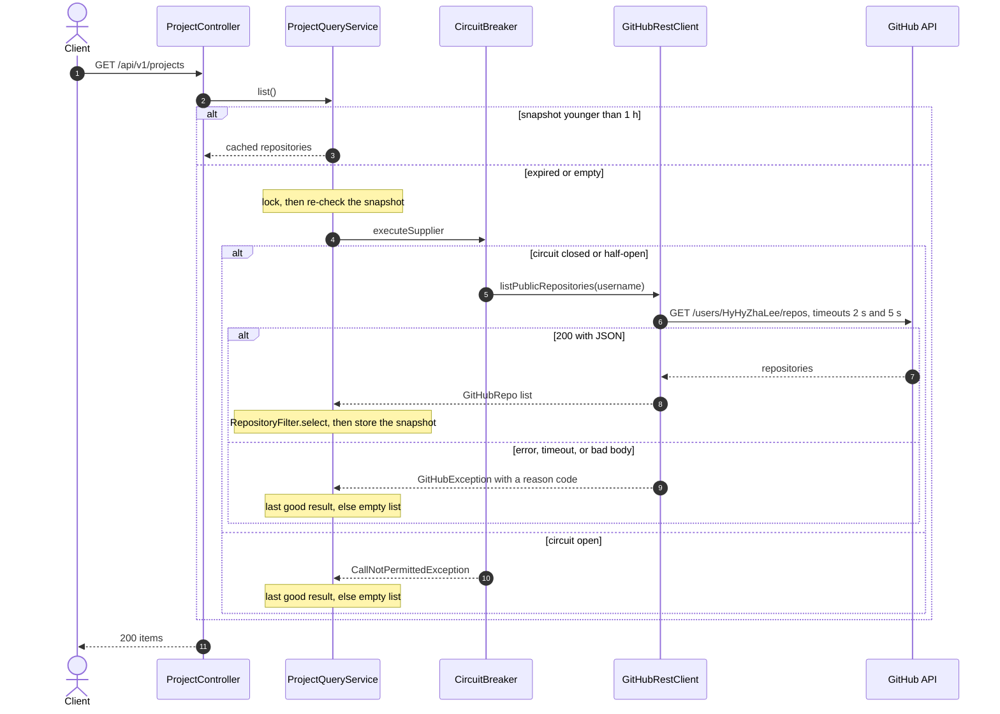
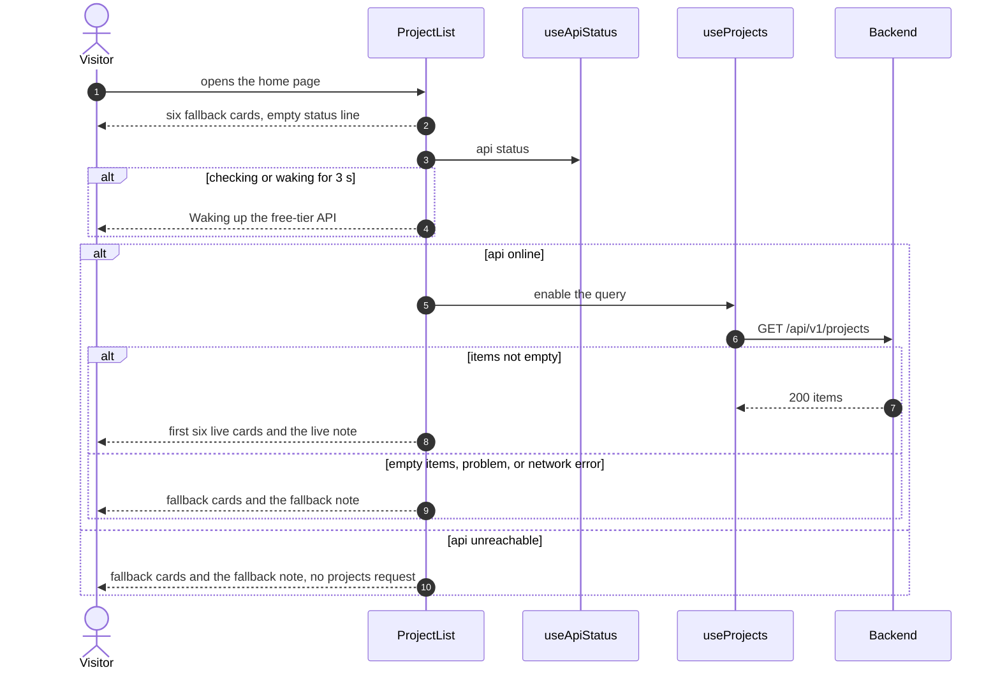

# PF-007 — Open-source projects

**Ticket**: PF-007 · **Refined requirement**: [PF-007-refined-requirement.md](PF-007-refined-requirement.md) · **Packages**: backend and frontend · **Status**: Approved 2026-11-23 · **Last updated**: 2026-11-23 (built in `/dev`; synced with the code)

> ⚠️ **Review these flows first** — [F1 — List projects](#f1--list-projects) · [F2 — The Open source list's state](#f2--the-open-source-lists-state)

## 1. Requirement summary

List the owner's public GitHub repositories on the home page without ever making the page wait for them. `GET /api/v1/projects` answers 200 `{items}`: the public repositories of `app.github.username` (`HyHyZhaLee`) that are neither forks, archived, nor private, the featured ones (`app.github.featured`) first, cached for 1 hour; a Resilience4j circuit breaker guards the GitHub call, and when GitHub fails the endpoint still answers 200 with the last good result, else an empty list. The frontend's Open source section, between Experience and Education, starts from `content/fallbackRepos.ts`, swaps in the first six live repositories once the API is online, shows the cold-start hint after about 3 s, keeps its height in every state, and links to the GitHub profile. Implements SITE-005 and SITE-001 (Non-Negotiable 1); maps to `../portfolio-implementation-plan.md` §5.1, §5.3 (`app.github`), §6.3, and §7 Phase 6 (private), and to backend guide principle 8 and its Projects guideline.

## 2. Requirement analysis

| Need | Source | Backend work | Frontend work |
|---|---|---|---|
| Read the owner's public repositories from GitHub with explicit timeouts and an optional token | FR-1, FR-2, D8, principle 8 | `GitHubClient` port, `GitHubRestClient` adapter, `GitHubProperties` | — |
| Drop forks, archived, and private repositories; featured first, then by last push | FR-3, D6, D7, SITE-005 | `RepositoryFilter` (pure) | — |
| Cache 1 h; circuit breaker; fallback to the last good result, else empty; always 200 | FR-4, FR-5, D9, SITE-005 | `ProjectQueryService`, `ProjectConfig` (breaker) (F1) | — |
| `GET /api/v1/projects` answers `{items}` | FR-6, D11, implementation plan §5.1 | `ProjectController`, `ProjectListResponse`, `SecurityConfig` public path | — |
| WireMock stands in for GitHub in tests | FR-10, principle 14 | `WireMockSupport` points `app.github.base-url` at WireMock | — |
| Open source section between Experience and Education, with a link to the GitHub profile | FR-7, D1, content plan §6.2 | — | `sections/OpenSource.tsx`, `HomePage` |
| Start from static repositories and swap in live data, no layout shift, cold-start hint after 3 s | FR-8, FR-9, D2 to D5 | — | `content/fallbackRepos.ts`, `features/projects` (F2) |
| Contract | AC-8 | `make openapi` | `pnpm gen:api` |

## 3. Current state

- Platform: `SecurityConfig.PUBLIC_GET_PATHS` (`backend/src/main/java/com/huygialy/portfolio/platform/security/SecurityConfig.java:31`) lists the public `GET` paths; anything else answers 404. The injected `Clock` comes from `platform/ClockConfig.java`. `GlobalExceptionHandler` turns anything unexpected into 500 `INTERNAL_ERROR`.
- PF-006 patterns: `ResendEmailSender` (`contact/ResendEmailSender.java`) is the adapter shape to copy: a JDK `HttpClient` forced to HTTP/1.1 with a connect timeout, `JdkClientHttpRequestFactory` with a read timeout, `RestClient.builder().configureMessageConverters(...)`, and every `RestClientResponseException` or `ResourceAccessException` mapped to the port's own exception with a reason code. Resilience4j is on the classpath as `resilience4j-retry:2.4.0` (`backend/build.gradle.kts:38`), core module only, no Spring Boot starter or AOP.
- PF-005 pattern: `StatsQueryService` memoizes one value, with a zero TTL in the test profile meaning no cache (`stats/StatsQueryService.java`, `application-test.yml`).
- `application.yml` sets `spring.jackson.factory.constraints.read.max-document-length: 65536` on Boot's `JsonMapper` (PF-005 P18). GitHub's repository list is about 5 KB per repository, so a response parsed with Boot's mapper would fail beyond about a dozen repositories; the adapter needs its own mapper (P4).
- Tests: `WireMockSupport` registers only `app.contact.resend.base-url` (`backend/src/test/java/com/huygialy/portfolio/support/WireMockSupport.java:25`). `.env.example` already holds `GITHUB_USERNAME` and an empty `GITHUB_TOKEN`.
- Frontend: `HomePage` renders `<Experience />` then `<Education />` (`frontend/src/pages/HomePage.tsx:32`). `useApiStatus` shares the one health check per page load and `SLOW_AFTER_MS = 3000` (`features/api-status/useApiStatus.ts:6`); `useSlowAfter` is internal to `api-status` and `index.ts` exports only `ApiStatusDot`, `SystemPanel`, and `useApiStatus`. `VisitCounter` already waits for `api === 'online'` (PF-005 D2). The MSW defaults (`frontend/src/test/handlers.ts:19`) have no projects handler. `profile.links.github` and `profile.links.repository` hold the real GitHub URLs. There is no `Skeleton` component yet.

## 4. Approach

| # | Decision | Why |
|---|---|---|
| P1 | Add `io.github.resilience4j:resilience4j-circuitbreaker:2.4.0`, the same version as `resilience4j-retry` (published months ago); core module only, about 200 KB, no threads, no AOP | Principle 8 asks for a circuit breaker; the core module shares `resilience4j-core` with the retry already in use (Non-Negotiable 8) |
| P2 | `GitHubProperties` (`app.github`): `username` (`${GITHUB_USERNAME:HyHyZhaLee}`, `@Pattern` `[A-Za-z0-9-]{1,39}`), `token` (`${GITHUB_TOKEN:}`, optional in every profile), `featured` (`${GITHUB_FEATURED:BK2023_Thesis_SmartPole,portfolio}`), `cacheTtl` (`${GITHUB_CACHE_TTL:1h}`), and record defaults for `baseUrl` (`https://api.github.com`), `connectTimeout` (2 s), `readTimeout` (5 s), and `circuitOpenFor` (10 min); `toString` never prints the token | Principle 12; the token only raises the rate limit (D8), so a missing token must not fail startup |
| P3 | `GitHubClient` (port, `project`): `List<GitHubRepo> listPublicRepositories(String username)`, with nested `record GitHubRepo(name, description, url, homepage, language, stars, topics, pushedAt, fork, archived, privateRepository)` and `final class GitHubException(String reason)` (no cause, no stack trace, like `DeliveryException`) | Principle 8: the feature owns the port; only the adapter knows GitHub's JSON |
| P4 | `GitHubRestClient` (adapter, `@Component`): `GET /users/{username}/repos?type=owner&sort=pushed&per_page=100` with `Accept: application/vnd.github+json`, `X-GitHub-Api-Version: 2022-11-28`, a `User-Agent`, and `Authorization: Bearer` only when a token is set; HTTP/1.1, connect and read timeouts as in `ResendEmailSender`; its own `JsonMapper` with a 2 MB document cap (Boot's mapper is capped at 64 KB) and `FAIL_ON_NULL_FOR_PRIMITIVES` off, so an absent flag or count reads as `false` or 0 (Jackson 3 fails on it by default; added in /dev S1, pre-approved by the owner (blanket approval, 2026-11-23)), and a response record with `@JsonIgnoreProperties(ignoreUnknown = true)`; entries without a name or URL are skipped; maps `RestClientResponseException` to `HTTP_{status}`, `ResourceAccessException` to `IO_ERROR`, any other `RestClientException` or a missing body to `BAD_RESPONSE`; a blank homepage or description becomes `null`, missing topics an empty list | Explicit timeouts (principle 8); one page of 100 is enough for the owner (about 40 public repositories); no provider text leaves the adapter (Non-Negotiable 5) |
| P5 | `RepositoryFilter.select(repos, featured)` (static, pure): drops forks, archived, and private repositories; sorts featured names first in the configured order (case-insensitive), then by `pushedAt` newest first (unknown last), then by name | SITE-005, D6, D7; a pure rule is unit-tested on its own. The backend guide put this inside `GitHubClient`; it moves out so the adapter only translates (principle 1), and the guide is updated |
| P6 | `ProjectConfig` declares the `CircuitBreaker` bean `github`: count-based window of 4 calls, at least 2 calls, opens at a 50% failure rate, stays open `circuitOpenFor`, then lets 1 trial call through; no automatic transition thread | D9; a bean so integration tests can `reset()` it between tests, as they `resetAll()` WireMock |
| P7 | `ProjectQueryService.list()`: returns the last good snapshot while it is younger than `cacheTtl` (time from the injected `Clock`); otherwise takes a `ReentrantLock`, re-checks, and calls `circuitBreaker.executeSupplier(() -> RepositoryFilter.select(gitHubClient.listPublicRepositories(username), featured))`; a success replaces the snapshot; a `GitHubException` or `CallNotPermittedException` logs one WARN line with the reason code and returns the last good result, else an empty list. Only successes are cached; a zero TTL (test profile) never serves from the snapshot but still keeps it as the fallback | F1, FR-4, FR-5. A `ReentrantLock` instead of Caffeine's `get(key, loader)`: Caffeine computes inside a `synchronized` map bin, which pins a virtual thread's carrier on Java 21 for the whole GitHub call (up to 7 s on one CPU), stalling every other request; the lock makes concurrent first requests share one call |
| P8 | `ProjectController` (`project.api`): `GET /api/v1/projects`, `@Operation(operationId = "listProjects")`, returns `ProjectListResponse(items)` with nested `ProjectResponse(name, description, url, homepage, language, stars, topics, updatedAt)`; `name`, `url`, `stars`, `topics`, and `items` are `REQUIRED`; `description`, `homepage`, `language`, and `updatedAt` are `types = {"string", "null"}`; `updatedAt` is GitHub's `pushed_at` | The master plan's `ProjectDto` shape (D11); required and nullable markers give exact generated types, as `StatsSummaryResponse` does |
| P9 | `SecurityConfig` adds `/api/v1/projects` to `PUBLIC_GET_PATHS`; no rate limit | D10: a read served from memory; GitHub calls are bounded by the cache, the lock, and the breaker |
| P10 | Test support: `WireMockSupport` also registers `app.github.base-url`; `application-test.yml` sets a synthetic user (`synthetic-user`), featured names (`alpha-featured`, `beta-featured`), and token, `app.github.cache-ttl: 0s`, and `read-timeout: 500ms` | Every test controls GitHub's answer; the token proves the header is sent; no test calls the real GitHub API (FR-10) |
| P11 | `make openapi` regenerates the snapshot and `frontend/src/api/schema.d.ts` | REST rules; frontend types come only from the schema |
| P12 | `content/fallbackRepos.ts`: six `FallbackRepo { name, url, description }`, in the order the live rule gives today: the two featured repositories, then the four most recently pushed public repositories; names and URLs are real (Tier A), descriptions are `todo(...)` placeholders (PF-003 D2) | D3: the same count as the cap, so loading, live, and fallback all show six cards and the section never changes height; no invented language, stars, or descriptions |
| P13 | `features/projects`: `api.ts` `listProjects(signal)` through `apiClient` (15 s default timeout), returning `items`; `queries.ts` `projectKeys` and `useProjects(enabled)`; `types.ts` `RepoCardData`; `ProjectList` enables the query only when `useApiStatus().api === 'online'`, derives the state (F2), and renders a status line and six `RepoCard`s; `index.ts` exports `ProjectList`. `api-status/index.ts` also exports `useSlowAfter` and `SLOW_AFTER_MS` | D4, D5: the same wait-for-health rule as the counter, so the query never times out against a sleeping API; the fallback is content, not API data, so it is not `placeholderData` (D12) |
| P14 | `RepoCard`: a fixed-height card: the name as a link to the repository (one line, truncated), the description clamped to two lines with two lines reserved, and one reserved line for the language and a star count (shown when above zero) | No layout shift when live data replaces the fallback (frontend principle 5) |
| P15 | `sections/OpenSource.tsx`: `Section id='open-source'` with the heading, `ProjectList`, and a link to `profile.links.github`; `HomePage` renders it between `Experience` and `Education`; no header navigation link | D1: the site map and content plan §6.2 order; the header keeps its five links |
| P16 | MSW default `projectsEmpty` (`GET */api/v1/projects` → `{items: []}`) | Every page test renders the section, which asks once health answers; MSW fails unhandled requests |

| Alternative | Why not |
|---|---|
| Spring's cache abstraction and the Resilience4j Spring Boot starter | Adds starters, AOP proxies, and startup time for one cached call (Non-Negotiable 8); the core modules are enough, as for the Resend retry |
| Caffeine `get(key, loader)` for the 1 h cache | Pins the virtual thread's carrier during the GitHub call on Java 21 (P7) |
| Cache the fallback for an hour too | One failed call would hide GitHub's recovery for an hour; the breaker already limits calls during an outage |
| Filter inside `GitHubRestClient` | Mixes translation and a product rule; the rule would need WireMock to test |
| `placeholderData: fallbackRepos` in `useQuery` | Fallback entries are not API records: they would need invented language, stars, and dates to fit the type (D12) |
| Two fallback repositories and four skeleton cards | The section would shrink by two to four rows whenever the API is down, moving the content below it (D3) |
| Query at once, without waiting for the health check | During a cold start the 15 s timeout expires and the retries cost up to about 48 s, after which the live list may never appear for that visit |

**Reuse**: `ResendEmailSender`'s adapter shape, Resilience4j core, the injected `Clock`, `SecurityConfig`, springdoc `@Operation` and `@Schema`, `@IntegrationTest` and `WireMockSupport`; `apiClient`, `useApiStatus`, `useSlowAfter`, `Section`, `todo()`, `formatCount`, `t()`, `TestIds`, `renderWithProviders`, MSW. **New dependency**: `resilience4j-circuitbreaker` (P1). **Single responsibility**: `GitHubClient` is the port; `GitHubRestClient` calls GitHub; `RepositoryFilter` selects and orders; `ProjectConfig` builds the breaker; `ProjectQueryService` caches and falls back; `ProjectController` serves; `fallbackRepos` holds the static list; `useProjects` queries; `ProjectList` decides what to show; `RepoCard` shows one repository; `OpenSource` lays out the section.

## 5. Backend

### Domain

No table and no migration: the list lives in memory and may vanish on restart (principle 11). `GitHubRepo` is an immutable record; the snapshot is `(List<GitHubRepo> repos, Instant fetchedAt)`, held in one `volatile` field.

### Services

| Unit | Responsibility | Transaction |
|---|---|---|
| `GitHubRestClient.listPublicRepositories` | One GitHub request, mapped to `GitHubRepo`s or a `GitHubException` with a reason code | none (no database) |
| `RepositoryFilter.select` | Drops forks, archived, and private repositories; orders featured first, then by last push | none |
| `ProjectQueryService.list` | Serves the fresh snapshot, or refreshes it once through the breaker, or falls back | none |
| `ProjectController.listProjects` | Maps the list to `ProjectListResponse` | none |

### API

| Method and path | Rate limit | Success | Errors (code → status) |
|---|---|---|---|
| `GET /api/v1/projects` (`listProjects`) | none (D10) | 200 `{items: [{name, description, url, homepage, language, stars, topics, updatedAt}]}`, featured first; `{items: []}` when GitHub is down and nothing was fetched since the last start | none by design: a GitHub failure falls back with 200; only an unexpected bug answers 500 `INTERNAL_ERROR` |

### Failure modes

| Failure | Behavior | Test |
|---|---|---|
| GitHub 5xx or connection refused | `HTTP_5xx` or `IO_ERROR` → last good result, else empty; 200; WARN with the reason code | `ProjectApiIT.anOutageServesTheLastGoodResultAndOpensTheCircuit` |
| GitHub rate limit (403 or 429) | `HTTP_403` or `HTTP_429` → same as an outage; the token raises the limit from 60 to 5,000 an hour | `ProjectApiIT.anOutageServesTheLastGoodResultAndOpensTheCircuit` (403) |
| GitHub slower than the 5 s read timeout | `IO_ERROR` → same as an outage | `ProjectApiIT.aSlowGitHubTimesOutAndFallsBack` |
| Circuit open | `CallNotPermittedException` → last good result, else empty, without a request to GitHub | `ProjectApiIT.anOutageServesTheLastGoodResultAndOpensTheCircuit` |
| Nothing fetched since the start, and GitHub fails | 200 `{items: []}`; the frontend shows its fallback list | `ProjectQueryServiceTest` |
| Fresh snapshot (younger than 1 h) | Served without a GitHub call | `ProjectQueryServiceTest` |
| Response over 64 KB | Parsed by the adapter's own mapper (2 MB cap) | `ProjectApiIT.listsPublicRepositoriesFeaturedFirst` (one repository padded past 64 KB) |
| Unknown user (404), malformed JSON, empty body | `HTTP_404` or `BAD_RESPONSE` → same as an outage | none (same path) |
| Concurrent requests on an expired snapshot | One GitHub call under the lock; the others re-check and read the new snapshot | none |
| No token | Unauthenticated calls, 60 an hour; one call per hour plus one per restart fits; no `Authorization` header | `ProjectApiIT.withoutATokenTheAdapterSendsNoAuthorizationHeader` |

## 6. Frontend

### Components and routes

- `HomePage` (changed: `OpenSource` between `Experience` and `Education`)
  - `OpenSource` (new section): heading, `ProjectList`, link to the GitHub profile
    - `ProjectList` (new, `features/projects`): status line and six `RepoCard`s
      - `RepoCard` (new): name link, two-line description, language and stars line

No new route, title, or meta description.

### Content

| Block | Source | Tier | Status |
|---|---|---|---|
| Section heading "Open source" | UI string (`t('openSource.heading')`) | A | approved (structure) |
| Fallback repository names and URLs: `BK2023_Thesis_SmartPole`, `portfolio`, `Intelligent-Systems-Project`, `TrainningReactAndSpring`, `TrainningReactjsAndNextjs`, `TRAINING_WPF_and_WindowsApplications` | The owner's public GitHub repositories (featured list from implementation plan §5.3, the rest by last push on 2026-11-23) | A (public repositories) | reviewed by the rule; the owner may reorder in PF-012 |
| Fallback descriptions | placeholder (`todo(...)`) | — | placeholder until PF-012 |
| GitHub profile link | `profile.links.github` | A | approved |
| Status texts (live, waking, fallback) and the profile link label | UI strings about the site | A | approved (UI) |
| Live repository names, descriptions, languages | GitHub at request time (the owner's public repositories) | A | live data |

### Data and states

| View | Hook and query key | Endpoint | Loading | Fallback | Error |
|---|---|---|---|---|---|
| `ProjectList` | `useProjects(enabled)`, `['projects', 'list']`; enabled when the health check says online | `GET /api/v1/projects` | Fallback cards and an empty status line; after 3 s "Waking up the free-tier API…" | API unreachable, or `{items: []}`: fallback cards and the fallback note | Problem or network error after the default retries: fallback cards and the fallback note |

### Test IDs

| Element | Test ID | Purpose |
|---|---|---|
| Status line | `projects-status-text` | Live, waking, or fallback note |
| Repository name link | `projects-repo-link` | Which repositories show, in order |
| GitHub profile link | `open-source-profile-link` | The section links to the profile |

## 7. Complex flows

### F1 — List projects

> ⚠️ **Review this flow** — `ProjectQueryService.list`: the snapshot check, a lock, the circuit breaker, one GitHub call through `GitHubRestClient`, the filter, and the fallback; no database and no transaction.

1. The frontend asks once the API is online (F2).
2. The controller only maps the result (principle 1).
3. A snapshot younger than `cacheTtl` answers at once: at most one GitHub call per hour while GitHub is up (FR-4).
4. Otherwise one caller at a time refreshes: the lock is a `ReentrantLock`, which parks a virtual thread instead of pinning its carrier (P7), and a caller that waited re-checks and usually finds a fresh snapshot. The call goes through the breaker, which counts outcomes and opens after 2 of the last 4 calls failed (D9).
5. The adapter makes the only provider call (principle 8).
6. One request for one page of 100 repositories, with a 2 s connect and a 5 s read timeout (P4).
7. and 8. On success the filter drops forks, archived, and private repositories and orders featured first (FR-3); the result becomes the new snapshot and the last good result.
9. On an error status, a timeout, or an unreadable body the adapter throws `GitHubException` with `HTTP_{status}`, `IO_ERROR`, or `BAD_RESPONSE`; nothing is cached, so the next request tries again unless the breaker has opened (FR-5).
10. While the breaker is open, no request reaches GitHub for `circuitOpenFor` (10 min); then one trial call decides whether it closes.
11. Always 200 (SITE-005, Non-Negotiable 1).

**Simplest alternative**: no breaker, only the 1 h cache and the fallback. During an outage every request after the cache expires would wait up to 7 s for GitHub before falling back; the breaker answers at once instead.

### F2 — The Open source list's state

> ⚠️ **Review this flow** — `ProjectList`: merges the shared health query (`useApiStatus`) with `useProjects`, plus a 3 s timer.

1. and 2. The fallback list renders at once (SITE-001).
3. The health check is the shared one-per-page-load query (PF-003).
4. While health or the projects query is pending for 3 s, the cold-start hint shows (implementation plan §6.3).
5. to 8. Only an online API is asked (D4); the first six live repositories replace the six fallback cards in place (D2, D3).
9. An empty list means GitHub failed and the backend had nothing cached, so the static list is the better answer (FR-9).
10. An unreachable API never gets a projects request.

**Simplest alternative**: query at once and ignore the health check; during a cold start the request would time out and the live list would often not appear for that visit.

## 8. Files, order, risks, tests

**New**: `backend/src/main/java/com/huygialy/portfolio/project/{GitHubClient,GitHubRestClient,GitHubProperties,RepositoryFilter,ProjectConfig,ProjectQueryService}.java`, `project/api/{ProjectController,ProjectListResponse}.java`; tests `backend/src/test/java/com/huygialy/portfolio/project/{RepositoryFilterTest,ProjectQueryServiceTest,ProjectApiIT}.java`; `frontend/src/content/fallbackRepos.ts`, `frontend/src/features/projects/{api.ts,queries.ts,types.ts,index.ts,ProjectList.tsx,RepoCard.tsx,ProjectList.test.tsx}`, `frontend/src/sections/OpenSource.tsx`.

**Modified**: `backend/build.gradle.kts`, `application.yml`, `application-test.yml`, `platform/security/SecurityConfig.java`, `support/WireMockSupport.java`, `backend/openapi/openapi.json`; `frontend/src/api/schema.d.ts`, `pages/HomePage.tsx`, `pages/HomePage.test.tsx`, `features/api-status/index.ts`, `i18n/en.ts`, `config/test-ids.config.ts`, `test/handlers.ts`, `content/content.test.ts`. Docs: `docs/prd/backlog.md`, `docs/product/product-guide.md` (SITE-005: six shown, the profile link), `docs/architecture/backend.md` (principle 12, Key Services, Projects guideline), `docs/architecture/frontend.md` (key directories), `docs/architecture/overview.md` (the token is optional), `.claude/rules/rest-api-conventions.md` (endpoint built), `.env.example` (optional GitHub settings), `CLAUDE.md`, `backend/CLAUDE.md`, `frontend/CLAUDE.md`, `docs/knowledge/tooling.md`.

**Order**: S1 backend: dependency → `GitHubProperties` → `GitHubClient` → `RepositoryFilter` → `ProjectConfig` → `ProjectQueryService` → `ProjectListResponse` and `ProjectController` → `SecurityConfig` → YAML and `WireMockSupport` → tests → `make openapi`. S2 frontend: `gen:api` → `fallbackRepos.ts` → `api.ts` → `queries.ts` → `RepoCard`, `ProjectList` → `OpenSource` and `HomePage` → tests.

| Risk | Mitigation |
|---|---|
| Boot's 64 KB Jackson cap breaks parsing of GitHub's list | The adapter builds its own `JsonMapper` (2 MB cap); the happy-path test pads one repository past 64 KB |
| A virtual thread pinned during the GitHub call stalls the one-CPU server | A `ReentrantLock`, not a cache loader inside a `synchronized` bin (P7) |
| Unauthenticated rate limit (60 an hour) | One call per hour plus one per cold start; the optional token raises it to 5,000 (owner step) |
| More than 100 public repositories | Only the first page (100, most recently pushed) is read; the owner has about 40 |
| The `portfolio` repository is private until launch | The live list leaves it out until it is public; the fallback already links it like `profile.links.repository` (owner step, PF-009) |
| Live descriptions come from GitHub unreviewed | They are the owner's public repository descriptions (Tier A); the owner controls them on GitHub |
| Circuit breaker state shared across integration tests | The breaker is a bean; `ProjectApiIT` resets it and WireMock before each test |

**Tests** (within the test budget):

- S1 unit `RepositoryFilterTest`: a table of about five cases: forks, archived, and private dropped; featured first in configured order, case-insensitive; the rest newest push first, unknown push last; ties by name; an empty list.
- S1 unit `ProjectQueryServiceTest` (no Spring, a lambda `GitHubClient`, a real breaker, a movable clock): a fresh snapshot is served without a call and an expired one is refreshed; a failure before any success answers an empty list; a failure after a success answers the last good result.
- S1 integration `ProjectApiIT` (gate surfaces: an endpoint and an external HTTP interaction through WireMock): `listsPublicRepositoriesFeaturedFirst` (200, filtered and ordered, fields mapped, Bearer token and query sent, one repository padded past 64 KB); `anOutageServesTheLastGoodResultAndOpensTheCircuit` (success, then 403 → 200 with the last good items, then no further request reaches WireMock while the circuit is open); `aSlowGitHubTimesOutAndFallsBack` (a 1 s delay against the 500 ms read timeout → 200 with the last good items); `withoutATokenTheAdapterSendsNoAuthorizationHeader` (the adapter built with a blank token against the same WireMock, AC-2; added in /dev S1, pre-approved by the owner (blanket approval, 2026-11-23)). `OpenApiSnapshotIT` picks up the new path.
- S2 frontend `ProjectList.test.tsx` (MSW): live list (first six, in order, linked, live note); API unreachable (fallback cards and note, no projects request); problem response (fallback note); empty items (fallback); the waking hint after 3 s. `HomePage.test.tsx`: the "Open source" heading renders with the API down. `content.test.ts`: six fallback repositories with unique names and URLs under the GitHub profile.
