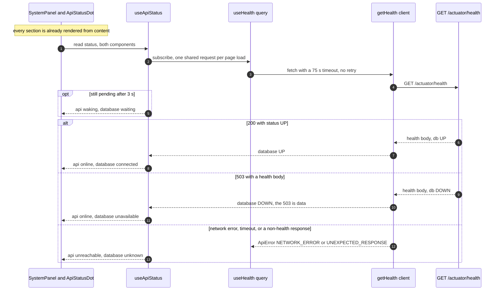
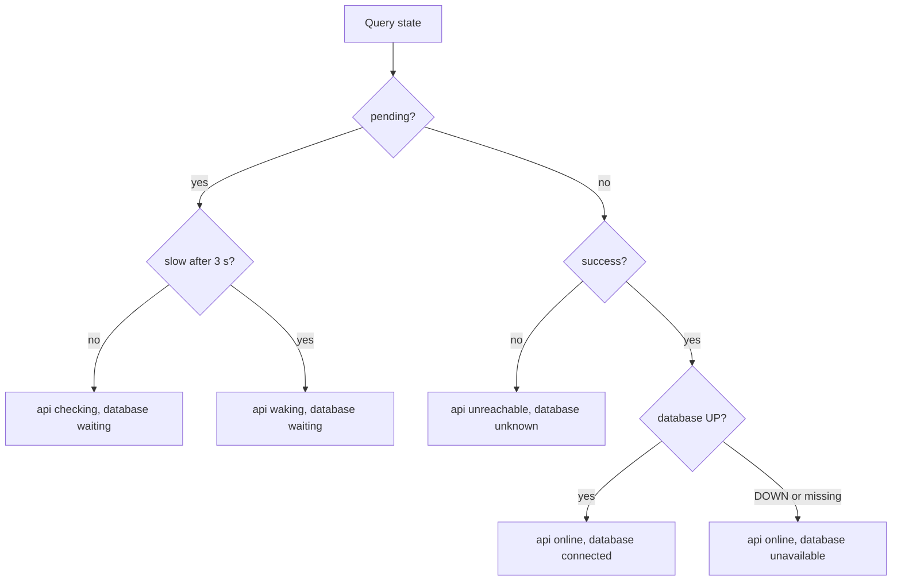

# PF-003 — Static site

**Ticket**: PF-003 · **Refined requirement**: [PF-003-refined-requirement.md](PF-003-refined-requirement.md) · **Packages**: frontend · **Status**: Approved 2026-11-23 · **Last updated**: 2026-11-23 (built in `/dev`; synced with the code)

> ⚠️ **Review these flows first** — [F1 — API status from one health check](#f1--api-status-from-one-health-check)

## 1. Requirement summary

Build the static site in the owner-approved design (D1): design tokens and self-hosted fonts, a sticky header and footer, the home sections rendered from typed files in `src/content/`, the seven `/work/<slug>` case-study pages, a title and meta description per route, and accessibility. The hero's live system panel and the footer status dot come from one health check, moved here from PF-005 (D3). All portfolio copy is placeholder text until PF-012 swaps in the reviewed content pack and deploys (D2, D4, D6). Implements SITE-001 (content never waits for the API) and the site map in `docs/product/product-guide.md` §3; maps to `../portfolio-implementation-plan.md` §6 and §7 Phase 2 (private) and `../cv-portfolio-content-plan.md` §6 and §7.1 (private).

## 2. Requirement analysis

| Need | Source | Frontend work |
|---|---|---|
| Approved palette and typefaces, light scheme by default | D1, D9, FR-13, FR-18 | Tokens in `src/index.css`; two `@fontsource-variable` packages (P1, P2) |
| Header with anchor nav, Download CV, mobile menu | FR-14, FR-15 | `sections/Header.tsx`; links work from any route (P6) |
| Hero passes the 10-second test | FR-2, FR-3, AC-2 | `sections/Hero.tsx` with `ProofPoints` linking to case studies |
| Live system panel and footer status dot | FR-9 to FR-12, FR-17, D3 | `features/api-status/` (F1) |
| Home sections from content | FR-1, FR-4, FR-8 | Content files plus `About`, `FeaturedWork`, `HowIWork`, `Skills`, `Experience`, `Education`, `Contact` |
| Skill toggle highlights Featured work | FR-8, AC-7 | Selection state lifted to `HomePage` (P5) |
| Seven case-study pages and the 404 for unknown slugs | FR-5, FR-7, AC-4, AC-5 | `pages/CaseStudyPage.tsx`, route `work/:slug`, `content/caseStudies/` |
| Title and meta description per route | FR-6, FR-7, D7 | `app/useDocumentMeta.ts` (P3) |
| Default meta in `index.html`; SPA rewrite | FR-19, FR-20 | `index.html`, `vercel.json` |
| Placeholder copy of realistic length | FR-22, D2 | `content/placeholder.ts` (P4) |
| Accessibility and 390 px layout | FR-16, AC-8, AC-10 | Tokens checked for AA; focus styles; `motion-safe:` animation; test IDs |
| Works with no backend; production build | FR-1, FR-21, AC-1, AC-11 | No section waits on a query; `pnpm build` |

## 3. Current state

- Routes: `frontend/src/app/routes.tsx:8` lists only `/` and `*`; `buildRoutes` already wraps pages in `RouteErrorPage` (PF-002 D18).
- Layout: `frontend/src/app/RootLayout.tsx:15` renders the skip link and a centered `max-w-5xl` `main`; no header or footer.
- Home: `frontend/src/pages/HomePage.tsx` is a placeholder with the name and title from `frontend/src/content/profile.ts`.
- Tokens: `frontend/src/index.css:7` holds a minimal oklch palette with a dark override at `:17`; reduced motion is handled globally.
- API client: `frontend/src/api/client.ts:114` `createApiClient` supports `tolerateStatus` (`:14`) and a 75 s `COLD_START_TIMEOUT_MS` (`:8`), which `api-status` reuses as designed (KNOWN-FE-006).
- Queries: `frontend/src/app/queryClient.ts:17` retries network and server failures twice by default; `api-status` overrides that.
- Tests: `frontend/src/test/handlers.ts:4` has no default handlers, and the MSW setup fails any unhandled request; `renderRoute` (`frontend/src/test/renderWithProviders.tsx:25`) renders the real route table.
- i18n and test IDs exist (`frontend/src/i18n/en.ts`, `frontend/src/config/test-ids.config.ts`) and gain the new keys.
- No backend change: `GET /actuator/health` is public since PF-002 (D5 there), outside the OpenAPI contract.

## 4. Approach

Build the approved design as Tailwind tokens and a handful of primitives, render every word from typed content files, and keep exactly one API-backed feature (`api-status`) whose failure only changes two status rows and a dot. The design decisions:

| # | Decision | Why |
|---|---|---|
| P1 | Tokens in `src/index.css` `@theme`, values from the approved design. Light: `surface #f2f4f3`, `surface-raised #ffffff`, `surface-sunk #e7ebe9`, `ink #18211e`, `muted #55615c`, `line #cbd3d0`, `accent #1f4fd1`, `accent-ink #ffffff`, `accent-soft #e3e9fb`, `status-ok #17855a`, `status-wake #b7770a`, `status-idle #87918e`. Dark (approved, but not applied since D9, which makes light the default whatever the system setting; kept here for a possible toggle): `surface #111816`, `surface-raised #18211e`, `surface-sunk #0c1210`, `ink #e3e9e6`, `muted #9ca8a3`, `line #2b3633`, `accent #93aaff`, `accent-ink #0f1a3d`, `accent-soft #1c2747`, `status-ok #3ccb8c`, `status-wake #e8a93a`, `status-idle #6b7672`. Also `--font-ui`, `--font-read`, type sizes from the design (`caption`, `label`, `body`, `title`, `subtitle`, `lead`, `section`, `case`, `display`, so no arbitrary font sizes), `--container-page: 74rem` with a `wrap` utility for the shared page width and gutter, `--shadow-panel`, `--radius-panel: 1rem`, `--radius-control: 0.625rem`, and two animations (`travel` for the panel pulse, `breathe` for the waking dot) with their `@keyframes`. Breakpoints stay Tailwind's defaults (`md` 768 px, `lg` 1024 px) | The owner approved these exact values (D1); existing token names are kept so PF-002 classes still work. Status colours appear only as dots, never as text, so amber needs no text contrast |
| P2 | Fonts from `@fontsource-variable/bricolage-grotesque` 5.3.0 and `@fontsource-variable/source-serif-4` 5.3.1, imported once in `src/main.tsx`: the optical-size (`opsz`) roman files only, no italics | Self-hosted with no Google request (FR-18); OFL-1.1; zero JavaScript; `@font-face` rules with `unicode-range`, so a browser fetches only the Latin subset files (76.9 kB and 122.4 kB, `docs/knowledge/tooling.md`) and shows fallback text until they arrive (`font-display: swap`) |
| P3 | `useDocumentMeta({ title, description })` in `src/app/useDocumentMeta.ts`: an effect that sets `document.title` and the `content` of the existing `<meta name="description">`, adding the tag when it is missing (as in jsdom) | Synchronizing with the document is the effect's intended use (frontend principle 12). React 19's hoisted `<title>` would duplicate the static title `index.html` keeps for link previews (D7) |
| P4 | Content model: one file per case study holds both its Featured work row and its page; `featuredWork.ts` holds only the groups and their order; slugs are a `const` tuple, so every reference (proof points, rows, skills) is checked at compile time. Placeholders come from `todo(block, words)`, which returns `TODO: {block} (content pack C)` padded with a neutral filler sentence to about `words` words; placeholder links use `#todo-{name}`. Periods are display strings in content (for example `TODO: period (content pack C)`, later `08/2025 – Present`), so `formatPeriod` is not built | Single source for each fact (FR-4, FR-5); realistic lengths make the layout judgeable (FR-22); a structured period adds a formatter and a placeholder problem for no gain on a static site. This changes the "Period in content" row in `frontend/CLAUDE.md`, updated in this ticket |
| P5 | The selected skill is `useState` in `HomePage`; `Skills` gets the selection and a setter, and `FeaturedWork` gets the set of slugs to highlight | Two sibling sections share one value; no global store (frontend checklist) |
| P6 | Header links are `<Link to={{ pathname: '/', hash: 'work' }}>` and so on, and `RootLayout` adds `<ScrollRestoration />`, which scrolls to the hash after navigation and to the top on a new page; `scroll-padding-top` keeps headings clear of the sticky header | The same links work from a case-study page and the home page |
| P7 | `api-status` feature: `getHealth` uses `createApiClient<LocalPaths>({ tolerateStatus: [503], timeoutMs: COLD_START_TIMEOUT_MS })`; `useHealth` runs with `retry: false` and `staleTime: Infinity`, so the hero panel and the footer dot share one request per page load; `useApiStatus` derives the states (F1) | One check per page load, bounded at 75 s, no loop (FR-9, FR-10); reuses the PF-002 client unchanged |
| P8 | Primitives in `src/components/`: `Section` (heading rail plus content), `ChipList` (a wrapping list of chips; four callers), `ButtonLink` (primary, outline, quiet; a route or a plain URL), `StatusDot` (ok, wake, idle), and `DownloadIcon` (header and hero CV buttons). `Card`, `Skeleton`, and `ErrorNote` wait for their first caller (PF-005 to PF-007) | Frontend principle 2: add a primitive when a caller needs it; `StatusDot` has two callers (panel, footer) |
| P9 | `Header` and `Footer` live in `src/sections/`; `RootLayout` renders skip link, `Header`, a full-width `main`, `Footer`, and `ScrollRestoration` | Sections own their own width (`Section` wraps content), so `main` drops its `max-w-5xl` |
| P10 | `frontend/vercel.json` rewrites every path to `/index.html`; Vercel serves real files first | FR-19; verified for real at the PF-012 deploy (D4) |

| Alternative | Why not |
|---|---|
| React 19 `<title>` and `<meta>` tags in each page | Duplicates the static title in `index.html`, which link previews still need until prerendering (D7) |
| `react-helmet-async` | A dependency for what a ten-line effect does |
| Fonts from Google Fonts | A third-party request on every visit (FR-18) |
| Copying woff2 files into `public/fonts` by hand | No version pin or update path; the license file and subsets are managed by hand |
| Card and row content in `featuredWork.ts`, page content in `caseStudies/` | Two places for the same title, role, and chips; they would drift |
| A global store or context for the skill selection | One parent component suffices |
| Polling the health endpoint | The state cannot change in a way the visitor needs mid-read; a loop costs free-tier wake-ups |

**Reuse**: `createApiClient` with `tolerateStatus` and `COLD_START_TIMEOUT_MS`, `ApiError`, `buildRoutes` and `RouteErrorPage`, `NotFoundPage`, `t()`, `TestIds` and `getTestIdProp`, `renderWithProviders`, `renderRoute`, the MSW server. **Single responsibility**: `useDocumentMeta` sets the document title and description; `getHealth` fetches and normalizes the health body; `useHealth` owns the query; `useSlowAfter` reports that a pending state passed a delay; `useApiStatus` maps query state to display states; `SystemPanel` and `ApiStatusDot` render them; each section renders one content file; `CaseStudyPage` resolves a slug and renders one study.

## 6. Frontend

### Components and routes

- `RootLayout` (modified): skip link (reused), `Header` (new), `main` (full width), `Footer` (new), `ScrollRestoration` (new)
    - `Header` (new): wordmark link to `/`; nav links Work, How I work, Skills, Experience, Contact (hash links to `/`); Download CV `ButtonLink` to `/cv.pdf`; menu button with `aria-expanded` and a mobile nav below 1024 px (`lg`), rendered only while open; a link in it closes it
    - `Footer` (new): copyright with the name, `ApiStatusDot` (feature), View source link to the repository, privacy note from content
- `/` → `HomePage` (rewritten): owns the selected skill; `useDocumentMeta` with the home title and description
    - `Hero` (new): name and title (real), where line, pitch, stack `Chip`s, `ProofPoints` (three links to `/work/<slug>`), actions View work (`#work`), Download CV, Contact (`#contact`), `SystemPanel` (feature)
    - `About` (new): paragraphs and a facts list
    - `FeaturedWork` (new): two groups of `WorkRow`s; a row is a stretched link to `/work/<slug>` and shows title, role, problem, outcome, three chips; while a skill is selected, the rows it used get `data-state="match"`, a tinted background, and a left accent bar; the other rows keep full contrast (no fading, so AC-8 holds)
    - `HowIWork` (new): six principles, each with an example
    - `Skills` (new): groups of skill toggle buttons (`aria-pressed`, count of case studies); the selected skill's "Used in" links below its group
    - `Experience` (new): timeline of three roles, the current one marked
    - `Education` (new): degrees and awards
    - `Contact` (new): LinkedIn and GitHub links and a short note; the form arrives in PF-006
- `/work/:slug` → `CaseStudyPage` (new) resolves the slug: an unknown slug renders `NotFoundPage`, a known one `CaseStudyArticle` (new), which sets the meta; back link to `/#work`; title and angle; `GlanceAside` (role, period, team, stack chips, up to three outcomes, links); sections Context, The problem, My role and scope, What I built, Deep dive, Outcome, What I learned, Tech used; link to the next case study in Featured work order (the last wraps to the first)
- `*` → `NotFoundPage` (modified): sets its title and description

| Route | `<title>` | Meta description | Sitemap |
|---|---|---|---|
| `/` | Will Ly - Full-stack Software Engineer | `site.homeDescription` (placeholder) | PF-012 |
| `/work/:slug` | `{caseStudy.title} \| Will Ly` | `caseStudy.metaDescription` (placeholder) | PF-012 |
| `*` | Page not found \| Will Ly | `t('notFound.description')` | none |

`index.html` keeps the default title and description, and adds `og:title`, `og:description`, `og:type`, and one light `theme-color` meta; `color-scheme` is `light` (D9).

### Content

New files under `frontend/src/content/`: `placeholder.ts`, `profile.ts` (extended: pitch, where line, stack, proof points, about, links, CV path), `site.ts` (home description, privacy note), `featuredWork.ts`, `howIWork.ts`, `skills.ts`, `experience.ts`, `education.ts`, `caseStudies/slugs.ts`, `caseStudies/types.ts`, `caseStudies/index.ts`, and one file per slug.

| Block | Source | Tier | Status |
|---|---|---|---|
| Name "Will Ly", title "Full-stack Software Engineer" | Product guide §2, already in `profile.ts` | A | real |
| GitHub URL `https://github.com/HyHyZhaLee`, repository link | Content plan D6 | A | real |
| The seven slugs | Content plan §6.4 | A | real |
| Hero pitch, where line, stack chips, three proof points | Placeholder | A later | placeholder |
| About paragraphs and facts | Placeholder | A later (growth story approved for About only) | placeholder |
| Featured work group headings, rows (title, role, problem, outcome, chips) | Placeholder | A later; B items pending | placeholder |
| Case-study pages (seven), including meta descriptions | Placeholder | A later; B items pending | placeholder |
| How I work (six principles and examples) | Placeholder | A later | placeholder |
| Skill groups, skills, and their case-study links | Placeholder | A later | placeholder |
| Experience (three roles), Education and awards | Placeholder | A later | placeholder |
| LinkedIn URL, home description, privacy note | Placeholder (`#todo-linkedin`) | A later | placeholder |

UI strings (navigation, headings, buttons, panel labels and notes, status labels) go in `src/i18n/en.ts`; they describe the site, not Will's work. The panel's row texts describe this site's own architecture (React on Vercel, Spring Boot on Render, PostgreSQL on Neon), which is public and Tier A.

### Data and states

| View | Hook and query key | Endpoint | Loading | Fallback | Error |
|---|---|---|---|---|---|
| Hero `SystemPanel` (API and database rows, note) | `useApiStatus` → `useHealth`, `apiStatusKeys.health()` | `GET /actuator/health` | API "Checking", database "Waiting"; after 3 s API "Waking up" (amber, breathing) with the cold-start note | Not needed: the other two rows and every section are static | API "Unreachable" (grey), database "Unknown", note says the page still works and links to the `this-site` case study |
| Footer `ApiStatusDot` | same query, deduplicated | same | grey "API checking", then amber "API waking up" | — | grey "API unreachable" |

A 503 with a health body is data, not an error: API "Online", database "Unavailable" (grey), with its own note (KNOWN-FE-006). The panel has fixed row heights and a reserved note height, so status changes never shift the layout.

### Test IDs

| Element | Test ID | Purpose |
|---|---|---|
| Header wordmark | `header-home-link` | Back to the home page |
| Header nav links | `header-nav-link` (one per link) | Anchor navigation |
| Header Download CV | `header-cv-link` | CV download |
| Header menu button | `header-menu-button` | Opens and closes the mobile nav |
| Hero View work, Download CV, Contact | `hero-work-link`, `hero-cv-link`, `hero-contact-link` | Actions |
| Hero proof point | `hero-proof-link` (one per proof) | Link to its case study |
| Featured work row link | `work-case-study-link` (one per row) | Link to the case study |
| Skill toggle | `skills-skill-button` (one per skill) | Select or clear a skill |
| Used-in link | `skills-used-in-link` | Link to a case study |
| Contact LinkedIn, GitHub | `contact-linkedin-link`, `contact-github-link` | Contact links |
| Case-study back, next | `case-study-back-link`, `case-study-next-link` | Navigation |
| Case-study glance links | `case-study-glance-link` (one per link) | Source and other links in At a glance |
| System panel | `api-status-panel-region` | The panel |
| Panel API and database states | `api-status-api-state`, `api-status-database-state` | Status text |
| Footer status dot | `api-status-footer-state` | Status text |
| Panel "How this site is built" link | `api-status-how-built-link` | Link to the `this-site` case study once the check answers |
| Footer View source | `footer-source-link` | Repository link |

The existing `home-title-heading`, `app-skip-link`, and `app-main-region` stay.

### User flow

1. A recruiter opens `/`: header, hero, and every section render at once from content; the panel shows "Checking".
2. The health check answers: the API row turns "Online" and the database row "Connected" (or, after 3 s of waiting, "Waking up"; after a failure, "Unreachable").
3. The recruiter clicks a proof point or a Featured work row and lands on `/work/<slug>`, scrolled to the top, with its own title.
4. "All work" returns to `/#work`; a header link from the case-study page lands on the right home section.
5. On the home page, selecting a skill lists its case studies and highlights their rows; selecting it again clears it.

## 7. Complex flows

### F1 — API status from one health check

> ⚠️ **Review this flow** — `useApiStatus` (hook) → `useHealth` → `getHealth`: one query shared by two components, a 3 s timer, and a decision table with five outcomes; no retries, no polling.

| Messages | What happens, and why |
|---|---|
| Note, 1 | Static content renders first; the check never gates a section (SITE-001, FR-1). Both consumers call `useApiStatus` |
| 2 | TanStack Query deduplicates the two consumers into one request, and `staleTime: Infinity` keeps it to one per page load, also across route changes (FR-9) |
| 3, 4 | One attempt through the shared client (correlation ID, `ApiError` on failure) with the 75 s cold-start timeout and `retry: false`, so the worst case is one 75 s wait, never a loop (FR-10) |
| 5 | `useSlowAfter(isPending, 3000)` flips to slow after 3 s; the hook shows "waking" only while the query is still pending (FR-10) |
| 6 to 8 | A 200 health body means online and connected |
| 9 to 11 | A 503 is tolerated and read as a body: the API answered and the database is down (FR-11, KNOWN-FE-006) |
| 12, 13 | Any failure, including the Vite proxy's error page when the backend is stopped in development, means unreachable |

**Simplest alternative**: drop the 3 s waking state and show "checking" until the answer. The visitor would then see "checking" for up to a minute on a cold start with no hint why, which the cold-start UX in the master plan (§6.3) asks for.

## 8. Files, order, risks, tests

**New**: `frontend/vercel.json`; `frontend/src/app/useDocumentMeta.ts`; `frontend/src/components/{Section,ChipList,ButtonLink,StatusDot,DownloadIcon}.tsx`; `frontend/src/sections/{Header,Footer,Hero,ProofPoints,About,FeaturedWork,WorkRow,HowIWork,Skills,Experience,Education,Contact}.tsx`; `frontend/src/pages/{CaseStudyPage,CaseStudyArticle,GlanceAside}.tsx`; `frontend/src/features/api-status/{types,api,queries,useSlowAfter,useApiStatus,statusTone,index}.ts` and `{SystemPanel,ApiStatusDot}.tsx`; `frontend/src/content/{placeholder,site,featuredWork,howIWork,skills,experience,education}.ts`; `frontend/src/content/caseStudies/{slugs,types,index}.ts` and seven `{slug}.ts` files; tests listed below.

**Modified**: `frontend/package.json` and `pnpm-lock.yaml` (two font packages); `frontend/index.html`; `frontend/src/main.tsx` (font imports); `frontend/src/index.css` (tokens, fonts, keyframes, `scroll-padding-top`); `frontend/src/app/{routes,RootLayout}.tsx`; `frontend/src/pages/{HomePage,NotFoundPage,RouteErrorPage}.tsx` (the 404 and error pages take the page width now that `main` is full width); `frontend/src/content/profile.ts`; `frontend/src/i18n/en.ts`; `frontend/src/config/test-ids.config.ts`; `frontend/src/test/handlers.ts` (default health handler: 200 UP); `frontend/src/test/setup.ts` (stubs for `window.scrollTo` and `scrollIntoView`, which jsdom lacks); `frontend/vite.config.ts` (`test.env.VITE_API_URL`, because openapi-fetch rejects a relative URL in Node); `frontend/src/app/routes.test.tsx`. Docs: `docs/product/product-guide.md` §3 (status dot moves to PF-003, Open source and the counter keep their tickets), `docs/architecture/frontend.md` (Key Directories: `api-status` in PF-003, primitives built, `utils/format.ts` waits for PF-005), `frontend/CLAUDE.md` (routing line, analytics in PF-012, the "Period in content" row, project structure).

**Order** (frontend only; no `gen:api`, no backend change). Each slice: contract first (content types, strings, test IDs, hook and component signatures), then the test writer starts while the implementation is written.

| Slice | Demo | Contract first | Then |
|---|---|---|---|
| S1 — Design system and shell | `/` shows header, hero (without the panel), and footer in the approved look, in the light scheme (D9) | Font packages installed; tokens; `useDocumentMeta`; primitives' props; `profile.ts` and `site.ts` types and placeholders; strings; test IDs | `Header` with mobile menu, `Footer` (no dot yet), `Hero` with `ProofPoints` (links point at `/work/<slug>`, which 404 until S4), `RootLayout`, `HomePage`, `index.html` |
| S2 — API status | The hero panel and the footer dot go from checking to online with the backend up, and to unreachable with it down | `types.ts` (`LocalPaths`, `HealthBody`, `ApiStatus`), `getHealth`, `apiStatusKeys`, `useHealth`, `useApiStatus` signatures; default MSW health handler | `useSlowAfter`, `useApiStatus`, `SystemPanel` with the one-time pulse (`motion-safe:`), `ApiStatusDot`, embedded in `Hero` and `Footer` |
| S3 — Home sections | Every home section renders from placeholders; the skill toggle highlights rows | `featuredWork.ts`, `howIWork.ts`, `skills.ts`, `experience.ts`, `education.ts`, `caseStudies/slugs.ts` and `types.ts` with the seven placeholder files (row fields used here, page fields filled too) | `Section`-based `About`, `FeaturedWork` with `WorkRow`, `HowIWork`, `Skills`, `Experience`, `Education`, `Contact`; skill state in `HomePage` |
| S4 — Case studies and routes | Every row opens its case study with its own title; an unknown slug shows the 404 | Route `work/:slug`; `getCaseStudy`; `CaseStudyPage` props | `CaseStudyPage`, `GlanceAside`, next link, `NotFoundPage` meta, `ScrollRestoration`, `vercel.json`; docs updates; `pnpm build` |

| Risk | Mitigation |
|---|---|
| `ScrollRestoration` in React Router 8 might not scroll to a hash after navigation | Resolved: it calls `scrollIntoView` on the hash target after navigation (`docs/knowledge/tooling.md`), proven by the S4 header-link test; no fallback effect needed |
| Fontsource file names for the `opsz` axis differ from the assumption | Resolved: both packages ship `opsz.css`; the families are named `… Variable` (`docs/knowledge/tooling.md`) |
| Placeholder lengths hide a fold problem that real copy causes | `todo(block, words)` matches the target lengths from the content plan (pitch ≤ 20 words, About 120–180); re-check the fold at 1366×768 in PF-012 |
| Every page test now renders the panel, so an unhandled health request fails tests | Default health handler in `src/test/handlers.ts` (200 UP); tests that need another state override it with `server.use` |
| Sticky header covers anchored headings | `scroll-padding-top` and the rail's sticky `top` offset |
| Placeholder text published by accident | No deploy in PF-003 (D4); PF-012 adds a content test that fails on any `TODO:` |
| Amber or grey fails contrast | Status colours are dots only; every label is `ink` text |

**Tests** (within the test budget; one writer per slice, frontend only):

- S1: `src/app/routes.test.tsx` (modified): `/` renders the header, the hero heading, three proof links to `/work/<slug>`, and the CV link to `/cv.pdf`; the home title is set. `src/sections/Header.test.tsx`: the menu button opens and closes the mobile nav and flips `aria-expanded`.
- S2 (review fix: the panel test also checks `api-status-how-built-link`): `src/features/api-status/useApiStatus.test.tsx`: 200 UP → online and connected; 503 with a DOWN body → online and unavailable; network error → unreachable and unknown; a delayed response → waking after 3 s (fake timers); two consumers send one request. `src/features/api-status/SystemPanel.test.tsx`: the panel and the footer dot render the state labels for online and unreachable.
- S3: `src/pages/HomePage.test.tsx`: with the health check failing, every section heading renders (AC-1); each row links to its case study (AC-3); the contact links point at LinkedIn and GitHub; selecting a skill lists its case studies and marks exactly their rows `match`, and selecting it again clears (AC-7). `src/content/content.test.ts`: every slug referenced by a proof point, a row, or a skill exists; each group lists known slugs once; no content string is empty; each study has three chips, at most three outcomes, and three to five "What I built" items; there are exactly three proof points.
- S4: `src/pages/CaseStudyPage.test.tsx`: each of the seven slugs renders its title, section headings, and glance links and sets the title and meta description (a seven-row table); an unknown slug renders the 404 page with its title (AC-5); the next link follows Featured work order and wraps; a header link from a case study lands on the home section.
- Not tested by unit tests: the visual design, the fold at 1366×768, and 390 px layout. They are checked by eye with the dev server when the owner asks (live verification), and Lighthouse runs in PF-009. Checked on 2026-11-23 against the local stack (review finding 3): at 1366×768 the whole hero, including the three actions, sits above the fold; at 390 px no element overflows and the mobile menu opens and closes; the page stays light with the system set to dark (D9); a selected skill tints and bars its rows while the others keep full opacity; the panel showed Online and Connected from the running backend. The only console error was the missing `favicon.ico`.
