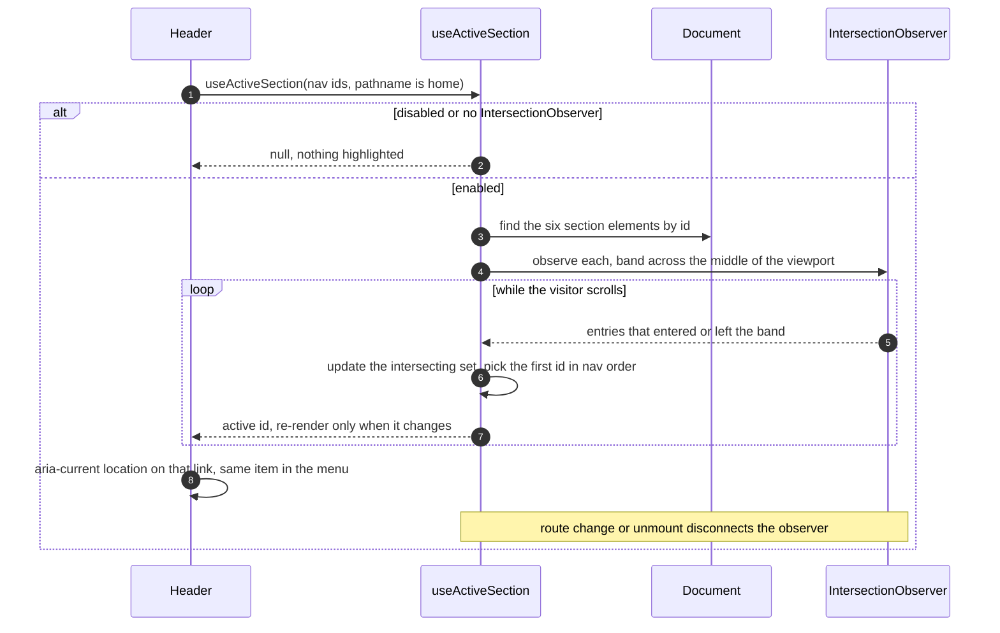

# PF-015 — Responsive polish for every device

**Ticket**: PF-015 · **Refined requirement**: [PF-015-refined-requirement.md](PF-015-refined-requirement.md) · **Packages**: frontend · **Status**: Approved 2026-11-24 · **Last updated**: 2026-11-25

> ⚠️ **Review these flows first** — [F1 — Active section in the header](#f1--active-section-in-the-header)

## 1. Requirement summary

Rework the owner-approved PF-003 design so it looks deliberate on every device: portrait and landscape phones, tablets, 1024px screens, laptops, and wide monitors. Fix every gap from the 2026-11-24 audit, tighten phones without removing content, scale the layout up from 1600px, and add a subtle motion layer (menu transition, scroll fade-in, active section in the header). Light scheme only (PF-003 D9 kept), no copy changes, no backend. Implements FR-1 to FR-12 and decisions D1 to D8 of the refined requirement; maps to `../portfolio-implementation-plan.md` §6 and §7 Phase 2 (responsive navbar) and Phase 8 (manual mobile test, Lighthouse ≥ 90). Keeps SITE-001 (content never waits for the API).

## 2. Requirement analysis

| Need | Source | Frontend work |
|---|---|---|
| No sideways scroll anywhere | FR-1, AC-1 | Keep it so; an e2e overflow matrix guards it |
| Overlay mobile menu | FR-2, AC-2 | `MobileMenu` on a native modal `<dialog>`, icon button, P1 |
| Hero actions sooner on phones | FR-3, AC-3 | Portrait beside the name below 640px |
| Shorter phone page, nothing removed | FR-4, AC-4, D4, D7 | Spacing tokens per tier, compact work rows, full-width intros, 2-column facts |
| At a glance folds on narrow screens | FR-5, AC-5 | Toggle in `GlanceAside` below 1024px |
| 44px touch hit areas | FR-6, AC-6, D6 | `touch-target` utility on coarse pointers, P5 |
| Tablet panel uses its width | FR-7, AC-7, D8 | Horizontal four-step strip at 768–1023px; wrap fixes at 1024px |
| Reading columns ≥ 36rem at 1024px | FR-8, AC-8, D8 | Heading rail and About facts column move to 1280px |
| Compact header on short screens | FR-9, AC-9 | `short` custom variant (height ≤ 30rem), P8 |
| Proportional scaling on wide screens | FR-10, AC-10, D3 | Root `font-size` clamp, P4 |
| Motion that never hides content | FR-11, AC-11, D1, D5 | Dialog transition, CSS scroll-driven `reveal`, `useActiveSection`, P2, P3 |
| Nothing regresses | FR-12, AC-12 | Existing tests, test IDs, states; hero fold at 1366×768; Lighthouse |
| Owner signs off on the look | AC-13 | Before/after screenshots at the viewport matrix |

## 3. Current state

The audit ran on 2026-11-24 with Playwright against the local dev build at 320, 375, 414, 768, 844×390, 1024, 1024×1366, 1366, 1920, and 2560px. No horizontal overflow at any width. The gaps and their code:

| Gap | Where |
|---|---|
| Text "Menu" button; menu pushes the page down; no Escape or outside close | `frontend/src/sections/Header.tsx:50-80` (`menuOpen &&` inline block) |
| Portrait stacks above the name on phones | `frontend/src/sections/Hero.tsx:16` (`flex-col … sm:flex-row`), `:23` (`size-28`) |
| Same section spacing on phones as on tablets | `frontend/src/components/Section.tsx:15` (`py-16`), `:16` (`gap-7`) |
| Heading rail from 1024px squeezes content | `frontend/src/components/Section.tsx:16-17` (`lg:grid-cols-[15rem_…]`, `lg:sticky`) |
| Three narrow About columns at 1024px | `frontend/src/sections/About.tsx:8` (`lg:grid-cols-[minmax(0,1fr)_15rem]`) |
| Panel title breaks after "full-stack"; stranded words in captions and note | `frontend/src/features/api-status/SystemPanel.tsx:86`, `:102`, `:119` |
| Panel full width and mostly empty at 768px | `frontend/src/sections/Hero.tsx:14` (two columns only from `lg`) |
| Work row "View project details" label takes its own line on phones | `frontend/src/sections/WorkRow.tsx:13`, `:33-36` |
| Skill buttons 34px tall | `frontend/src/sections/Skills.tsx:51` (`px-3 py-2`) |
| Small standalone links (back, next, source, certificate) | `CaseStudyArticle.tsx:41`, `:83`, `Footer.tsx:19`, `Education.tsx:21` |
| At a glance a full screen above the article on phones | `frontend/src/pages/GlanceAside.tsx:12-14` |
| 64px header on 390px-tall landscape phones | `frontend/src/sections/Header.tsx:27` (`h-16`), `frontend/src/index.css:97` |
| 1184px island on wide screens | `frontend/src/index.css:84-92` (`wrap`, `--container-page: 74rem`) |
| Modal dialog pattern exists once | `frontend/src/sections/Education.tsx:16-75` (`showModal`, backdrop click close); jsdom stand-in in `frontend/src/test/setup.ts:12-23` |
| Reduced motion already zeroes animations | `frontend/src/index.css:146-155` |

Baseline page heights, re-measured on `main` at `99ce517` (after PF-022, PF-023, PF-025): home 13,150px at 320, 11,529px at 414×896, 9,085px at 768, 7,946px at 1024, 7,119px at 1366 and wider; hero 647px at 1024×768 and 641px at 1366×768 (fits). No horizontal page scroll at any width. Lighthouse ≥ 90 since PF-009.

**Since the first draft (rebase onto `99ce517`).** PF-022 added the architecture diagram as the case study's lead figure (`frontend/src/components/diagram/ArchitectureFigure.tsx`). Its drawing keeps a minimum width and scrolls sideways inside its own frame below `lg`, with a "scroll sideways" hint (PF-022 P8); PF-015 keeps that design, checks the figure in the viewport matrix, and counts FR-1 overflow on the page, not inside that scroll region. PF-023 changed the system panel's states and colours, not its layout. The work row label is now "View project details", which makes the phone chevron in P7 more useful.

## 4. Approach

Keep every token, font, and component's look; change layout per device tier, add three small motion pieces, and use the platform (native `<dialog>`, CSS scroll-driven animations, `IntersectionObserver`, `@starting-style`) instead of a dependency. Each enhancement degrades to today's static behavior in a browser that lacks it.

**Layout tiers** (D8):

| Tier | Width | Header | Hero | System panel | Section heading | At a glance |
|---|---|---|---|---|---|---|
| Phone | < 640px | Icon button + dialog menu | Portrait 80px beside the name; title and location full width below | Vertical list (as today) | Above content, tighter spacing | Role, period, team + toggle |
| Large phone | 640–767px | Same | Portrait 128px beside name, title, location (as today) | Vertical list | Above content | Same |
| Tablet | 768–1023px | Same | One column | Horizontal four-step strip | Above content | Same |
| Small laptop, iPad landscape | 1024–1279px | Inline nav | Two columns (as today) with panel wrap fixes | Vertical list | Above full-width content (rail moves to 1280px) | Beside the article, no toggle |
| Laptop, desktop | 1280–1599px | Inline nav | Unchanged | Unchanged | Sticky left rail (as today) | Unchanged |
| Wide | ≥ 1600px | As desktop, everything scales to 125% at 2560px | | | | |
| Short screen | height ≤ 30rem, any width | 48px tall; `scroll-padding-top` 3.5rem | | | | |

**Decisions**:

- **P1 — Mobile menu on a native modal `<dialog>`.** `showModal()` gives the top layer, a focus trap, Escape to close, an inert page, and focus back on the button at close, all built in (FR-2). A click on `::backdrop` lands on the dialog element, so the existing "target is the dialog" check closes it on an outside tap. The sheet drops from the top and repeats the header row, with a close button where the menu button was, so the button visually turns into ✕. An effect closes it when `(width >= 64rem)` starts matching (resize or rotate). The page behind stops scrolling through one CSS rule, `html:has(dialog[open]) { overflow: hidden }`, which also stops background scroll behind the certificate viewer. Built as: `useModalDialog()` returns `{ isOpen, open, close, dialogRef, dialogProps }`, with the ref apart from the spread props because the `react-hooks/refs` lint rule rejects spreading an object that holds a ref; the brand in the sheet's header row is plain text, not a second home link; `html` keeps `scrollbar-gutter: stable` so the lock never shifts the layout.
- **P2 — Section fade-in is CSS only.** A `reveal` utility runs a one-time `opacity 0 → 1, translate 0 1.25rem → 0` keyframe on `animation-timeline: view()` with `animation-range: entry 0% entry 8rem` (built as: the first draft's `entry 100%` left a unit taller than a short screen, such as the Contact form at 844×390, faded while it was read; a fixed 8rem finishes the fade 128px after the top edge enters, whatever the unit's height), inside `@media screen and (prefers-reduced-motion: no-preference)` and `@supports (animation-timeline: view())`. Without support, under reduced motion, or in print the rule never applies and everything is plainly visible (D5). It goes on units smaller than a screen (the section heading block, each work row, role, principle, skill group, education item, and the two Contact columns), never on a whole tall section, so no text stays translucent while being read. `animation-timeline` is declared after the `animation` shorthand, which resets it.
- **P3 — Active section through `IntersectionObserver`.** `useActiveSection(ids, enabled)` watches the six nav sections through a thin band across the middle of the viewport and returns the first intersecting id in nav order, or `null`. The header link for it gets `aria-current="location"` and an accent underline; the dialog menu highlights the same item. Enabled on `/` only; returns `null` where `IntersectionObserver` is missing (jsdom). See F1.
- **P4 — Wide screens scale through the root font size.** `html { font-size: clamp(100%, 0.5833rem + 0.4167vw, 125%) }` is 16px up to 1600px and 20px from 2560px with a default browser font. Spacing, type, and `--container-page` are all in rem, so the whole layout scales together; media queries in rem keep reading the initial size, so breakpoints do not move; a visitor's larger default font still scales the result (D3).
- **P5 — Touch hit areas without heavier chips.** A `touch-target` utility, active only under `(pointer: coarse)`, makes the element `relative` and adds an invisible `::after` centred on it of at least 44×44px (D6). Skill chips keep their 34px look; their row gap grows to 10px on coarse pointers so neighbouring hit areas never overlap. Applied to the skill buttons, the header brand and inline nav links (touch laptops and iPads at 1024px), the back and next links, the glance links, the certificate buttons, and the footer source link. Running-text links stay exempt, including the Skills "Used in" links inside their sentence. The menu and close buttons are 44px boxes; the glance toggle also gets `touch-target`.
- **P6 — Breakpoints per D8.** The heading rail, its sticky position, the 28ch intro width, and the About facts column move from `lg` to `xl`. The hero stays two columns from `lg` so the live panel stays above the fold at 1024×768; the panel's title row becomes `flex-wrap` with "Status now" `whitespace-nowrap`, so it drops whole to the next line instead of the title breaking, and its captions and note get `text-pretty`. From `md` to `lg` the panel's list becomes a four-column strip: icon, name, what, and status stacked per column, a horizontal connector between icons, fixed column heights so status changes never shift the layout, and the travel pulse hidden in that range (its keyframe is vertical).
- **P7 — Phones tighten through spacing only** (D4, D7): section padding `py-10 sm:py-16` (Contact matches), section inner gap `gap-4 sm:gap-7`, hero padding `pt-6 pb-10 sm:pt-8 sm:pb-14`, role gap `gap-7 sm:gap-9`, principle gap `gap-6 sm:gap-8`, work row padding `py-4 sm:py-5.5`, Contact column gap `gap-8 sm:gap-10`, footer bottom padding `pb-10 sm:pb-12`, group spacing `mt-10 sm:mt-13`, skill group padding `py-4 sm:py-4.5`, section intros full width below `xl`, About facts in two columns on phones and three on tablets. Below 640px the decorative "View project details" label becomes a chevron after the title (both `aria-hidden`; the whole row stays one link). Measured after the build: the home page is 10,593px at 414×896 (from 11,529), 11,224px at 375×667, and 12,416px at 320×640. The first pass (`py-12`, `gap-5`, `py-4.5`) reached 10,773px, so section padding, the section gap, the work row padding, the Contact gap, and the footer padding each lost one more step on phones only to meet AC-4.
- **P8 — Short screens.** `@custom-variant short (@media (height <= 30rem))`; the header uses `short:h-12` and `html` gets `scroll-padding-top: 3.5rem` there.
- **P10 — The header is fixed, not sticky** (found in the S5 visual QA, also present on `main`). Chromium scrolls the page each time focus lands on an element of a sticky header that sits inside the `scroll-padding-top` band, so tabbing through the header made the page jump about 392px per key press at 1366×768. `Header` now renders `fixed inset-x-0 top-0` (`print:absolute`) after an `aria-hidden` spacer that mirrors it (`box-content h-16 short:h-12` plus a transparent 1px bottom border), so the layout is unchanged to the pixel; `scroll-padding-top` stays, keeping anchors and focused content clear of the header. Rejected: removing `scroll-padding-top` in favour of `scroll-margin-top` on targets (focused content could slide under the header where focus scrolling aligns to the nearest edge), and dropping the padding only while the header has focus (a link activated from the header would then land under it).
- **P11 — QA polish.** The hero pitch gets `text-pretty` (a stranded last word at 320px); the panel's "How this site is built" link is `whitespace-nowrap` (it broke across lines at 1024px); skill chips are `text-left` with a `rounded-2xl` radius (a pill on one line, a rounded block when a long label wraps on phones); the case study's next-project link gets the same chevron as the back link. Kept as approved: the Contact grid's own columns from `lg` (PF-003 layout) and the case-study titles' hyphen separators (copy is out of scope).
- **P9 — No new dependency.** Everything above is CSS or a few lines of React.

| Alternative | Why not |
|---|---|
| A motion library (Framer Motion, about 30–50 kB) for the menu and reveal | Adds bundle weight against Lighthouse ≥ 90 for effects CSS does natively; Non-Negotiable 8 spirit and principle 13 |
| JavaScript reveal (`IntersectionObserver` adds a class) | Content would start hidden and depend on a script running; the CSS version cannot hide anything where it is unsupported (D5) |
| Popover API for the menu (`popovertarget`, light dismiss) | Fewer lines, but no focus trap or inert page, and jsdom has no popover stand-in; the dialog pattern and its test stand-in already exist |
| Hero two columns only from 1280px | The live panel would fall below the fold at 1024×768 (iPad landscape, small laptops), where it is visible today |
| 44px-tall skill chips | About 200px more on phones and a heavier look; the hit area meets the same target (D6) |
| Separate phone components (render different trees per breakpoint) | Duplicated markup and test IDs; Tailwind variants on one tree are enough |
| Hide-on-scroll header | Needs a scroll listener and causes jumps; a compact header on short screens solves the landscape case (refined requirement, open question default) |

**Reuse**: `Section`, `ChipList`, `ButtonLink`, `StatusDot`, the theme tokens, the dialog markup and backdrop-click logic from `CertificateViewer`, the jsdom dialog stand-in, `getTestIdProp`, `t()`, the Playwright config and its API-abort pattern from `e2e/smoke.spec.ts`. **Single responsibility**: `useModalDialog` owns a modal dialog's ref, open state, show, close, and backdrop close; `MobileMenu` renders the menu button and the menu dialog; `navItems` lists the header's section links; `useActiveSection` reports which nav section is in view; the `reveal`, `touch-target`, and `short` CSS units each own one presentational rule.

## 6. Frontend

### Components and routes

No route, title, meta description, or sitemap change.

- `RootLayout` (reused)
  - `Header` (changed): brand link, inline nav from `lg` with `aria-current` on the active section, `MobileMenu` below `lg`; `short:h-12`
    - `MobileMenu` (new, `src/sections/MobileMenu.tsx`): 44px icon button (`aria-label`, `aria-expanded`, `aria-haspopup="dialog"`, `aria-controls`) and the dialog sheet with the brand row, close button, and the six links; closes on link click, Escape, backdrop, close button, or reaching `lg`
    - `navItems` (new, `src/sections/navItems.ts`): moved out of `Header.tsx` for `Header`, `MobileMenu`, and `useActiveSection`
    - `useActiveSection` (new, `src/app/useActiveSection.ts`), F1
  - `HomePage` (reused)
    - `Hero` (changed): portrait and name grid on phones, padding per tier
      - `SystemPanel` (changed): title-row wrap, `text-pretty`, `md`–`lg` strip; states and reserved heights unchanged
    - `Section` (changed): spacing per tier, rail and intro width at `xl`, `reveal` on the heading block
    - `About`, `Experience`, `FeaturedWork`, `WorkRow`, `HowIWork`, `Skills`, `Education`, `Contact` (changed): spacing per P7, `reveal` per P2, `touch-target` per P5; `WorkRow` switches `transition` to `transition-colors` so no transition touches the reveal's opacity and translate
    - `Education` (changed): `CertificateViewer` uses `useModalDialog`
  - `CaseStudyArticle` (changed): header spacing per tier, `touch-target` on back and next links
    - `GlanceAside` (changed): below `lg`, stack, outcomes, and links sit in a region shown by a toggle button (`aria-expanded`, `aria-controls`); from `lg` the region always shows and the toggle is hidden. Stack and outcomes moved into their own `<dl>` inside that region so the markup stays valid
  - `Footer` (changed): `touch-target` on the source link
- `src/components/useModalDialog.ts` (new): shared by `CertificateViewer` and `MobileMenu`
- `src/index.css` (changed): root clamp (P4), `short` variant (P8), `touch-target` (P5), `reveal` and its keyframe (P2), `html:has(dialog[open])` scroll lock, the dialog sheet's `@starting-style` open and close transition (200ms opacity and `translate`, `transition-behavior: allow-discrete` on `display` and `overlay`, backdrop fade), `scroll-padding-top` for short screens

### Content

No portfolio content changes; every public text block keeps its PF-012 source and tier. New UI strings in `src/i18n/en.ts` (labels for controls, not portfolio claims, so no tier applies):

| Key | Text | Used by |
|---|---|---|
| `nav.openMenu` | Open menu | Menu button accessible name |
| `nav.closeMenu` | Close menu | Close button accessible name |
| `caseStudy.glanceMore` | More details | Glance toggle, collapsed |
| `caseStudy.glanceLess` | Fewer details | Glance toggle, expanded |

`nav.menu` ("Menu") is removed if nothing uses it after the change.

### Data and states

No new API-backed view. The system panel keeps checking, waking, online, unreachable, and database-down in every tier, with fixed row or column heights so a status change never moves the layout (PF-003 FR-17, principle 5). The page still renders fully with the API down (smoke suite).

### Test IDs

| Element | Test ID | Purpose |
|---|---|---|
| Menu button | `header-menu-button` (existing) | Opens the menu |
| Menu dialog | `header-menu-dialog` | Open state in tests |
| Menu close button | `header-close-button` | Closes the menu |
| Menu and inline nav links | `header-nav-link` (existing) | Navigation |
| Glance toggle | `case-study-glance-toggle` | Shows and hides stack, outcomes, and links below `lg` |

### User flow — mobile menu

1. Below 1024px the visitor taps the menu icon; the sheet drops from the top over a dimmed page in 200ms and focus moves to the first link.
2. The current section, if any, is highlighted.
3. Tapping a link closes the sheet and scrolls to the section under the header; Escape, the close button, or a tap on the dimmed page closes it with focus back on the menu button.
4. Rotating or resizing to 1024px or wider closes it, and the inline nav takes over.

## 7. Complex flows

### F1 — Active section in the header

> ⚠️ **Review this flow** — `useActiveSection(ids, enabled)` in `src/app/useActiveSection.ts`, called by `Header`: one `IntersectionObserver` over six sections, an in-memory set of intersecting ids, and a winner picked in nav order. No network, no storage.

1. `Header` passes the nav ids and `enabled = pathname === '/'`; case studies and the 404 page have none of the sections (FR-11).
2. Disabled or unsupported returns `null`, so jsdom, old browsers, and other routes simply show no highlight; nothing breaks (D5 spirit).
3. Missing elements are skipped, so a section removed later cannot throw.
4. The band is `rootMargin: '-45% 0px -50% 0px'`: a 5%-tall strip, so at most two adjacent sections meet it, at a boundary.
5. The callback adds or removes each entry's id in a `Set` held in a ref (no state per entry).
6. The winner is the first nav id in the set, so a boundary tie is stable; an empty set (the hero, or Education, which has no nav link) gives `null`.
7. `setActive` with the same value does not re-render, so scrolling inside one section costs nothing.
8. The link gets `aria-current="location"`, which screen readers announce as the current location, and a token-coloured underline; the menu reuses the value.

**Simplest alternative**: no active-section highlight (drop FR-11's third part). The header stays static and about 40 lines and one test go away; the visitor loses the "where am I" cue on a long single page.

## 8. Files, order, risks, tests

**New**: `frontend/src/sections/MobileMenu.tsx`, `frontend/src/sections/navItems.ts`, `frontend/src/components/useModalDialog.ts`, `frontend/src/app/useActiveSection.ts`, `frontend/e2e/responsive.spec.ts`.

**Modified**: `frontend/src/index.css`, `frontend/src/sections/{Header,Hero,About,Experience,FeaturedWork,WorkRow,HowIWork,Skills,Education,Contact,Footer}.tsx`, `frontend/src/sections/Header.test.tsx`, `frontend/src/components/Section.tsx`, `frontend/src/features/api-status/SystemPanel.tsx`, `frontend/src/pages/{CaseStudyArticle,GlanceAside}.tsx`, `frontend/src/pages/CaseStudyPage.test.tsx`, `frontend/src/i18n/en.ts`, `frontend/src/config/test-ids.config.ts`, `frontend/CLAUDE.md` (Key Patterns: menu dialog, reveal, touch-target, tiers), `docs/architecture/frontend.md` (principle 10: motion is CSS-first and never hides content; principle 2: `useModalDialog`), `docs/prd/backlog.md`. Knowledge entries in `docs/knowledge/` for any quirk verified while building (for example the `animation` shorthand resetting `animation-timeline`).

**Order** (frontend only; each slice ends with type check, lint, format, unit tests, and the e2e suite green):

1. **S1 — Foundations (CSS only, demo: 2560px scaled, compact landscape header).** Contract: the `index.css` additions (root clamp, `short`, `touch-target`, `reveal` defined but not yet applied, scroll lock); `Header` `short:h-12`. Tests: AC-9, AC-10.
2. **S2 — Mobile menu (demo: the sheet at 375px).** Contract: `useModalDialog` signature, `navItems`, `MobileMenu` props, the new i18n keys and test IDs; then `CertificateViewer` on the hook, `Header` split, dialog transition. Tests: `Header.test.tsx` rewritten for the dialog; AC-2; the menu part of AC-6.
3. **S3 — Layout per tier (demo: the viewport matrix).** `Hero` grid, `Section` and `About` to `xl`, spacing per P7, `WorkRow` chevron, `SystemPanel` wrap fixes and strip, skill and link hit areas, `GlanceAside` toggle, case-study spacing. Tests: AC-1, AC-3, AC-5, AC-6, AC-8; glance toggle in `CaseStudyPage.test.tsx`.
4. **S4 — Motion (demo: scroll the home page).** `reveal` on the units from P2, `useActiveSection` with the header and menu highlight. Tests: active-section test in `Header.test.tsx`; AC-11.
5. **S5 — Verify and sync.** Before/after screenshots at 320, 375, 414, 768, 844×390, 1024, 1366, 1920, 2560 for `/` and a case study for the owner (AC-13); home height at 414×896 (AC-4) and the panel's wrapping at 768 and 1024 (AC-7) checked on them; Lighthouse mobile and desktop on `vite preview` (AC-12); coverage ≥ 80%; docs and knowledge updated.

| Risk | Mitigation |
|---|---|
| The reveal leaves something translucent (deep link, screenshot, tall unit) | CSS only, guarded by `@supports`, `screen`, and reduced motion; applied to sub-screen units; AC-11 e2e checks a deep link and reduced motion |
| Moving the rail to `xl` changes the 1024–1279px desktop look the owner approved | That range had the squeeze the audit found; the owner reviews 1024 and 1280 screenshots (AC-13) |
| Hero no longer fits at 1366×768 | Desktop tier unchanged; AC-3 e2e asserts the hero's bottom ≤ 768px |
| The dialog close transition is not supported everywhere (`overlay` in Firefox) | Progressive: it closes instantly there; open state and focus are unaffected |
| The `:has()` scroll lock also locks the page behind the certificate viewer | Intended and consistent; the Education test still passes |
| Phone height misses ≤ 10,600px | Levers listed in P7; the owner decides at the screenshot review (D7) |
| Root scaling enlarges something drawn in px (borders, shadows, hairlines) | They stay thin on purpose; checked in the 1920 and 2560 screenshots |
| Lighthouse drops | No dependency; one tiny hook; CSS only otherwise; measured in S5 |
| Conflict with PR #8's backlog row | One-line rebase fix when either merges |

**Tests** (within the test budget; no snapshots):

- `Header.test.tsx` (rewritten): the menu button opens the dialog (`open`, `aria-expanded`); the close button and a link click close it (jsdom stand-in fires `close`); with a stubbed `IntersectionObserver` reporting `work`, the Work link has `aria-current="location"`, and on `/work/:slug` no link does. Escape and backdrop behavior is native and covered in e2e.
- `CaseStudyPage.test.tsx`: the glance toggle flips `aria-expanded` and controls the region that holds the stack, outcomes, and links.
- `Education.test.tsx`: unchanged; it proves the hook refactor.
- `e2e/responsive.spec.ts` (Chromium, API calls aborted as in the smoke suite, about 120 lines): AC-1 overflow matrix (8 widths × `/` and a case study); AC-2 menu at 375px with touch (Escape returns focus, a link navigates and closes); AC-3 fold checks at 390×844 and 1366×768; AC-5 glance toggle at 375px and no toggle at 1366px; AC-6 hit areas at 375px with a coarse pointer (sizes, and `elementFromPoint` 4px outside a skill chip); AC-8 column widths at 1024px; AC-9 header height at 844×390; AC-10 root size at 1440 and 2560; AC-11 reduced motion leaves no running animation, and `/#skills` leaves the Skills heading and first group fully opaque.
- Checked at build time, not asserted: AC-4 height (a content edit would break it), AC-7 wrapping (visual), AC-12 Lighthouse, AC-13 owner review.

**Results (S5, 2026-11-25)**:

| Check | Result |
|---|---|
| Unit tests and coverage | 142 tests pass; branch coverage 89.8% |
| End-to-end | 36 tests pass (8 smoke, 28 responsive); the responsive spec passed three repeated runs |
| No horizontal page scroll (AC-1) | 0px overflow on `/` and a case study at 320, 375, 390, 414, 768, 844×390, 1024, 1280, 1366, 1920, and 2560 |
| Home height at 414×896 (AC-4) | 10,593px, from 11,529px (8.1% shorter) |
| Hero fold (AC-3) | View work ends at 784px of 844 on a 390px phone; hero ends at 712px at 1024×768 and 706px at 1366×768 |
| Lighthouse, `/` | Mobile: performance 85, accessibility 100, best practices 100, SEO 92. Desktop: 100, 100, 100, 92 |
| Lighthouse, a case study | Mobile: 90, 100, 100, 91. Desktop: 100, 100, 100, 91 |
| Lighthouse baseline, `main` at `99ce517` | Mobile performance 86 and SEO 92 before this ticket; PF-015 adds about 2.2 kB gzip (847 B CSS, 1.3 kB JS). Mobile performance back to 90 is PF-026; SEO needs PF-012's robots.txt |
| Visual QA | Two independent rounds over the viewport matrix: one High finding (P10, also on `main`) and four nits, fixed (P11); two kept as approved |
| Code review | The `code-reviewer` agent found nothing at high confidence; its one medium note (a tall unit faded while read) led to the 8rem reveal range (P2) |
