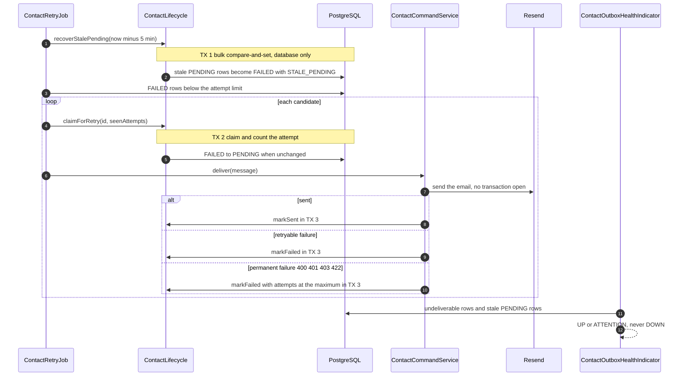
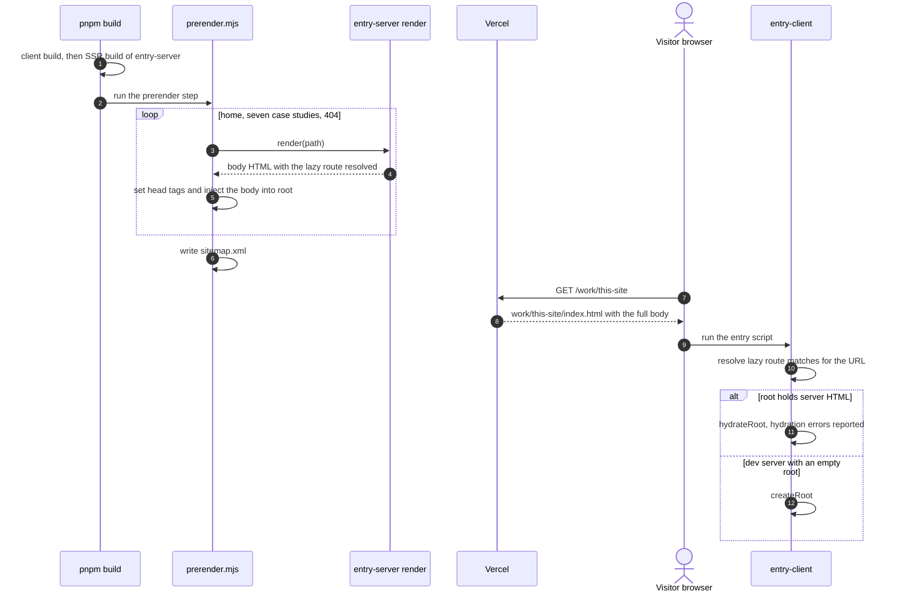
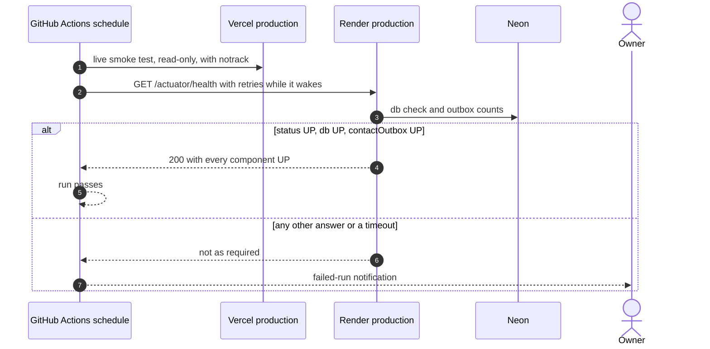

# PF-029 — Launch audit: security, reliability, SEO, accessibility, content

**Ticket**: PF-029 · **Refined requirement**: [PF-029-refined-requirement.md](PF-029-refined-requirement.md) · **Packages**: backend and frontend · **Status**: Approved 2026-11-25 · **Last updated**: 2026-11-26

> ⚠️ **Review these flows first** — [F1 Contact outbox recovery and health signal](#f1--contact-outbox-recovery-and-health-signal) · [F2 Static prerender and hydration](#f2--static-prerender-and-hydration) · [F3 Daily production check](#f3--daily-production-check)

## 1. Requirement summary

Every fix from the 2026-11-25 full-site audit (four read-only audits plus production header checks) in one ticket, built in ten slices of one sitting and shipped as six pull requests. The content API is dropped and ADR 0001 records where data lives (D1). The site gains security headers, real 404s, sharing metadata, and full static HTML. The backend stops logging raw IP addresses, verifies the client address behind Render's proxy, hardens its two public writes, recovers stuck contact messages, and reports undeliverable ones. A daily read-only check watches production. Content gets safe fixes now and claim changes only as approved. Rules touched: SITE-001, SITE-002, SITE-004, SITE-005, SITE-006, SITE-007; master plan `portfolio-implementation-plan.md` §5, §8, §9, §12; content plan §6.

## 2. Requirement analysis

| Need | Source | Backend work | Frontend work |
|---|---|---|---|
| Where data lives; drop PF-014, PF-019, PF-020 | FR-43, D1 | none | none; docs only (S1) |
| Security headers, cache, real 404 | FR-1–3 | none | `vercel.json`, `404.html` from the prerender (S5) |
| API headers | FR-4 | `SecurityConfig` HSTS and CSP writers (S2) | none |
| No raw IP in logs; verified client address; IPv6 /64 | FR-5–7, D8 | `ClientInfoResolver`, `ClientAddress` (S2) | none |
| Global contact limit; stricter text rule | FR-8, FR-9 | `RateLimit.CONTACT_GLOBAL`, request patterns (S2) | `contact/validation.ts` mirrors the rule |
| Server-side GPC; visit path allowlist | FR-10, FR-11, D10 | `ClientInfo.gpc`, `RecordVisitRequest` pattern (S2) | beacon sends only tracked paths |
| Secret hygiene; CSRF rationale | FR-12, FR-13 | `ClientProperties`, `SecurityConfig` comment (S2) | none |
| Outbox recovery, shutdown, permanent failures, health signal | FR-14–17 | F1 (S3) | none |
| JVM, pool, profile | FR-18 | `Dockerfile`, `application.yml` (S3) | none |
| Remove the projects API | FR-19, D5 | delete `project/` and its config (S3) | regenerated `schema.d.ts` |
| Daily check, Docker build in CI, Dependabot Docker, Gradle checksum, token scope, runbook | FR-20–25 | F3, workflows, `Dockerfile`, wrapper (S4) | `test:live` gains header and 404 checks |
| Canonical, og-image, JSON-LD, sitemap, home meta, title and description lengths, chunk preload | FR-26–30, FR-32, D7 | none | `prerender.mjs`, `site.ts`, `og-image.png`, `seoTitle` (S5) |
| Full static prerender | FR-31, D4 | none | F2 (S8, S9) |
| Accessibility and resilience | FR-33–38 | none | `RouteAnnouncer`, `FeatureBoundary`, tokens, axe (S6) |
| Content fixes and approvals; length rule; privacy note | FR-39–42, D3, D6, D11 | none | content files, `en.ts`, product guide (S7) |
| Cold-start experiment | FR-44 | `Dockerfile` (S10) | none |

## 3. Current state

- Frontend serving: `frontend/vercel.json` sets only the staging `noindex` header and a catch-all rewrite to `/index.html`, so every unknown path answers 200. Production sends only HSTS (measured 2026-11-25).
- Prerender: `frontend/scripts/prerender.mjs` swaps four head tags per case study into copies of `dist/index.html`; the home page keeps the static template text, and the body is always an empty `<div id="root">`.
- Router: `frontend/src/app/App.tsx:5` creates the browser router at module scope; `frontend/src/app/routes.tsx:9` loads the case-study page with `React.lazy` inside `RootLayout`'s `Suspense` (PF-026 D1); `frontend/src/main.tsx:14` calls `createRoot`.
- Hydration hazards: `frontend/src/sections/useNearViewport.ts:8` (true on the server), `frontend/src/sections/Footer.tsx:13` (current year), `frontend/src/pages/NotFoundPage.tsx:15` (echoes the path).
- Client address: `backend/.../platform/client/ClientInfoResolver.java:47` takes the `X-Forwarded-For` entry `trustedProxyHops` from the right (default 1, `application.yml:64`); `:58` holds the PF-004 D3 raw-header log (`LOG_FORWARDED_FOR_ONCE`, default off). The layout behind Render and Cloudflare was never recorded. `server.request.header.forwarded.strategy: none` (`application.yml:10`) is why Spring never sees the request as secure and writes no HSTS.
- Rate limits: `platform/ratelimit/RateLimit.java` (`VISIT` 30 per minute, `CONTACT` 3 per hour) keyed by `VisitorHasher.addressKey(ip)`; `ContactCommandService.java:39` checks before the honeypot.
- Outbox: `ContactMessageRepository.java:17` selects only `FAILED` rows; `claim` (`:27`) sets `PENDING` and counts the attempt; nothing ever selects a stale `PENDING` row. `ContactCommandService.java:72` marks every failure the same way; `EmailSender.DeliveryException.retryable` is used only inside one attempt. `updated_at` is maintained on every transition.
- Health: `/actuator/health` shows components (`show-components: always`); the frontend reads only the HTTP status and `components.db.status` (`frontend/src/features/api-status/api.ts:20`).
- Projects: `backend/.../project/**` serves `GET /api/v1/projects`, which no page calls since PF-012.
- Image and CI: `backend/Dockerfile:5,16` pins Temurin tags without digests, `:22` sets `MaxRAMPercentage=75`; CI never builds the image; Dependabot has no `docker` entry; `deploy.yml` passes `VERCEL_TOKEN` to `vercel build`.
- Accessibility: Lighthouse accessibility is 100, but focus stays on `BODY` after a route change and field borders (`--color-line`, `frontend/src/index.css:16`) measure 1.4:1.

## 4. Approach

One ticket, ten slices, six pull requests, each through staging before the next (PF-027). Backend hardening ships first, so the client-address probe reaches staging early and the owner can read it while the frontend work continues. Content claim changes wait for the owner's approval of the content table below, so their slice comes after the gate. Full static prerender comes last, because it touches the entry points every other frontend slice relies on.

Plan decisions:

- **P1. Data placement (ADR 0001).** Copy that changes only through a pull request and is the same for every visitor ships in the frontend bundle. Data created at runtime, aggregated, different per visitor, private to the owner, needing a secret, or describing the running system lives in the backend. The backend refers to frontend content by slug only.
- **P2. Masked, marker-gated probe.** `ClientInfoResolver` logs at INFO, for a request whose `X-Forwarded-For` contains `192.0.2.1` (RFC 5737 documentation range), the entry count and each entry masked to `/24` (IPv4) or `/48` (IPv6), or `other`. No raw address is ever logged, it needs no switch and no second deploy, and only the person who sends the marker triggers it. The owner posts one visit to staging with the marker (owner checklist) and reads the line.
- **P3. IPv6 /64.** `ClientAddress.normalize(ip)` maps an IPv6 literal to its `/64` prefix before hashing and rate keys; IPv4 and anything unparsable pass through. IPv4 is parsed by hand, and only a string with a colon that starts with a hex digit or a colon reaches `InetAddress` (`isIpv6Candidate`): the JDK parses only such a string as a literal and sends any other, such as `999.1.1.1` or `.::1`, to DNS.
- **P4. Global contact limit.** `RateLimit.CONTACT_GLOBAL(20, 1 hour)` with the fixed key `all`, checked after the per-client limit, so one abuser hits their own limit before draining everyone's, and only for a message that would be emailed (`ContactMessageEntity.isHoneypotHit` is false), so bots that fill the honeypot cannot lock real visitors out for an hour (review 2026-11-26, owner-approved; refined requirement D14). The 429 text is neutral, because the visitor who sees it may have sent nothing.
- **P5. Text rule.** Name and subject reject control characters (C0 `\x00-\x1F`, DEL, C1 `\x7F-\x9F`), the line and paragraph separators U+2028 and U+2029, and the bidi controls U+200E, U+200F, U+202A–U+202E, U+2066–U+2069; the message allows tab, LF, and CR. Each rule is one negated character class (`CreateContactMessageRequest.SINGLE_LINE`, `MULTI_LINE`), so a 10,000-character value never recurses in Java's regex engine, and `validation.ts` mirrors it. Zero-width joiners stay allowed, because emoji sequences and some scripts need them.
- **P6. GPC on the server.** `ClientInfo` gains `gpc` (`Sec-GPC: 1`); `VisitCommandService` checks the rate limit, then drops the view like a bot (SITE-002 order unchanged).
- **P7. Visit paths.** `RecordVisitRequest.path` must match `TRACKED_PATH` (`/|/work/[a-z0-9]+(-[a-z0-9]+)*`) and be at most 70 characters; the frontend's `trackedPath()` in `features/visits/tracking.ts` checks the same pattern after removing a trailing slash and skips the beacon for other paths, so 404 pages send nothing.
- **P8. Outbox health signal.** `ContactOutboxHealthIndicator` returns custom status `ATTENTION` (never `DOWN`, also when its query fails) and the status order `DOWN, OUT_OF_SERVICE, UP, ATTENTION, UNKNOWN` keeps the aggregate `UP` and HTTP 200, so visitors' health checks and the status panel are unaffected. It exposes no details.
- **P9. Permanent failures.** HTTP 400, 401, 403, and 422 from the provider set the message's attempts to the maximum in the same `markFailed` transaction; 429 and 5xx stay retryable.
- **P10. Serving.** No rewrites: Vercel serves `index.html`, `work/<slug>/index.html`, and, for anything else, `404.html` with status 404. Host-scoped header blocks: production uses `missing: host = staging`, staging uses `has: host = staging`, each with its own API origin in `connect-src`.
- **P11. One origin constant.** `site.siteUrl = 'https://will-ly-portfolio.vercel.app'` feeds canonical, `og:url`, `og:image`, JSON-LD, the sitemap, and `robots.txt`; staging points at production too (it is `noindex`). A custom domain later is a one-line change plus `vercel.json`.
- **P12. og-image.** A 1200×630 PNG with the name, title, and the "WL" monogram on the site's colours, no portrait (default), generated once by `scripts/og-image.mjs` with the Playwright already installed and committed to `public/`.
- **P13. Static prerender (S8, S9).** `entry-server.tsx` renders each route with React Router's `createStaticHandler` and `StaticRouterProvider` (`hydrate={false}`, so no inline script and the CSP stays strict; there are no loaders to hydrate) through `renderToString`; `entry-client.tsx` resolves lazy route matches, then calls `hydrateRoot` when `#root` has server HTML and `createRoot` otherwise (the dev server). The case-study page moves from `React.lazy` plus `Suspense` to the route's `lazy` property: the router loads it before committing the navigation, which keeps PF-026 D1's visible behaviour (the old page stays) and lets the server resolve it. Fixes: `useNearViewport` starts `false`; the footer year is a build-time constant; the not-found body stops echoing the path.
- **P14. Route announcer.** On a pathname change after the first render, `RouteAnnouncer` moves focus to `#main` and writes `document.title` into a polite live region.
- **P15. Cold start.** Try the extracted jar plus a class-data-sharing archive built at image time (training run with the database switched off), then lazy initialization; measure locally with `docker run --cpus 0.1 --memory 512m` against compose PostgreSQL; keep only a ≥ 20% gain, then confirm on staging.

| Alternative | Why not |
|---|---|
| Keep the content API (PF-014) | Three copies of the same text and no visitor-facing change (D1) |
| Re-enable the raw one-time log for the IP check | Logs real visitors' addresses; the masked probe answers the same question (P2) |
| `framework` forwarded-header strategy | Trusts the leftmost, client-supplied entry; HSTS is set by a writer instead |
| Health indicator that goes `DOWN` | Would turn visitors' status panel red for an owner-only problem (P8) |
| Email the owner when a message fails | Fails exactly when the provider fails; GitHub's failed-run notification is independent (F3) |
| Keep the catch-all rewrite and fix 404s in the client | Crawlers still get 200 (soft 404) |
| A CSP report endpoint | A new write endpoint to protect; the staging live test catches violations before production |
| Server-side rendering at request time | Needs a server for static content; build-time HTML does the job on Vercel's CDN |
| `prerender` from `react-dom/static` | Needed only for Suspense on the server; the route's `lazy` is resolved before render |
| Rate-limit spam storage or delete old rows | The owner chose to keep data (D3) |

**Reuse**: `RateLimiter`, `VisitorHasher`, `ClientInfoResolver`, `ContactLifecycle` transactions, `ContactRetryJob` schedule, `GlobalExceptionHandler`, the `setup-frontend` composite action, `playwright.live.config.ts` and its read-only `?notrack=1` test, `routeMeta.ts` (`homeMeta`, `caseStudyMeta`, `prerenderedRoutes`), `buildRoutes`, `AppProviders`, `useModalDialog`, `TestIds`.

**Single responsibility**: `ClientAddress` normalizes and masks addresses. `ContactOutboxHealthIndicator` reports the outbox state. `ContactLifecycle.recoverStalePending` owns the new transition. `entry-server.tsx` renders one URL to HTML. `entry-client.tsx` boots the browser. `prerender.mjs` writes files. `RouteAnnouncer` handles focus and announcement on navigation. `FeatureBoundary` contains a feature's failure.

## 5. Backend

### Database

No schema change and no migration. Recovery and the health signal read `status`, `attempts`, and `updated_at` through the existing partial index `idx_contact_message_unsent (status, id) WHERE status IN ('PENDING', 'FAILED')`; the table is small, so no index is added. No column holds an IP address, a full user agent, or a full referrer URL (Non-Negotiable 3). Data is kept with no deletion schedule (D3).

### Domain

The outbox states stay `PENDING`, `SENT`, `FAILED`, `SPAM`. New transitions:

| From | To | When | Attempts |
|---|---|---|---|
| `PENDING` | `FAILED`, `last_error = 'STALE_PENDING'` | the retry job finds `updated_at` older than `app.contact.stale-pending-after` (5 minutes; the worst send is about 22 s) | unchanged; the claim already counted it |
| `PENDING` | `FAILED`, attempts = max | a permanent provider failure (P9) | set to `app.contact.max-attempts` |

A `FAILED` message at the maximum, or a `PENDING` message older than 15 minutes, is "undeliverable" for the health signal.

### Services

| Unit | Responsibility | Transaction |
|---|---|---|
| `ClientAddress` (new, `platform.client`) | `normalize(ip)` (IPv6 to /64) and `mask(entry)` (/24, /48, `other`) | none |
| `ClientInfoResolver` (changed) | normalizes the resolved address; logs the masked probe for the marker (P2); reads `Sec-GPC`; the PF-004 D3 log, its flag, and `LOG_FORWARDED_FOR_ONCE` are removed | none |
| `ClientInfo` (changed) | gains `gpc` | none |
| `ClientProperties` (changed) | redacting `toString`; the secret's length is not enforced (D15) | none |
| `RateLimit` (changed) | adds `CONTACT_GLOBAL(20, 1h)` | none |
| `ContactCommandService` (changed) | per-client limit, then the global limit for a message that is not a honeypot hit (P4); passes `permanent` to `markFailed` (S3) | none, as today |
| `CreateContactMessageRequest` (changed) | P5 patterns | none |
| `VisitCommandService` (changed) | drops a view when `client.gpc()` (P6) | as today |
| `RecordVisitRequest` (changed) | P7 path pattern | none |
| `ContactLifecycle` (changed) | `recoverStalePending(cutoff)`; `markFailed(id, reason, permanent)` | one short transaction each |
| `ContactMessageRepository` (changed) | `recoverStalePending(cutoff, now)` bulk compare-and-set; `countUndeliverable(max, pendingCutoff)` | caller's |
| `ContactRetryJob` (changed) | recovers stale rows first, then retries (F1) | none |
| `ContactOutboxHealthIndicator` (new, `contact`) | `UP` or `ATTENTION` (P8), no details | read-only |
| `SecurityConfig` (changed) | HSTS for every request (one year, no subdomains); `Content-Security-Policy: default-src 'none'; frame-ancestors 'none'` and `Referrer-Policy: no-referrer` except `/swagger-ui/**` and `/v3/api-docs/**`; a comment beside `csrf` with the stateless rationale; the projects path removed | none |
| `project/**` (deleted) | `GitHubClient`, `GitHubRestClient`, `GitHubProperties`, `ProjectConfig`, `ProjectQueryService`, `RepositoryFilter`, `ProjectController`, `ProjectListResponse`, their tests; `resilience4j-circuitbreaker` from `build.gradle.kts`; the `app.github` block and the test profile's `github` block; `GITHUB_*` in `.env.example` | — |

Configuration (`application.yml`): `server.shutdown: graceful`; `spring.lifecycle.timeout-per-shutdown-phase: 25s`; Hikari `minimum-idle: 0`, `idle-timeout: 60s`, `max-lifetime: 300s`, `connection-timeout: 10s` (so Neon can scale to zero; `/dev` confirms Neon's current idle window); `app.contact.stale-pending-after: 5m`; `management.endpoint.health.status.order: DOWN, OUT_OF_SERVICE, UP, ATTENTION, UNKNOWN`. `Dockerfile`: `ENV SPRING_PROFILES_ACTIVE=prod`; `JAVA_TOOL_OPTIONS="-XX:MaxRAMPercentage=65 -XX:+ExitOnOutOfMemoryError -XX:MaxMetaspaceSize=<measured +30%> -XX:ReservedCodeCacheSize=48m -XX:MaxDirectMemorySize=32m -XX:+UseSerialGC -Xss512k -XX:TieredStopAtLevel=1"`; both `FROM` lines pinned by digest.

### API

No new endpoint.

| Method and path | Rate limit | Success | Errors (code → status) |
|---|---|---|---|
| `POST /api/v1/visits` (changed) | 30 per minute per client, as today | 202; nothing stored for a bot or `Sec-GPC: 1` | `VALIDATION_FAILED` → 400 also for a path outside P7; `RATE_LIMITED` → 429 |
| `POST /api/v1/contact-messages` (changed) | 3 per hour per client (honeypot hits included), then 20 per hour for everyone (messages that would be emailed only) | 202 | `VALIDATION_FAILED` → 400 also for P5 characters; `RATE_LIMITED` → 429 for either limit |
| `GET /api/v1/projects` (removed) | — | — | 404 `NOT_FOUND` from the deny-by-default chain |
| `GET /actuator/health` (changed) | none | 200 with `components.contactOutbox.status` `UP` or `ATTENTION`; aggregate unchanged | 503 only when `db` is down, as today |
| every API response (changed) | — | adds `Strict-Transport-Security`; CSP and `Referrer-Policy` outside Swagger | — |

`make openapi` regenerates the snapshot and the frontend types; the contact and visit schemas change only in their patterns.

### Failure modes

| Failure | Behavior | Test |
|---|---|---|
| Crash or SIGTERM during a send | Row stays `PENDING`; the next retry run (≤ 10 min) moves it to `FAILED` after 5 minutes and retries it | `ContactOutboxIT`: stale row recovered and sent |
| Deploy while a request runs | Graceful shutdown lets it finish (≤ 25 s) | none |
| Provider rejects the key or the request (401, 403, 400, 422) | Attempts set to the maximum; no more retries; health shows `ATTENTION` | `ContactOutboxIT`: 401 leaves attempts at max |
| Provider down or 429 | Retried up to the maximum, as today | existing PF-006 tests |
| Health query fails while `db` is up | Indicator answers `ATTENTION`, aggregate stays `UP` | none |
| Message undeliverable | `contactOutbox` `ATTENTION`, HTTP 200; the daily check fails and GitHub notifies the owner (F3) | `ContactOutboxIT`: health shows `ATTENTION` with 200 |
| Many clients flood the contact form | Global limit answers 429 after 20 emailable messages an hour; the provider quota survives; honeypot hits never count | `RateLimiterTest`: global bucket; `ContactCommandServiceTest`: a honeypot hit skips it |
| Rotating IPv6 addresses in one /64 | One bucket and one visitor hash | `ClientAddressTest` |
| Unparsable `X-Forwarded-For` entry | Passed through unchanged; never a DNS lookup | `ClientAddressTest` |
| Bidi or separator characters in a name | 400 `VALIDATION_FAILED` | `ContactApiIT` |
| Visit with `Sec-GPC: 1` or an untracked path | 202 and no row; or 400 | `VisitApiIT` |
| `TRUSTED_PROXY_HOPS` wrong for Render | Shared buckets and skewed hashes; the probe reveals it and the owner corrects the variable | probe on staging (owner checklist) |
| Metaspace cap too small | The JVM exits with OutOfMemoryError and Render restarts it; staging catches it first | local `docker run --memory 512m` check |

## 6. Frontend

### Components and routes

- `frontend/vercel.json` (changed): no rewrites; headers below; `/assets/(.*)` gets `Cache-Control: public, max-age=31536000, immutable`.
- `scripts/prerender.mjs` (changed): writes `index.html` (home meta), seven `work/<slug>/index.html`, `404.html` (`noindex`, no canonical), and `sitemap.xml`; sets canonical, `og:url`, `og:image` (+ width, height, alt), `og:site_name`, `twitter:card`; injects JSON-LD `Person` on the home page; from S8 on also injects each page body.
- `src/entry-server.tsx` (new, S8), `src/entry-client.tsx` (new, replaces `main.tsx`, S8), `src/app/App.tsx` (removed: the router moves into the entries), `src/app/routes.tsx` (changed: route `lazy`), `src/app/RootLayout.tsx` (changed: no `Suspense`; `RouteAnnouncer`; root `errorElement`).
- `src/components/FeatureBoundary.tsx` (new) around `SystemPanel`, `VisitCounter`, `ApiStatusDot`; the fallback renders nothing.
- `src/app/RouteAnnouncer.tsx` (new, P14).
- `src/features/visits` (changed): `TRACKED_PATH` guard (P7). `src/features/contact/validation.ts` (changed): P5. `ContactForm` (changed): required note, `aria-required`, `--color-field` borders. `MobileMenu` (changed): dialog label "Menu".
- `src/content/site.ts` (changed): `siteUrl`, privacy note. `src/content/caseStudies/types.ts` (changed): optional `seoTitle`.
- `public/og-image.png` (new), `public/robots.txt` (changed: `Sitemap:` line), `scripts/og-image.mjs` (new).
- Routes, titles, and descriptions: `/` keeps "Will Ly - Full-stack Software Engineer" and gets `site.homeDescription` in its HTML; case studies per the content table; `404.html` "Page not found | Will Ly". The sitemap lists `/` and the seven case studies.

Headers (production block; the staging block is identical except `connect-src` uses `https://will-ly-portfolio-api-staging.onrender.com` and it keeps `X-Robots-Tag: noindex`):

```json
{ "source": "/(.*)", "missing": [{ "type": "host", "value": "will-ly-portfolio-staging.vercel.app" }], "headers": [
  { "key": "Content-Security-Policy", "value": "default-src 'self'; script-src 'self'; style-src 'self'; img-src 'self'; font-src 'self'; connect-src 'self' https://will-ly-portfolio-api.onrender.com; object-src 'none'; base-uri 'self'; form-action 'self'; frame-ancestors 'none'; upgrade-insecure-requests" },
  { "key": "X-Content-Type-Options", "value": "nosniff" },
  { "key": "Referrer-Policy", "value": "strict-origin-when-cross-origin" },
  { "key": "Permissions-Policy", "value": "camera=(), microphone=(), geolocation=(), payment=(), usb=(), browsing-topics=()" },
  { "key": "X-Frame-Options", "value": "DENY" },
  { "key": "Cross-Origin-Opener-Policy", "value": "same-origin" }
] }
```

### Content

The owner approved the plan on 2026-11-25, including every row marked "approved" (D11, D13); rows marked "safe" change no claim. Source for every row is the current site text (owner-reviewed in PF-012) or the content pack.

| Block | Proposed text or change | Tier | Status |
|---|---|---|---|
| This Portfolio, Outcome line 1 | "What I can verify today:" (drops "before the public launch") | A | approved 2026-11-25 |
| This Portfolio, Outcome, Playwright line | "A Playwright smoke test runs in CI against the production build with the API unreachable, and a read-only live test checks staging and production after each deploy and production once a day." | A | approved 2026-11-25 |
| This Portfolio, Outcome, "Live numbers…" line | removed | A | approved 2026-11-25 |
| This Portfolio, What I built, Cold-start handling | "…shows a calm "waking up" state and retries quietly; if the API still does not answer, it says so, while the rest of the page stays unchanged." | A | approved 2026-11-25 |
| This Portfolio, What I built, new item | "Staging and releases. Every merge deploys both apps to a staging copy with its own database; a version tag deploys production after a release gate and a smoke test, and the header shows the running version." | A | approved 2026-11-25 |
| This Portfolio, What I built, Link previews (after S9) | "Static HTML. A build step renders every page to HTML, so it reads without JavaScript and a shared link shows that page's title, description and image." | A | approved 2026-11-25 |
| This Portfolio, Deep dive, last sentence of paragraph 2 | "After three attempts in total, or at once when the provider rejects the message, it stops, and a daily check flags it for me." | A | approved 2026-11-25 |
| This Portfolio, What I learned | drop "an unavailable GitHub," | A | safe |
| How I work, AI principle | "I use AI coding assistants such as Claude Code to accelerate development, and I review and verify every change." (first person, as in About) | A | approved 2026-11-25 |
| Hero proof point 3 | unchanged: today's owner-supplied text stays (the optional rewording was not taken) | A | kept |
| TPMA/DCA web port, Deep dive | section removed (it refers to a held story) | A | approved 2026-11-25 |
| Case studies, Tech used | each skill that Skills links to a case study is added to that study's Tech used (source: the content pack's project marks); the list is shown in the PR | A | approved 2026-11-25 |
| Footer privacy note | "Visits are counted without cookies, and your IP address is never stored, only a keyed hash of it and your browser; Global Privacy Control turns counting off. Visit records and messages are kept with no fixed end date." | UI | approved 2026-11-25 |
| Hero note after a counted visit | "Your visit was counted, without cookies." (drops "anonymously", which a keyed hash is not) | UI | approved 2026-11-25 |
| Education, Code Race date | owner checks the certificate; default keeps 04/2023 | A | owner check |
| Experience, Xolv line | "The five Xolv projects in Featured work come from this role." | A | safe |
| Skills intro | drop the second sentence (the hint below repeats it) | UI | safe |
| Clockwork, Role | "I joined the Clockwork team in June 2026" | A | safe |
| Waking note | "…after 15 minutes without traffic" | UI | safe |
| Terms and spelling | "frontend", US spelling ("data center"), "Amazon Cognito", "project" on cards and buttons, consistent At a glance punctuation | A | safe |
| SEO titles (`seoTitle`) | Frontera "Frontera AI Clinical-Assessment Integration"; web port "TPMA/DCA Web Port - ABA Treatment Planning"; This Portfolio "This Portfolio - Full-Stack, Built Like Production"; each plus " \| Will Ly", all ≤ 60 | A | safe |
| Meta descriptions | the six outside 120–160 shortened to ≤ 160 using only words already in the study (audit drafts for multi-tenancy, Clockwork, Frontera, Smart Pole; trims for FAST and This Portfolio); shown in the PR | A | safe |
| Not-found body | "The page you asked for does not exist." (no path echo) | UI | safe |
| Contact 429 message | "Too many messages are arriving right now. Please try again later, or reach me on LinkedIn." (the global limit means the visitor may have sent nothing; built in S2 after review) | UI | safe |
| Contact form | "All fields are required." | UI | safe |
| og-image | name, "Full-stack Software Engineer", "WL" monogram; alt "Will Ly - Full-stack Software Engineer" | A | approved 2026-11-25; the final image is shown in the PR |
| JSON-LD `Person` | name, job title, `url`, `sameAs` GitHub and LinkedIn; no email, no employer | A | safe |
| Length rule | content conventions and product guide: case studies 300–800 words, About 80–180, depth over length (D6) | rule | approved 2026-11-25 |
| SITE-002, SITE-004, SITE-005, SITE-006 | path allowlist (D10); global limit and character rule; endpoint removed; retention and server-side GPC (D3) | rule | approved 2026-11-25 |

### Data and states

Unchanged for every API-backed view: loading, then data or the quiet fallback (SITE-001). A feature that throws renders nothing inside its `FeatureBoundary`; the page stays. With static prerender, the server and the first client render show the same pending states (status "checking", empty counter, contact placeholder).

### Forms

The contact schema mirrors P5 exactly; the server stays the defense (Non-Negotiable 4). A 429 from either limit maps to the existing rate-limit message.

### Test IDs

| Element | Test ID | Purpose |
|---|---|---|
| Route announcer live region | `TestIds.app.routeAnnouncer` = `route-announcer` | Assert the announced title |
| Contact required note | `TestIds.contact.requiredNote` = `contact-required-note` | Assert the note renders |

### User flow

1. The visitor follows a proof link from the home page.
2. The router loads the case-study chunk while the home page stays, then commits the new page.
3. `RouteAnnouncer` moves focus to `#main` and the live region reads the new page title.
4. Tab continues from the top of the new page; Back restores the home page and its scroll position (PF-026).

## 7. Complex flows

### F1 — Contact outbox recovery and health signal

> ⚠️ **Review this flow** — `ContactRetryJob.retryFailed()`, `ContactLifecycle`, `ContactCommandService.deliver()`, `ContactOutboxHealthIndicator.health()`: one bulk recovery, the existing claim and send, three outcomes, and a read-only status.



1. The bulk update recovers rows a crash or shutdown left behind (FR-14); it changes only rows still `PENDING` and older than the cutoff, so a live send is never touched, and several instances may run it at once.
2. The existing query and claim (PF-006 F2) now also see recovered rows; the claim already counted the stranded attempt, so the limit holds (FR-14).
3. The send runs with no transaction open (Non-Negotiable 7).
4. A permanent rejection uses up the attempts at once, so a revoked key shows up in the next health check instead of after three runs (FR-16).
5. The indicator reads two counts and reports `ATTENTION` without details; it never fails the aggregate (FR-17, P8).

**Simplest alternative**: retry `PENDING` rows directly in the claim query (`status IN (PENDING, FAILED)`). That drops the recovery update, but a row being sent right now could be claimed and emailed twice, and the attempt count would need a second rule.

### F2 — Static prerender and hydration

> ⚠️ **Review this flow** — `pnpm build` → `prerender.mjs` → `entry-server.render()` per route, then `entry-client` in the browser: route resolution, body injection, and the hydrate-or-render decision.



1. Two builds: the client bundle, then a Node bundle of `entry-server.tsx`, as today's SSR build of `routeMeta.ts` (FR-31).
2–6. Each route is rendered by the static router; `query()` resolves the route's `lazy` before rendering, so no Suspense fallback ends up in the HTML (P13). The head tags come from `routeMeta.ts`, as today (FR-26, FR-27).
7. The sitemap lists the indexable routes (FR-29).
8–9. Vercel serves the file; content shows before any JavaScript runs (FR-31, SITE-001).
10–11. The client loads the same lazy route before hydrating, or the first render would differ from the HTML.
12–15. `hydrateRoot` reuses the server DOM; `onRecoverableError` logs `[hydration]`, which the e2e suite fails on. The dev server serves the bare template, so it renders from scratch.

**Simplest alternative**: keep head-only prerendering. No hydration risk, but the body stays empty without JavaScript, mobile LCP stays about 3.0 s, and readers without JavaScript see nothing (breaks FR-31).

### F3 — Daily production check

> ⚠️ **Review this flow** — `.github/workflows/live-check.yml`: a scheduled job that wakes production once a day, runs the read-only live test, and checks the health components.



1. The existing `pnpm test:live` suite (read-only, `?notrack=1`) now also asserts the headers, a 404 for an unknown path, and no CSP violation (FR-1, FR-3, FR-20).
2–3. `curl --retry 4 --retry-delay 30 --retry-all-errors --max-time 150` rides out the about 80 s cold start; one wake a day costs about 0.02 of the 750 shared instance hours, and it is not a keep-alive (PF-027 D5).
4–6. `jq -e` requires all three statuses; anything else fails the run, and GitHub emails the owner (FR-20).

The workflow uses no GitHub environment (an approval rule would block a scheduled run) and no secret: the two URLs are public and live in its `env`. `permissions: contents: read`, actions pinned by SHA, `timeout-minutes: 10`, cron `17 6 * * *` plus `workflow_dispatch`. GitHub disables scheduled workflows after 60 days without repository activity; the runbook says so.

**Simplest alternative**: no scheduled check, relying on visitors and deploy-time smoke tests. An expired key or a paused service would then go unnoticed until someone reports it.

## 8. Files, order, risks, tests

**New**: `docs/architecture/adr/0001-where-data-lives.md`; `backend/.../platform/client/ClientAddress.java`, `backend/.../contact/ContactOutboxHealthIndicator.java`; tests `ClientAddressTest`, `ContactOutboxIT`; `.github/workflows/live-check.yml`; `frontend/src/entry-server.tsx`, `frontend/src/entry-client.tsx`, `frontend/src/app/RouteAnnouncer.tsx`, `frontend/src/components/FeatureBoundary.tsx`, `frontend/scripts/og-image.mjs`, `frontend/public/og-image.png`.

**Modified**: backend `ClientInfoResolver`, `ClientInfo`, `ClientProperties`, `RateLimit`, `ContactCommandService`, `CreateContactMessageRequest`, `ContactLifecycle`, `ContactMessageEntity`, `ContactMessageRepository`, `ContactRetryJob`, `ContactProperties`, `VisitCommandService`, `RecordVisitRequest`, `SecurityConfig`, `OpenApiConfig`, `application.yml`, `build.gradle.kts`, `Dockerfile`, `gradle-wrapper.properties`, `openapi/openapi.json`, `.env.example`, and the tests named below; deleted `backend/.../project/**` and its tests. Repository `.github/workflows/ci-cd.yml` (Docker build job in `ci-ok`), `.github/workflows/deploy.yml` (token scope), `.github/dependabot.yml` (`docker` for `/backend` and `/`), `compose.yaml` (digest). Frontend `vercel.json`, `index.html`, `vite.config.ts` (`__BUILD_YEAR__`, SSR entry), `package.json` (build script, `@axe-core/playwright`, version 1.1.0 in the last PR), `scripts/prerender.mjs`, `public/robots.txt`, `src/main.tsx` (removed), `src/app/App.tsx` (removed), `src/app/routes.tsx`, `src/app/RootLayout.tsx`, `src/app/routeMeta.ts`, `src/sections/useNearViewport.ts`, `src/sections/Footer.tsx`, `src/sections/MobileMenu.tsx`, `src/pages/NotFoundPage.tsx`, `src/features/visits/*`, `src/features/contact/*`, `src/index.css` (`--color-field`), `src/i18n/en.ts`, `src/config/test-ids.config.ts`, `src/api/schema.d.ts`, `src/content/*` per the content table, dead exports (FE-15), `e2e/*.spec.ts`, the live test. Docs: `CLAUDE.md` (overview and project table without the projects API), `README.md`, `backend/CLAUDE.md`, `frontend/CLAUDE.md`, `docs/architecture/backend.md` (CSRF rationale, privacy paragraph, outbox, Key Services), `docs/architecture/frontend.md` (static prerender, route announcer, boundaries), `docs/architecture/overview.md` (forwarded-header line, components, an Operations section: Neon backup and restore, the expand-then-contract rollback rule, what to do when the daily check fails), `docs/architecture/adr/README.md`, `docs/product/product-guide.md` (rules per the content table), `.claude/rules/content-conventions.md` (length rule), `docs/plans/README.md` (`content` domain marked dropped), `docs/plans/content/PF-014*`, `PF-020*` (Status Dropped with a pointer to ADR 0001), `docs/plans/site/PF-012-*` (diagram approvals, items moved here, D7), `docs/knowledge/hosting.md` (Render's forwarded-for layout, Neon idle window, cold-start result), `docs/knowledge/tooling.md` (`vite preview` proxies `/api` to `SERVER_PORT`, so a no-backend measurement needs that port dead), `docs/prd/backlog.md`.

**New dependencies**: `@axe-core/playwright` (dev only, pinned; not shipped to visitors). Removed: `resilience4j-circuitbreaker`. No runtime dependency is added.

**Order** (ten slices; pull requests A–F):

1. **S1 Docs and decisions (PR A).** ADR 0001; PF-014, PF-019, PF-020 docs set to Dropped; `docs/plans/README.md`; PF-012 docs. Demo: the ADR index lists 0001.
2. **S2 Backend privacy and abuse (PR A).** Contract first: `ClientAddress` signatures, `ClientInfo.gpc`, `RateLimit.CONTACT_GLOBAL`, the request patterns; then `ClientInfoResolver` (remove the PF-004 D3 log, add P2 and P3), `ContactCommandService`, `VisitCommandService`, `ClientProperties`, `SecurityConfig` headers and comment; frontend mirrors (`TRACKED_PATH`, contact validation). Demo: `curl -I` on a local endpoint shows HSTS and CSP; the masked probe line appears for the marker. After merge, staging runs it, and the owner reads the probe.
3. **S3 Backend reliability and cleanup (PR B).** Contract: `recoverStalePending`, `markFailed(…, permanent)`, `countUndeliverable`, the indicator; then F1, the configuration, the `Dockerfile` profile and JVM flags (metaspace measured with `docker run --memory 512m` and native memory tracking), the projects removal, `make openapi`, `pnpm gen:api`. Demo: health shows `contactOutbox`.
4. **S4 Operations and supply chain (PR B).** `live-check.yml`, the Docker build job, Dependabot `docker`, digests, the Gradle checksum (from the official `.sha256`), the token scope in `deploy.yml`, the Operations section. Demo: a manual `workflow_dispatch` run of the live check passes against production after PR B's release, or against staging before it.
5. **S5 Frontend serving and SEO (PR C).** `site.siteUrl`, `seoTitle`, the prerender changes (home meta, canonical, sharing tags, JSON-LD, `404.html`, sitemap), `robots.txt`, `og-image`, `vercel.json` (headers, cache, no rewrites), case-study `modulepreload` (until S9 makes it moot), the live-test additions. Demo: on staging, `/no-such-page` answers 404, the headers are present, and the console shows no CSP violation.
6. **S6 Accessibility and resilience (PR D).** `RouteAnnouncer`, `FeatureBoundary` and the root `errorElement`, `--color-field`, the menu label, the required note, dead exports, axe in e2e. Demo: keyboard navigation through a proof link lands on the new page.
7. **S7 Content (PR D).** The safe rows, then the rows the owner approved at this gate, the rule texts, the privacy note. Demo: `content.test.ts` passes the new length and SEO checks.
8. **S8 Static prerender: entries and home (PR E).** `entry-server.tsx`, `entry-client.tsx`, route `lazy`, the three hydration fixes, the build script; the home page body prerendered. Demo: `/` with JavaScript disabled shows the hero.
9. **S9 Static prerender: case studies, 404, measurement (PR E).** Bodies for every route, `404.html` body, the hydration check in e2e, the Lighthouse run (mobile and desktop, no backend), and the "Static HTML" content row if approved. Demo: no `[hydration]` errors; mobile performance on `/` at least 97 locally.
10. **S10 Cold-start experiment (PR F, merged only if kept).** P15; result in `docs/knowledge/hosting.md` either way. The last merged PR bumps `frontend/package.json` to 1.1.0, and the release follows once staging is green.

| Risk | Mitigation |
|---|---|
| The CSP blocks something the audit missed | Enforced on staging first; the live test fails on any "Refused to" console message; production gets it only through a release |
| Vercel does not serve `work/<slug>/index.html` for the path without a trailing slash once the rewrite is gone | Verify on staging in S5; fallback: one rewrite `/work/:slug` → `/work/:slug/index.html`, which still answers 404 for a missing file |
| Hydration mismatch drops the server HTML | The three known hazards fixed first; `[hydration]` errors fail e2e on `/`, a case study, and the 404 page |
| SSR asset URLs differ from the client's | Content hashes match by construction; the hydration check proves it |
| JSON-LD blocked by the CSP | It is a data block, not executed; verify in Chrome on staging that the CSP logs nothing for it |
| Changing the proxy hops or IPv6 grouping changes visitor hashes | Unique-visitor counts restart from the change; noted in the PR and the knowledge entry |
| The metaspace cap is too small | Measure locally under 512 MB; staging restarts before production would |
| Hikari settings slow the first query after Neon wakes | Measured on staging; the frontend's health retries already cover the wake |
| Content approvals stall PR D | Safe rows ship regardless; unapproved rows stay as today |
| Removing the projects API breaks a link someone saved | No page links it; 404 problem JSON answers it |
| Scheduled workflow disabled after 60 quiet days | Runbook note; any commit re-enables it |
| The global contact bucket is shared by every integration test in one JVM (about 5 of its 20 tokens are used; honeypot hits do not count) | The global limit is proven by `RateLimiterTest` only; a comment in `ContactApiIT` says so; new contact ITs must stay within the budget |

**Tests** (within the test budget; integration tests run against Testcontainers with WireMock for Resend):

- S2. `ClientAddressTest` (unit, small tables): two IPv6 addresses in one /64 normalize equal; IPv4 unchanged; an unparsable entry passes through; masking gives `/24`, `/48`, `other`; only strings the JDK reads as a literal (starting with a hex digit or a colon) reach `InetAddress`, so `.::1` never triggers a DNS lookup. `ContactCommandServiceTest`: a honeypot hit skips the global limit; a real message checks it. `RateLimiterTest`: the global bucket allows 20, then throws `RATE_LIMITED`. `ContactApiIT`: a name with U+2028 answers 400 `VALIDATION_FAILED`. `VisitApiIT`: `Sec-GPC: 1` answers 202 and stores no row; path `/admin` answers 400. `PlatformWebIT`: an API response carries HSTS, `Referrer-Policy`, and CSP, and `/swagger-ui/index.html` carries no CSP. `PlatformPropertiesTest`: `toString` hides the secret. Frontend: `validation.test.ts` rejects U+202E in a name; the visits test sends nothing for `/foo`.
- S3. `ContactOutboxIT`: a `PENDING` row updated six minutes ago is recovered and sent (WireMock 200 → `SENT`); a WireMock 401 leaves attempts at the maximum and the next run does not claim it; health answers 200 with aggregate `UP` and `contactOutbox` `ATTENTION`. The OpenAPI snapshot diff proves the projects removal.
- S4. CI itself runs the Docker build job; a `workflow_dispatch` run proves the live check; no unit tests.
- S5. `content.test.ts`: every title ≤ 60 and every description 120–160. e2e `smoke.spec.ts` (raw HTML through the preview server): each route has canonical, `og:url`, `og:image`, `twitter:card`; the home page's JSON-LD parses with `@type` `Person`; `sitemap.xml` has eight `<loc>` entries; `404.html` exists with `noindex`. Live test: headers present, `/no-such-page` answers 404, no CSP violation.
- S6. `FeatureBoundary.test.tsx`: a throwing child renders the fallback and the sibling content stays. `ContactForm` test: the required note renders. e2e: axe finds no serious or critical violation on `/`, `/work/this-site`, the open mobile menu, and the certificate dialog; after clicking a proof link, focus is on `#main` and the announcer holds the new title.
- S7. `content.test.ts`: case studies 300–800 words and About 80–180 (D6); every skill linked to a case study appears in that study's Tech used.
- S8–S9. `useNearViewport` test: the first render returns `false`. e2e: with `javaScriptEnabled: false`, `/` shows the pitch and `/work/this-site` its `<h1>`; on `/`, a case study, and `/no-such-page`, the console has no `[hydration]` message. Lighthouse numbers go in the PROGRESS doc and the PR.
- S10. Before-and-after timings (three runs each) in `docs/knowledge/hosting.md`; no tests.

**Owner checklist** (agents never change hosting settings):

1. After PR A reaches staging: `curl -s -X POST -H 'Content-Type: application/json' -H 'X-Forwarded-For: 192.0.2.1' -d '{"path":"/"}' https://will-ly-portfolio-api-staging.onrender.com/api/v1/visits`, then share the masked probe line from the staging log; set `TRUSTED_PROXY_HOPS` on both services if it must change; delete `LOG_FORWARDED_FOR_ONCE` from both services; confirm `ALLOWED_ORIGINS` lists exact origins.
2. Agree to dismiss CodeQL alert #1 as "won't fix" with the CSRF rationale (Claude runs the `gh api` call on your OK).
3. After PR B: delete the `GITHUB_*` variables on both services; Render health check path `/actuator/health/liveness` if not set yet; send one test message through the staging contact form.
4. Check the Code Race certificate date.
5. After the last PR is green on staging: `make release VERSION=1.1.0`.
6. Optional: note Neon Free's restore window from the Neon plan page for the runbook.
