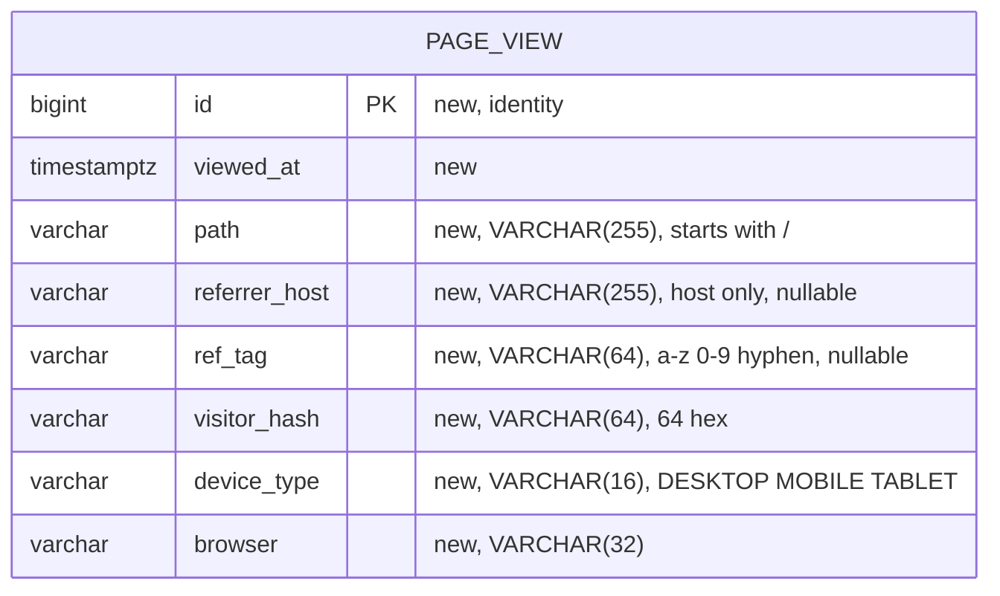
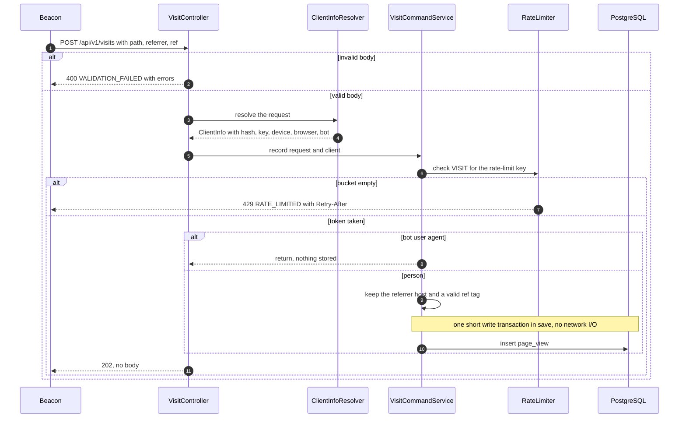
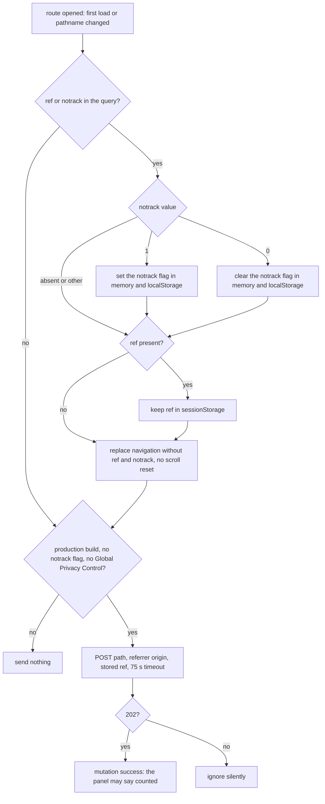

# PF-005 — Visit tracking and stats

**Ticket**: PF-005 · **Refined requirement**: [PF-005-refined-requirement.md](PF-005-refined-requirement.md) · **Packages**: backend and frontend · **Status**: Approved 2026-11-23 · **Last updated**: 2026-11-23 (built in `/dev`; review fixes applied in `/review`; synced with the code)

> ⚠️ **Review these flows first** — [F1 — Record a visit](#f1--record-a-visit) · [F2 — The page-view beacon](#f2--the-page-view-beacon)

## 1. Requirement summary

Count page views without tracking anyone. The frontend posts one view per route the visitor opens (D1), from production builds only, honoring `?notrack=1` (undone by `?notrack=0`, D5) and Global Privacy Control, and waits out a cold start so the first visitor after an idle period still counts (D8); `POST /api/v1/visits` rate-limits each client address, drops bots (D7), keeps the referrer's host and a valid ref tag only, and inserts an append-only `page_view` row. `GET /api/v1/stats/summary` returns totals cached for 60 seconds, and the footer shows "N visits from M visitors" whenever it answers (D2), without the "since" date (D6); the live system panel mentions the counted visit only when it was recorded (D3). Implements SITE-002, SITE-003, and SITE-006 on the PF-004 platform; maps to `../portfolio-implementation-plan.md` §5.1, §5.2, §6.3, §6.4, and §7 Phase 4 (private). PF-005 starts from the PF-004 branch and is rebased onto `main` once pull request #5 merges.

## 2. Requirement analysis

| Need | Source | Backend work | Frontend work |
|---|---|---|---|
| Store page views without personal data | FR-6, FR-12, SITE-006 | Migration, `PageViewEntity`, `PageViewRepository` | — |
| Record a view: validate, rate-limit, drop bots, reduce | FR-5 to FR-8, D7 | `VisitController`, `VisitCommandService`, `VisitValidator` (F1) | — |
| Totals for the counter, cached 60 s | FR-9 | `VisitQueryService.totals`, `StatsQueryService`, `StatsController` | — |
| One view per route, production only, opt-outs, ref tag | FR-1 to FR-4, D1, D5 | — | `useTrackPageView` in `features/visits` (F2) |
| The first view after an idle period still counts | D8, implementation plan §6.3 | — | The visits client uses the 75 s cold-start timeout |
| Footer counter, hidden unless the API is online and answers | FR-10, D2, D6 | — | `VisitCounter` in `features/stats`, `formatCount` |
| Panel note only after a recorded view | FR-11, D3 | — | `useVisitCounted`, `SystemPanel` note |
| Ref results for the owner | D4 | Partial index on `ref_tag` for SQL | — |
| Contract | AC-9 | `make openapi` | `pnpm gen:api` |

## 3. Current state

- Platform (PF-004, pull request #5, open): `ClientInfoResolver.resolve` returns `ClientInfo(visitorHash, rateLimitKey, deviceType, browser, bot)` (`backend/src/main/java/com/huygialy/portfolio/platform/client/ClientInfoResolver.java:30`), with the client IP taken from `X-Forwarded-For` at `trusted-proxy-hops` from the right (default 1) or the connection's address; `RateLimiter.check(RateLimit.VISIT, key)` throws `ApiException.rateLimited` (`platform/ratelimit/RateLimiter.java:35`, `RateLimit.java:7`: 30 per minute); `GlobalExceptionHandler` renders `MethodArgumentNotValidException` as `VALIDATION_FAILED` with field `errors` and any other framework 4xx, such as malformed JSON, as `VALIDATION_FAILED` without them (`platform/error/GlobalExceptionHandler.java:76`); `SecurityConfig` permits only `GET` on `PUBLIC_GET_PATHS` and `HEAD` on health, and denies everything else as 404 (`platform/security/SecurityConfig.java:31`, `:63`); CORS already allows `POST`, `Content-Type`, and `X-Correlation-Id` and exposes `Retry-After`. No Lombok on the classpath.
- Database: Flyway is configured and `backend/src/main/resources/db/migration/` is empty, so this is the first migration. `backend/openapi/openapi.json` has no paths yet.
- Frontend: `apiClient` (`frontend/src/api/client.ts:128`) is typed by `schema.d.ts`, which has no paths yet (`frontend/src/api/schema.d.ts:6`); `COLD_START_TIMEOUT_MS` is 75 s (`client.ts:8`); mutations never retry (`frontend/src/app/queryClient.ts:19`). `RootLayout` renders the header, page, and footer (`frontend/src/app/RootLayout.tsx:22`); `Footer` shows `ApiStatusDot` alone in its middle slot (`frontend/src/sections/Footer.tsx:14`); `SystemPanel.noteFor` picks the note and the panel renders it before the "How this site is built" link (`frontend/src/features/api-status/SystemPanel.tsx:23`, `:138`); `useApiStatus` (`useApiStatus.ts:9`) is not exported from `features/api-status/index.ts`. The MSW defaults hold only the health handler (`frontend/src/test/handlers.ts:7`), and the page and route tests render the footer. There is no `utils/format.ts` yet.

## 4. Approach

| # | Decision | Why |
|---|---|---|
| P1 | One migration creates `page_view` as in the master plan's §5.2, with `CHECK`s on the path, ref tag, hash, and device type, and indexes on `viewed_at` and the non-null `ref_tag`s | Constraints live in the database (Non-Negotiable 6); the ref index serves the owner's SQL (D4) |
| P2 | `PageViewEntity` is append-only: a static factory `record(...)`, a protected no-argument constructor for JPA, no setters, no `@Version`; `deviceType` is `ClientInfo.DeviceType` stored with `@Enumerated(EnumType.STRING)`; `viewedAt` comes from the injected `Clock` | Principle 6 and FR-12; the database default is only a safety net |
| P3 | `RecordVisitRequest(path, referrer, ref)`: `path` `@NotBlank`, `@Size(max = 255)`, `@Pattern(regexp = "/[^?#\\x00-\\x1F\\x7F]*")` (no query, fragment, or control character; the control-character exclusion was added in /review, pre-approved by the owner (blanket approval, 2026-11-23)); `referrer` `@Size(max = 2048)`; `ref` `@Size(max = 256)`. springdoc marks `path` required from `@NotBlank`, so the generated type has `referrer?` and `ref?` | FR-5. PostgreSQL rejects a NUL in text, so without the exclusion such a path would answer 500 and log an ERROR stack trace instead of 400 `VALIDATION_FAILED`; `referrer` and `ref` cannot reach the database with one (`URI.create` and the tag pattern reject it). `ref` is bounded but not rejected for its format, because an invalid tag only drops the tag (SITE-003) |
| P4 | `VisitController` (`visit.api`): `@PostMapping("/api/v1/visits")`, `@Operation(operationId = "recordVisit")`, `@ResponseStatus(HttpStatus.ACCEPTED)`, returns `void` (no body, no content in the OpenAPI document); it takes `@Valid @RequestBody RecordVisitRequest` and the `HttpServletRequest`, resolves `ClientInfo`, and calls `VisitCommandService.record` | Controllers translate HTTP only (principle 1) |
| P5 | `VisitCommandService.record(request, client)`, not transactional: first `rateLimiter.check(RateLimit.VISIT, client.rateLimitKey())`; then a bot returns at once; then `VisitValidator` reduces the referrer and the ref tag; then `pageViewRepository.save(PageViewEntity.record(...))`, which runs in the repository's own short transaction | The order of F1 (D7): the limit runs before any work, as principle 10 and the contact flow do; no network I/O, so the one insert needs no `Lifecycle` bean (Non-Negotiable 7) |
| P6 | `VisitValidator` (static, pure): `refTag(raw)` keeps a value matching `^[a-z0-9-]{1,64}$`; `referrerHost(raw)` keeps the lowercased host of an `http` or `https` URI, at most 255 characters, else nothing | SITE-003, SITE-006; unit-testable rules |
| P7 | `VisitQueryService.totals()` (`@Transactional(readOnly = true)`) returns `PageViewTotals(long totalViews, long uniqueVisitors, Instant firstViewAt)` from one JPQL constructor query on `PageViewRepository`: `count(p)`, `count(distinct p.visitorHash)`, `min(p.viewedAt)` (null when there are no rows) | Principle 3: `stats` reads page views through a query the `visit` feature exposes, never its repository |
| P8 | `StatsQueryService.summary()` memoizes the totals in a one-entry Caffeine cache (`maximumSize(1)`, `expireAfterWrite` from `StatsProperties.cacheTtl`, bound to `app.stats.cache-ttl: ${STATS_CACHE_TTL:60s}`, `0s` in the test profile, where it reads straight through without the cache); `StatsController`: `GET /api/v1/stats/summary`, `@Operation(operationId = "getStatsSummary")`, answers `StatsSummaryResponse(totalViews, uniqueVisitors, since)` built by `StatsSummaryResponse.from(totals)`; `totalViews` and `uniqueVisitors` carry `@Schema(requiredMode = REQUIRED)` so the generated type has plain numbers; `since` stays optional and is `null` when there are no rows, and carries `@Schema(types = {"string", "null"})` so the generated type is `since?: string \| null`, matching the `null` the server sends (added in /dev S2, pre-approved by the owner (blanket approval, 2026-11-23)) | FR-9; a one-value memo needs no cache starter or proxy; the test profile turns caching off so integration tests see their own inserts; `@Schema` ships with springdoc, so no new dependency |
| P9 | `SecurityConfig` permits `POST` on a new `PUBLIC_POST_PATHS` list (`/api/v1/visits`) and adds `/api/v1/stats/summary` to `PUBLIC_GET_PATHS` | Off-list paths still answer 404 (PF-004 D4) |
| P10 | `make openapi` regenerates the snapshot and `frontend/src/api/schema.d.ts`; both operations carry their operationIds | REST rules; the frontend types come only from the generated schema |
| P11 | `features/visits`: `api.ts` creates its own client, `createApiClient({ timeoutMs: COLD_START_TIMEOUT_MS })`, and `recordVisit(body)` posts through it with `keepalive: true`; `queries.ts` has `visitKeys` and `useRecordVisit()` (a mutation with `mutationKey: visitKeys.record()`, `retry: false`, and `gcTime: Infinity`, so the outcome lasts for the page load); `useVisitCounted()` is true when any `recordVisit` mutation succeeded, read with `useMutationState`; `tracking.ts` holds the pure helpers (`trackingAllowed`, `referrerOrigin`, reading and stripping `ref` and `notrack`, wrapped storage access) | One hook per concern; mutations never retry; the panel learns about the view without a global store. A cold start can exceed the default 15 s timeout, and a quiet portfolio's views mostly arrive while the API sleeps (D8, implementation plan §6.3); `keepalive` lets that slow first request finish when the visitor leaves |
| P12 | `useTrackPageView()` runs in `RootLayout`. An effect keyed on `pathname` only calls one `useEffectEvent` handler, which reads `useLocation()` (never `window.location`): when the query holds `notrack` or `ref`, it applies `?notrack=1` (sets `localStorage.notrack = '1'` and an in-memory flag in `tracking.ts`) or `?notrack=0` (clears both), keeps `?ref=` in `sessionStorage`, then removes only those two parameters with `navigate({ pathname, search, hash }, { replace: true, preventScrollReset: true })`, keeping the path, the other parameters, and the hash; then, when `trackingAllowed()` (production build read at call time, no `notrack` flag, no Global Privacy Control), it calls `mutate({ path: pathname, referrer, ref })`, omitting an empty referrer and a missing ref. Storage access is wrapped; because `optedOut()` reads the in-memory flag first, `?notrack=1` holds for the rest of the page load even when storage is blocked, and only a reload forgets it there; the ref tag then goes with the first view only (the in-memory flag was added in /review, pre-approved by the owner (blanket approval, 2026-11-23)) | FR-1 to FR-4, D5. Keying on `pathname` makes anchors and query changes count for nothing, and stripping the query cannot re-trigger the effect (loop safety, `KNOWN-FE-002`); `useEffectEvent` keeps the effect's real dependency list to `pathname` without silencing the hooks lint; `preventScrollReset` stops the cleanup from moving the page (`ScrollRestoration` otherwise scrolls on every navigation) |
| P13 | The beacon sends the referrer as its origin only (`https://www.linkedin.com`), never the full URL; the backend still reduces it to the host | Privacy by design: no path or query of the previous page ever leaves the browser (SITE-006); the server check stays the defense |
| P14 | `SystemPanel`: when the API is online and connected and `useVisitCounted()` is true, the note adds `t('apiStatus.note.counted')` after the online sentence and before the "How this site is built" link | FR-11, D3; it reads a mutation's outcome, so a skipped, failed, or rate-limited view never claims it |
| P15 | `features/stats`: `api.ts` `getStatsSummary(signal)` through `apiClient`, `queries.ts` `statsKeys` and `useStatsSummary(enabled)` (the default 60 s stale time); `VisitCounter` enables the query only when `useApiStatus().api === 'online'` (exported from `features/api-status/index.ts` for it) and always renders one `inline-block min-h-5 min-w-56` span, empty unless the query succeeded; `min-h-5` (one `text-sm` line) keeps the empty span's height where the footer wraps it onto its own line below about 380 px (added in /dev S4, pre-approved by the owner (blanket approval, 2026-11-23)) | FR-10, D2: no call to a sleeping API, nothing shown on failure, no layout shift (frontend principle 5) |
| P16 | `utils/format.ts` with `formatCount` only (`new Intl.NumberFormat('en')`, grouped digits whatever the visitor's locale, to match the English UI); strings for one and many visits and visitors | The formatting table in `frontend/CLAUDE.md`; `formatInstant` and `formatDate` wait for a caller (D6 hides `since`) |
| P17 | `src/test/handlers.ts` gains default handlers: `POST */api/v1/visits` answers 202, and `GET */api/v1/stats/summary` answers zeros with `since: null` | Every page and route test renders the footer, which calls the stats endpoint once health answers; MSW fails any unhandled request |
| P18 | `application.yml` sets `spring.jackson.factory.constraints.read.max-document-length: 65536`, so the parser stops a JSON body over 64 KB; it surfaces as `HttpMessageNotReadableException`, which `GlobalExceptionHandler` already answers with 400 `VALIDATION_FAILED` without field errors (added in /review, pre-approved by the owner (blanket approval, 2026-11-23)) | `POST /api/v1/visits` is the first public endpoint that reads a body. Jackson 3 allows a 100,000,000-character string and no document cap by default, and binding runs before Bean Validation and the rate limit, so a few large bodies could exhaust the 384 MB heap (Non-Negotiables 4 and 8, principles 10 and 11). A Boot property needs no new class or dependency; a `Content-Length` filter would miss chunked bodies |

| Alternative | Why not |
|---|---|
| `navigator.sendBeacon` | Cannot send `application/json` cross-origin without a preflight it does not support, and gives no response, so the panel could not know the view was recorded (D3) |
| Count once per page load | Hides which case studies get read (D1) |
| Check for a bot before the rate limit | Breaks principle 10 ("before any work") and differs from the contact flow; a bot that learns it is limited learns nothing useful, and the stored data is the same (D7) |
| The default 15 s client for the beacon | A cold start can take up to a minute, so the first view after every idle period would be lost (D8) |
| Spring's cache abstraction for one value | Adds a starter and a proxy for a one-entry memo; Caffeine is already a dependency (PF-004) |
| Send the full `document.referrer` | Sends the previous page's path and query, which the server would discard anyway (SITE-006) |
| Fetch stats as soon as the page loads | During a cold start it times out and the counter never appears for that visit; waiting for the health check costs nothing |
| `history.replaceState` to clean the address bar | The router would keep the old location, so `useLocation` would still show `?ref=`; the router's replace navigation keeps both in step |

**Reuse**: `ClientInfoResolver`, `RateLimiter` and `RateLimit.VISIT`, `ApiException` and `GlobalExceptionHandler`, `SecurityConfig`, `Clock`, Caffeine, springdoc's `@Operation` and `@Schema`, `@IntegrationTest`; `createApiClient` and `COLD_START_TIMEOUT_MS`, `apiClient`, `useApiStatus`, the footer's middle slot, `t()`, `TestIds`, `renderWithProviders`, MSW. **New dependencies**: none (Non-Negotiable 8). **Single responsibility**: `VisitController` binds the request; `VisitCommandService` orchestrates a view; `VisitValidator` holds the tag and referrer rules; `PageViewEntity` is one stored view; `VisitQueryService` reads totals; `StatsQueryService` caches them; `StatsController` serves them; `useTrackPageView` decides when to send; `useRecordVisit` sends; `useVisitCounted` reports the outcome; `VisitCounter` shows the totals; `formatCount` formats a count.

## 5. Backend

### Database

Migration `V20261123140000__create_page_view.sql`, additive (the first table).

| Table.column | SQL type | Null | Default or constraint | Why |
|---|---|---|---|---|
| `page_view.id` | `BIGINT GENERATED ALWAYS AS IDENTITY` | no | primary key | Row identity |
| `page_view.viewed_at` | `TIMESTAMPTZ` | no | `DEFAULT now()` | When the view happened; the application sets it from the `Clock` |
| `page_view.path` | `VARCHAR(255)` | no | `CHECK (path LIKE '/%')` | Which route was opened (D1) |
| `page_view.referrer_host` | `VARCHAR(255)` | yes | — | The referrer's host only (SITE-006) |
| `page_view.ref_tag` | `VARCHAR(64)` | yes | `CHECK (ref_tag ~ '^[a-z0-9-]{1,64}$')` | The application link the visitor came from (SITE-003) |
| `page_view.visitor_hash` | `VARCHAR(64)` | no | `CHECK (visitor_hash ~ '^[0-9a-f]{64}$')` | Distinct visitors without identity (KNOWN-BE-010: never `CHAR`) |
| `page_view.device_type` | `VARCHAR(16)` | no | `CHECK (device_type IN ('DESKTOP', 'MOBILE', 'TABLET'))` | Coarse device mix |
| `page_view.browser` | `VARCHAR(32)` | no | — | Browser family from `UserAgentParser` (at most 16 characters today) |

**Constraints and indexes**: the checks above enforce SITE-003 and the hash format in the database. `idx_page_view_viewed_at (viewed_at)` serves `min(viewed_at)` and future time-window queries; `idx_page_view_ref_tag (ref_tag) WHERE ref_tag IS NOT NULL` serves the owner's per-tag SQL (D4). No column holds personal data: no IP address, no user-agent string, and no full referrer URL (Non-Negotiable 3). Rows are only inserted, so no `@Version` and no unique key (principle 6).

### Domain

`PageViewEntity.record(path, referrerHost, refTag, visitorHash, deviceType, browser, viewedAt)` is the only way to build a view; there are no setters and no transitions. `VisitValidator.refTag` and `VisitValidator.referrerHost` return `Optional<String>`.

### Services

| Unit | Responsibility | Transaction |
|---|---|---|
| `visit.api.VisitController` | Bind and validate `RecordVisitRequest`, resolve `ClientInfo`, answer 202 | none |
| `visit.VisitCommandService` | F1: rate limit, bot check, reduce, insert | none on the service; the repository's `save` runs one short write transaction |
| `visit.VisitValidator` | Ref-tag and referrer rules | none |
| `visit.PageViewRepository` | Insert; the totals query | — |
| `visit.VisitQueryService` | `totals()` for other features | read-only |
| `stats.StatsQueryService` | Memoized totals for `cacheTtl` | none (calls the read-only query) |
| `stats.api.StatsController` | `GET /api/v1/stats/summary` | none |
| `stats.StatsProperties` | `app.stats.cache-ttl` (`@DefaultValue("60s")`, `@NotNull`) | none |

### API

| Method and path | Rate limit | Success | Errors (code → status) |
|---|---|---|---|
| `POST /api/v1/visits` (`recordVisit`), body `{path, referrer?, ref?}` | `RateLimit.VISIT`: 30 per minute per client address, bots included (D7) | 202, no body | `VALIDATION_FAILED` → 400 (with `errors` for invalid fields, without them for a body that is not JSON or is over 64 KB); `RATE_LIMITED` → 429 with `Retry-After` |
| `GET /api/v1/stats/summary` (`getStatsSummary`) | none (cached) | 200 `{totalViews, uniqueVisitors, since}`; `since` is an ISO-8601 instant or `null` | `INTERNAL_ERROR` → 500 |

### Failure modes

| Failure | Behavior | Test |
|---|---|---|
| Missing path, a path without a leading slash, or one with a query or a control character (NUL included) | 400 `VALIDATION_FAILED` with a field error | `VisitApiIT` (no leading slash, NUL) |
| Body that is not JSON, or no body | 400 `VALIDATION_FAILED` without field errors | none (`GlobalExceptionHandler` path, PF-004) |
| JSON body over 64 KB (P18) | 400 `VALIDATION_FAILED` without field errors, before binding, validation, and the rate limit | `VisitApiIT` |
| Invalid ref tag (uppercase, too long, symbols) | 202; the row has no tag | `VisitApiIT`, `VisitValidatorTest` |
| Missing, malformed, or non-http referrer | 202; the row has no referrer host | `VisitValidatorTest` |
| Bot user agent | 202; nothing stored | `VisitApiIT` |
| 31st view in a minute from one address | 429 `RATE_LIMITED` with `Retry-After` | `VisitApiIT` |
| Bot user agent over its address's limit | 429 `RATE_LIMITED`, like any request (D7) | none |
| Database down during the insert | 500 `INTERNAL_ERROR`; the beacon ignores it | none |
| Stats query fails | 500 `INTERNAL_ERROR`; the counter stays hidden | `VisitCounter.test.tsx` (MSW) |
| API asleep | The beacon waits up to 75 s and the page never waits for it (D8); the counter asks only once health answers | `VisitCounter.test.tsx` (never asks while unreachable) |
| API unreachable | The beacon fails silently; the counter never asks | `VisitCounter.test.tsx` |
| Storage blocked (some private modes) | `?notrack=1` still stops every view for the rest of the page load (kept in memory) and is forgotten at the next load; other views are sent, with the ref tag on the first view only | `useTrackPageView.test.tsx` (the opt-out) |

## 6. Frontend

### Components and routes

- `RootLayout` (modified): calls `useTrackPageView()` (new, `features/visits`)
- `Footer` (modified): `ApiStatusDot` (reused) and `VisitCounter` (new, `features/stats`)
- `Hero` → `SystemPanel` (modified): the online note adds the counted sentence (P14)

No route, title, or meta description changes. The not-found page is a route like any other, so opening it counts as a view of its path; a path longer than 255 characters is rejected by the server and ignored by the beacon.

### Content

None: PF-005 adds no portfolio copy. The counter and the panel note are UI strings in `src/i18n/en.ts`: `stats.counter` "{visits} from {visitors}", `stats.visitsOne` "1 visit", `stats.visitsMany` "{count} visits", `stats.visitorsOne` "1 visitor", `stats.visitorsMany` "{count} visitors", and `apiStatus.note.counted` "Your visit was counted anonymously."

### Data and states

| View | Hook and query key | Endpoint | Loading | Fallback | Error |
|---|---|---|---|---|---|
| Page-view beacon | `useRecordVisit`, mutation `visitKeys.record()` | `POST /api/v1/visits` (75 s timeout) | nothing shown | nothing shown | ignored silently |
| Footer `VisitCounter` | `useStatsSummary(enabled)`, `statsKeys.summary()` | `GET /api/v1/stats/summary` | empty span of fixed width while the API is checking or waking | empty while the API is unreachable | empty |
| Panel note | `useVisitCounted` (mutation state) | — | the PF-003 note | the PF-003 note | the PF-003 note |

### Test IDs

| Element | Test ID | Purpose |
|---|---|---|
| Footer visit counter | `stats-counter-text` | The counter's text (empty while hidden) |

The beacon has no element; tests observe it through MSW.

### User flow

1. A visitor opens `/?ref=company-a`: the ref tag goes to session storage and leaves the address bar; one view of `/` is posted, and it may wait for the API to wake.
2. The health check answers: the panel says the API is online and, once the view is recorded, that the visit was counted; the footer counter appears.
3. The visitor opens a case study: one more view, of `/work/<slug>`, with the same ref tag.
4. On the owner's devices, `?notrack=1` once stops every later view; `?notrack=0` undoes it.

## 7. Complex flows

### F1 — Record a visit

> ⚠️ **Review this flow** — `VisitController.recordVisit` → `VisitCommandService.record`: client info, the rate limit, a bot branch, two reductions, and one insert; the decision table has four outcomes (400, 429, 202 without a row, 202 with a row).

| Messages | What happens, and why |
|---|---|
| 1, 2 | The parser stops a body over 64 KB (P18), and Bean Validation rejects a bad path or an oversized field, before any work (FR-5, Non-Negotiable 4) |
| 3, 4 | `ClientInfoResolver` is the only reader of the IP and user agent (PF-004 principle 9) |
| 5 to 7 | 30 views per minute per client address, checked before any other work, for bots too (FR-8, PF-004 D6, D7, principle 10) |
| 8 | A bot gets the same 202 and is never stored (FR-7) |
| 9, 10 | Only the host and a valid tag survive; one insert in the repository's own short transaction (FR-6, Non-Negotiable 7) |
| 11 | Every accepted request answers 202 with no body (REST rules) |

**Simplest alternative**: drop the bot branch and store every view with its bot flag. The counter would then include crawlers that run JavaScript, which SITE-002 rules out.

### F2 — The page-view beacon

> ⚠️ **Review this flow** — `useTrackPageView`: the opt-out, the ref tag, address-bar cleanup, and the production-only gate in one effect keyed on the path.

The steps serve FR-3 and D5 (opt-out and undo), FR-4 (ref tag and cleanup), FR-2 (production only, origin only), D8 (the cold-start wait), FR-1 (one view per route), and FR-11 (the counted note). Only a first load can carry `ref` or `notrack`, because the site's own links never add them, so the hook needs no first-run flag. **Simplest alternative**: send the view from `main.tsx` once per load; route changes would no longer count (D1) and the opt-out would have to run outside React.

## 8. Files, order, risks, tests

**New**: `backend/src/main/resources/db/migration/V20261123140000__create_page_view.sql`; `backend/src/main/java/com/huygialy/portfolio/visit/{PageViewEntity,PageViewRepository,PageViewTotals,VisitCommandService,VisitQueryService,VisitValidator}.java` and `visit/api/{VisitController,RecordVisitRequest}.java`; `stats/{StatsQueryService,StatsProperties}.java` and `stats/api/{StatsController,StatsSummaryResponse}.java`; `frontend/src/features/visits/{api,queries,tracking,useTrackPageView,index}.ts`; `frontend/src/features/stats/{api,queries,index}.ts` and `VisitCounter.tsx`; `frontend/src/utils/format.ts`; the tests below.

**Modified**: `platform/security/SecurityConfig.java` (two public paths); `application.yml` (`app.stats.cache-ttl`, and the 64 KB JSON document cap of P18); `backend/src/test/resources/application-test.yml` (`cache-ttl: 0s`); `.env.example` (the optional `STATS_CACHE_TTL=60s`, added at hand-off so the template lists every backend variable, pre-approved by the owner (blanket approval, 2026-11-23)); `backend/openapi/openapi.json` and `frontend/src/api/schema.d.ts` (generated); `frontend/src/api/client.ts` (the timeout comment names the visit beacon); `frontend/src/app/RootLayout.tsx`; `frontend/src/sections/Footer.tsx`; `frontend/src/features/api-status/{SystemPanel.tsx,index.ts}`; `frontend/src/i18n/en.ts`; `frontend/src/config/test-ids.config.ts`; `frontend/src/test/handlers.ts` (P17). Docs: `docs/prd/backlog.md` (status and plan link); `docs/product/product-guide.md` (SITE-002: each route opened counts, D1; `?notrack=0`, D5; bots count toward the limit, D7), `docs/architecture/backend.md` (Key Services rows built; principle 10 names the JSON body cap), `docs/architecture/overview.md` (`page_view` built), `docs/architecture/frontend.md` (Key Directories: `visits`, `stats`, `utils/format.ts` with `formatCount` built), `frontend/CLAUDE.md` (visit tracking: origin-only referrer, `?notrack=0`, the opt-out kept for the page load when storage is blocked, the router's replace navigation instead of `history.replaceState`, the 75 s client; structure), `.claude/rules/rest-api-conventions.md` (the two endpoints built), `backend/CLAUDE.md` ("Adding an endpoint" confirmed; structure), `CLAUDE.md` (project structure: visits and stats APIs built; the frontend row's stale PF-003 _(planned)_ marker replaced with what PF-003 and PF-005 built).

**Order**: backend first (S1, S2, with `make openapi` after each backend slice; S2's run left the S3 and S4 contract unchanged), then the frontend (S3, S4).

| Slice | Demo | Contract first | Then |
|---|---|---|---|
| S1 — Record a visit | `curl -X POST localhost:<port>/api/v1/visits -H 'Content-Type: application/json' -d '{"path":"/"}'` answers 202 and a row appears | Migration, `PageViewEntity`, `PageViewRepository`, `RecordVisitRequest`, `VisitController` and `VisitCommandService` signatures, `VisitValidator` signatures, public path | `VisitValidator` and the F1 body |
| S2 — Stats summary | `curl localhost:<port>/api/v1/stats/summary` answers the totals | `PageViewTotals`, `VisitQueryService.totals`, `StatsSummaryResponse`, `StatsController`, `StatsProperties`, public path | The query, the memo; `make openapi`; backend docs |
| S3 — Beacon and panel note | A production preview posts one view per route; the panel says the visit was counted | `features/visits` `api.ts`, `queries.ts`, `tracking.ts` signatures; the note string; the default visits handler | `useTrackPageView` (F2), `RootLayout`, `SystemPanel`; tracking docs |
| S4 — Footer counter | The footer shows "N visits from M visitors" once the API is online | `features/stats` `api.ts`, `queries.ts`; `formatCount`; strings and test ID; the default stats handler; `useApiStatus` export | `VisitCounter`, `Footer`; frontend docs |

| Risk | Mitigation |
|---|---|
| A cross-origin `keepalive` POST with `application/json` needs a preflight, which some browsers handled poorly in older versions | `VisitApiIT` proves the server's answer to the preflight (`POST` with `content-type` and `x-correlation-id` from an allowed origin, added in /review); the browsers are checked in PF-012 against the real deployment in Chrome, Firefox, and Safari (owner step); the fallback is to drop `keepalive`, which only helps a visitor who leaves during a cold start |
| PF-004 changes in review change what PF-005 builds on | PF-005 is rebased onto `main` after pull request #5 merges; the platform API it uses is small (`ClientInfo`, `RateLimiter`) |
| The stats cache hides new rows in integration tests | `app.stats.cache-ttl: 0s` in the test profile; `StatsQueryService` reads straight through when the TTL is zero, so the test does not depend on how Caffeine treats a zero expiry; the tests compare totals before and after their own inserts, because the shared database holds other tests' rows |
| The shared rate limiter carries state across tests, and requests without `X-Forwarded-For` all share `127.0.0.1`'s bucket of 30 | Every integration-test request that posts a view carries its own `X-Forwarded-For` address from `203.0.113.0/24` or `198.51.100.0/24`, never reused across tests |
| springdoc marks record components optional, so the generated types would be `number \| undefined` | `@Schema(requiredMode = REQUIRED)` on `totalViews` and `uniqueVisitors`; `path` is required through `@NotBlank`. Read in S2: the required lists are as planned, `since` is `["string", "null"]`, springdoc adds no responses from `GlobalExceptionHandler`, and the 200 body is listed under `*/*` because the controller declares no `produces`, which openapi-fetch's default media type matches, so `data` is typed |
| The router's replace navigation could re-run the effect or move the page | The effect is keyed on `pathname` only, which the cleanup never changes; `preventScrollReset: true` |
| Storage throws in some private-browsing modes | Wrapped access, and the opt-out also kept in memory: tracking still works, `?notrack=1` holds until the page reloads, and the ref tag goes with the first view only |
| An oversized JSON body is parsed before validation and the rate limit | The 64 KB document cap (P18) stops the parser and answers 400; `VisitApiIT` sends a 100 KB body and checks that no field errors came back, so Bean Validation never ran |
| The panel note grows by one sentence | Checked in S3 on the local dev server: at 1280 px the counted note fits the reserved height (`min-h-14`, 56 px); at 360 px it grows from 2 lines to 3 (56 to 73 px), still shorter than the waking note's 4 lines (92 px), and the panel starts below the fold, so only the content below the panel moves and the hero copy above it never does |
| A long-pending first view during a cold start | The page never waits for it; the counted note appears when it lands (the note is `aria-live="polite"`) |
| `VisitApiIT`'s rate-limit test reads the system clock, and `RateLimit.VISIT` refills greedily, one token every 2 s | Its 31 requests run well under 2 s today; if it ever flakes in CI, give the test profile a controllable `Clock` |

**Owner steps** (owner-only, after the first deploy in PF-012; nothing here needs a new environment variable, because `STATS_CACHE_TTL` defaults to 60 s and `.env.example` lists it as optional):

1. On each of your own browsers and devices, open the production site once with `?notrack=1`.
2. In the PF-012 smoke test, confirm in Chrome, Firefox, and Safari that the cross-origin beacon answers 202 (browser network tab), that a visit with `?ref=test` stores `ref_tag = 'test'`, and that counts survive a Render redeploy (implementation plan §7 Phase 4 "Done when").
3. Read ref results in the Neon console's SQL editor (D4): `SELECT ref_tag, count(*) AS views, count(DISTINCT visitor_hash) AS visitors FROM page_view WHERE ref_tag IS NOT NULL GROUP BY ref_tag ORDER BY views DESC;`

**Tests** (within the test budget):

- S1: `VisitApiIT` (new, `@IntegrationTest`): a valid view answers 202 and stores the path, the referrer host only, the tag, a 64-hex hash, the device type, and the browser (checked through `JdbcTemplate` by its unique path), and no stored value holds the IP, the user agent, or the full referrer; a path without a leading slash, or with a NUL, answers 400 `VALIDATION_FAILED` with a field error on `path` and stores nothing; a 100 KB body answers 400 `VALIDATION_FAILED` without field errors (P18); the preflight for `POST` with `content-type` and `x-correlation-id` from the allowed origin answers 200 with the CORS headers; an uppercase tag stores the view with a null tag; a bot user agent answers 202 and stores nothing; the 31st view in a minute from one `X-Forwarded-For` address answers 429 `RATE_LIMITED` with `Retry-After`. `VisitValidatorTest` (unit): a small table each for ref tags and referrers (valid, uppercase, too long, `javascript:` scheme, malformed, missing; the S1 convergence added a host over 255 characters and a host that is not a server-based authority, `under_score.example`). The migration itself is proven by the context starting under Flyway with `ddl-auto: validate`.
- S2: `StatsApiIT` (new): the summary before and after two views from two fresh addresses grows by two views and two visitors, and `since` equals `min(viewed_at)` read through `JdbcTemplate`; `OpenApiSnapshotIT` regenerates the snapshot through `make openapi`. `StatsQueryServiceTest` (unit, added in /dev S2): with a 60 s TTL two calls read the totals once and return the same answer; with a zero TTL each call reads through, so the memo that only production runs is tested.
- S3: `useTrackPageView.test.tsx` (new, with `vi.stubEnv('PROD', true)` and MSW counting requests): one post on load and one per route change, none for an anchor; `?ref=company-a` is sent on both views and leaves the router's location; the referrer is sent as its origin; nothing is sent in a development build, after `?notrack=1`, or with Global Privacy Control; `?notrack=0` re-enables; with `Storage` throwing, `?notrack=1` still stops the view on that load and after a route change. `SystemPanel.test.tsx` (extended): the counted sentence appears after a successful view and not after a rate-limited one. Existing page and route tests stay green because the beacon is off outside production builds.
- S4: `VisitCounter.test.tsx` (new): with the API online and stats answering, the formatted text ("1,284 visits from 312 visitors", and the singular "1 visit from 1 visitor"); empty when stats fail; never requested while the API is unreachable.
- Integration-test gate: both endpoints, the insert, and the totals query are covered by `VisitApiIT` and `StatsApiIT`; `VisitValidator` and the `StatsQueryService` memo are pure logic and claim the unit-test exemption explicitly.
- Result at hand-off (2026-11-23): backend `spotlessApply check` passes with both tiers rerun, 72 unit and 21 integration tests (PF-005 adds `VisitValidatorTest` 16, `StatsQueryServiceTest` 2, `VisitApiIT` 5, `StatsApiIT` 2) and 95% branch coverage (109 of 115); frontend `check:type`, `check:lint`, and `check:format` pass and `coverage` runs 70 tests in 14 files with 93% branch coverage (181 of 194). No live browser check was run; the production preview and the cross-origin beacon are checked in PF-012 (owner). After the `/review` fixes (2026-11-23): backend `check` passes with 72 unit and 24 integration tests (`VisitApiIT` 8: the invalid-path test became two rows, plus the 100 KB body and the preflight) and 95% branch coverage (109 of 115); frontend `check:type`, `check:lint`, and `check:format` pass and `coverage` runs 71 tests in 14 files with 93% branch coverage (183 of 196); the disclosure scrub counts 0.
