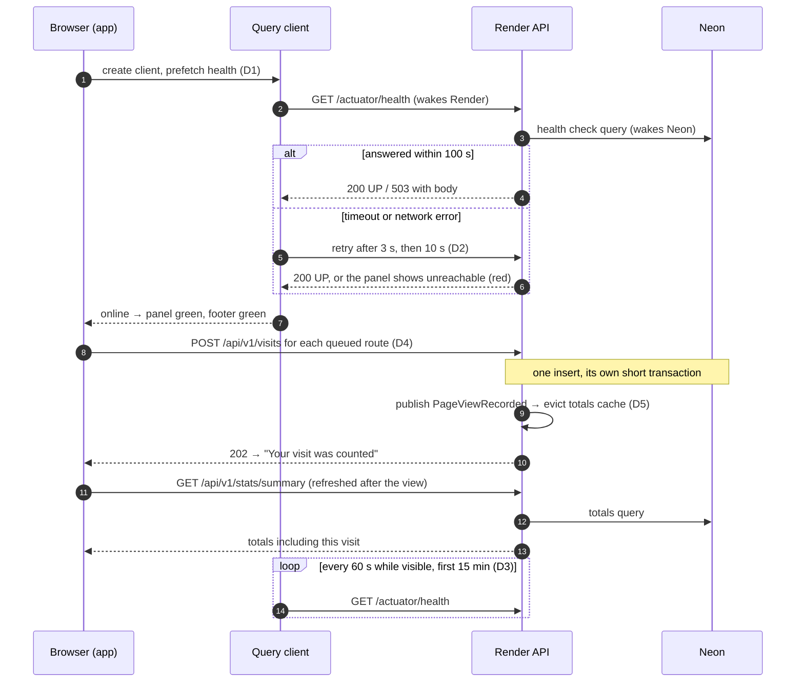

# PF-023 — Wake the backend on page load, count every visit, show the live service state

**Ticket**: PF-023 · **Refined requirement**: [PF-023-refined-requirement.md](PF-023-refined-requirement.md) · **Packages**: backend and frontend · **Status**: Approved 2026-11-24 (the owner asked for the fix in chat; the defaults D1 to D7 are open to change) · **Last updated**: 2026-11-24

> ⚠️ **Review these flows first** — [F1 — Page load: wake, status, visit, counter](#f1--page-load-wake-status-visit-counter)

## 1. Requirement summary

Every page load sends one early signal that wakes the Render backend and its Neon database, so a contact message sent a minute later does not wait for a cold start. Every page view is recorded and the footer counter includes the visitor's own visit. The status panel's colors follow the real state of each service: green when it answers, amber while it wakes, red when it is down, grey while it is not known yet. Changes SITE-001 and SITE-002 and supersedes PF-003's "one health check per page load, no retry" (FR-9, FR-10) and PF-005's parallel visit beacon. Maps to `../portfolio-implementation-plan.md` §5 (visits, cold-start handling) and §8.F (keep-alive).

## 2. Requirement analysis

| Need | Source | Backend work | Frontend work |
|---|---|---|---|
| One wake signal per page load, as early as possible | Owner request 2026-11-24, D1 | none | prefetch the shared health query when the app starts |
| A cold start still ends Online, and a message sent during one is not reported as failed | Owner request; cold start measured at 78.8 s, D2 | none | the health query retries twice (3 s, 10 s); the cold-start timeout goes from 75 s to 100 s |
| The panel follows the real state while the visitor reads | Owner request, D3 | none | re-check every 60 s while visible for 15 min, and on return to the tab |
| Every page view recorded | Owner request; production showed 0 views on 2026-11-24, D4 | none | send the view once the health check answered; queue route opens until then |
| The counter includes the visitor's own visit | Owner request, D5 | evict the totals cache when a view is stored | refresh the counter after the view is recorded |
| Colors reflect each service's state | Owner request, D6 | none | red tone for unreachable and unavailable; amber while re-checking |
| Keep the API warm without keeping Neon awake | PF-013 follow-up, D7 | `GET`/`HEAD /actuator/health/liveness` public | none |

## 3. Current state

- `frontend/src/features/api-status/queries.ts`: `useHealth` runs `GET /actuator/health` once per page load with `retry: false` and `staleTime: Infinity`; the panel and the footer dot share it.
- `frontend/src/features/api-status/useApiStatus.ts` and `statusTone.ts`: pending → `checking`, then `waking` after 3 s; error → `unreachable` (grey); success → `online` (green), database `connected` (green) or `unavailable` (grey).
- `frontend/src/features/visits/useTrackPageView.ts`: posts the view on every route open, in parallel with the health check, with a 75 s timeout and no retry.
- `frontend/src/features/stats/VisitCounter.tsx`: asks for the totals as soon as the API is online, so it races the visit; `backend/.../stats/StatsQueryService.java` caches the totals for 60 s.
- `backend/.../platform/security/SecurityConfig.java`: only the exact `/actuator/health` is public, so `/actuator/health/liveness` (served by Spring Boot 4.2, probes on by default) answers 404.
- `frontend/src/api/client.ts`: the health check, the beacon, and the contact form give up after 75 s; a production cold start measured 78.8 s to the first byte on 2026-11-24, so after every sleep all three timed out.
- Production on 2026-11-24 had 0 stored views after the owner's visits, and the owner's panel did not say "Your visit was counted". A local production build against a local backend recorded the view and showed the note, but its counter read 0 because the totals were fetched before the view was stored and then cached.

## 4. Approach

The health check becomes the page's one wake signal and the gate for everything that writes. `AppProviders` prefetches it into the shared query when the app mounts, on every route, whichever components render; the panel and the footer join the same request (D1). It retries a failed attempt twice, after 3 s and 10 s, and the health check, the visit, and the contact form now wait up to 100 s per attempt instead of 75 s, because Render's cold start measured 78.8 s to the first byte on 2026-11-24 (D2). While the tab is visible it repeats every 60 s for the first 15 minutes on the page, and again when the visitor comes back to the tab after more than 60 s; a hidden tab never polls, and the 15-minute cap means a forgotten tab cannot keep Render and Neon awake for hours (D3).

The visit beacon waits for that answer: a route opened before the health check succeeds is queued, and the queue is sent in order as soon as it does (D4). The view then reaches an awake backend in well under a second instead of racing the cold start, and it is still never retried, because a retried request whose first attempt did arrive would count twice. When the view is stored, the backend's `VisitCommandService` publishes `PageViewRecorded`, `StatsQueryService` drops its cached totals, and the frontend refreshes the counter, so the footer includes the visitor's own visit (D5).

The status colors gain a red tone: the API row and the footer dot are red when the API is unreachable, the database row is red when the API reports it unavailable, amber means waking or re-checking after a failure, and grey means not known yet (D6). Finally, `GET` and `HEAD /actuator/health/liveness` become public. That check never touches the database, so Render's health check and an UptimeRobot keep-alive can use it to keep the API warm around the clock without keeping Neon awake (Neon Free gives 100 compute-hours a month) (D7).

| Alternative | Why not |
|---|---|
| A separate wake request (`fetch` in `main.tsx`) | A second request to the same endpoint; the shared health query already is the signal, it only needs to start early |
| Keep the parallel beacon and retry it | A retry after a timeout can count one view twice when the first attempt reached the server late |
| Poll the health check for the whole page lifetime | A tab left open keeps Render and Neon awake indefinitely; Neon Free has 100 compute-hours a month |
| Lower the totals cache TTL instead of evicting | Still stale for up to the TTL; eviction on write is exact and costs one count query per stored view |
| Have `visit` call `stats` directly | `stats` already depends on `visit`; an application event keeps the dependency one-way (backend principle 3) |
| UptimeRobot on `/actuator/health` | Its database check would keep Neon awake 24/7, about 186 of the 100 free compute-hours |

**Reuse**: the shared health query, `useSlowAfter`, `StatusDot`, `shouldRetryQuery` semantics, the Caffeine cache in `StatsQueryService`, Spring's `ApplicationEventPublisher`. **Single responsibility**: `healthQueryOptions` owns when the health check runs; `useTrackPageView` owns when a view is sent; `PageViewRecorded` is the only link from `visit` to `stats`.

## 5. Backend

### Services

| Unit | Responsibility | Transaction |
|---|---|---|
| `VisitCommandService.record` | After the insert, publishes `PageViewRecorded` (a record with the view's instant) | the repository's own insert; the event follows the commit |
| `StatsQueryService.onPageViewRecorded` | `@EventListener`: invalidates the one-entry totals cache | none |
| `SecurityConfig` | Adds `/actuator/health/liveness` to the public `GET` and `HEAD` rules | none |

### API

| Method and path | Rate limit | Success | Errors (code → status) |
|---|---|---|---|
| `GET /actuator/health/liveness` | none (like `/actuator/health`) | 200 `{"status":"UP", "components":{"livenessState":…}}`, no `db` | none |
| `HEAD /actuator/health/liveness` | none | 200 | none |

`/actuator/health` is unchanged and stays the page's check, because it reports the database. The OpenAPI contract does not list actuator paths, so the snapshot does not change.

### Failure modes

| Failure | Behavior | Test |
|---|---|---|
| The cache eviction fails | It cannot in practice: the listener runs after the insert committed and only calls Caffeine's in-memory `invalidateAll`; the view is stored either way | none |
| Liveness while the database is down | 200 `UP`: liveness never reflects the database, which is the point | `HealthIT` asserts no `db` component |

## 6. Frontend

### Data and states

| View | Hook and query key | Endpoint | Loading | Fallback | Error |
|---|---|---|---|---|---|
| Hero panel, footer dot | `useHealth` / `['api-status','health']`, prefetched at start, retry 2 (3 s, 10 s), refetch every 60 s while visible for 15 min and on focus when older than 60 s | `GET /actuator/health` | `checking` (grey), `waking` (amber) after 3 s or while re-checking after a failure | content never waits (SITE-001) | `unreachable` (red) after the retries; the database row `unknown` (grey) |
| Visit beacon | `useRecordVisit` / `['visits','record']` | `POST /api/v1/visits` | queued until the health check succeeds | not sent if the API never answers | not retried |
| Footer counter | `useStatsSummary` / `['stats','summary']`, invalidated after a recorded view | `GET /api/v1/stats/summary` | empty, fixed width | empty | empty |

Tone table (D6): API `checking` grey, `waking` amber, `online` green, `unreachable` red; database `waiting` grey, `connected` green, `unavailable` red, `unknown` grey. A new token `--color-status-down` in `src/index.css`; the dot stays decorative next to its text label.

### Test IDs

No new test IDs.

## 7. Complex flows

### F1 — Page load: wake, status, visit, counter

> ⚠️ **Review this flow** — `AppProviders` prefetch, `useHealth`, `useApiStatus`, `useTrackPageView`, `VisitCounter`: one health query gating one write and one read, with retries and a bounded re-check

1–3. The prefetch starts the one wake signal when the app mounts, shared with the panel's and the footer's observers (D1); it reaches Render, which starts the service if it slept, and the health check's database probe wakes Neon.
4–6. A cold start longer than one attempt, or a dropped connection, is retried twice before the panel turns red (D2).
7. The panel and the footer read the same query, so there is never a second request for them.
8–10. Views queued since the page opened go out only now, to an awake backend; the insert commits and the totals cache is evicted (D4, D5).
11–13. The counter asks for the totals after the view is stored, so it includes it (D5).
14. The re-check keeps "Status now" true and lets a late wake turn the panel green; it stops after 15 minutes and never runs in a hidden tab (D3).

**Simplest alternative**: keep one parallel health check and one parallel beacon with no retries (today). A cold start over 75 s or one dropped request then loses the view for good, and the panel stays grey after the API wakes.

## 8. Files, order, risks, tests

**New**: `docs/plans/visits/PF-023-wake-and-live-status.md`, `docs/plans/visits/PF-023-refined-requirement.md`, `backend/src/main/java/com/huygialy/portfolio/visit/PageViewRecorded.java`, `backend/src/test/java/com/huygialy/portfolio/visit/VisitCommandServiceTest.java`, `frontend/src/test/healthRetries.ts` (steps fake timers through the health retries). **Modified**: `frontend/src/api/client.ts` (100 s), the comments in `frontend/src/features/{api-status,contact,visits}/api.ts`, `backend/.../platform/security/SecurityConfig.java`, `backend/.../visit/VisitCommandService.java`, `backend/.../stats/StatsQueryService.java`, `backend/src/test/.../HealthIT.java`, `backend/src/test/.../stats/StatsQueryServiceTest.java`; `frontend/src/app/AppProviders.tsx`, `frontend/src/features/api-status/{queries.ts,useApiStatus.ts,statusTone.ts,index.ts}`, `frontend/src/components/StatusDot.tsx`, `frontend/src/index.css`, `frontend/src/features/visits/{useTrackPageView.ts,queries.ts}`, their tests; `docs/product/product-guide.md` (SITE-001, SITE-002), `docs/architecture/frontend.md`, `docs/architecture/backend.md` (Key Services), `.claude/rules/rest-api-conventions.md` (liveness row), `docs/knowledge/tooling.md` (Spring Boot 4.2 probes), `docs/prd/backlog.md`.

**Order**: backend slice (liveness rule, event, eviction, tests) → frontend slice (health options and prefetch, tones, beacon gate, counter refresh, tests) → docs.

| Risk | Mitigation |
|---|---|
| Re-checks keep Neon awake while a visitor reads | Only while visible and only for 15 minutes; one health query a minute |
| A visitor who leaves during a cold start is not counted | Accepted: before, such a view usually timed out too; the early wake shortens the window |
| Retries delay "Unreachable" when the API is really down | Grey then amber for at most about 13 s plus the attempts; content never waits (SITE-001) |
| The e2e smoke suite refuses every API call | It asserts content only, never the status, so the slower path to "Unreachable" does not affect it |

**Tests**: backend: `HealthIT` (liveness `GET` 200 without `db`, `HEAD` 200); `StatsQueryServiceTest` (an event evicts the cached totals); `VisitCommandServiceTest` (a stored view is announced with `PageViewRecorded`, a bot view is neither stored nor announced; a Mockito unit test under the integration-test gate's exemption, since `VisitApiIT` already covers the insert). Frontend: `useApiStatus.test` (retry after a network error ends online; unreachable after the retries; re-check after a failure shows waking); tone mapping in `SystemPanel.test`; `useTrackPageView.test` (no view before the health check answers, the queued views sent in order after it, none when it never answers); `VisitCounter.test` (the counter refreshes after a recorded view).
